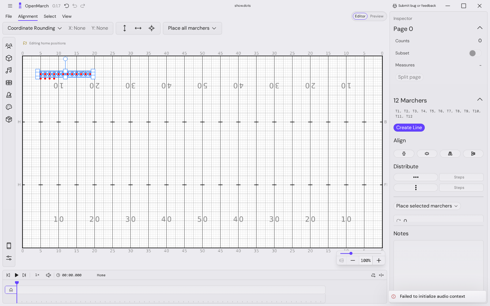
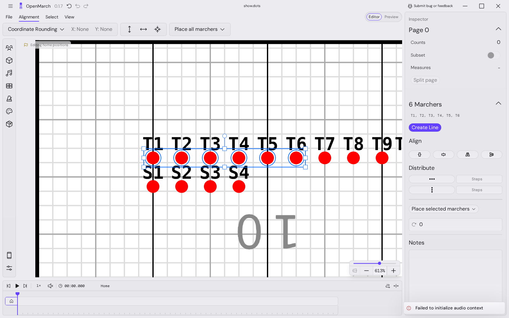
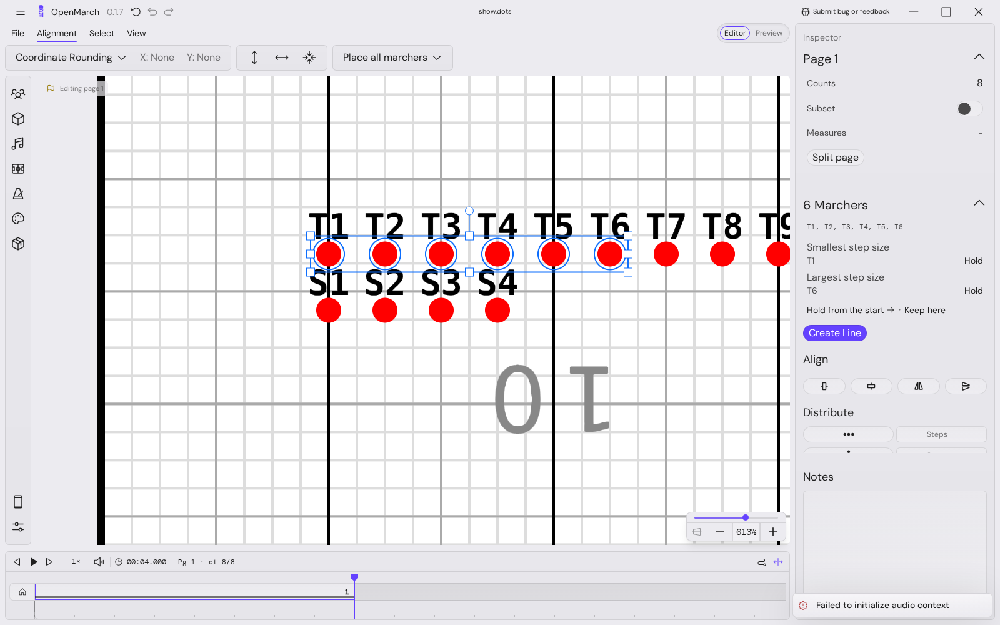
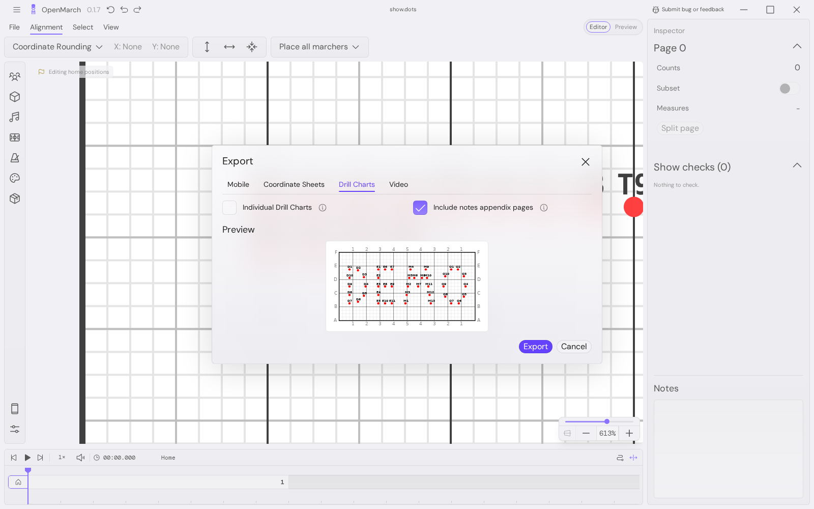
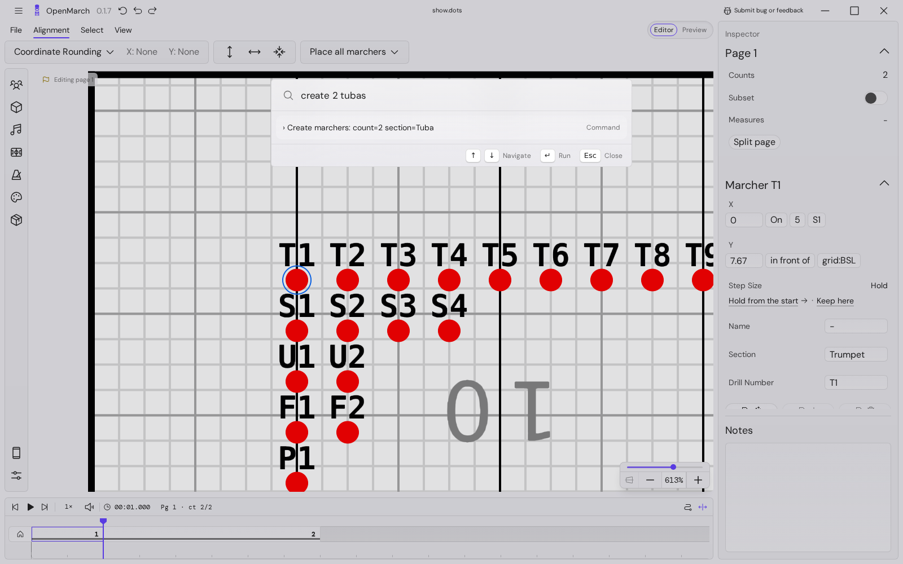
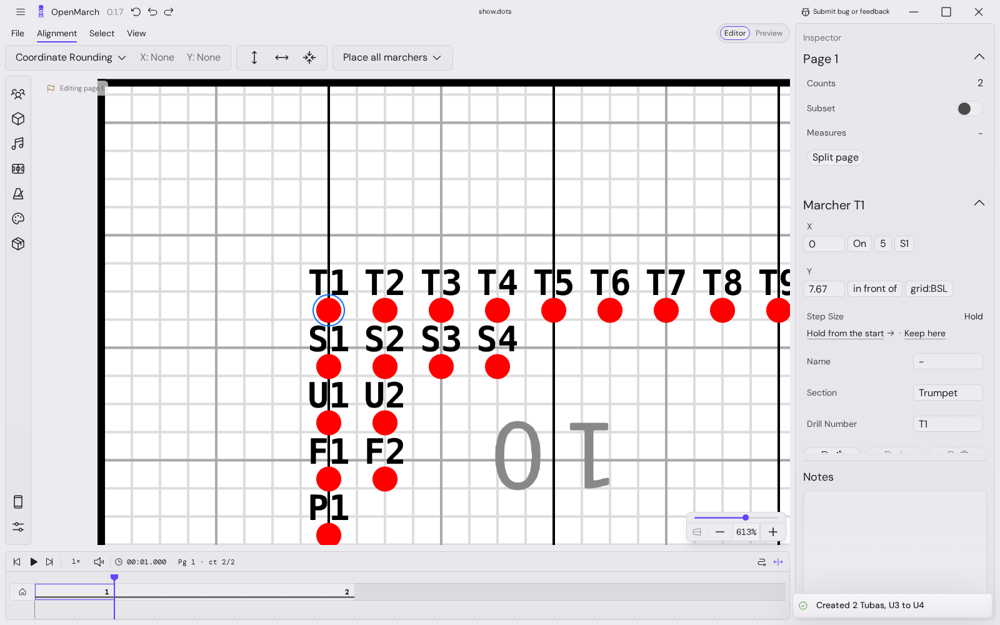
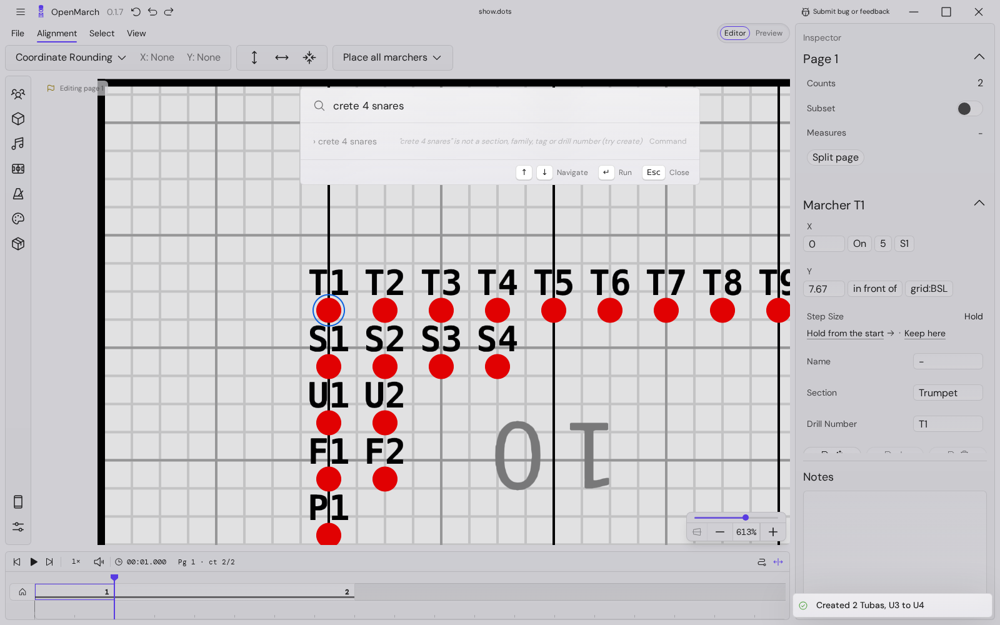

<!-- cspell:disable -->

# Agent transcript (basic)

Written by e2e/browser/tests/commands-proto-agent.spec.mts. Each step: the call, then its JSON result.

## 1. list commands

`window.openmarchCommands.list()` (34 ms)

```json
[
  {
    "id": "select",
    "title": "Select marchers",
    "description": "Select the marchers a query names, e.g. 'trumpets', 'brass - T4', 'T1-6, #rifles'. Replaces the selection.",
    "effects": "view",
    "params": [
      {
        "key": "who",
        "label": "Marchers",
        "kind": "marchers"
      }
    ],
    "schema": {
      "type": "object",
      "properties": {
        "who": {
          "description": "Marchers: marcher query, e.g. \"T1-6, brass - T4\", \"#rifles\", \"sel\"",
          "type": "string"
        }
      },
      "required": ["who"]
    },
    "available": {
      "ok": true
    }
  },
  {
    "id": "marchers.create",
    "title": "Create marchers",
    "description": "Create COUNT marchers in SECTION. Drill numbers continue after the section's highest; each new marcher gets a home spot.",
    "effects": "editsDrill",
    "params": [
      {
        "key": "count",
        "label": "How many",
        "kind": "count",
        "range": {
          "min": 1,
          "max": 200
        }
      },
      {
        "key": "section",
        "label": "Section",
        "kind": "section"
      }
    ],
    "schema": {
      "type": "object",
      "properties": {
        "count": {
          "description": "How many",
          "type": "integer",
          "minimum": 1,
          "maximum": 200
        },
        "section": {
          "description": "Section",
          "enum": [
            "Other",
            "Piccolo",
            "Flute",
            "Clarinet",
            "Bass Clarinet",
            "Soprano Sax",
            "Alto Sax",
            "Tenor Sax",
            "Bari Sax",
            "Trumpet",
            "Mellophone",
            "Trombone",
            "Bass Trombone",
            "Baritone",
            "Euphonium",
            "Tuba",
            "Snare",
            "Tenors",
            "Bass Drum",
            "Cymbals",
            "Flub Drum",
            "Color Guard",
            "Rifle",
            "Flag",
            "Dancer",
            "Twirler",
            "Soloist",
            "Marimba",
            "Vibraphone",
            "Xylophone",
            "Aux Percussion",
            "Synthesizer",
            "Drum Major"
          ]
        }
      },
      "required": ["count", "section"]
    },
    "available": {
      "ok": true
    }
  },
  {
    "id": "page.addAt",
    "title": "Add a page at a beat",
    "description": "Add a page flag at BEAT (a timeline beat, 1 = the start; or 'here' for the playhead). Inside a page it splits that page; past the last flag it adds a page ending there. In Basic it also splits moves at the flag.",
    "effects": "editsDrill",
    "params": [
      {
        "key": "beat",
        "label": "Beat",
        "kind": "beat",
        "default": "playhead"
      }
    ],
    "schema": {
      "type": "object",
      "properties": {
        "beat": {
          "description": "Beat",
          "anyOf": [
            {
              "type": "integer",
              "minimum": 1
            },
            {
              "const": "here"
            }
          ]
        }
      },
      "required": []
    },
    "available": {
      "ok": true
    }
  },
  {
    "id": "view.focus",
    "title": "Focus the field on marchers",
    "description": "Pan and zoom the field to frame the marchers a query names, where they stand at the beat the field shows. Doesn't change the selection.",
    "effects": "view",
    "params": [
      {
        "key": "who",
        "label": "Marchers",
        "kind": "marchers",
        "default": "sel"
      }
    ],
    "schema": {
      "type": "object",
      "properties": {
        "who": {
          "description": "Marchers: marcher query, e.g. \"T1-6, brass - T4\", \"#rifles\", \"sel\"",
          "type": "string"
        }
      },
      "required": []
    },
    "available": {
      "ok": false,
      "reason": "The timeline is not ready (loading)"
    }
  },
  {
    "id": "export.open",
    "title": "Open export",
    "description": "Open the export window on a tab. It only opens; the person exports.",
    "effects": "opensUi",
    "params": [
      {
        "key": "tab",
        "label": "Export",
        "kind": "enum",
        "default": "mobile",
        "options": ["mobile", "coordinate-sheets", "drill-charts", "video"]
      }
    ],
    "schema": {
      "type": "object",
      "properties": {
        "tab": {
          "description": "Export",
          "enum": ["mobile", "coordinate-sheets", "drill-charts", "video"]
        }
      },
      "required": []
    },
    "available": {
      "ok": true
    }
  },
  {
    "id": "edit.undo",
    "title": "Undo",
    "description": "Undo the last edit (an agent batch is one edit).",
    "effects": "editsDrill",
    "params": [],
    "schema": {
      "type": "object",
      "properties": {},
      "required": []
    },
    "available": {
      "ok": true
    }
  },
  {
    "id": "edit.redo",
    "title": "Redo",
    "description": "Redo the last undone edit.",
    "effects": "editsDrill",
    "params": [],
    "schema": {
      "type": "object",
      "properties": {},
      "required": []
    },
    "available": {
      "ok": true
    }
  },
  {
    "id": "action",
    "title": "Run an app action",
    "description": "Run one of the app's existing actions by id (adapter; returns no details).",
    "effects": "editsDrill",
    "params": [
      {
        "key": "action",
        "label": "Action id",
        "kind": "text"
      }
    ],
    "schema": {
      "type": "object",
      "properties": {
        "action": {
          "description": "Action id",
          "type": "string"
        }
      },
      "required": ["action"]
    },
    "available": {
      "ok": true
    }
  }
]
```

## 2. legacy actions with a handler / enabled now

`window.openmarchCommands._actions().then(a => ({ total: a.length, withHandler: a.filter(x => x.handler).length, enabled: a.filter(x => x.enabled).length, noHandler: a.filter(x => !x.handler).map(x => x.id) }))` (32 ms)

```json
{
  "total": 103,
  "withHandler": 90,
  "enabled": 73,
  "noHandler": [
    "launchImportMusicXmlFileDialogue",
    "splitSelectedIntoNewMove",
    "mergeMoveIntoPage",
    "timelinePlayPause",
    "timelineTapBeats1",
    "timelineTapBeats2",
    "timelineTapBeats3",
    "timelineTapBeats4",
    "timelineTapBeats5",
    "timelineTapBeats6",
    "timelineTapBeats7",
    "timelineTapBeats8",
    "timelineTapBeats9"
  ]
}
```

## 3. show

`window.openmarchCommands.show()` (106 ms)

```json
{
  "fileOpen": true,
  "mode": "basic",
  "workspace": "editor",
  "resolverStatus": "loading",
  "isPlaying": false,
  "playheadBeat": 0,
  "beats": 1,
  "pages": [
    {
      "id": 0,
      "name": "0",
      "beats": [0, 1]
    }
  ],
  "marchers": 0,
  "sections": [],
  "selection": [],
  "freshness": {
    "dbMarchers": 0,
    "queryCacheMarcherRows": 0,
    "resolverMarchers": 0,
    "resolverVersion": 1,
    "fieldMarchers": 0,
    "dbPages": 1,
    "queryCachePages": 1,
    "fieldPageId": 0,
    "selection": 0
  }
}
```

## 4. create 12 trumpets, then show() and fieldTest in the same task

`(async () => { const r = await window.openmarchCommands.runSentence("create 12 trumpets"); const s = await window.openmarchCommands.show(); const f = (() => { const f = window.fieldTest; return f ? { marchers: f.marchers().length, selection: f.selection().length, page: f.pageId(), view: f.viewport() } : null })(); return { run: r, showRightAfter: s.freshness, fieldRightAfter: f }; })()` (461 ms)

```json
{
  "run": {
    "ok": true,
    "summary": "Created 12 Trumpets, T1 to T12",
    "changed": {
      "marchers": [1, 2, 3, 4, 5, 6, 7, 8, 9, 10, 11, 12]
    },
    "debug": {
      "ms": 404,
      "undoGroupsMade": 1,
      "freshAtResolve": {
        "dbMarchers": 12,
        "queryCacheMarcherRows": 12,
        "resolverMarchers": 12,
        "resolverVersion": 3,
        "fieldMarchers": 12,
        "dbPages": 1,
        "queryCachePages": 1,
        "fieldPageId": 0,
        "selection": 0
      }
    },
    "parsedAs": {
      "id": "marchers.create",
      "args": {
        "count": 12,
        "section": "Trumpet"
      }
    },
    "notes": []
  },
  "showRightAfter": {
    "dbMarchers": 12,
    "queryCacheMarcherRows": 12,
    "resolverMarchers": 12,
    "resolverVersion": 3,
    "fieldMarchers": 12,
    "dbPages": 1,
    "queryCachePages": 1,
    "fieldPageId": 0,
    "selection": 0
  },
  "fieldRightAfter": {
    "marchers": 12,
    "selection": 0,
    "page": 0,
    "view": {
      "zoom": 0.6522222222222223,
      "pan": {
        "x": 16,
        "y": 62.445562499999994
      }
    }
  }
}
```

## 5. field after idle

`(() => { const f = window.fieldTest; return f ? { marchers: f.marchers().length, selection: f.selection().length, page: f.pageId(), view: f.viewport() } : null })()` (2 ms)

```json
{
  "marchers": 12,
  "selection": 0,
  "page": 0,
  "view": {
    "zoom": 0.6522222222222223,
    "pan": {
      "x": 16,
      "y": 62.445562499999994
    }
  }
}
```

## 6. create 4 snares

`window.openmarchCommands.runSentence("create 4 snares")` (127 ms)

```json
{
  "ok": true,
  "summary": "Created 4 Snares, S1 to S4",
  "changed": {
    "marchers": [13, 14, 15, 16]
  },
  "debug": {
    "ms": 84,
    "undoGroupsMade": 1,
    "freshAtResolve": {
      "dbMarchers": 16,
      "queryCacheMarcherRows": 16,
      "resolverMarchers": 16,
      "resolverVersion": 4,
      "fieldMarchers": 16,
      "dbPages": 1,
      "queryCachePages": 1,
      "fieldPageId": 0,
      "selection": 0
    }
  },
  "parsedAs": {
    "id": "marchers.create",
    "args": {
      "count": 4,
      "section": "Snare"
    }
  },
  "notes": []
}
```

## 7. trumpets (bare who = select), then fieldTest selection same task

`(async () => { const r = await window.openmarchCommands.runSentence("trumpets"); return { run: r, field: (() => { const f = window.fieldTest; return f ? { marchers: f.marchers().length, selection: f.selection().length, page: f.pageId(), view: f.viewport() } : null })() }; })()` (34 ms)

```json
{
  "run": {
    "ok": true,
    "summary": "Selected 12 marchers: T1, T2, T3, T4, T5, T6 … T12",
    "changed": {
      "selection": [1, 2, 3, 4, 5, 6, 7, 8, 9, 10, 11, 12]
    },
    "debug": {
      "ms": 17,
      "undoGroupsMade": 0,
      "freshAtResolve": {
        "dbMarchers": 16,
        "queryCacheMarcherRows": 16,
        "resolverMarchers": 16,
        "resolverVersion": 4,
        "fieldMarchers": 16,
        "dbPages": 1,
        "queryCachePages": 1,
        "fieldPageId": 0,
        "selection": 12
      }
    },
    "parsedAs": {
      "id": "select",
      "args": {
        "who": "trumpets"
      }
    },
    "notes": []
  },
  "field": {
    "marchers": 16,
    "selection": 12,
    "page": 0,
    "view": {
      "zoom": 0.6522222222222223,
      "pan": {
        "x": 16,
        "y": 62.445562499999994
      }
    }
  }
}
```



## 8. brass - T4

`(async () => { const r = await window.openmarchCommands.runSentence("brass - T4"); return { run: r, field: (() => { const f = window.fieldTest; return f ? { marchers: f.marchers().length, selection: f.selection().length, page: f.pageId(), view: f.viewport() } : null })() }; })()` (15 ms)

```json
{
  "run": {
    "ok": true,
    "summary": "Selected 11 marchers: T1, T2, T3, T5, T6, T7 … T12",
    "changed": {
      "selection": [1, 2, 3, 5, 6, 7, 8, 9, 10, 11, 12]
    },
    "debug": {
      "ms": 8,
      "undoGroupsMade": 0,
      "freshAtResolve": {
        "dbMarchers": 16,
        "queryCacheMarcherRows": 16,
        "resolverMarchers": 16,
        "resolverVersion": 4,
        "fieldMarchers": 16,
        "dbPages": 1,
        "queryCachePages": 1,
        "fieldPageId": 0,
        "selection": 11
      }
    },
    "parsedAs": {
      "id": "select",
      "args": {
        "who": "brass - T4"
      }
    },
    "notes": []
  },
  "field": {
    "marchers": 16,
    "selection": 11,
    "page": 0,
    "view": {
      "zoom": 0.6522222222222223,
      "pan": {
        "x": 16,
        "y": 62.445562499999994
      }
    }
  }
}
```

## 9. T1-6, S2 & brass

`window.openmarchCommands.runSentence("T1-6, S2 & brass")` (34 ms)

```json
{
  "ok": true,
  "summary": "Selected 6 marchers: T1, T2, T3, T4, T5, T6",
  "changed": {
    "selection": [1, 2, 3, 4, 5, 6]
  },
  "debug": {
    "ms": 7,
    "undoGroupsMade": 0,
    "freshAtResolve": {
      "dbMarchers": 16,
      "queryCacheMarcherRows": 16,
      "resolverMarchers": 16,
      "resolverVersion": 4,
      "fieldMarchers": 16,
      "dbPages": 1,
      "queryCachePages": 1,
      "fieldPageId": 0,
      "selection": 6
    }
  },
  "parsedAs": {
    "id": "select",
    "args": {
      "who": "T1-6, S2 & brass"
    }
  },
  "notes": []
}
```

## 10. parse: T1-T6 vs T1 - T6

`Promise.all([window.openmarchCommands.parse("T1-T6"), window.openmarchCommands.parse("T1 - T6"), window.openmarchCommands.parse("trumpets-T4")])` (1 ms)

```json
[
  {
    "ok": true,
    "id": "select",
    "args": {
      "who": "T1-T6"
    },
    "notes": []
  },
  {
    "ok": true,
    "id": "select",
    "args": {
      "who": "T1 - T6"
    },
    "notes": []
  },
  {
    "ok": true,
    "id": "select",
    "args": {
      "who": "trumpets-T4"
    },
    "notes": []
  }
]
```

## 11. focus T3

`window.openmarchCommands.runSentence("focus T3")` (21 ms)

```json
{
  "ok": true,
  "summary": "Framed 1 marcher: T3",
  "debug": {
    "beat": 0,
    "missingFromResolver": 0,
    "view": {
      "zoom": 4,
      "panX": 63,
      "panY": 15.5
    },
    "ms": 3,
    "undoGroupsMade": 0,
    "freshAtResolve": {
      "dbMarchers": 16,
      "queryCacheMarcherRows": 16,
      "resolverMarchers": 16,
      "resolverVersion": 4,
      "fieldMarchers": 16,
      "dbPages": 1,
      "queryCachePages": 1,
      "fieldPageId": 0,
      "selection": 6
    }
  },
  "parsedAs": {
    "id": "view.focus",
    "args": {
      "who": "T3"
    }
  },
  "notes": []
}
```



## 12. T3 focus (who-first)

`window.openmarchCommands.runSentence("snares focus")` (7 ms)

```json
{
  "ok": true,
  "summary": "Framed 4 marchers: S1, S2, S3, S4",
  "debug": {
    "beat": 0,
    "missingFromResolver": 0,
    "view": {
      "zoom": 4,
      "panX": 108,
      "panY": -74.5
    },
    "ms": 2,
    "undoGroupsMade": 0,
    "freshAtResolve": {
      "dbMarchers": 16,
      "queryCacheMarcherRows": 16,
      "resolverMarchers": 16,
      "resolverVersion": 4,
      "fieldMarchers": 16,
      "dbPages": 1,
      "queryCachePages": 1,
      "fieldPageId": 0,
      "selection": 6
    }
  },
  "parsedAs": {
    "id": "view.focus",
    "args": {
      "who": "snares"
    }
  },
  "notes": ["who-first form"]
}
```

## 13. add page at beat 9, then show() same task

`(async () => { const r = await window.openmarchCommands.runSentence("add page at 9"); const s = await window.openmarchCommands.show(); return { run: r, show: s }; })()` (232 ms)

```json
{
  "run": {
    "ok": true,
    "summary": "Added page 1, beats 1 to 9 (moves split at the flag)",
    "changed": {
      "pages": [1]
    },
    "debug": {
      "mode": "basic",
      "splitMoves": null,
      "ms": 215,
      "undoGroupsMade": 1,
      "freshAtResolve": {
        "dbMarchers": 16,
        "queryCacheMarcherRows": 16,
        "resolverMarchers": 16,
        "resolverVersion": 4,
        "fieldMarchers": 16,
        "dbPages": 2,
        "queryCachePages": 2,
        "fieldPageId": 1,
        "selection": 6
      }
    },
    "parsedAs": {
      "id": "page.addAt",
      "args": {
        "beat": "9"
      }
    },
    "notes": []
  },
  "show": {
    "fileOpen": true,
    "mode": "basic",
    "workspace": "editor",
    "resolverStatus": "ready",
    "isPlaying": false,
    "playheadBeat": 9,
    "beats": 9,
    "pages": [
      {
        "id": 0,
        "name": "0",
        "beats": [0, 1]
      },
      {
        "id": 1,
        "name": "1",
        "beats": [1, 9]
      }
    ],
    "marchers": 16,
    "sections": [
      {
        "name": "Trumpet",
        "count": 12,
        "drill": "T1-12"
      },
      {
        "name": "Snare",
        "count": 4,
        "drill": "S1-4"
      }
    ],
    "selection": ["T1", "T2", "T3", "T4", "T5", "T6"],
    "freshness": {
      "dbMarchers": 16,
      "queryCacheMarcherRows": 16,
      "resolverMarchers": 16,
      "resolverVersion": 4,
      "fieldMarchers": 16,
      "dbPages": 2,
      "queryCachePages": 2,
      "fieldPageId": 1,
      "selection": 6
    }
  }
}
```



## 14. add page on an existing flag (refusal)

`window.openmarchCommands.run("page.addAt", { beat: 9 })` (9 ms)

```json
{
  "ok": false,
  "code": "E_NO_PAGE_HERE",
  "message": "Beat 9 is already on page 1's flag",
  "debug": {
    "ms": 4,
    "undoGroupsMade": 0,
    "freshAtResolve": {
      "dbMarchers": 16,
      "queryCacheMarcherRows": 16,
      "resolverMarchers": 16,
      "resolverVersion": 4,
      "fieldMarchers": 16,
      "dbPages": 2,
      "queryCachePages": 2,
      "fieldPageId": 1,
      "selection": 6
    }
  }
}
```

## 15. page 12 (ambiguous sentence)

`window.openmarchCommands.parse("page 12")` (2 ms)

```json
{
  "ok": true,
  "id": "page.addAt",
  "args": {
    "beat": "12"
  },
  "notes": ["\"page 12\" read as a beat; in the go-to box \"12\" means page 12"]
}
```

## 16. batch of 3 (create 2 tubas, select tubas, split page), then show() same task

`(async () => { const b = await window.openmarchCommands.runBatch([{ id: "marchers.create", args: { count: 2, section: "Tuba" } }, { id: "select", args: { who: "tubas" } }, { id: "page.addAt", args: { beat: 5 } }], "Agent: tubas and a page"); const s = await window.openmarchCommands.show(); return { batch: b, showRightAfter: s }; })()` (281 ms)

```json
{
  "batch": {
    "ok": true,
    "label": "Agent: tubas and a page",
    "labelStored": false,
    "summary": "Created 2 Tubas, U1 to U2; Selected 2 marchers: U1, U2; Added page 1, beats 1 to 5 (moves split at the flag)",
    "failedAt": null,
    "partialApplied": false,
    "results": [
      {
        "ok": true,
        "summary": "Created 2 Tubas, U1 to U2",
        "changed": {
          "marchers": [17, 18]
        }
      },
      {
        "ok": true,
        "summary": "Selected 2 marchers: U1, U2",
        "changed": {
          "selection": [17, 18]
        }
      },
      {
        "ok": true,
        "summary": "Added page 1, beats 1 to 5 (moves split at the flag)",
        "changed": {
          "pages": [2],
          "marchers": []
        },
        "debug": {
          "mode": "basic",
          "splitMoves": {
            "split": 0,
            "leftAlone": 0
          }
        }
      }
    ],
    "debug": {
      "undoGroupsBeforeFlatten": 2,
      "undoGroupsAfterFlatten": 1,
      "freshAtResolve": {
        "dbMarchers": 18,
        "queryCacheMarcherRows": 18,
        "resolverMarchers": 18,
        "resolverVersion": 5,
        "fieldMarchers": 18,
        "dbPages": 3,
        "queryCachePages": 3,
        "fieldPageId": 2,
        "selection": 2
      }
    }
  },
  "showRightAfter": {
    "fileOpen": true,
    "mode": "basic",
    "workspace": "editor",
    "resolverStatus": "ready",
    "isPlaying": false,
    "playheadBeat": 5,
    "beats": 9,
    "pages": [
      {
        "id": 0,
        "name": "0",
        "beats": [0, 1]
      },
      {
        "id": 2,
        "name": "1",
        "beats": [1, 5]
      },
      {
        "id": 1,
        "name": "2",
        "beats": [5, 9]
      }
    ],
    "marchers": 18,
    "sections": [
      {
        "name": "Trumpet",
        "count": 12,
        "drill": "T1-12"
      },
      {
        "name": "Snare",
        "count": 4,
        "drill": "S1-4"
      },
      {
        "name": "Tuba",
        "count": 2,
        "drill": "U1-2"
      }
    ],
    "selection": ["U1", "U2"],
    "freshness": {
      "dbMarchers": 18,
      "queryCacheMarcherRows": 18,
      "resolverMarchers": 18,
      "resolverVersion": 5,
      "fieldMarchers": 18,
      "dbPages": 3,
      "queryCachePages": 3,
      "fieldPageId": 2,
      "selection": 2
    }
  }
}
```

## 17. show after idle

`window.openmarchCommands.show()` (9 ms)

```json
{
  "fileOpen": true,
  "mode": "basic",
  "workspace": "editor",
  "resolverStatus": "ready",
  "isPlaying": false,
  "playheadBeat": 5,
  "beats": 9,
  "pages": [
    {
      "id": 0,
      "name": "0",
      "beats": [0, 1]
    },
    {
      "id": 2,
      "name": "1",
      "beats": [1, 5]
    },
    {
      "id": 1,
      "name": "2",
      "beats": [5, 9]
    }
  ],
  "marchers": 18,
  "sections": [
    {
      "name": "Trumpet",
      "count": 12,
      "drill": "T1-12"
    },
    {
      "name": "Snare",
      "count": 4,
      "drill": "S1-4"
    },
    {
      "name": "Tuba",
      "count": 2,
      "drill": "U1-2"
    }
  ],
  "selection": ["U1", "U2"],
  "freshness": {
    "dbMarchers": 18,
    "queryCacheMarcherRows": 18,
    "resolverMarchers": 18,
    "resolverVersion": 5,
    "fieldMarchers": 18,
    "dbPages": 3,
    "queryCachePages": 3,
    "fieldPageId": 2,
    "selection": 2
  }
}
```

## 18. undo once (did the whole batch go?), then show() same task

`(async () => { const u = await window.openmarchCommands.run("edit.undo"); const s = await window.openmarchCommands.show(); return { undo: u, showRightAfter: s }; })()` (311 ms)

```json
{
  "undo": {
    "ok": true,
    "summary": "Undid an edit to utility, pages, marchers",
    "debug": {
      "ms": 224,
      "undoGroupsMade": null,
      "freshAtResolve": {
        "dbMarchers": 16,
        "queryCacheMarcherRows": 16,
        "resolverMarchers": 16,
        "resolverVersion": 6,
        "fieldMarchers": 16,
        "dbPages": 2,
        "queryCachePages": 2,
        "fieldPageId": 0,
        "selection": 0
      }
    }
  },
  "showRightAfter": {
    "fileOpen": true,
    "mode": "basic",
    "workspace": "editor",
    "resolverStatus": "ready",
    "isPlaying": false,
    "playheadBeat": 0,
    "beats": 9,
    "pages": [
      {
        "id": 0,
        "name": "0",
        "beats": [0, 1]
      },
      {
        "id": 1,
        "name": "1",
        "beats": [1, 9]
      }
    ],
    "marchers": 16,
    "sections": [
      {
        "name": "Trumpet",
        "count": 12,
        "drill": "T1-12"
      },
      {
        "name": "Snare",
        "count": 4,
        "drill": "S1-4"
      }
    ],
    "selection": [],
    "freshness": {
      "dbMarchers": 16,
      "queryCacheMarcherRows": 16,
      "resolverMarchers": 16,
      "resolverVersion": 6,
      "fieldMarchers": 16,
      "dbPages": 2,
      "queryCachePages": 2,
      "fieldPageId": 0,
      "selection": 0
    }
  }
}
```

## 19. show after idle

`window.openmarchCommands.show()` (7 ms)

```json
{
  "fileOpen": true,
  "mode": "basic",
  "workspace": "editor",
  "resolverStatus": "ready",
  "isPlaying": false,
  "playheadBeat": 0,
  "beats": 9,
  "pages": [
    {
      "id": 0,
      "name": "0",
      "beats": [0, 1]
    },
    {
      "id": 1,
      "name": "1",
      "beats": [1, 9]
    }
  ],
  "marchers": 16,
  "sections": [
    {
      "name": "Trumpet",
      "count": 12,
      "drill": "T1-12"
    },
    {
      "name": "Snare",
      "count": 4,
      "drill": "S1-4"
    }
  ],
  "selection": [],
  "freshness": {
    "dbMarchers": 16,
    "queryCacheMarcherRows": 16,
    "resolverMarchers": 16,
    "resolverVersion": 6,
    "fieldMarchers": 16,
    "dbPages": 2,
    "queryCachePages": 2,
    "fieldPageId": 0,
    "selection": 0
  }
}
```

## 20. redo

`window.openmarchCommands.run("edit.redo")` (279 ms)

```json
{
  "ok": true,
  "summary": "Redid an edit",
  "debug": {
    "ms": 212,
    "undoGroupsMade": null,
    "freshAtResolve": {
      "dbMarchers": 18,
      "queryCacheMarcherRows": 18,
      "resolverMarchers": 18,
      "resolverVersion": 7,
      "fieldMarchers": 18,
      "dbPages": 3,
      "queryCachePages": 3,
      "fieldPageId": 0,
      "selection": 2
    }
  }
}
```

## 21. show after redo

`window.openmarchCommands.show()` (9 ms)

```json
{
  "fileOpen": true,
  "mode": "basic",
  "workspace": "editor",
  "resolverStatus": "ready",
  "isPlaying": false,
  "playheadBeat": 0,
  "beats": 9,
  "pages": [
    {
      "id": 0,
      "name": "0",
      "beats": [0, 1]
    },
    {
      "id": 2,
      "name": "1",
      "beats": [1, 5]
    },
    {
      "id": 1,
      "name": "2",
      "beats": [5, 9]
    }
  ],
  "marchers": 18,
  "sections": [
    {
      "name": "Trumpet",
      "count": 12,
      "drill": "T1-12"
    },
    {
      "name": "Snare",
      "count": 4,
      "drill": "S1-4"
    },
    {
      "name": "Tuba",
      "count": 2,
      "drill": "U1-2"
    }
  ],
  "selection": ["U1", "U2"],
  "freshness": {
    "dbMarchers": 18,
    "queryCacheMarcherRows": 18,
    "resolverMarchers": 18,
    "resolverVersion": 7,
    "fieldMarchers": 18,
    "dbPages": 3,
    "queryCachePages": 3,
    "fieldPageId": 0,
    "selection": 2
  }
}
```

## 22. undo again (leave batch undone)

`window.openmarchCommands.run("edit.undo")` (225 ms)

```json
{
  "ok": true,
  "summary": "Undid an edit to utility, pages, marchers",
  "debug": {
    "ms": 159,
    "undoGroupsMade": null,
    "freshAtResolve": {
      "dbMarchers": 16,
      "queryCacheMarcherRows": 16,
      "resolverMarchers": 16,
      "resolverVersion": 8,
      "fieldMarchers": 16,
      "dbPages": 2,
      "queryCachePages": 2,
      "fieldPageId": 0,
      "selection": 0
    }
  }
}
```

## 23. bad args: count 'twelve'

`window.openmarchCommands.run("marchers.create", { count: "twelve", section: "Trumpet" })` (2 ms)

```json
{
  "ok": false,
  "code": "E_ARGS",
  "message": "\"twelve\" is not a whole number"
}
```

## 24. bad args: count 0

`window.openmarchCommands.run("marchers.create", { count: 0, section: "Trumpet" })` (1 ms)

```json
{
  "ok": false,
  "code": "E_ARGS",
  "message": "How many must be at least 1"
}
```

## 25. bad args: unknown key

`window.openmarchCommands.run("marchers.create", { count: 2, section: "Trumpet", where: "home" })` (1 ms)

```json
{
  "ok": false,
  "code": "E_ARGS",
  "message": "unknown argument(s): where",
  "suggestions": ["count", "section"]
}
```

## 26. bad args: missing section

`window.openmarchCommands.run("marchers.create", { count: 2 })` (1 ms)

```json
{
  "ok": false,
  "code": "E_ARGS",
  "message": "missing Section (section)"
}
```

## 27. unknown command

`window.openmarchCommands.run("marcher.create", { count: 2, section: "Trumpet" })` (1 ms)

```json
{
  "ok": false,
  "code": "E_UNKNOWN_COMMAND",
  "message": "No command \"marcher.create\"",
  "suggestions": ["marchers.create"]
}
```

## 28. unknown query: trumpts

`window.openmarchCommands.runSentence("trumpts")` (1 ms)

```json
{
  "ok": false,
  "code": "E_PARSE",
  "message": "\"trumpts\" is not a section, family, tag or drill number",
  "suggestions": ["Trumpet"],
  "notes": []
}
```

## 29. ambiguous query: bass

`window.openmarchCommands.runSentence("bass")` (1 ms)

```json
{
  "ok": false,
  "code": "E_PARSE",
  "message": "\"bass\" could mean Bass Clarinet or Bass Trombone or Bass Drum",
  "suggestions": ["Bass Clarinet", "Bass Trombone", "Bass Drum"],
  "notes": []
}
```

## 30. ambiguous query: tenor

`window.openmarchCommands.parse("tenor")` (1 ms)

```json
{
  "ok": true,
  "id": "select",
  "args": {
    "who": "tenor"
  },
  "notes": []
}
```

## 31. query matching nothing: flutes

`window.openmarchCommands.runSentence("flutes")` (10 ms)

```json
{
  "ok": false,
  "code": "E_QUERY",
  "message": "\"flutes\" matches no marchers in this show",
  "suggestions": ["Snare", "Trumpet"],
  "debug": {
    "ms": 2,
    "undoGroupsMade": 0,
    "freshAtResolve": {
      "dbMarchers": 16,
      "queryCacheMarcherRows": 16,
      "resolverMarchers": 16,
      "resolverVersion": 8,
      "fieldMarchers": 16,
      "dbPages": 2,
      "queryCachePages": 2,
      "fieldPageId": 0,
      "selection": 0
    }
  },
  "parsedAs": {
    "id": "select",
    "args": {
      "who": "flutes"
    }
  },
  "notes": []
}
```

## 32. unknown tag

`window.openmarchCommands.runSentence("#rifels")` (8 ms)

```json
{
  "ok": false,
  "code": "E_QUERY",
  "message": "no tag \"#rifels\"",
  "suggestions": [],
  "debug": {
    "ms": 3,
    "undoGroupsMade": 0,
    "freshAtResolve": {
      "dbMarchers": 16,
      "queryCacheMarcherRows": 16,
      "resolverMarchers": 16,
      "resolverVersion": 8,
      "fieldMarchers": 16,
      "dbPages": 2,
      "queryCachePages": 2,
      "fieldPageId": 0,
      "selection": 0
    }
  },
  "parsedAs": {
    "id": "select",
    "args": {
      "who": "#rifels"
    }
  },
  "notes": []
}
```

## 33. sentence typo: crete 4 snares

`window.openmarchCommands.runSentence("crete 4 snares")` (1 ms)

```json
{
  "ok": false,
  "code": "E_PARSE",
  "message": "\"crete 4 snares\" is not a section, family, tag or drill number",
  "suggestions": ["create"],
  "notes": []
}
```

## 34. raw createMarchers with no invalidation: what is stale, for how long?

`window.openmarchCommands._probeRawCreate()` (1104 ms)

```json
{
  "atResolve": {
    "dbMarchers": 17,
    "queryCacheMarcherRows": 16,
    "resolverMarchers": 17,
    "resolverVersion": 9,
    "fieldMarchers": 17,
    "dbPages": 2,
    "queryCachePages": 2,
    "fieldPageId": 0,
    "selection": 0
  },
  "afterOneFrame": {
    "dbMarchers": 17,
    "queryCacheMarcherRows": 16,
    "resolverMarchers": 17,
    "resolverVersion": 9,
    "fieldMarchers": 17,
    "dbPages": 2,
    "queryCachePages": 2,
    "fieldPageId": 0,
    "selection": 0
  },
  "after1s": {
    "dbMarchers": 17,
    "queryCacheMarcherRows": 16,
    "resolverMarchers": 17,
    "resolverVersion": 9,
    "fieldMarchers": 17,
    "dbPages": 2,
    "queryCachePages": 2,
    "fieldPageId": 0,
    "selection": 0
  },
  "afterInvalidate": {
    "dbMarchers": 17,
    "queryCacheMarcherRows": 17,
    "resolverMarchers": 17,
    "resolverVersion": 9,
    "fieldMarchers": 17,
    "dbPages": 2,
    "queryCachePages": 2,
    "fieldPageId": 0,
    "selection": 0
  }
}
```

## 35. undo the probe

`window.openmarchCommands.run("edit.undo")` (149 ms)

```json
{
  "ok": true,
  "summary": "Undid an edit to marchers",
  "debug": {
    "ms": 120,
    "undoGroupsMade": null,
    "freshAtResolve": {
      "dbMarchers": 16,
      "queryCacheMarcherRows": 16,
      "resolverMarchers": 16,
      "resolverVersion": 10,
      "fieldMarchers": 16,
      "dbPages": 2,
      "queryCachePages": 2,
      "fieldPageId": 0,
      "selection": 0
    }
  }
}
```

## 36. export pdf

`window.openmarchCommands.runSentence("export pdf")` (2 ms)

```json
{
  "ok": false,
  "code": "E_ARGS",
  "message": "\"pdf\" could mean coordinate-sheets or drill-charts",
  "suggestions": ["coordinate-sheets", "drill-charts"],
  "parsedAs": {
    "id": "export.open",
    "args": {
      "tab": "pdf"
    }
  },
  "notes": []
}
```

## 37. export drill-charts

`window.openmarchCommands.run("export.open", { tab: "drill-charts" })` (45 ms)

```json
{
  "ok": true,
  "summary": "Opened export on drill-charts",
  "debug": {
    "ms": 26,
    "undoGroupsMade": 0,
    "freshAtResolve": {
      "dbMarchers": 16,
      "queryCacheMarcherRows": 16,
      "resolverMarchers": 16,
      "resolverVersion": 10,
      "fieldMarchers": 16,
      "dbPages": 2,
      "queryCachePages": 2,
      "fieldPageId": 0,
      "selection": 0
    }
  }
}
```



## 38. legacy adapter: togglePreview

`window.openmarchCommands.run("action", { action: "togglePreview" })` (40 ms)

```json
{
  "ok": true,
  "summary": "Ran togglePreview (no details: legacy action)",
  "debug": {
    "ms": 17,
    "undoGroupsMade": 0,
    "freshAtResolve": {
      "dbMarchers": 16,
      "queryCacheMarcherRows": 16,
      "resolverMarchers": 16,
      "resolverVersion": 10,
      "fieldMarchers": 16,
      "dbPages": 2,
      "queryCachePages": 2,
      "fieldPageId": 0,
      "selection": 0
    }
  }
}
```

## 39. create 2 tubas in Preview (refused?)

`window.openmarchCommands.runSentence("create 2 tubas")` (2 ms)

```json
{
  "ok": false,
  "code": "E_UNAVAILABLE",
  "message": "Preview edits nothing. Leave Preview first",
  "parsedAs": {
    "id": "marchers.create",
    "args": {
      "count": 2,
      "section": "Tuba"
    }
  },
  "notes": []
}
```

## 40. select in Preview (refused?)

`window.openmarchCommands.runSentence("trumpets")` (1 ms)

```json
{
  "ok": false,
  "code": "E_UNAVAILABLE",
  "message": "Preview has no selection",
  "parsedAs": {
    "id": "select",
    "args": {
      "who": "trumpets"
    }
  },
  "notes": []
}
```

## 41. list() availability in Preview

`window.openmarchCommands.list().then(l => l.map(c => ({ id: c.id, available: c.available })))` (1 ms)

```json
[
  {
    "id": "select",
    "available": {
      "ok": false,
      "reason": "Preview has no selection"
    }
  },
  {
    "id": "marchers.create",
    "available": {
      "ok": false,
      "reason": "Preview edits nothing. Leave Preview first"
    }
  },
  {
    "id": "page.addAt",
    "available": {
      "ok": false,
      "reason": "Preview edits nothing. Leave Preview first"
    }
  },
  {
    "id": "view.focus",
    "available": {
      "ok": true
    }
  },
  {
    "id": "export.open",
    "available": {
      "ok": true
    }
  },
  {
    "id": "edit.undo",
    "available": {
      "ok": false,
      "reason": "Preview edits nothing"
    }
  },
  {
    "id": "edit.redo",
    "available": {
      "ok": false,
      "reason": "Preview edits nothing"
    }
  },
  {
    "id": "action",
    "available": {
      "ok": true
    }
  }
]
```

## 42. legacy adapter: togglePreview back

`window.openmarchCommands.run("action", { action: "togglePreview" })` (64 ms)

```json
{
  "ok": true,
  "summary": "Ran togglePreview (no details: legacy action)",
  "debug": {
    "ms": 29,
    "undoGroupsMade": 0,
    "freshAtResolve": {
      "dbMarchers": 16,
      "queryCacheMarcherRows": 16,
      "resolverMarchers": 16,
      "resolverVersion": 10,
      "fieldMarchers": 16,
      "dbPages": 2,
      "queryCachePages": 2,
      "fieldPageId": 0,
      "selection": 0
    }
  }
}
```

## 43. legacy adapter: toggleWorkspace (Visuals)

`window.openmarchCommands.run("action", { action: "toggleWorkspace" })` (6 ms)

```json
{
  "ok": false,
  "code": "E_UNAVAILABLE",
  "message": "\"toggleWorkspace\" is disabled (no reason given)",
  "debug": {
    "ms": 0,
    "undoGroupsMade": 0,
    "freshAtResolve": {
      "dbMarchers": 16,
      "queryCacheMarcherRows": 16,
      "resolverMarchers": 16,
      "resolverVersion": 10,
      "fieldMarchers": 16,
      "dbPages": 2,
      "queryCachePages": 2,
      "fieldPageId": 0,
      "selection": 0
    }
  }
}
```

## 44. create 2 tubas in Visuals (refused?)

`window.openmarchCommands.runSentence("create 2 tubas")` (135 ms)

```json
{
  "ok": true,
  "summary": "Created 2 Tubas, U1 to U2",
  "changed": {
    "marchers": [17, 18]
  },
  "debug": {
    "ms": 77,
    "undoGroupsMade": 1,
    "freshAtResolve": {
      "dbMarchers": 18,
      "queryCacheMarcherRows": 18,
      "resolverMarchers": 18,
      "resolverVersion": 11,
      "fieldMarchers": 18,
      "dbPages": 2,
      "queryCachePages": 2,
      "fieldPageId": 0,
      "selection": 0
    }
  },
  "parsedAs": {
    "id": "marchers.create",
    "args": {
      "count": 2,
      "section": "Tuba"
    }
  },
  "notes": []
}
```

## 45. add page in Visuals (refused?)

`window.openmarchCommands.run("page.addAt", { beat: 3 })` (100 ms)

```json
{
  "ok": true,
  "summary": "Added page 1, beats 1 to 3 (moves split at the flag)",
  "changed": {
    "pages": [2],
    "marchers": []
  },
  "debug": {
    "mode": "basic",
    "splitMoves": {
      "split": 0,
      "leftAlone": 0
    },
    "ms": 94,
    "undoGroupsMade": 1,
    "freshAtResolve": {
      "dbMarchers": 18,
      "queryCacheMarcherRows": 18,
      "resolverMarchers": 18,
      "resolverVersion": 11,
      "fieldMarchers": 18,
      "dbPages": 3,
      "queryCachePages": 3,
      "fieldPageId": 2,
      "selection": 0
    }
  }
}
```

## 46. show in Visuals

`window.openmarchCommands.show().then(s => ({ mode: s.mode, workspace: s.workspace }))` (6 ms)

```json
{
  "mode": "basic",
  "workspace": "editor"
}
```

## 47. legacy adapter: toggleWorkspace back

`window.openmarchCommands.run("action", { action: "toggleWorkspace" })` (4 ms)

```json
{
  "ok": false,
  "code": "E_UNAVAILABLE",
  "message": "\"toggleWorkspace\" is disabled (no reason given)",
  "debug": {
    "ms": 0,
    "undoGroupsMade": 0,
    "freshAtResolve": {
      "dbMarchers": 18,
      "queryCacheMarcherRows": 18,
      "resolverMarchers": 18,
      "resolverVersion": 11,
      "fieldMarchers": 18,
      "dbPages": 3,
      "queryCachePages": 3,
      "fieldPageId": 2,
      "selection": 0
    }
  }
}
```

## 48. legacy adapter: unknown action

`window.openmarchCommands.run("action", { action: "alignHorizontaly" })` (6 ms)

```json
{
  "ok": false,
  "code": "E_UNKNOWN_ACTION",
  "message": "No action \"alignHorizontaly\"",
  "suggestions": ["alignHorizontally", "flipHorizontal", "alignVertically"],
  "debug": {
    "ms": 1,
    "undoGroupsMade": 0,
    "freshAtResolve": {
      "dbMarchers": 18,
      "queryCacheMarcherRows": 18,
      "resolverMarchers": 18,
      "resolverVersion": 11,
      "fieldMarchers": 18,
      "dbPages": 3,
      "queryCachePages": 3,
      "fieldPageId": 2,
      "selection": 0
    }
  }
}
```

## 49. legacy adapter: alignHorizontally (selection: trumpets?)

`window.openmarchCommands.run("action", { action: "alignHorizontally" })` (4 ms)

```json
{
  "ok": false,
  "code": "E_UNAVAILABLE",
  "message": "\"alignHorizontally\" is disabled (no reason given)",
  "debug": {
    "ms": 0,
    "undoGroupsMade": 0,
    "freshAtResolve": {
      "dbMarchers": 18,
      "queryCacheMarcherRows": 18,
      "resolverMarchers": 18,
      "resolverVersion": 11,
      "fieldMarchers": 18,
      "dbPages": 3,
      "queryCachePages": 3,
      "fieldPageId": 2,
      "selection": 0
    }
  }
}
```

## 50. two creates at once (same section)

`Promise.all([window.openmarchCommands.run("marchers.create", { count: 2, section: "Flute" }), window.openmarchCommands.run("marchers.create", { count: 2, section: "Flute" })])` (165 ms)

```json
[
  {
    "ok": true,
    "summary": "Created 2 Flutes, F1 to F2",
    "changed": {
      "marchers": [19, 20]
    },
    "debug": {
      "ms": 94,
      "undoGroupsMade": 1,
      "freshAtResolve": {
        "dbMarchers": 20,
        "queryCacheMarcherRows": 20,
        "resolverMarchers": 20,
        "resolverVersion": 12,
        "fieldMarchers": 20,
        "dbPages": 3,
        "queryCachePages": 3,
        "fieldPageId": 2,
        "selection": 0
      }
    }
  },
  {
    "ok": false,
    "code": "E_EXCEPTION",
    "message": "Failed query: insert into \"marchers\" (\"id\", \"name\", \"section\", \"year\", \"notes\", \"drill_prefix\", \"drill_order\", \"created_at\", \"updated_at\", \"home_x\", \"home_y\", \"type\") values (null, null, ?, null, null, ?, ?, (CURRENT_TIMESTAMP), (CURRENT_TIMESTAMP), ?, ?, ?), (null, null, ?, null, null, ?, ?, (CURRENT_TIMESTAMP), (CURRENT_TIMESTAMP), ?, ?, ?) returning \"id\", \"name\", \"section\", \"year\", \"notes\", \"drill_prefix\", \"drill_order\", \"created_at\", \"updated_at\", \"home_x\", \"home_y\", \"type\"\nparams: Flute,F,1,0,0,marcher,Flute,F,2,0,0,marcher",
    "debug": {
      "ms": 159,
      "undoGroupsMade": 1,
      "freshAtResolve": {
        "dbMarchers": 20,
        "queryCacheMarcherRows": 20,
        "resolverMarchers": 20,
        "resolverVersion": 12,
        "fieldMarchers": 20,
        "dbPages": 3,
        "queryCachePages": 3,
        "fieldPageId": 2,
        "selection": 0
      }
    }
  }
]
```

## 51. batch (2 clarinet creates) with a mellophone create started in between

`(async () => { const b = window.openmarchCommands.runBatch([{ id: "marchers.create", args: { count: 1, section: "Clarinet" } }, { id: "marchers.create", args: { count: 1, section: "Clarinet" } }], "Agent: clarinets"); await new Promise(r => setTimeout(r, 0)); const other = window.openmarchCommands.run("marchers.create", { count: 1, section: "Mellophone" }); return { batch: await b, other: await other }; })()` (374 ms)

```json
{
  "batch": {
    "ok": true,
    "label": "Agent: clarinets",
    "labelStored": false,
    "summary": "Created 1 Clarinet, C1; Created 1 Clarinet, C2",
    "failedAt": null,
    "partialApplied": false,
    "results": [
      {
        "ok": true,
        "summary": "Created 1 Clarinet, C1",
        "changed": {
          "marchers": [22]
        }
      },
      {
        "ok": true,
        "summary": "Created 1 Clarinet, C2",
        "changed": {
          "marchers": [23]
        }
      }
    ],
    "debug": {
      "undoGroupsBeforeFlatten": 3,
      "undoGroupsAfterFlatten": 1,
      "freshAtResolve": {
        "dbMarchers": 23,
        "queryCacheMarcherRows": 23,
        "resolverMarchers": 23,
        "resolverVersion": 15,
        "fieldMarchers": 23,
        "dbPages": 3,
        "queryCachePages": 3,
        "fieldPageId": 2,
        "selection": 0
      }
    }
  },
  "other": {
    "ok": true,
    "summary": "Created 1 Mellophone, M1",
    "changed": {
      "marchers": [21]
    },
    "debug": {
      "ms": 83,
      "undoGroupsMade": 1,
      "freshAtResolve": {
        "dbMarchers": 21,
        "queryCacheMarcherRows": 21,
        "resolverMarchers": 21,
        "resolverVersion": 13,
        "fieldMarchers": 21,
        "dbPages": 3,
        "queryCachePages": 3,
        "fieldPageId": 2,
        "selection": 0
      }
    }
  }
}
```

## 52. show

`window.openmarchCommands.show()` (8 ms)

```json
{
  "fileOpen": true,
  "mode": "basic",
  "workspace": "editor",
  "resolverStatus": "ready",
  "isPlaying": false,
  "playheadBeat": 3,
  "beats": 9,
  "pages": [
    {
      "id": 0,
      "name": "0",
      "beats": [0, 1]
    },
    {
      "id": 2,
      "name": "1",
      "beats": [1, 3]
    },
    {
      "id": 1,
      "name": "2",
      "beats": [3, 9]
    }
  ],
  "marchers": 23,
  "sections": [
    {
      "name": "Trumpet",
      "count": 12,
      "drill": "T1-12"
    },
    {
      "name": "Snare",
      "count": 4,
      "drill": "S1-4"
    },
    {
      "name": "Tuba",
      "count": 2,
      "drill": "U1-2"
    },
    {
      "name": "Flute",
      "count": 2,
      "drill": "F1-2"
    },
    {
      "name": "Mellophone",
      "count": 1,
      "drill": "M1-1"
    },
    {
      "name": "Clarinet",
      "count": 2,
      "drill": "C1-2"
    }
  ],
  "selection": [],
  "freshness": {
    "dbMarchers": 23,
    "queryCacheMarcherRows": 23,
    "resolverMarchers": 23,
    "resolverVersion": 15,
    "fieldMarchers": 23,
    "dbPages": 3,
    "queryCachePages": 3,
    "fieldPageId": 2,
    "selection": 0
  }
}
```

## 53. undo once

`window.openmarchCommands.run("edit.undo")` (115 ms)

```json
{
  "ok": true,
  "summary": "Undid an edit to marchers",
  "debug": {
    "ms": 100,
    "undoGroupsMade": null,
    "freshAtResolve": {
      "dbMarchers": 20,
      "queryCacheMarcherRows": 20,
      "resolverMarchers": 20,
      "resolverVersion": 16,
      "fieldMarchers": 20,
      "dbPages": 3,
      "queryCachePages": 3,
      "fieldPageId": 2,
      "selection": 0
    }
  }
}
```

## 54. show after undo (are mellophones gone too?)

`window.openmarchCommands.show()` (10 ms)

```json
{
  "fileOpen": true,
  "mode": "basic",
  "workspace": "editor",
  "resolverStatus": "ready",
  "isPlaying": false,
  "playheadBeat": 3,
  "beats": 9,
  "pages": [
    {
      "id": 0,
      "name": "0",
      "beats": [0, 1]
    },
    {
      "id": 2,
      "name": "1",
      "beats": [1, 3]
    },
    {
      "id": 1,
      "name": "2",
      "beats": [3, 9]
    }
  ],
  "marchers": 20,
  "sections": [
    {
      "name": "Trumpet",
      "count": 12,
      "drill": "T1-12"
    },
    {
      "name": "Snare",
      "count": 4,
      "drill": "S1-4"
    },
    {
      "name": "Tuba",
      "count": 2,
      "drill": "U1-2"
    },
    {
      "name": "Flute",
      "count": 2,
      "drill": "F1-2"
    }
  ],
  "selection": [],
  "freshness": {
    "dbMarchers": 20,
    "queryCacheMarcherRows": 20,
    "resolverMarchers": 20,
    "resolverVersion": 16,
    "fieldMarchers": 20,
    "dbPages": 3,
    "queryCachePages": 3,
    "fieldPageId": 2,
    "selection": 0
  }
}
```

## 55. focus T1-4 (so T1 is on screen)

`window.openmarchCommands.run("view.focus", { who: "T1-4" })` (19 ms)

```json
{
  "ok": true,
  "summary": "Framed 4 marchers: T1, T2, T3, T4",
  "debug": {
    "beat": 3,
    "missingFromResolver": 0,
    "view": {
      "zoom": 4,
      "panX": 108,
      "panY": 15.5
    },
    "ms": 3,
    "undoGroupsMade": 0,
    "freshAtResolve": {
      "dbMarchers": 20,
      "queryCacheMarcherRows": 20,
      "resolverMarchers": 20,
      "resolverVersion": 16,
      "fieldMarchers": 20,
      "dbPages": 3,
      "queryCachePages": 3,
      "fieldPageId": 2,
      "selection": 0
    }
  }
}
```

## 56. T1 before

`(() => { const m = window.fieldTest.marchers().find(m => m.label === "T1"); return m && { x: m.x, y: m.y } })()` (2 ms)

```json
{
  "x": 90,
  "y": 90
}
```

## 57. batch result (person dragged T1 meanwhile)

`window.__batch` (1 ms)

```json
{
  "ok": true,
  "label": "Agent: piccolos",
  "labelStored": false,
  "summary": "Created 1 Piccolo, P1; Selected 1 marcher: P1; Created 1 Piccolo, P2",
  "failedAt": null,
  "partialApplied": false,
  "results": [
    {
      "ok": true,
      "summary": "Created 1 Piccolo, P1",
      "changed": {
        "marchers": [21]
      }
    },
    {
      "ok": true,
      "summary": "Selected 1 marcher: P1",
      "changed": {
        "selection": [21]
      }
    },
    {
      "ok": true,
      "summary": "Created 1 Piccolo, P2",
      "changed": {
        "marchers": [22]
      }
    }
  ],
  "debug": {
    "undoGroupsBeforeFlatten": 2,
    "undoGroupsAfterFlatten": 1,
    "freshAtResolve": {
      "dbMarchers": 22,
      "queryCacheMarcherRows": 22,
      "resolverMarchers": 22,
      "resolverVersion": 18,
      "fieldMarchers": 22,
      "dbPages": 3,
      "queryCachePages": 3,
      "fieldPageId": 2,
      "selection": 1
    }
  }
}
```

## 58. T1 after drag

`(() => { const m = window.fieldTest.marchers().find(m => m.label === "T1"); return m && { x: m.x, y: m.y } })()` (2 ms)

```json
{
  "x": 105,
  "y": 90
}
```

## 59. undo once

`window.openmarchCommands.run("edit.undo")` (148 ms)

```json
{
  "ok": true,
  "summary": "Undid an edit to timeline_assignments, timeline_slot_destinations, timeline_transitions, timelines",
  "debug": {
    "ms": 133,
    "undoGroupsMade": null,
    "freshAtResolve": {
      "dbMarchers": 22,
      "queryCacheMarcherRows": 22,
      "resolverMarchers": 22,
      "resolverVersion": 20,
      "fieldMarchers": 22,
      "dbPages": 3,
      "queryCachePages": 3,
      "fieldPageId": 2,
      "selection": 1
    }
  }
}
```

## 60. T1 after undo (did the agent's undo take the person's drag?)

`(() => { const m = window.fieldTest.marchers().find(m => m.label === "T1"); return m && { x: m.x, y: m.y } })()` (1 ms)

```json
{
  "x": 90,
  "y": 90
}
```

## 61. show after undo

`window.openmarchCommands.show().then(s => ({ sections: s.sections }))` (8 ms)

```json
{
  "sections": [
    {
      "name": "Trumpet",
      "count": 12,
      "drill": "T1-12"
    },
    {
      "name": "Snare",
      "count": 4,
      "drill": "S1-4"
    },
    {
      "name": "Tuba",
      "count": 2,
      "drill": "U1-2"
    },
    {
      "name": "Flute",
      "count": 2,
      "drill": "F1-2"
    },
    {
      "name": "Piccolo",
      "count": 2,
      "drill": "P1-2"
    }
  ]
}
```







## 62. final show

`window.openmarchCommands.show()` (10 ms)

```json
{
  "fileOpen": true,
  "mode": "basic",
  "workspace": "editor",
  "resolverStatus": "ready",
  "isPlaying": false,
  "playheadBeat": 3,
  "beats": 9,
  "pages": [
    {
      "id": 0,
      "name": "0",
      "beats": [0, 1]
    },
    {
      "id": 2,
      "name": "1",
      "beats": [1, 3]
    },
    {
      "id": 1,
      "name": "2",
      "beats": [3, 9]
    }
  ],
  "marchers": 24,
  "sections": [
    {
      "name": "Trumpet",
      "count": 12,
      "drill": "T1-12"
    },
    {
      "name": "Snare",
      "count": 4,
      "drill": "S1-4"
    },
    {
      "name": "Tuba",
      "count": 4,
      "drill": "U1-4"
    },
    {
      "name": "Flute",
      "count": 2,
      "drill": "F1-2"
    },
    {
      "name": "Piccolo",
      "count": 2,
      "drill": "P1-2"
    }
  ],
  "selection": ["T1"],
  "freshness": {
    "dbMarchers": 24,
    "queryCacheMarcherRows": 24,
    "resolverMarchers": 24,
    "resolverVersion": 21,
    "fieldMarchers": 24,
    "dbPages": 3,
    "queryCachePages": 3,
    "fieldPageId": 2,
    "selection": 1
  }
}
```
