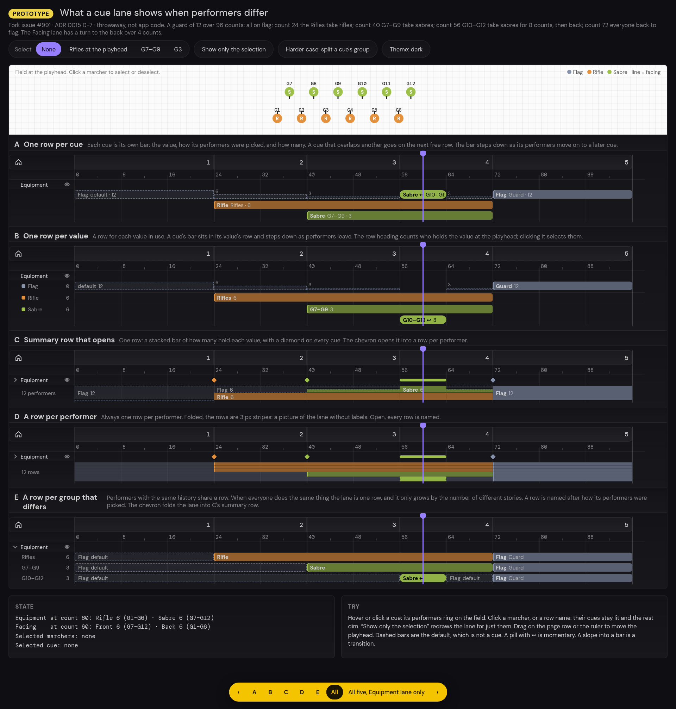

# Cue lanes: what a lane shows when performers differ

Status: throwaway prototype for fork issue #991 (part of epic #989), 2026-11-15. Nothing is
decided: **the owner picks**, and the pick is recorded on #991. No app code changed.

[ADR 0015](../../../adr/0015-cue-model.md) D-7 gives each cue type a lane under the drill rows: a
lasting cue draws as a bar to the next one, a momentary cue as a block of its length. That picture
assumes one value at a time. A cue stores its own performers (D-4), so at one count half the guard
can hold rifles while the rest hold flags or sabres. This prototype compares five answers to what
the lane draws then.

## Try it

Open [cue-lanes-prototype.html](cue-lanes-prototype.html) in a browser. It is one file with no
build. Switch options with the yellow bar, the left and right arrow keys, or `?variant=A` to `E`
and `all`.

- Hover or click a cue: its performers ring on the field.
- Click a marcher or a row name: their cues stay lit and the rest dim.
- "Show only the selection" redraws the lanes for just the selected marchers.
- "Harder case" adds a cue that takes half of an earlier cue's performers.
- Drag on the page row or the ruler to move the playhead.

The show: a guard of 12 (G1–G12) over 96 counts, all on flag by default. Count 24, the Rifles
(G1–G6) take rifles. Count 40, G7–G9 take sabres. Count 56, G10–G12 take sabres for 8 counts, then
back (momentary). Count 72, everyone back to flag. The Facing lane has the Rifles turn to the back
over 4 counts at count 48 and return over 2 at count 72.

## The options

| Option                             | What the lane draws                                                                                                                              | Rows here |
| ---------------------------------- | ------------------------------------------------------------------------------------------------------------------------------------------------ | --------- |
| **A** One row per cue              | Each cue is its own bar (value, how it was picked, how many). An overlapping cue goes on the next free row. A bar steps down as performers leave | 3         |
| **B** One row per value            | A row per value in use (Flag, Rifle, Sabre). The row heading counts who holds it at the playhead, and clicking it selects them                   | 4         |
| **C** Summary row that opens       | One stacked bar of how many hold each value, a diamond on every cue. Opens into a row per performer                                              | 1, or 13  |
| **D** A row per performer          | Always per performer. Folded: 3 px stripes without labels. Open: named rows                                                                      | 12        |
| **E** A row per group that differs | Performers with the same history share a row. One row when everyone agrees. Folds into C's summary                                               | 3, or 1   |

E is not in the issue's list. It came out of the research: take lanes in Ableton and Logic only
exist where there are alternatives, and that is the property the other four lack.

Screenshots of each: [A](images/option-a.png), [B](images/option-b.png),
[C](images/option-c.png) ([open](images/option-c-open.png)), [D](images/option-d.png)
([open](images/option-d-open.png)), [E](images/option-e.png)
([folded](images/option-e-folded.png)). Behaviors, all five at once:
[hovering a cue](images/all-hover-cue.png), [G3 selected](images/all-selected-g3.png),
[only the Rifles shown](images/all-only-rifles.png), [the harder case](images/all-harder-case.png).

## Trade-offs

| Question                                | A                    | B                      | C                 | D                   | E                        |
| --------------------------------------- | -------------------- | ---------------------- | ----------------- | ------------------- | ------------------------ |
| Everyone the same: is it one bar?       | Yes                  | One row per value used | Yes               | No, a row each      | Yes                      |
| What does one performer hold over time? | Trace across rows    | Trace across rows      | Only when open    | One row             | One row                  |
| How many hold rifles here?              | Read the bar's count | The row heading        | Band thickness    | Count stripes       | Add the rows' counts     |
| Can a cue be grabbed as one object?     | Yes                  | Yes                    | A diamond         | No, a piece per row | A piece per row it spans |
| Room for the picked-by label?           | Yes                  | Yes                    | No                | No                  | In the row name          |
| Height in a messy show                  | Grows with overlaps  | Grows with values      | Fixed when folded | Grows with people   | Grows with stories       |
| Do rows stay put while editing?         | No, cues repack      | Yes                    | Yes               | Yes                 | No, rows split and merge |
| A ripple (12 cues on successive counts) | 12 rows              | 1 row, a staircase     | A staircase       | 12 rows             | 12 rows; fold it         |

Weak spots seen in the prototype:

- **A:** a row has no meaning, so the eye has to trace. The default (not a cue) still needs a bar,
  or counts 0 to 24 look empty.
- **B:** a type with many values (an angle, a look per section) grows many rows. Two cues of one
  value at the same time stack inside the row.
- **C:** folded, it can't say who. Three performers of 12 make a 7 px band with no room for text.
- **D:** 12 rows for 3 stories, and a band of 150 would need folding by section. Folded stripes
  can't be read or grabbed.
- **E:** in the harder case a cue for G4–G6 splits the Rifles row in two. A cue that spans rows
  (the count 72 "Guard" cue) is drawn once per row; hovering lights all its pieces.

## Recommendation

**E, a row per group that differs, folding into C's summary row.** Reasons:

1. The common case stays as ADR 0015 D-7 describes it. A cue for the whole band or guard is one
   row of bars, and the lane grows only by the number of different stories (3 here, not 12).
2. Every row is unambiguous: one value at a time, room for the value, and the row name says who.
   What a performer holds over time is one row, never a trace across rows.
3. Cues stay bars you can grab, with the same lasting bar, momentary pill and transition slope as the
   single-value case, so there is one lane grammar and not a second one for mixed spans.
4. C's summary covers what E is bad at: a folded lane, and a lane with too many stories, such as a
   ripple written as 12 cues.

Worth keeping from the others, whichever layout wins:

- **B's heading action.** "Select who holds a rifle at the playhead" is ADR 0015 D-4's selection
  tool. It can be a command and a field action without B's rows.
- **A's step-down.** A bar that thins as performers leave is how C's summary and a partly selected
  cue can show "3 of 6".

The costs of E are in the trade-off table: rows split and merge as cues are added, and a cue that
spans rows is drawn in pieces.

## Precedents

From DAWs and editors, per the owner's rule (never drill-writing software).

- **Ableton Live take lanes:** the comp sits in the track's main lane and take lanes show under it
  only when asked for ([Live 12 manual, Comping](https://www.ableton.com/en/live-manual/12/comping/)).
  Behind C (a result row over detail rows) and E (lanes only where there are alternatives).
- **Ableton Live group tracks:** a folded group shows an overview of the clips in its tracks
  ([Live 12 manual, Mixing](https://www.ableton.com/en/live-manual/12/mixing/)). Behind C's summary
  and D's stripes.
- **Logic Pro take folders:** a disclosure triangle opens a folder into take lanes, and empty lanes
  are removed
  ([Logic Pro user guide](https://support.apple.com/guide/logicpro-ipad/lpip458ce486/ipados)).
  Behind the chevron on C, D and E.
- **After Effects:** a row per layer, and U reveals only the properties that animate, for the
  selected layers. Behind D, and behind "Show only the selection".
- **Premiere and Resolve:** a clip that overlaps another sits a track up. Behind A's packing.
- **Piano roll and drum grid:** a row per pitch or kit piece. Behind B.
- **Figma:** a mixed selection reads "Mixed", and Selection colors lists each value in use with a
  way to select everything that has it. Behind B's headings. Stated from memory, not checked
  against the current docs in this pass.

## Touch

Desktop first; touch reaches the same actions and data.

- Hover is never required. A tap on a cue selects it, which rings its performers on the field and
  shows what the hover tooltip shows.
- Row names, B's headings, chevrons and C's diamonds need 44 px hit areas in touch mode without
  growing on desktop.
- D's folded stripes are too thin for a finger, so a tap would have to pick the cue under it by
  count. This is a reason against D as the only view.
- A cue's menu (edit, select its performers, delete) is a long-press.

## Choices the prototype made that are not settled

1. **Transitions arrive on the cue's count.** "Turn to the back over 4" at count 48 is drawn as a
   slope from 44 to 48, as the parked design did. ADR 0015 doesn't say whether the change starts or
   ends on the count.
2. **A lane draws only the performers with a cue of its type.** Everyone else is on the default and
   left out, or the Equipment lane of a 150-member band would be mostly winds.
3. **The default is drawn dashed.** It is not a cue (D-2), but leaving it out makes counts before
   the first cue look empty.
4. **The type's default value is the quiet neutral color**, and other values take a hue.
5. **Lanes need a name column.** The prototype widens the timeline's gutter to 124 px for lane and
   row names; the real timeline's gutter only holds the home button.
6. **A picked-by label can echo the value** ("Rifle · Rifles"). E avoids it by putting the label in
   the row name.

## Files

- `cue-lanes-prototype.html`: the prototype. URL switches: `variant`, `t` (playhead count), `sel`
  (`rifles`, `g7-9`, `g3`), `filter=1`, `open=equipment,facing` (C and D), `fold=equipment` (E),
  `hide=facing`, `cue=e1`, `messy=1`, `theme=light`.
- `images/`: screenshots from headless Chromium on the GPU, 1280 px wide.

Starting points read from the parked design on `archive/pre-convergence` (002b6da97):
`VisualsCueBand.tsx`, `visualsLanes.ts`, `visualsWho.ts` and `visualsWhy.ts`. Kept from it: the
ramp into a state's count, the dashed and hatched treatment for what isn't a cue, and counting how
many of the focused performers have each value (`whyAt`), which is what C's bands and B's headings
show.
