# Layer priority

Which of two overlapping moves a marcher follows, and how the app chooses the stored `layer` so
that answer comes from the timeline alone. Decided by the project owner on 2026-10-16; the
normative rules are spec §6.2 (L-1 to L-6, D-18) and the ADR 0001 amendment of the same date.

## The rule

1. **A page's own move is underneath.** Any other move wins over it where they overlap.
2. **Otherwise the later start wins.** A marcher follows a move until a move that starts later
   picks them up.
3. **On the same start, the shorter one wins.** The longer one picks the marcher back up when the
   shorter one ends.

Put together: at any count the marcher follows the move that started most recently among those
still running (the shortest on a tie). A move inside another nests like brackets: when it ends,
the marcher goes back to the outer move, starting from where they actually are and finishing on
time (spec R-5, D-12). A move that only partly overlaps an earlier one cuts it off for good. A
marcher who joins a move partway ranks by the count they join. Page moves rank the same way among
themselves (after a flag insert or delete, two can overlap), always below every other move. Two of one marcher's moves of the same kind (two page moves, or two others) over exactly the same counts
can't be ranked, so that edit is refused (L-4).

Nobody types or picks a layer. The layer module works every layer out from these rules at the end
of each edit, and a test checks that the stored layers always match (I-L1).

A page's own move is the move a page's box stands for: the one the app makes for each page, and the
converter writes for each page of an older show. It is now stored as such
(`timeline_page_moves`, ADR 0001) instead of being guessed from its range.

## Why it changed

Before this, each edit picked a layer its own way:

| Edit                                 | Layer it picked (PR #266)                      |
| ------------------------------------ | ---------------------------------------------- |
| Make a move, add marchers, cast      | One above whatever it overlaps (`stealLayer`)  |
| Split a move                         | The old row's layer                            |
| Drag a move's edge                   | Rises over page moves only (`growOverLayers`)  |
| Drag a whole move                    | Keeps its layer, so it was refused with `E-A3` |
| Set one marcher's spot               | The neighboring row's layer, or 0              |
| Type a layer in the Expert inspector | Any number from −1000 to 1000                  |

The owner's example: split some marchers out of Page 2's move, then drag their new move 3 counts
back into Page 1. The drag was refused, while dragging the move's start edge over the same counts
was allowed.

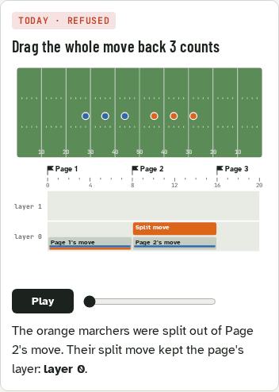

And the inspector let a designer undo a takeover silently by typing a lower layer:

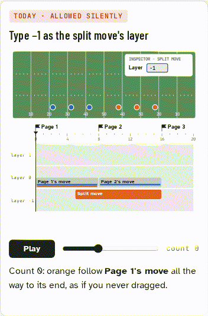

Two ways to decide were compared:

- **A, last edited on top:** each make, drag or resize puts that move above whatever it overlaps.
- **B, later start on top:** the rule above.

## The cases

Each animation comes from a small simulator in [cases.html](cases.html) (open it in a browser to
play, scrub, and switch between A and B). It follows the spec's resolution: the winning row
controls the marcher, and a row that picks a marcher up starts from where they are and finishes
at its end. Faded clip parts are counts a move loses; a red ring marks a marcher sprinting to catch
up. Every verdict below was checked against the simulator's output.

| Case                                     | A · last edited      | B · later start    |
| ---------------------------------------- | -------------------- | ------------------ |
| 1. Drag a split move back into Page 1    | ✓ Works              | ✓ Works            |
| 2. Grow a move past the next page        | ✓ Works              | ✓ Works            |
| 3. Move a page flag around a breakaway   | ⚠ Breakaway vanishes | ✓ Works            |
| 4. Nudge a move by one count             | ⚠ Whole path flips   | ✓ Nothing jumps    |
| 5. Same timeline, built in another order | ⚠ Plays differently  | ✓ Plays the same   |
| 6. Make a long move over a short one     | ⚠ Short move hidden  | ✓ Short move kept  |
| 7. A breakaway hands back late           | ⚠ Sprint             | ⚠ Sprint           |
| 8. Two moves start on the same count     | ⚠ One is hidden      | ✓ They nest        |
| 9. Drag a move past another's start      | ✓ Takes over         | ✓ Takes over       |
| 10. Micro moves inside a long move       | ⚠ Micro moves hidden | ✓ Micro moves play |

### 1. Drag a split move back into Page 1

The split move now covers counts 5 to 13. It isn't a page's move, so it wins over Page 1's move from count 5 (rule 1). Both rules agree.

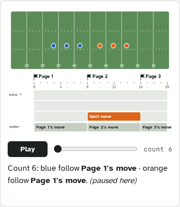

### 2. Grow a move past the next page

The split move's end goes from 16 to 18. It wins counts 16 to 18 over Page 3's move, which then
picks the marchers up and catches up (the owner's V-340 decision). Both rules agree.

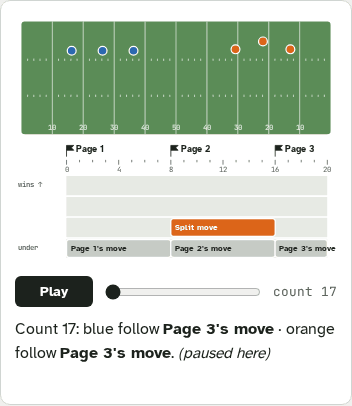

### 3. Move a page flag around a breakaway

Move 3 is a breakaway for the orange marchers inside Page 2. Dragging Page 3's flag later edits
Page 2's move. Under A that puts the page's move on top, and the breakaway silently stops playing.
Under B a page's move is always underneath.

| A                                     | B                                     |
| ------------------------------------- | ------------------------------------- |
| 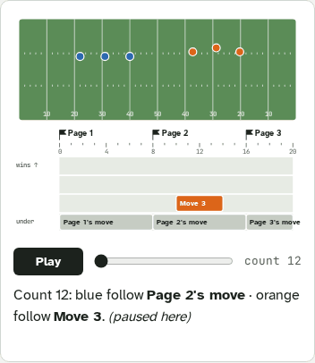 |  |

### 4. Nudge a move by one count

Move 3 (4 to 12) and Move 4 (8 to 16) overlap, and Move 4 was made later. Stretching Move 3's end
by one count puts it on top under A, so the orange marchers follow Move 3 until 13 and then rush to
catch up with Move 4. Under B, Move 4 still starts later; the extra count is drawn faded.

| A                                     | B                                     |
| ------------------------------------- | ------------------------------------- |
|  | 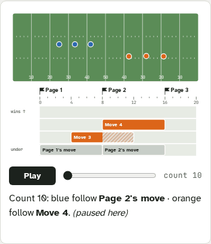 |

### 5. Same timeline, built in a different order

Two shows with exactly the same moves. Under A they play differently, depending on which move was
made first, and nothing on screen says why. Under B both play the same.

| A                                     | B                                     |
| ------------------------------------- | ------------------------------------- |
| 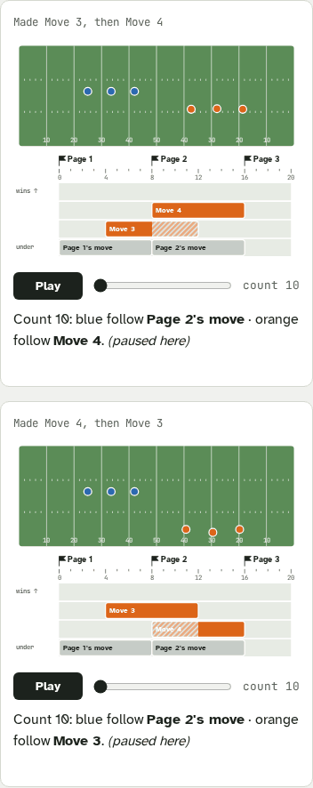 | 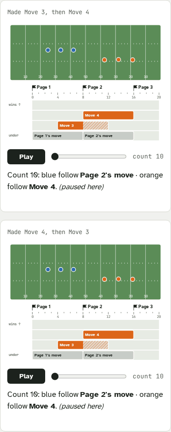 |

### 6. Make a long move over a short one

Move 3 (10 to 14) exists; Move 4 is made over 4 to 16. Under A, Move 3 never plays but stays on the
timeline. Under B, Move 3 starts later, so it still breaks away. The owner decided that is the
system working as intended (2026-10-16): the designer shortens or deletes Move 3 if they don't
want it. There is no "replace" prompt.

| A                                     | B                                     |
| ------------------------------------- | ------------------------------------- |
|  | 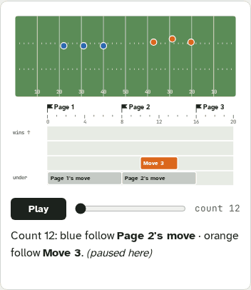 |

### 7. A breakaway hands back late

Move 3 takes the orange marchers far away inside Page 2, and its end is stretched to 15. Page 2's
move picks them up with 1 count left to reach its set. This happens under either rule; it isn't
about layers.

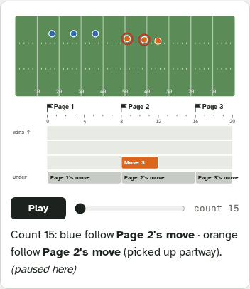

### 8. Two moves start on the same count

Move 3 (8 to 12) and Move 4 (8 to 16). Under A, whichever was made last wins, and Move 3 can be
hidden. Under B the shorter one wins: Move 3 plays, then Move 4 picks the marchers up.

| A                                     | B                                     |
| ------------------------------------- | ------------------------------------- |
|  | 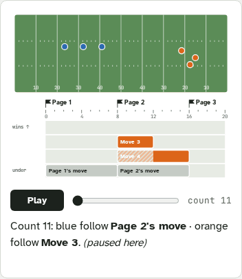 |

### 9. Drag a move past another's start

Dragging Move 3 to start after Move 4 makes it win from count 10 under both rules. Under B, who
wins changes only when two starts visibly swap.

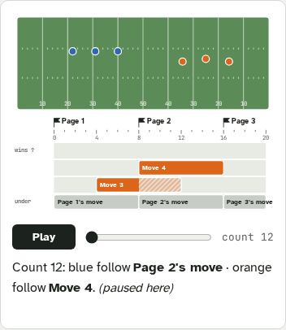

### 10. Micro moves inside a long move

The owner's question: a long move with micro moves inside it, where the first micro move starts on
the same count as the long one. Under B the micro move is shorter, so it wins; the next one starts
later, so it wins too; the long move picks the marchers back up after each. Under A the micro moves
are hidden whenever the long move was made or nudged after them.

| A                                       | B                                       |
| --------------------------------------- | --------------------------------------- |
| 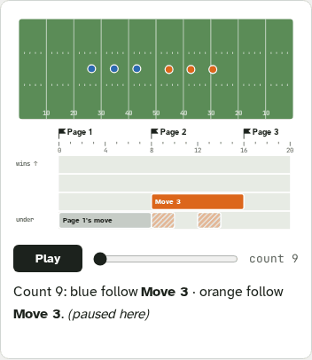 | 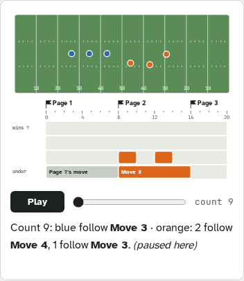 |

## What can still surprise

- **One move never hides another, except a page's move**, since that would need the same start
  and a later end, which makes it the longer one. A single move can hide a page's move entirely. Several shorter moves inside a long one can still cover all of it.
  That's the designer's choice, and the long move's faded counts show it.
- **Catch-up sprints** (case 7): a move that hands marchers back with little time left makes them
  rush. A warning for that is a separate question.
- **No override.** A designer who wants a long move to win over one inside it shortens or deletes
  the inner move.
- **Dragging marchers on the field over a window** (UI-10) follows the same rule (owner,
  2026-10-16): a move that starts inside the window wins from its start. If it runs past the
  window's end, the marchers aren't at the dropped spot there, and the toast says which move takes
  over.
- **Follow the leader**: who founds an FTL move depends on which rows win at its start, so
  changing the end of one of two rows that start together can change an FTL move's founders.

## How it shows in the app

- Clips stack by who plays: a move inside another sits above it.
- Counts a move loses are drawn faded, and hovering them says why ("Move 4 takes over: starts
  later" or "same start, shorter").
- The inspector names which moves take over from each marcher's move. It has no layer field.

## Files

- [cases.html](cases.html): the ten cases with the simulator, A/B switch and scrubbing.
- [before-the-decision.html](before-the-decision.html): the first explainer, written before rule B
  was chosen. Its draft rules (a "rise over page moves" rule) are superseded by the rule above; its
  scenes of today's behavior still hold.
- `images/`: the GIFs above, captured from those pages.
