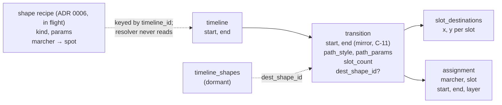
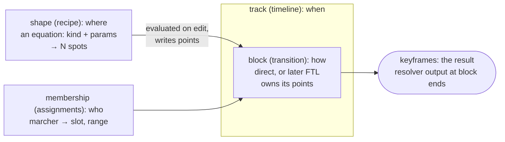
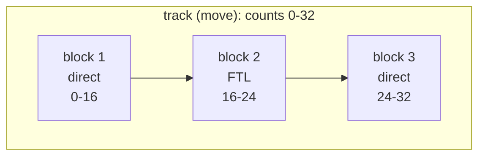
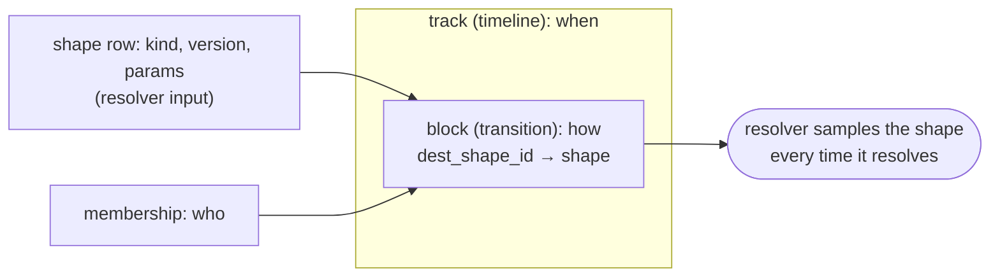

<!-- cspell:disable -->

# Ownership model for motion: shapes, transitions and keyframes

Status: research for owner review (fork issue #434). Nothing decided, nothing built. It
recommends; the owner decides in a grilling session (questions at the end). The draft ADR text is
in [adr-0001-amendment-draft.md](adr-0001-amendment-draft.md), and the cited prior art is in
[prior-art.md](prior-art.md).

Code references are to fork `main` at `dc2b92c25` unless a branch is named. Paths are relative to
`apps/desktop/src/` for app code and to the repository root otherwise. The holds design is fork
PR #362 (`research/keyframe-model`, `docs/timeline/research/holds/`). The shape work is #344
(spec), #363 (`shapes/host`), #181 (`shapes/box-v1`) and #288 (`shapes/frame-editor`).

This is a different question from the older [ownership](../ownership/README.md) research, which was
about steals and joins (layers). That one is settled by spec §6.2.

## Findings

1. **The spec already separates the four concerns. The app is what bundled them.** Spec §3
   (`docs/timeline/spec.md:81-108`) says shapes are _where_ with no time, timelines are tracks,
   transitions are _how and when_, and assignments are _who, when and precedence_. A transition
   only has to sit inside its timeline (I-T1, the `tr_in_timeline_*` triggers). Two app rules
   collapsed it:
   - **C-11** (ADR 0001 §2, `docs/adr/0001-timeline-motion-model.md:123-136`) makes every
     transition span its timeline exactly. So _when_ is stored three times: on the timeline, on the
     transition as a mirror, and on each assignment. The `E-T1` row in
     `timeline_commit_violations` (`apps/desktop/electron/database/migrations/triggers.ts:64-78`)
     enforces the mirror.
   - **UI-9 / C-12** give each marcher its own one-slot shapeless transition (ADR 0001
     `:147-149`). So in practice _where_ lives in `timeline_slot_destinations`, one point per
     slot, and the transition row is mostly a carrier for a path style.

2. **Spec shapes, follow-the-leader and arcs are dormant in the app.** No user path creates them.
   - #319 removed the shapes editor and path editing on 2026-10-19 (`docs/timeline/ui.md:1526`).
     `createTimelineShape` (`db-functions/timelineShapes.ts:18`) has no caller outside tests.
   - The converter writes only shapeless direct moves (ADR 0001 C-8, `:545-551`).
   - The owner deprecated arcs and said "pathways will be redone" on 2026-10-19
     (`db-functions/timelineSplitAtBeat.ts:57-61`).

   Yet several commands still branch on them:
   - split by marcher refuses (`db-functions/timelineSplitMoves.ts:224-258`, 284-286);
   - compaction leaves slots vacant (`db-functions/timelineMembership.ts:514-521`);
   - a drag refuses an FTL member, or converts a shape into points (`db-functions/timelineMoves.ts:344-351`);
   - the page-move test excludes shaped moves (`db-functions/timelineRipple.ts:300-306`).

   These are the "edge cases in every command" the owner wants gone. Today they guard data that
   only fixtures and `ref/` contain, so the model can change now at almost no migration cost.

3. **The in-flight shape work already chose a model, and it is not the spec's.** ADR 0006
   (`docs/adr/0006-shape-recipes.md` on `shapes/host`) says:
   - **Positions stay the source of truth.** Placing a shape writes ordinary points through the
     drag path (`moveMarchersInTarget`).
   - **A recipe is stored beside them** as app data that the resolver never reads:
     `timeline_shape_recipes` (keyed by `timeline_id`) and `timeline_shape_recipe_marchers`
     (marcher → spot, plus where it was put).
   - It rejected spec shapes on purpose: fixed kinds checked by the database, a spec, schema and
     resolver change for every new kind, and a clash with UI-9.

   So a shape is already "an equation that distributes marchers into spots with no timing". It
   is just evaluated **when you edit**, not when you play.

4. **Leaving a shape is already decided for boxes: the spot becomes a hole.** In
   `docs/timeline/research/shapes/07-placed-boxes.md` (on `shapes/host`), the owner decided
   (2026-10-14) that membership is binary. Moving a member takes it out and leaves its spot as a
   hole. A toast offers **Close up** (keep files and intervals, back rank goes short) or
   **Re-split** (spread the rest inside the old edges). Even spread is the one mode that relaxes
   when the count changes (ADR 0006 amendment of 2026-10-22, item 1).

5. **The resolver needs a shape for one thing only: the FTL trail.** For direct and arc motion it
   needs one destination per slot. That is why D-16 calls points "a second source" with nothing
   downstream able to tell (`spec.md:129`; `destinationsOf`, `packages/core/src/timeline/geom.ts:145-155`).
   Only follow-the-leader reads the shape as geometry: its exact arc-length path `destPath`
   (R-9, R-13; `geom.ts:79`). A shape baked into points loses nothing for direct motion.

6. **Operation 1 ("cut a block in time") already exists, and is exact only for direct motion.**
   Split at playhead (`db-functions/timelineSplitAtBeat.ts:28-68`) gives the first half a
   shapeless direct transition to the resolver's positions at the cut.
   - For direct motion it is exact: `lerp(A, lerp(A,B,p), b/p) = lerp(A,B,b)`.
   - For arcs and FTL it is sampled. The second half "starts again", so the path after the cut
     changes, and the toast says so.

7. **Operation 2 ("remove a marcher for a range of counts") exists only in pieces.**
   - `removeAssignmentRowsInTransaction` (`db-functions/timelineMembership.ts:446`) removes whole
     rows and compacts slots, except in shaped and FTL moves.
   - Nothing removes a marcher for _part_ of a move. Holds composes it as "cut at both ends, then
     remove from the middle piece" (holds `01-edit-rules.md`, "Take out of a page").

8. **Follow-the-leader is coupled to membership by design.** The target index is `n−m+q`, where
   `m` is the number of founders (R-9, `spec.md:631-656`). So removing one founder moves every
   member's target by one point. Overriding a founder from _another_ move does the same (QA-REG-4;
   ADR 0001 `:278-279`). Its order is read from the previous transition's slot numbers (R-12).
   It is the one style where "take one marcher out" can't be local.

9. **Keyframes are already a result, not a fact.** Holds decision 13 defines a keyframe as every
   visible stored move end. A baked shape's points are destinations, which are authored facts
   like a dragged spot (D-16), not positions at beats. So baking keeps D-2 ("positions are
   generated, not stored", `spec.md:115`). D-2 forbids storing sampled _positions over time_,
   not storing where a move ends.

**What this adds up to.** The owner's split (track: when; block: how; shape: where; keyframes: the
result) is nearly the spec's own model. Two app rules (C-11, UI-9) and one dormant feature
(`dest_shape_id`) blur it. What is really open is **when a shape is evaluated** (on edit, or on
play) and **what a block promises the commands** (the two operations).

## The four concerns, today



| Concern | Stored on today                                                         | Who reads it                |
| ------- | ----------------------------------------------------------------------- | --------------------------- |
| when    | `timelines`, mirrored on `timeline_transitions`, and on each assignment | resolver reads the last two |
| where   | `timeline_slot_destinations`, or `dest_shape_id` (dormant)              | resolver (R-13)             |
| how     | `path_style`, `path_params`, `order_mode`                               | resolver (R-6 to R-12)      |
| who     | `timeline_assignments` (slot, range, layer)                             | resolver (R-2)              |
| design  | `timeline_shape_recipes` (in flight)                                    | the shape host only         |

## Options

All three keep the resolver's contract (positions generated on demand, D-2), the change log and
undo. They differ in **when a shape is evaluated** and **what owns a block's counts**.

### Option A: shapes are evaluated when you edit (bake), and a block is a transition (recommended)

Formalise what ADR 0006 already does, and make the block a code contract.



- **Where.** A shape is a recipe: an equation (kind, version, params, distribution) that
  produces N spots. Placing or editing it **writes the block's points**. The resolver never sees
  the equation. A file from a newer app with an unknown kind still plays (ADR 0006 decision 5).
- **How.** A block is a transition. Its path style is the only thing commands may not look inside.
- **When.** As today, C-11 kept: a block spans its move.
- **Who.** Assignments, as today.
- **The block contract.** One module per path style implements the two operations (and, later,
  add a member and retime). Commands call the contract and never branch on `path_style` or
  `dest_shape_id`. This is what removes the edge cases, whichever option is chosen.
- **The dormant spec shape link.** Retire `dest_shape_id` for distribution. If FTL comes back, it
  owns its **route** (its trail geometry) in `path_params`, copied from a recipe's path when it is
  made, so no transition references a shape. Owner question 4 asks whether to keep the column for
  FTL routes instead.
- **Recipes attach to the block that holds their points** (`transition_id`), not to the move
  (`timeline_id`). Then split by marcher, merge and cut carry the recipe with the points instead of
  leaving it on the old move (ADR 0006's own "recipes can go stale" consequence).

Trade-offs:

- **Pro:** almost nothing changes. The resolver, `ref/` and the change log stay as they are.
  #181, #288 and #363 keep their storage, apart from the recipe key.
- **Pro:** membership changes are always explicit edits. Nobody else moves unless you choose
  Close up or Re-split.
- **Pro:** a newer file plays in an older app, because the points are there.
- **Con:** a shape doesn't update "live". Editing it is a write that re-places its members, which
  is what the host does today.
- **Con:** a recipe and its points can disagree if some path writes points without the host.
  ADR 0006's binary membership settles that: a marcher not on its spot leaves the recipe.
- **Con:** "transforms over time" (a form that turns or grows during a move, an #344 follow-up)
  can't be baked into end points. It would be a block type of its own, which needs the equation
  at resolve time (Option C, limited to that block type).

### Option B: Option A, plus blocks own their counts inside a track (lane model)

Relax C-11 so that a track (a move) can hold several blocks one after another, the way a DAW
track holds clips. The spec schema already allows it (I-T1 only asks for containment).



- **Cut in time** splits a block **inside the same move**, instead of making a second move (Split
  at playhead makes a new timeline today, `timelineSplitAtBeat.ts:35-41`). The move's clip stays
  one clip, with a seam.
- **Remove for a range** is "cut twice, take the marcher out of the middle block", all inside one
  move. Holds' "take out of a page" never has to create moves.
- The mirror of `start_beat`/`end_beat` on transitions stops being a mirror and becomes real data.
  The resolver already reads it (R-5 uses `T.end_beat`), so the resolver doesn't change.

Trade-offs:

- **Pro:** this is the owner's phrase taken literally: "an isolated block of transition logic
  attached to a track". A move's counts and its blocks are separate things.
- **Pro:** cuts stop multiplying moves and names ("Move 7", "Move 8").
- **Con:** C-11 was chosen on 2026-10-01 so that a move is the unit of start and stop. Undoing it
  touches range edits, which move a timeline and all its transitions together (P8.10), as well as
  resize, flag drags, the ripple, merge-refit and the page-move mark. It also breaks C-12's "a
  marcher has at most one transition in a timeline" (ADR 0001 `:147-149`), which split and merge
  rely on. Layers are unaffected: back-to-back blocks don't overlap, so §6.2 never ranks them.
- **Con:** the timeline must draw blocks inside a clip: new UI.
- **Cost:** medium to large. It can come after A, since A's contract doesn't depend on it.

### Option C: shapes are evaluated when you play (live)

Make the shape a resolver input again, as spec §3 intended, but with open kinds.



- `timeline_shapes` becomes open-ended: kind and version as text, params as JSON, with no fixed
  kind CHECK. Recipes fold into it. Every kind's generator (the box distributor, the circle,
  spread generator 1) moves into `@openmarch/core`, so the resolver can evaluate it.
- **Re-distribute on leave becomes possible at play time.** A shape could spread over its
  _occupied_ slots only. That makes destinations depend on assignments, which spec §9.4's
  invalidation doesn't model today (destinations depend only on the transition and its shape).
- Editing a shape moves every block that uses it, at once, with no write per marcher.

Trade-offs:

- **Pro:** "a shape is an equation" holds at play time. Transforms over time and morphing
  blocks become natural.
- **Pro:** one shape can drive several blocks (a form held across pages, then re-used).
- **Con:** every generator becomes a resolver contract. It must give the same numbers in every
  engine (only spread generator 1 is designed for that, ADR 0006 amendment item 8). It needs
  goldens in `ref/` and a version for any change.
- **Con:** a file with a kind the app doesn't know **can't play**. Under A it plays as points.
- **Con:** large rework of #181, #288 and #363 storage (recipes become shape rows), and an
  amendment to ADR 0006 that reverses its main decision.
- **Con:** an edit to one shape silently moves marchers in every block that uses it. That is the
  "pile of edge cases" coming back as "which uses do you mean?"

### Side by side

|                              | A: bake                                                               | B: A + lanes           | C: live                                 |
| ---------------------------- | --------------------------------------------------------------------- | ---------------------- | --------------------------------------- |
| Shape evaluated              | on edit                                                               | on edit                | on play                                 |
| A move's counts              | the block's (C-11)                                                    | its own; blocks inside | the block's (C-11)                      |
| Schema change                | recipe key → `transition_id`; retire `dest_shape_id` for distribution | as A; no new columns   | open `timeline_shapes`; recipes fold in |
| Resolver / `ref/` change     | none                                                                  | none                   | kind registry in core, new goldens      |
| ADR 0001                     | amend §2 (shapes are recipes; block contract)                         | as A, and relax C-11   | amend §2 and §4 (core API)              |
| ADR 0006                     | key change only                                                       | key change only        | reverse decision 1                      |
| In-flight shape PRs          | small change (recipe key)                                             | small change           | large rework                            |
| Unknown kind in an older app | plays as points                                                       | plays as points        | can't play                              |
| Re-distribute on leave       | explicit edit (Close up, Re-split)                                    | same                   | could be automatic                      |
| Transforms over time         | needs a special block                                                 | same                   | natural                                 |
| Cost                         | small                                                                 | medium to large        | large                                   |

**Recommendation: A now, keep B open, and use C only for a future "morph" block type.** The block
contract is the part that removes the edge cases, and it is the same under all three.

## Leaving a shape: re-distribute, or leave the spot open?

**Recommend: leave the spot open (a hole) by default, and make re-distributing an explicit edit.**
This is already the owner's decision for boxes (Finding 4). The holds design needs the same thing,
because "remove a marcher for a range of counts" must not move anyone else.

```text
 before            hole (default)      Close up            Re-split
 o o o o           o o o o             o o o o             o  o  o
 o o X o    →      o o . o      or     o o o        or      o  o  o
 o o o o           o o o o             o o o               o  o  o   (spread inside the edges)
```

- **Should it be a shape setting?** Every tool in the prior art that offers both behaviours makes
  them a named switch ([prior-art.md](prior-art.md), takeaway 1). A stored `onLeave` in the
  recipe's params (`hole`, `closeUp`, `resplit`) would let a designer set "this form always closes
  up", and the toast stays as the per-edit override. Most tools re-spread by default on a count
  change; the box keeps the hole because its files and intervals are what a drill writer counts.
  Owner question 6.
- **For a range of counts, re-distributing writes new motion for the others.** Under A, Close up
  or Re-split over counts 9-16 means cutting the block at 9 and 16 and re-placing the middle
  block's points. So the others move twice: out to the new spots and back. That must be visible
  (the bars and squares from holds decision 9 and 10), never automatic.
- **Even spread** already relaxes on a count change (ADR 0006, 2026-10-22). It is the one kind
  where "re-split" is the natural default. Owner question 7.

## Follow-the-leader: what happens to the order when a member leaves?

FTL is dormant, so this decides how it comes back, not a migration. Under any option, FTL
targets are counted from the founders (`n−m+q`, R-9). The choices:

```text
 line:   L  2  3  4  T   (L = leader, T = tail; 3 leaves)
 (i) close up:  L  2  4  T  .    everyone behind 3 moves up one point; 3's point empties at the tail end
 (ii) keep gap: L  2  .  4  T    3's point stays reserved; nobody else changes target
 (iii) refuse:  holds' current fallback ("refuses for that marcher, with a reason")
```

- **(i) Close up** is what the spec does today, implicitly, and what a real follow-the-leader
  does on the field. But it changes every target behind the leaver, and every later block that
  inherits FTL order (R-12).
- **(ii) Keep the gap** needs targets keyed by slot, not by founder count: a change to R-9. It
  keeps the remove operation local, which the holds contract wants.
- **(iii) Refuse** is what holds does until this lands.

**Recommend (ii) as the rule for "remove for a range" (local, reversible), with (i) as an explicit
command.** The same pattern as shapes: local by default, re-flow on request. Owner question 8. The prior art leans the other way for a permanent removal: deleting from an ordered
chain closes it up unless each member stores its own offset (prior-art takeaway 4). So (ii)
is recommended only for the time-limited removal holds needs, where the line must come back as
it was.

**Cutting an FTL block in time** is harder than for direct motion. The second half's trail is
rebuilt from the members' positions at the cut (R-9 step 3), which cuts corners wherever the trail
bends between two members. An exact cut needs FTL to own an **explicit trail** (route) that the
second half continues from, rather than one rebuilt from origins. That is the same "FTL owns its
route" change as in Option A. Until then, the cut is sampled, as today (Finding 6).

## How shapes produce keyframes without storing positions

- **Under A and B:** the recipe is evaluated once per edit and writes each slot's point. The
  keyframe (a marcher's arrival) is the resolver's position at the block end. For a founding direct
  span that is exactly the point, bit for bit (endpoint-exact `lerp`, spec §8.10). Stored: the
  equation (recipe) and the block's points, which are authored ends (D-16). Not stored: any
  position over time. D-2 holds.
- **Under C:** nothing but the equation is stored. The resolver samples the shape whenever it
  needs a destination (R-13 extended to open kinds), and caches it like any other derived value.
- **Both keep "positions are resolved, never stored".** The difference is whether a block's _end
  points_ are stored facts (A, B) or derived values (C).

## The two operations, per block type

The contract every block type implements. Holds relies only on these (holds README, Scope).

| Block type                                     | 1. Cut in time at count c                                                                                                                                      | 2. Remove marcher m over counts [a, b)                                                                                                                                                            |
| ---------------------------------------------- | -------------------------------------------------------------------------------------------------------------------------------------------------------------- | ------------------------------------------------------------------------------------------------------------------------------------------------------------------------------------------------- |
| **direct**, own points (every live move today) | Exact. First half: points = positions at c. Second half keeps the points. Already built (`timelineSplitAtBeat.ts`).                                            | Cut at a and b, then delete m's row in the middle block. m holds there (R-6). Its slot stays vacant (D-13) or is compacted (`removeAssignmentRowsInTransaction`). Nobody else moves.              |
| **direct**, from a shape recipe                | As above. The recipe stays with the second half (it holds the points the recipe made). The first half gets no recipe, since its points are mid-move positions. | As above. In the middle block the recipe gets a hole for m (ADR 0006, 2026-10-14). Close up or Re-split are explicit edits that re-place the middle block.                                        |
| **arc** (deprecated)                           | Sampled: the first half becomes direct (today). An exact cut would keep the arc's circle; not worth building while arcs are deprecated.                        | As direct.                                                                                                                                                                                        |
| **follow-the-leader** (dormant)                | Exact only if FTL owns an explicit trail; the second half continues it with order inherited (R-12 FTL → FTL founding case). Otherwise sampled, as today.       | Under (ii): cut at a and b, and in the middle block m's target point stays reserved, so nobody else changes target. Under (i): the others close up, and later blocks inheriting order change too. |
| **morph** (future, Option C only)              | Cut the parameter curve at c (as an After Effects shape keyframe would be).                                                                                    | Hole in the shape for m over the middle block.                                                                                                                                                    |

Under B, "cut" makes two blocks in the same move. Under A and C it makes a second move, as Split at
playhead does today.

## What changes, per option

### Schema

- **A:**
  - `timeline_shape_recipes.timeline_id` becomes `transition_id`. Migration 0027 (on #181) isn't on
    `main` yet, so the change can be made in place.
  - The write path stops creating `dest_shape_id`. Retire the `timeline_shapes` table and the
    I-T3, I-T4, I-T5 and `tr_shape_set` triggers, or keep them for FTL routes only (question 4).
  - Optional: `onLeave` in recipe params (question 6), which needs no column.
- **B:** as A. No new column; C-11's commit check (`E-T1` row) changes from "equal" to "inside".
- **C:**
  - `timeline_shapes` gets `kind_version` and loses the five-kind CHECK and the block-capacity
    triggers.
  - Recipes migrate into it, and `timeline_shape_recipe_marchers` becomes assignments.
  - The change log already logs shapes (spec §5.1).

### ADR 0001

- **A:** amend §2 ("Shapes are recipes, evaluated on edit; transitions own their points"; the
  block contract). Note in §4 that `ShapeRow` remains for FTL routes or is deprecated. Draft
  text: [adr-0001-amendment-draft.md](adr-0001-amendment-draft.md).
- **B:** as A, and amend C-11 (`:123-136`), the range-edit rule (P8.10) and C-12's "a marcher has
  at most one transition in a timeline".
- **C:** amend §2 and §4. The core API gains a shape-kind registry. Spec D-16 changes from "or
  points" to "or a kind". ADR 0006 decision 1 is reversed.

### In-flight shape work

| PR / issue                             | A                                                                                                           | B                                     | C                                                                                 |
| -------------------------------------- | ----------------------------------------------------------------------------------------------------------- | ------------------------------------- | --------------------------------------------------------------------------------- |
| #181 box v1 (migration 0027, ADR 0006) | Re-key the recipe to `transition_id` before 0027 reaches `main`                                             | same                                  | Recipes become shape rows; 0027 rewritten                                         |
| #288 frame and floating editor         | none                                                                                                        | none                                  | The frame is stored on the shape row                                              |
| #344 / #363 shape host                 | `placeShape` passes the block, not the move. "Shapes with unassigned spots" (#358) is a hole from the start | same                                  | `placeShape` writes a shape and assignments, not points; unknown kinds can't play |
| #362 holds                             | Its two operations are defined by the table above; R5 is answered by questions 6 to 8                       | Take out of a page needs no new moves | same as A                                                                         |

## Prior art

Primary sources only: DAWs, NLEs, animation and motion-graphics tools, and lighting consoles. No
drill-design tools. The full notes with citations are in [prior-art.md](prior-art.md).

What bears on the options, and where it pulls against the recommendation:

- **Re-spread or keep the gap is always a named switch, never a hidden rule.** Examples: Cinema 4D
  Cloner Per Step vs Endpoint, Blender Array Offset vs Endpoint, grandMA3 Adaptive Measure and
  Remove Gaps, and Eos Even trail vs a fixed trail %. This supports a stored per-shape setting
  (question 6).
- **For a permanent count change, the common default re-spreads.** Cinema 4D calls Endpoint "the
  typical Cinema 4D behavior", and Eos's Even trail divides by the member count. That differs from
  the owner's box decision (a hole, 2026-10-14). The difference is worth confirming, not
  overturning: a box keeps files and intervals that a drill writer counts, and re-spreading breaks
  them.
- **Hiding a member for a while is a different operation from changing the count,** and it leaves
  the layout alone. Examples: a Cinema 4D Selection plus an Effector, Maya override layers, and
  Eos and grandMA3 Cue Only, Block and Release, which stop at a boundary. This supports a hole for
  "remove for a range of counts" (question 7), stored as a scoped edit on the block.
- **Ordered chains close up when an item is deleted.** A chain keeps a gap only when each member
  stores its own offset (Blender Follow Path, grandMA3 per-fixture phase). Houdini's `id`
  attribute exists because index numbers change with the count. So option (ii) for
  follow-the-leader is the less common choice. It needs targets keyed by a stable id or slot
  (question 8).
- **A split cuts the time window, not the logic.** Blender's split NLA strips both point at the
  same action, and Resolve keeps trimmed keyframes "still there and active". Every DAW checked
  has an "automation follows the clip" toggle. This supports Option B's blocks inside a move, and
  an FTL trail that a cut continues (question 9).
- **Tools keep results derived by default, and bake only on request, reversibly.** Examples: After
  Effects' Convert Expression to Keyframes, Houdini caches, and Cinema 4D's Current State to Object.
  This pulls toward Option C. Option A is still recommended for app reasons: older apps play newer
  files, and edits stay explicit. The recipe is what keeps the derivation, so a bake can always be
  redone from it.
- **Per-member pins are override layers above the derived result,** keyed by a stable id
  (Houdini Edit SOP, Cinema 4D Effector with a Selection, Blender NLA Replace). ADR 0006 removed
  overrides for boxes (binary membership), so this is noted, not proposed.

The gaps: no vendor page says what grandMA3 or Eos does to a running effect when one fixture
leaves. Clip-envelope behaviour on a split isn't documented for Ableton, Bitwig, Premiere or Pro
Tools. Adobe quotes come from search snippets only (tagged in the notes).

## Owner questions (for the grilling)

1. **When is a shape evaluated: when you edit (A, B), or when you play (C)?** Recommend: on edit.
   Live evaluation only for a future block type that changes a form during a move.
2. **What is a "track" in your phrase "a block attached to a track"?** Is it a move (today's
   timeline, one clip), or a lane that can hold several blocks one after another (Option B)?
3. **Should a cut in time stay inside one move (B), or keep making a second move, as Split at
   playhead does (A)?**
4. **Retire the spec's shape link (`dest_shape_id`, `timeline_shapes`) entirely?** Or keep it only
   as follow-the-leader's route? Recommend: retire it, and let FTL own its route in its params.
5. **Should a shape recipe belong to the block that holds its points (`transition_id`), rather
   than to the move (`timeline_id`)?** Recommend: yes, before migration 0027 reaches `main`.
6. **When a marcher leaves a shape, is "hole, Close up or Re-split" a stored setting on the shape,
   or only the toast's choice each time?** Recommend: a per-shape setting (default: hole for
   boxes, re-split for even spread), with the toast as the per-edit override.
7. **For "remove a marcher for a range of counts" (holds), is a hole always the result?** Or does
   Re-split apply there too, which moves the others out and back? Recommend: always a hole;
   re-flow only as an explicit command.
8. **Follow-the-leader: when a member leaves, does the line close up (i), or keep the gap (ii)?**
   Recommend: (ii) for remove-for-a-range, (i) as an explicit command.
9. **Should follow-the-leader come back with an explicit trail (route) it owns,** so a cut in time
   is exact? Or is a sampled cut, which changes the path after it, acceptable?
10. **Arcs are deprecated.** Remove them from the block types now (convert to direct on open, as
    the converter does for curves), or leave them dormant?
11. **Should the block contract (cut, remove, and later add and retime, per path style) be built
    first, as a refactor with no behaviour change?** It removes today's branches on `path_style`
    and `dest_shape_id`.
12. **Transforms over time (#344 follow-up): are they a block type ("morph") or a shape feature?**
    Under A they have to be a block type.

## Confidence and gaps

- **Read in code:** findings 1, 2, 5, 6, 7 and 8, at the lines cited.
- **Read in docs and branches:** findings 3, 4 and 9 (ADR 0006 and `07-placed-boxes.md` on
  `shapes/host`; holds on `research/keyframe-model`).
- **Not prototyped:** the block contract, FTL keep-gap (ii), the explicit FTL trail and Option
  B's lanes. Option B's cost estimate comes from the list of rules C-11 feeds, not from a spike.
- **Not checked:** whether lab testers' files contain shaped or FTL transitions. Finding 2 says no
  user path can make them since #319. Files from before #319 could, and a migration under A would
  bake them into points as `writeSlotMoves` already does (`timelineMoves.ts:351`).
