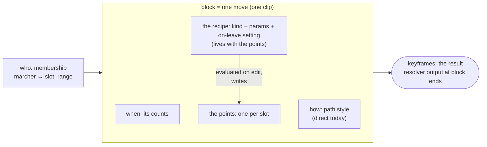

<!-- cspell:disable -->

# Ownership model for motion: shapes, blocks and keyframes

Status: **decisions taken (owner, 2026-10-26, on fork PR #436)**; nothing built. Open items and
deferred work are at the end. The draft ADR text is in
[adr-0001-amendment-draft.md](adr-0001-amendment-draft.md), and the cited prior art is in
[prior-art.md](prior-art.md). The brief is fork issue #434.

Code references are to fork `main` at `dc2b92c25` unless a branch is named. Paths are relative to
`apps/desktop/src/` for app code and to the repository root otherwise. The holds design is fork
PR #362 (`research/keyframe-model`, `docs/timeline/research/holds/`). The shape work is #344
(spec), #363 (`shapes/host`), #181 (`shapes/box-v1`) and #288 (`shapes/frame-editor`).

This is a different question from the older [ownership](../ownership/README.md) research, which was
about steals and joins (layers). That one is settled by spec §6.2.

## Decisions (owner, 2026-10-26)

1. **A shape is evaluated when you edit, and its formula (the recipe) is saved for later
   edits.** This was already decided by ADR 0006; this research confirms it rather than reopening
   it. Placing or editing a shape writes the marchers' points, and the resolver never reads the
   recipe. Evaluating shapes at play time is **not an option**. It survives only as a note: a
   future block type that changes a form during a move ("morph") would need it (see Notes).
2. **A "track" is a single clip: one move, one block.** OpenMarch has no channels or lanes. Each
   block is its own isolated thing, and the vertical space it sits on means nothing. So a block
   never holds several blocks one after another, and a cut in time makes two blocks, as Split at
   playhead does today. The lane model (Option B in the first draft) is dropped.
3. **The recipe lives with the block that holds the points.** The formula is stored with the same
   thing that stores the marchers' coordinates, so a split, merge or cut carries it with the
   points. **Timing:** this must be settled before migration 0027 (#181, box v1) reaches `main`,
   because 0027 creates the recipe table. How it maps onto today's tables is open item 1: the
   points of one move sit in several transitions.
4. **Hole, Close up or Re-split is a stored setting on each shape.** When a marcher leaves a
   shape, the shape's setting says what the others do. The toast stays as the per-edit override.
   Holds' "remove a marcher for a range of counts" uses the shape's setting too (open item 2 notes
   the side effect).
5. **Follow-the-leader is deferred.** It isn't implemented in the app (Finding 2), and nothing in
   holds or shapes needs it now. Its questions are in [Deferred](#deferred-follow-the-leader).

## The model



| Concern   | Owner                                  | Stored as                                                                |
| --------- | -------------------------------------- | ------------------------------------------------------------------------ |
| when      | the block (a move)                     | `timelines.start_beat/end_beat`; transitions mirror it (C-11, unchanged) |
| how       | the block's path style                 | `path_style`, `path_params`, `order_mode`                                |
| where     | the block's points, made by its recipe | `timeline_slot_destinations`, plus the recipe beside them (ADR 0006)     |
| who       | membership                             | `timeline_assignments`, and the recipe's marcher → spot rows             |
| keyframes | the resolver (a result, never stored)  | nothing: a visible move end, positioned by the resolver (holds dec. 13)  |

**The block contract.** One module per path style implements the operations that commands use:
cut in time, and remove a marcher over a range of counts (later: add a marcher, retime). Commands
call the contract and never branch on `path_style` or `dest_shape_id`. This is what removes the
"edge cases in every command" (Finding 2). Whether to build it first, as a refactor with no
behaviour change, is open item 5.

## Findings

1. **The spec already separates the four concerns. The app is what bundled them.** Spec §3
   (`docs/timeline/spec.md:81-108`) says shapes are _where_ with no time, timelines are tracks,
   transitions are _how and when_, and assignments are _who, when and precedence_. Two app rules
   collapsed it:
   - **C-11** (ADR 0001 §2, `docs/adr/0001-timeline-motion-model.md:123-136`) makes every
     transition span its timeline exactly, enforced by the `E-T1` row in
     `timeline_commit_violations` (`apps/desktop/electron/database/migrations/triggers.ts:64-78`).
     Decision 2 keeps it: a block is one move.
   - **UI-9 / C-12** give each marcher its own one-slot shapeless transition (ADR 0001
     `:147-149`; `createOwnTransitionsInTransaction`, `db-functions/timelineMembership.ts:163-180`).
     So in practice _where_ lives in `timeline_slot_destinations`, one point per slot, spread over
     one transition per marcher. Converted shows share transitions instead.

2. **Spec shapes, follow-the-leader and arcs are dormant in the app.** No user path creates them.
   - #319 removed the shapes editor and path editing on 2026-10-19 (`docs/timeline/ui.md:1526`).
     `createTimelineShape` (`db-functions/timelineShapes.ts:18`) has no caller outside tests.
   - The converter writes only shapeless direct moves (ADR 0001 C-8, `:545-551`).
   - The owner deprecated arcs and said "pathways will be redone" on 2026-10-19
     (`db-functions/timelineSplitAtBeat.ts:57-61`).

   Yet several commands still branch on them:
   - split by marcher refuses (`db-functions/timelineSplitMoves.ts:224-258`, 284-286);
   - compaction leaves slots vacant (`db-functions/timelineMembership.ts:514-521`);
   - a drag refuses an FTL member, or converts a shape into points
     (`db-functions/timelineMoves.ts:344-351`);
   - the page-move test excludes shaped moves (`db-functions/timelineRipple.ts:300-306`).

   These are the "edge cases in every command". Today they guard data that only fixtures and
   `ref/` contain, so the model can change now at almost no migration cost.

3. **The in-flight shape work already evaluates shapes on edit** (decision 1). ADR 0006
   (`docs/adr/0006-shape-recipes.md` on `shapes/host`):
   - placing a shape writes ordinary points through the drag path (`moveMarchersInTarget`);
   - a recipe is stored beside them as app data that the resolver never reads:
     `timeline_shape_recipes` (keyed by `timeline_id`, `NULL` for homes) and
     `timeline_shape_recipe_marchers` (marcher → spot, plus where it was put)
     (`db-functions/shapeRecipes.ts:1-60` on `shapes/host`);
   - it rejected spec shapes on purpose: fixed kinds checked by the database, a schema and
     resolver change for every new kind, and a clash with UI-9.

4. **Leaving a shape was already decided for boxes: the spot becomes a hole, with Close up and
   Re-split offered.** `docs/timeline/research/shapes/07-placed-boxes.md` (on `shapes/host`,
   owner 2026-10-14): membership is binary, and the toast offers **Close up** (keep files and
   intervals, back rank goes short) or **Re-split** (spread the rest inside the old edges). Even
   spread relaxes when the count changes (ADR 0006, 2026-10-22, item 1). Decision 4 turns the
   choice into a stored setting.

5. **The resolver needs a shape for one thing only: the FTL trail.** For direct and arc motion it
   needs one destination per slot, which is why D-16 calls points a second source with nothing
   downstream able to tell (`spec.md:129`; `destinationsOf`,
   `packages/core/src/timeline/geom.ts:145-155`). Only follow-the-leader reads a shape as
   geometry (R-9, R-13; `destPath`, `geom.ts:79`). Baking loses nothing for direct motion.

6. **Operation 1 ("cut a block in time") already exists, and is exact for direct motion.** Split at
   playhead (`db-functions/timelineSplitAtBeat.ts:28-68`) gives the first half a shapeless direct
   transition to the resolver's positions at the cut. For direct motion that is exact:
   `lerp(A, lerp(A,B,p), b/p) = lerp(A,B,b)`. Arcs and FTL are sampled, and the toast lists the
   marchers whose path changes.

7. **Operation 2 ("remove a marcher for a range of counts") exists only in pieces.**
   `removeAssignmentRowsInTransaction` (`db-functions/timelineMembership.ts:446`) removes whole
   rows and compacts slots, except in shaped and FTL moves. Nothing removes a marcher for _part_
   of a move. Holds composes it as "cut at both ends, then remove from the middle block" (holds
   `01-edit-rules.md`, "Take out of a page").

8. **Follow-the-leader is coupled to membership by design.** The target index is `n−m+q`, where
   `m` counts founders (R-9, `spec.md:631-656`), so removing one founder moves every member's
   target, and so does overriding a founder from another move (QA-REG-4; ADR 0001 `:278-279`).
   This is why it is deferred rather than squeezed into the contract now.

9. **Keyframes are a result, not a fact.** Holds decision 13 defines a keyframe as every visible
   stored move end. A baked shape's points are destinations, authored facts like a dragged spot
   (D-16), not positions at beats. So decision 1 keeps D-2 ("positions are generated, not
   stored", `spec.md:115`): D-2 forbids storing positions over time, not where a move ends.

## Leaving a shape (decision 4)

```text
 before            hole                Close up            Re-split
 o o o o           o o o o             o o o o             o  o  o
 o o X o    →      o o . o      or     o o o        or      o  o  o
 o o o o           o o o o             o o o               o  o  o   (spread inside the edges)
```

- **The setting** is stored in the recipe's params (for example `onLeave`: `hole`, `closeUp` or
  `resplit`), so it needs no column and no migration. The toast that offers the other two stays
  as the override for one edit.
- **Defaults per kind** are open item 3. A box defaulting to a hole matches the 2026-10-14
  decision. Even spread already relaxes, so re-split is its natural default.
- **For a range of counts**, holds uses the shape's setting (decision 4). With `hole` nobody else
  moves. With `closeUp` or `resplit` the block is cut at both ends and the middle block's points
  are placed again, so the others step out to new spots and back. See open item 2.
- The prior art agrees with a stored switch: every tool that offers both behaviours names it
  ([prior-art.md](prior-art.md), takeaway 1).

## How shapes produce keyframes without storing positions

The recipe is evaluated once per edit and writes each slot's point. A marcher's keyframe (its
arrival) is the resolver's position at the block's end. For a founding direct span that is exactly
the point, bit for bit (endpoint-exact `lerp`, spec §8.10). Stored: the recipe and the block's
points, which are authored ends (D-16). Not stored: any position over time. D-2 holds.

## The two operations, per block type

The contract every block type implements. Holds relies only on these (holds README, Scope). A cut
always makes two blocks (decision 2).

| Block type                                     | 1. Cut in time at count c                                                                                                                                     | 2. Remove marcher m over counts [a, b)                                                                                                                                                              |
| ---------------------------------------------- | ------------------------------------------------------------------------------------------------------------------------------------------------------------- | --------------------------------------------------------------------------------------------------------------------------------------------------------------------------------------------------- |
| **direct**, own points (every live move today) | Exact. First half: points = positions at c. Second half keeps the points. Already built (`timelineSplitAtBeat.ts`).                                           | Cut at a and b, then delete m's row in the middle block. m holds there (R-6). Its slot stays vacant (D-13) or is compacted (`removeAssignmentRowsInTransaction`). Nobody else moves.                |
| **direct**, from a shape recipe                | As above. The recipe goes with the second half, which holds the points it made. The first half gets no recipe: its points are mid-move positions, not a form. | Cut at a and b. In the middle block m leaves the recipe, and the recipe's on-leave setting applies there: `hole` moves nobody; `closeUp` or `resplit` places the middle block's other points again. |
| **arc** (deprecated)                           | Sampled: the first half becomes direct (today).                                                                                                               | As direct.                                                                                                                                                                                          |
| **follow-the-leader**                          | Deferred. Until then, sampled as today.                                                                                                                       | Deferred. Until then, refused for that marcher with a reason (holds' fallback).                                                                                                                     |

## What changes

### Schema

- **The recipe's key** (decision 3): see open item 1. Either way, the change belongs in migration
  0027 itself, which isn't on `main` yet, rather than in a follow-up migration.
- **The on-leave setting** (decision 4) lives in recipe params: no column.
- **The spec's shape link** (`dest_shape_id`, `timeline_shapes`): no write path sets it. Whether to
  retire the table and its checks (I-T3, I-T4, I-T5, `tr_shape_set`) is open item 4.

### ADR 0001

Amend §2 with the ownership rule, the block contract, and where the recipe lives. ADR 0006 gets
two small amendments: the recipe's key (decision 3) and the on-leave setting (decision 4). The
core API, the resolver and `ref/` are unchanged. Draft:
[adr-0001-amendment-draft.md](adr-0001-amendment-draft.md).

### In-flight shape work

| PR / issue                             | What it needs                                                                                                                               |
| -------------------------------------- | ------------------------------------------------------------------------------------------------------------------------------------------- |
| #181 box v1 (migration 0027, ADR 0006) | Settle the recipe's key (open item 1) **before 0027 reaches `main`**. A comment on #181 says so.                                            |
| #288 frame and floating editor         | Nothing.                                                                                                                                    |
| #344 / #363 shape host                 | `placeShape` stores the on-leave setting and passes whatever the recipe is keyed by. The toast's choice becomes an override of the setting. |
| #362 holds                             | Its two operations are defined by the table above. R5 is answered: shapes use their on-leave setting; follow-the-leader stays refused.      |

## Prior art

Primary sources only: DAWs, NLEs, animation and motion-graphics tools, and lighting consoles. No
drill-design tools. The full notes with citations are in [prior-art.md](prior-art.md).

- **Re-spread or keep the gap is always a named switch, never a hidden rule.** Examples: Cinema 4D
  Cloner Per Step vs Endpoint, Blender Array Offset vs Endpoint, grandMA3 Adaptive Measure and
  Remove Gaps, and Eos Even trail vs a fixed trail %. This matches decision 4.
- **For a permanent count change, the common default re-spreads.** Cinema 4D calls Endpoint "the
  typical Cinema 4D behavior", and Eos's Even trail divides by the member count. A box defaults to
  a hole because its files and intervals are what a drill writer counts (open item 3).
- **Hiding a member for a while is a different operation from changing the count,** and leaves
  the layout alone. Examples: a Cinema 4D Selection plus an Effector, Maya override layers, and Eos
  and grandMA3 Cue Only, Block and Release. This is the case for open item 2.
- **A split cuts the time window, not the logic.** Blender's split NLA strips both point at the
  same action, and every DAW checked has an "automation follows the clip" toggle. Decision 2 makes
  a cut two blocks; carrying the recipe with the second half is the same idea at small scale.
- **Tools keep results derived by default, and bake on request.** Examples: After Effects' Convert
  Expression to Keyframes, Houdini caches, and Cinema 4D's Current State to Object. OpenMarch
  bakes on every edit (decision 1). The recipe is what keeps the derivation, so a bake can always
  be redone from it.
- **Ordered chains close up when an item is deleted,** unless each member stores its own offset
  (Blender Follow Path, grandMA3 per-fixture phase). This is for follow-the-leader, when it comes
  back.
- **Per-member pins are override layers above the derived result** (Houdini Edit SOP, Cinema 4D
  Effector with a Selection). ADR 0006 removed overrides for boxes, so this is noted, not
  proposed.

The gaps: no vendor page says what grandMA3 or Eos does to a running effect when one fixture
leaves, and clip-envelope behaviour on a split isn't documented for Ableton, Bitwig, Premiere or
Pro Tools. Adobe quotes come from search snippets only (tagged in the notes).

## Open items

1. **Where exactly the recipe is keyed (decision 3).** The points of one move are not held by one
   transition: UI-9 gives each marcher its own one-slot transition
   (`db-functions/timelineMembership.ts:163-180`), and converted shows share transitions. So a
   box's members usually sit in several transitions of the same move. Two ways to honour "the
   recipe lives with the block that holds the points":
   - **(a) Key by `transition_id`, and placing a shape gathers its members into one transition of
     the move** (their own one-slot transitions become slots of a shared one). Then one recipe is
     one transition, and split by marcher, merge and cut carry it for free. Cost: every placement
     restructures transitions, and peeling a member out (a hole) splits a slot off again, as split
     by marcher already does.
   - **(b) Keep `timeline_id`, because the move is the block (decision 2),** and make split by
     marcher and merge carry a recipe with its members' transitions (re-point it, or split it when
     its members end up in two moves). Cost: those two commands each learn about recipes. No
     change to 0027.
   - **Recommend (b):** it matches decision 2's "a block is one move", it doesn't touch 0027, and
     cut already keeps the recipe on the original move, which is the half that holds its points
     (`timelineSplitAtBeat.ts:35-38`). Either way, decide before 0027 reaches `main`.
2. **Re-split or Close up over a range of counts moves other marchers twice.** With `closeUp` or
   `resplit`, removing one marcher for counts 9-16 steps the others out to new spots at 9 and back
   at 16. That is real new motion the designer didn't draw. Should holds' remove-for-a-range use
   `hole` regardless of the setting, offer the setting as a choice in the moment, or follow it as
   decided? The prior art treats a temporary removal as a separate operation that leaves the
   layout alone. Not a blocker: decision 4 stands until the owner says otherwise.
3. **Default on-leave setting per kind.** Recommend: hole for a box (the 2026-10-14 decision),
   re-split for even spread, and hole for other kinds until each kind's spec says otherwise.
4. **Retire the spec's shape link** (`dest_shape_id`, `timeline_shapes` and their checks)? No
   write path uses it, and the resolver needs it only for FTL, which is deferred. Recommend: stop
   writing it now, and retire it with the FTL design.
5. **Build the block contract first, as a refactor with no behaviour change?** It moves today's
   branches on `path_style` and `dest_shape_id` into one module per style, so holds' tickets and
   the shape host call one seam.
6. **Arcs are deprecated.** Convert them to direct on open, as the converter does for curves, or
   leave them dormant?

## Deferred: follow-the-leader

Not implemented in the app (Finding 2); decided to punt (decision 5). Nothing in holds or the shape
host is blocked by it: holds refuses for an FTL member, with a reason. Notes for when it returns:

- **When a member leaves, does the line close up, or keep the gap?**

  ```text
   line:   L  2  3  4  T   (L = leader, T = tail; 3 leaves)
   close up:  L  2  4  T  .    everyone behind 3 moves up one point
   keep gap:  L  2  .  4  T    3's point stays reserved; nobody else changes target
  ```

  Close up is what the spec does today (targets count founders, R-9) and what ordered chains do in
  the prior art. Keep gap keeps a temporary removal local, but needs targets keyed by slot, a
  change to R-9. Decision 4's pattern (a stored setting) would fit here too.

- **An exact cut needs an explicit trail.** The second half's trail is rebuilt from the members'
  positions at the cut (R-9 step 3), which cuts corners where the trail bends between two members.
  An FTL block that owns its route in `path_params` (copied from a recipe's path) could be cut
  exactly, and would need no reference to a spec shape.
- **Founders depend on layers** (QA-REG-4), so an edit elsewhere can change an FTL block's
  targets. The block contract would have to report that.

## Notes

- **Morph blocks (not an option, a note).** A form that turns, grows or changes during a move
  ("transforms over time", an #344 follow-up) can't be baked into end points. It would be a block
  type of its own that evaluates a recipe at play time, which needs the kind's generator in
  `@openmarch/core` and its own ADR. Decision 1 holds for every other block.

## Confidence and gaps

- **Read in code:** findings 1, 2, 5, 6, 7 and 8, and open item 1's transition layout, at the lines
  cited.
- **Read in docs and branches:** findings 3, 4 and 9 (ADR 0006, `shapeRecipes.ts` and
  `07-placed-boxes.md` on `shapes/host`; holds on `research/keyframe-model`).
- **Not prototyped:** the block contract, either recipe key in open item 1, and the on-leave
  setting.
- **Not checked:** whether lab testers' files from before #319 contain shaped or FTL transitions.
  A file that does would bake them into points, as `writeSlotMoves` already does for a drag
  (`timelineMoves.ts:351`).
