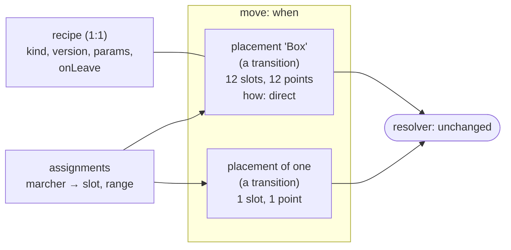
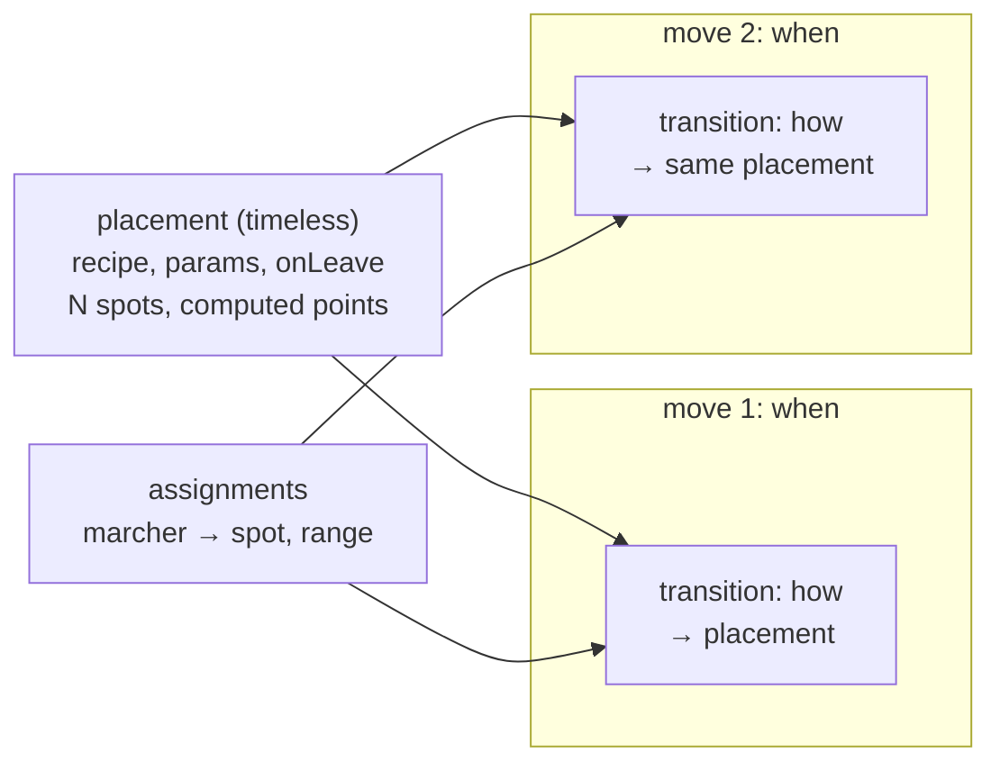

<!-- cspell:disable -->

# Placements as their own entity

> **Status (owner, 2026-10-30): P1 chosen.** The grilling answered questions 1, 2, 4, 5 and 6
> below. See [Decisions (owner, 2026-10-30)](README.md#decisions-owner-2026-10-30). Question 3 is
> still open.

This page reframes README open item 1 (where the recipe is keyed). Its "recommended" labels are
the research's suggestions for the grilling, not decisions. All its owner questions are open.

**What counts as the shape implementation.** Shapes and transitions are early. The reference
shape implementation is the **box editing branch** (`shapes/box-v1`, #181, and its stack #288 and
#363). The spec shapes, arcs and follow-the-leader code on `main` was never what the owner
intended (owner, 2026-10-26), so it is treated here as leftovers to remove, not as a design to
keep compatible with.

**The owner's direction (paraphrased):** the way marcher coordinates are stored today doesn't fit
the new structure, so shapes and marcher coordinates should become their own entity. A single
marcher is just a shape that places one marcher. Changing how data is stored is fine if it makes
sense.

**The model under study:**

- A **placement** is a formula (a recipe with its params), the marchers it places, and the points
  it computed.
- A dragged single marcher is a placement of one.
- The **move** (the block) is _when_.
- The **transition logic** is _how_ marchers get from their previous placement to this one.
- **Membership** (who fills which slot) and the **on-leave setting** live with the placement.

Code references are to fork `main` at `dc2b92c25`; app paths are relative to `apps/desktop/src/`.

## Findings

1. **A placement already exists in the schema. It's a transition.** A transition row owns N
   anonymous slots (`slot_count`) and one point per slot (`timeline_slot_destinations`).
   Assignments put marchers into those slots. That is a placement's points and membership,
   without the formula.
   - Every interactive edit already makes **placements of one**. Adding a marcher to a move gives
     it its own one-slot transition (UI-9; `createOwnTransitionsInTransaction`,
     `db-functions/timelineMembership.ts:163-180`), and Basic's point moves do the same
     (`db-functions/timelinePointMoves.ts:445`).
   - The converter writes **one shared placement per page**: one transition with a slot for every
     marcher whose spot changed (`timeline/convert/convertPagesInTransaction.ts:193-197`).

2. **What's missing is the formula, and the in-flight recipe tables duplicate the rest.** On
   `shapes/host`, `timeline_shape_recipe_marchers` stores `marcher_id`, `slot`, `x` and `y` for
   each member (`db-functions/shapeRecipes.ts:1-60`). That is a second copy of the assignment
   (marcher to slot) and of the slot's point. Because the recipe is keyed by the move
   (`timeline_id`), a box's members usually sit in as many transitions as there are members. The
   recipe ties them together from the side. Two copies can disagree, which is why ADR 0006 needed
   binary membership to keep them in step.

3. **So "placement as its own entity" mostly means one recipe per transition.** Give a transition
   an optional formula, have placing a shape put its members into **one** transition, and drop the
   duplicate member rows. The result is the owner's model on today's tables:
   - a placement of one is a one-slot transition, as now;
   - a converted page is a transition with no formula ("freeform");
   - a box is a transition with a formula, whose slots are the box's spots.

4. **It's close to the spec's original shapes, but not the same.** (That spec design is the model
   behind `main`'s leftover shape code, which isn't the intended implementation.) Spec §3 had shapes as their own
   timeless table, referenced by `dest_shape_id` and sampled by the resolver (R-13). UI-9 drifted
   away from that to one point per marcher. The placement model returns to "a group's _where_ is
   one thing", with three differences:
   - kinds are open (no fixed five);
   - points are computed when you edit, not when you play (decision 1);
   - a placement belongs to one move rather than being shared by several.

   Option P2 below is the closer variant, with placements timeless and shared.

5. **Membership already lives with the slots.** Assignments carry the slot, the range and the
   layer. A hole is a slot with a point and no assignment, which the spec already allows (D-13,
   "empty slots are valid"; `D-VACANT` is a diagnostic, hidden from users since eee5430a7). So
   binary membership and holes need no new storage.

6. **Positions stay resolved, never stored.** A placement's points are where the move _ends_ for
   each slot: the resolver's input (D-16), not positions over time. D-2 forbids storing sampled
   positions (`docs/timeline/spec.md:115`), not a move's ends.

7. **No export needs stored per-page coordinates.** They all sample the resolver (see
   [Exports](#exports)).

## The options

```text
 today (UI-9 + ADR 0006 recipe per move)        P1: placement = transition + its recipe

 move ─┬─ transition A (1 slot) ── point          move ─┬─ transition "Box" (12 slots) ── 12 points
       ├─ transition B (1 slot) ── point                │     └─ recipe: box, params, onLeave
       ├─ ... ×12                                       │     └─ assignments: who is in which slot
       └─ recipe (timeline_id)                          └─ transition "M7" (1 slot) ── point  (a placement of one)
            └─ 12 member rows: marcher, slot, x, y
               (a second copy of the assignments and points)
```

### P1: a placement is a transition with an optional recipe (recommended)



- **Storage.** One new app table, `timeline_placement_recipes`, keyed one-to-one by the
  transition (`transition_id INTEGER PRIMARY KEY REFERENCES timeline_transitions(id) ON DELETE
CASCADE`), with `kind`, `kind_version`, `params` (frame, pivot, distribution, `onLeave`, who goes
  where) and `created_at`. There is no member table: assignments are the membership, and slot
  destinations are the points. A transition without a recipe row is freeform.
- **The resolver reads exactly what it reads today.** Transitions with points, and assignments.
  `packages/core` is unchanged. The change log is unchanged, because the recipe table, like
  kept spots, has no change-log triggers and the resolver never reads it.
- **Placing a shape** writes one transition in the move, with a slot per spot and the computed
  points. It takes its members out of the transitions they had in that move (C-12 already allows
  only one per marcher per move). Editing it rewrites that transition's points and its recipe.
- **A member leaving** deletes its assignment. The recipe's `onLeave` decides the rest:
  - `hole`: the slot keeps its point and stays vacant;
  - `closeUp` or `resplit`: the recipe is evaluated again with the remaining count, and the
    points are rewritten.

  The leaver gets a placement of one where it was dropped.

- **Freeform placements** (converted pages, a group nudged together with no formula) behave
  exactly as today's shared transitions.

### P2: a placement is timeless and shared, and moves reference it



This is the spec's `timeline_shapes` + `dest_shape_id` with open kinds and stored points.

- **Pro:** one placement can be reused. A form held across several moves, or returned to later,
  is edited once.
- **Con:** an edit to a shared placement moves marchers in every move that uses it, which is the
  coupling decision 1 avoided. ADR 0006's "editing a box on a later page saves a copy on that
  page" (`07-placed-boxes.md`) says the owner chose copies over sharing.
- **Con:** the resolver needs a new input or a fan-out. Either `packages/core` learns a "points"
  shape (a spec and `ref/` change), or the change-log triggers emit a change for every transition
  that references an edited placement.
- **Con:** membership splits in two. Spots live on the placement, but ranges and layers live on
  each move's assignments.

### Compared with the decided model (Option A, recipe per move)

|                            | A: recipe per move (ADR 0006 today)                 | P1: placement = transition + recipe | P2: timeless shared placement              |
| -------------------------- | --------------------------------------------------- | ----------------------------------- | ------------------------------------------ |
| Where a box's points live  | one transition per member                           | one transition, a slot per spot     | the placement                              |
| Membership                 | assignments **and** recipe member rows (two copies) | assignments only                    | spots on the placement, ranges on moves    |
| A hole                     | a recipe member row removed                         | a vacant slot (D-13)                | a spot with no assignment                  |
| Recipe key                 | `timeline_id` (open item 1)                         | `transition_id`, one-to-one         | its own id                                 |
| Resolver, core, change log | unchanged                                           | unchanged                           | new input or a trigger fan-out             |
| Split, merge, cut          | must learn about recipes                            | carry the transition, as today      | must decide copy or share                  |
| Re-use across moves        | copy                                                | copy                                | shared                                     |
| Tables                     | 2 (recipes, members)                                | 1 (recipes)                         | 1 new, plus a schema change to transitions |

**Recommendation: P1.** It is the owner's model with one table and no resolver change. It also
removes the duplicate copy that ADR 0006 had to police. P2's sharing contradicts the copy-per-page
rule already chosen. Choosing P1 settles open item 1 as "`transition_id`, with placement gathering
the members", the option the first draft priced as more work. That work is the point here: it is
what makes the placement a real entity.

## Fit with ADR 0001

- **"Positions are resolved, never stored."** Under P1 a placement's points are **stored, authored
  facts**: the move's ends, exactly as slot destinations are today (D-16). The recipe is how they
  were made, not a second source. They are re-derived only by an edit (decision 1), never on open
  or play. Storing them also protects old shows from generator changes: spread generator 1 is
  versioned for exactly that (ADR 0006, 2026-10-22, item 4).
- **What the resolver reads:** under P1, nothing new. `TimelineSnapshot.transitions` keeps
  `points` and `assignments` keeps slots (ADR 0001 §4). `packages/core` stays unchanged, and
  ADR 0001 §4 needs no amendment. P2 would need one.
- **§2** gets the ownership amendment (draft updated), including the rule that a placed shape is
  one transition.

## What it does to each command (P1)

| Command                                                    | Today                                                                                         | Under P1                                                                                                                                                                                                                              |
| ---------------------------------------------------------- | --------------------------------------------------------------------------------------------- | ------------------------------------------------------------------------------------------------------------------------------------------------------------------------------------------------------------------------------------- |
| Split by marcher (`timelineSplitMoves.ts:185`)             | moves whole transitions, peels shared slots into one-slot ones; refuses shapes and FTL        | Whole placements move with their recipe. Taking part of a box out: the leavers move as freeform placements, and the box's `onLeave` applies to who stays. The shape refusal goes.                                                     |
| Merge (`timelineSplitMoves.ts:398`)                        | moves whole transitions; may refit counts                                                     | Unchanged: the placement (transition) carries its recipe.                                                                                                                                                                             |
| Split at playhead (`timelineSplitAtBeat.ts`)               | first half: a shapeless direct transition to positions at the cut; second half keeps the rest | Unchanged. The first half is a freeform placement; the second keeps the placement and its recipe, because it holds the points.                                                                                                        |
| Ripple, flag drags (`timelineRipple.ts`)                   | retimes moves, transitions and rows                                                           | Unchanged: placements have no counts of their own. `isPageMove`'s "shapeless" test (`:300-306`) reads "no `dest_shape_id`", which is still true.                                                                                      |
| Basic point moves (`timelinePointMoves.ts`, `basicSimple`) | works on "simple" moves: shapeless, direct, inside the box                                    | A Basic point move on a box member takes it out of the placement (binary membership): a placement of one, with the box's `onLeave`. "Simple" must mean "a placement of one or freeform", so a box isn't silently treated as freeform. |
| Holds op 1: cut in time                                    | as Split at playhead                                                                          | As Split at playhead.                                                                                                                                                                                                                 |
| Holds op 2: remove a marcher over [a, b)                   | missing for part of a move                                                                    | Cut at a and b, delete the marcher's assignment in the middle placement, then apply `onLeave` there (README open item 2).                                                                                                             |
| Undo                                                       | history triggers per table                                                                    | One new table in `tablesWithHistory`, key = rowid = transition id (C-2), cascade safe as for kept spots (C-1). Two fewer tables than ADR 0006.                                                                                        |
| Change log (`timeline_change_log`)                         | transitions, assignments, slot destinations                                                   | Unchanged. The recipe table isn't logged.                                                                                                                                                                                             |
| Converter (`convertPagesInTransaction.ts`)                 | one shared transition per page                                                                | Unchanged: each is a freeform placement. Page-era curved shapes stay points (C-8).                                                                                                                                                    |

## #181 and migration 0027

**Recommendation: don't merge #181 with 0027 as it is. Reshape 0027 on #181 into the placement
table first, then merge the stack (#181, then #288, then #363).**

- **What 0027 becomes.** Replace `timeline_shape_recipes` (keyed by `timeline_id`) and
  `timeline_shape_recipe_marchers` with one `timeline_placement_recipes` table keyed by
  `transition_id`. `shapeRecipes.ts` saves a placement as one transition plus its recipe row, and
  reads members from assignments and points from slot destinations. 0028 (`saved_shapes`) is
  unaffected.
- **Why before the merge, not after.** Once 0027 is on `main`, the nightly ships it to testers'
  files. Replacing it later means a migration that converts recipe rows into transitions. It also
  means pruning undo groups that name the dropped tables: the holds review found that old undo
  history hits "no such table" otherwise (holds `03-review.md`, storage M5). Before the merge, it
  costs only the branch work.
- **Use new table names and a fresh migration date.** `DrizzleMigrationService` applies every
  migration dated after the newest one a file has applied (`folderMillis`,
  `electron/database/services/DrizzleMigrationService.ts:89-110`). Lab builds of the shape
  branches already ran the old 0027 and 0028 (lab feedback #378, #379). A rewritten 0027 with a
  new date and new table names applies cleanly there, and leaves the old tables orphaned (empty
  in practice; a later `DROP TABLE IF EXISTS` can clean them). Reusing the old names would fail
  with "table already exists".
- **Format version 8** is unreleased, and nightlies and lab builds on `main` stop at 0026, so no
  file on `main`'s channel needs converting.
- **Sequence:**
  1. The owner confirms P1 (question 1 below).
  2. Reshape 0027, `shapeRecipes.ts` and their tests on `shapes/box-v1`.
  3. Merge it forward into `shapes/frame-editor` and `shapes/host`.
  4. Merge #181, #288 and #363 in order.

  If the owner wants box v1 in testers' hands sooner, merging #181 as-is is possible. The cost is
  the later conversion and undo pruning above, which this research advises against.

## Exports

**Nothing needs stored per-page coordinates.** Every exporter samples the resolver. Paths are
relative to `apps/desktop/`. The audit was done by a helper agent and spot-checked:
`acquireExportResolver`, `positionsAt` per page, the 0020 drop and the `MarcherPage` comment.

| Exporter                  | Where its positions come from                                                                                       |
| ------------------------- | ------------------------------------------------------------------------------------------------------------------- |
| Coordinate sheet PDF      | `readExportPositions` (`src/components/exporting/utils/exportPagePositions.ts:135-172`) → resolver at each page end |
| Drill chart SVG / PDF     | the same, then `utils/svg-generator.ts`                                                                             |
| Field video               | `ResolverFrameSampler(acquireExportResolver(db))` (`ExportCoordinatesModal.tsx:1403-1404`)                          |
| Launch-page SVG preview   | `sampleTimelinePagePositions` on the store resolver (`src/utilities/svgPreviewPositions.ts:18-33`)                  |
| Keyframe JSON (dev only)  | `buildKeyframes` → `resolver.positionAt` (`src/timeline/timelineKeyframes.ts:87`)                                   |
| Mobile app export (`.om`) | `sampleTimelinePagePositions` (`src/components/mobile/utilities/dots-to-om.ts:301-308`)                             |
| 3D View                   | `acquireExportResolver` (`src/view3d/positions.ts:120-125`); its sync channel sends only "rebuild"                  |
| Web build                 | exports the raw `.dots` file; no position code                                                                      |

- The shared path is `acquireExportResolver` (`src/timeline/timelineExport.ts:35-40`) and
  `sampleTimelinePagePositions`, which calls `positionsAt(pageEndBeat(page))` for each page
  (`src/timeline/timelinePagePositions.ts:56-82`). The per-page map is built for each export and
  thrown away.
- `MarcherPage` is now an in-memory shape only: "nothing is stored per marcher per page any more"
  (`src/global/classes/MarcherPage.ts`).
- Migration `0020_drop_page_era` drops `marcher_pages` (`electron/database/migrations/0020_drop_page_era.sql:5`),
  as the ADR 0001 amendment of 2026-10-12 says.
- The only runtime reads of `marcher_pages` are for unconverted version-7 files:
  - the previous-show import reads it as a source (`electron/main/services/previous-dots-import-service.ts:123-149`);
  - repair (`electron/database/repair.ts:279-290`);
  - the conversion gate's "does it exist" check (`electron/database/convertOnOpenGate.ts:172-175`).
- No exporter reads `timeline_slot_destinations` directly. It is resolver input only
  (`src/timeline/timelineRows.ts:241`).

So placements can change storage freely: exports follow the resolver, and the resolver's input
doesn't change under P1.

## Migration path from today's per-marcher transitions

- **Files on `main`'s channel (nightly, lab): nothing to migrate.** Their per-marcher one-slot
  transitions are already placements of one. Their converted page transitions are freeform
  placements. No recipe exists there, because 0027 never shipped on `main`.
- **Files from shape-branch lab builds:** their recipe rows would be orphaned by the new table
  names. Their boxes play exactly as before, because the points are in the transitions, but they
  can't be reopened as boxes. Recommend accepting that for lab files rather than writing a
  converter, unless the owner wants one (question 6).
- **New behaviour comes in per edit.** Placing or editing a shape gathers its members into one
  transition. Old moves are never restructured on open.

## Owner questions (open, for the grilling)

_Answered 2026-10-30 except question 3: see the README's decisions 6–13._

1. **Is a placement a transition with an optional recipe (P1), or a timeless shared entity that
   moves reference (P2)?** Recommend P1. It keeps the copy-per-page rule and needs no resolver
   change.
2. **Reshape migration 0027 on #181 into the placement table before #181 merges?** Recommend yes,
   with new table names and a fresh migration date.
3. **Where does the transition logic (_how_) live: on each placement, as `path_style` does today,
   or once per move?** Today it's per transition, so per placement. "How marchers get from their
   previous placement to this one" reads as per placement, and a move could still set it for all
   of its placements at once.
4. **When some members of a box are split into another move, do they keep the form there (a copy
   of the recipe with holes), or become freeform?** Recommend freeform, with the box's `onLeave`
   applying to who stays. It's the same rule as dragging members out.
5. **Should the UI and docs call it a "placement"?** The schema keeps the name `transition`, so
   `ref/` and the core API don't change.
6. **Lab files from the shape branches:** accept that their boxes reopen as plain positions, or
   write a converter from the old recipe tables?
