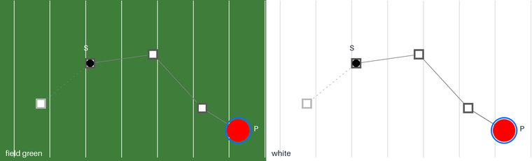
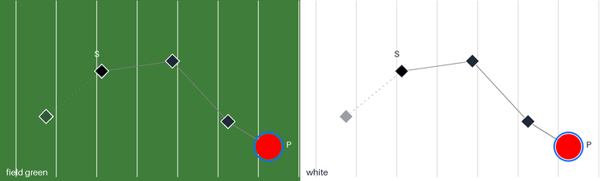
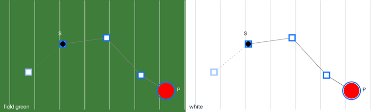

# Route square look (research, #479)

Fork PR #483 adds **route squares**: when marchers are selected and the start flag route is drawn (S → P), each selected marcher gets a square at every count where its coordinate is _set_, meaning the end of one of its own moves, or home at count 0. Behind S, the move it arrived by is drawn dotted and lighter, with lighter squares. Today the squares are a gray outline (`#595959`) with a white inside, 4.5 field units across, drawn over step-size warnings and under the start-flag dots (`apps/desktop/src/field/startFlagOverlay.ts`, `ROUTE_*`, `outlinedSquare`, `routeTail`).

On 2026-10-29 the owner said: "Plain gray for now; the squares' look needs research." This page is that research. Citations, each tagged by confidence, are in [prior-art.md](prior-art.md). Only DAWs, NLEs, animation, motion-graphics, 3D and lighting tools are used, with no drill-design tools.

## Findings

1. **A defined point is a bigger, separate glyph. An in-between point is small or not drawn.** After Effects draws a box at each keyframe and a dot per frame. Blender draws a "big yellow square dot" for each keyframe over small frame dots. Maya draws a square per key and a plus sign per frame. Houdini draws spheres for keys and ticks for frames. Unreal draws keys and smaller marks. OpenMarch already draws nothing between set counts, which is the simplest version of this.
2. **The square is the common shape, not a rule.** After Effects, Blender, Maya and grandMA3 use squares or rectangles. Houdini uses spheres.
3. **The path glyph doesn't have to match the timeline glyph.** Blender's Dope Sheet draws keys as diamonds (and other shapes by handle type) while its motion path draws keys as square dots. So a field square next to timeline diamonds is normal practice.
4. **Keys usually get their own color, set apart from the path.** Blender uses the theme's _selected vertex_ color (yellow or orange). Maya and Unreal each have a Key color and a separate Selected Key color. grandMA3 colors a point by where its value came from (cyan for a preset, yellow for a hard value). None of the tools I read uses the object's own color for keys by default.
5. **Selection is a further state.** Maya and Unreal recolor a selected key. grandMA3 draws a yellow ring around a selected point. Route squares can't be selected yet, so this is only for later.
6. **The current time has its own mark, and it wins over keyframes.** Blender draws the current frame as the biggest dot, in its own color, on top of keyframes. Unreal has `CurrentFrameMarkColor`. In OpenMarch the marcher itself already sits at P, and the start-flag dot sits at S.
7. **Numbers are opt-in or gone.** Blender's Keyframe Numbers and Frame Numbers are toggles. Maya's key numbers _replace_ the squares. Unreal deprecated its trail frame-number option in 5.6. No tool I read shows numbers by default.
8. **Past and future are styled differently, but not always as fainter past.** Blender: red past, green future. Maya: two colors, Pre/Post frame limits, optional fade. Unreal: `TimePreColor` and `TimePostColor` plus frame limits. Houdini makes the past _bright_ and the future shaded. So a different look for the part behind S is well supported, and fading it is one of several precedents (Maya's fade), not the only one.
9. **Holds get no special glyph.** After Effects hold keyframes simply have no dots after them. Blender's motion path skips repeated frame numbers when points coincide, so a hold shows one label. Blender's Dope Sheet, a timeline, draws a held key as a gray bar between keys. On a path, a hold is one point. On a timeline, it's a bar.
10. **Contrast.** The field is white by default and can be themed (field green is common). Contrast ratios, from `gen.py`:

    | Color                    | On white | On field green `#3f7d3a` |
    | ------------------------ | -------- | ------------------------ |
    | Neutral gray `#595959`   | 7.0:1    | 1.4:1                    |
    | Ink `#1f2937`            | 14.7:1   | 2.9:1                    |
    | Selection blue `#0d6efd` | 4.5:1    | 1.1:1                    |
    | Path gray `#808080`      | 3.9:1    | 1.3:1                    |

    On green, no outline color works on its own. It's the **white core** of a hollow square that carries it there (white on that green is about 5:1). Any option should keep a white core or white rim.

## Options

All mockups show the same route: the move it arrived by, dotted, behind S. Then S, a set spot that also holds, another set spot, and the selected marcher partway into its next move at P. Each is shown on field green (left) and white (right). They are drawn by [gen.py](gen.py) (`uv run --with pillow python gen.py`).

### A. Neutral hollow square (today)

A dark gray outline with a white core. The tail squares are light gray.

- **For:** matches the gray route line and reads as "part of the path". It's quiet with many marchers selected. It's what the owner asked for "for now" and costs nothing. It has the highest contrast on white of the square options.
- **Against:** on a themed field, the gray outline almost vanishes and only the white core remains. Nothing ties the squares to the selection. Every tool read gives keys a color of their own, apart from the path.

### B. Timeline diamond (match the timeline)

A filled ink diamond with a white rim, the same glyph and color as the timeline's filled keyframe diamond (`TimelineKeyframes.tsx`: `rotate-45`, `bg-text`).

- **For:** one glyph means "keyframe" in both places. Filled ink reads well on white and best of the three on green.
- **Against:** the black start-flag dot disappears on a filled dark diamond at S (see the mockup). It would need a hollow diamond, which loses the "filled = all set" meaning the timeline gives its diamonds. No tool read matches its path glyph to its timeline glyph (Blender deliberately doesn't). A diamond also looks like a rotated marcher shape or a drill symbol on a busy field. Heavier ink competes with the marchers.

### C. Selection-blue hollow square (recommended)

Today's square and sizes, with the outline in the field's selection blue (`#0d6efd`, `SELECTION_COLOR` in `selectionRing.ts`) and a white core. The tail squares use the same blue lightened (55% toward white), with today's dotted, lighter tail line.

- **For:** route squares only exist for selected marchers, and blue already means "selected" on the field (the selection ring), so the squares read as "this marcher's set spots". It follows the most common precedent (Blender, Maya, Unreal): keys in their own color, apart from the path. It's distinct from the gray path, the red step-size warnings, the black start-flag dots and the default red marchers. The white core keeps it visible on green, and the hollow centre keeps the S dot visible.
- **Against:** blue outline on green is low in luminance contrast (1.1:1) and relies on hue plus the white core. With many marchers selected there are many blue squares, which is louder than gray. If squares later become selectable, "selected square" needs another cue (Maya and Unreal use a color; grandMA3 uses a ring). A solid blue fill would fit that.

## Recommendation

**Option C.** Keep the hollow square, its 4.5-unit size and its white core, and change only the outline to the selection blue, with a lightened blue on the tail. Keep the dotted, lighter tail: past and future styled differently is supported by Blender, Maya, Unreal and Houdini, and fading the past matches Maya's fade. Keep squares distinct from the timeline's diamonds, as Blender does. Show no counts by default. If counts are wanted, show them on hover, reusing the timeline diamond's tooltip text ("Keyframe · Page 2, count 8"), since tools make numbers opt-in or have dropped them. Give a hold no extra glyph: one square at the spot, with the tooltip saying how long it holds.

If the owner prefers to stay neutral, Option A is fine on the default white field. Its only real weakness is themed fields, and the white core already covers most of that.

## Owner questions

1. **Color:** selection blue (C), neutral gray (A) or timeline ink (B)?
2. **Tail:** keep it a lighter shade of the same color (recommended), or make it neutral gray whatever the route color is?
3. **Labels:** none by default plus a hover tooltip with the count (recommended), always-on counts, or none at all? Hover needs hit-testing on the overlay, which it doesn't have today.
4. **Hover state:** should a hovered square grow like the timeline diamond does (`scale-125`)?
5. **Holds:** is one square at a held spot enough, or should a hold show its length on the field (for example "8–16" on hover)?
6. **At P:** when P lands exactly on a set count, should that square change (fill it, as Blender gives the current frame its own mark), or is the marcher sitting on it enough?
7. **Later, editable squares:** if squares become draggable, should a selected square be solid blue (fill as the cue) or get a ring (grandMA3's cue)?
