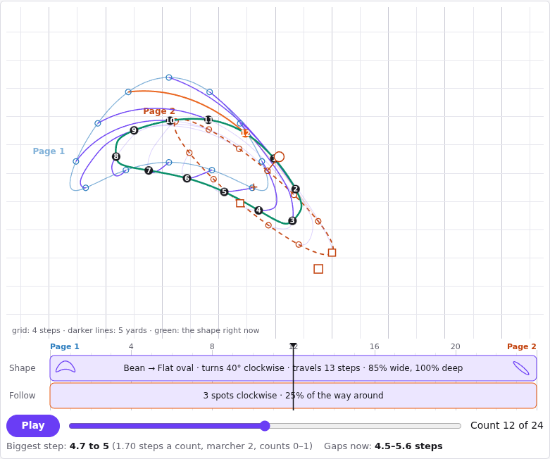
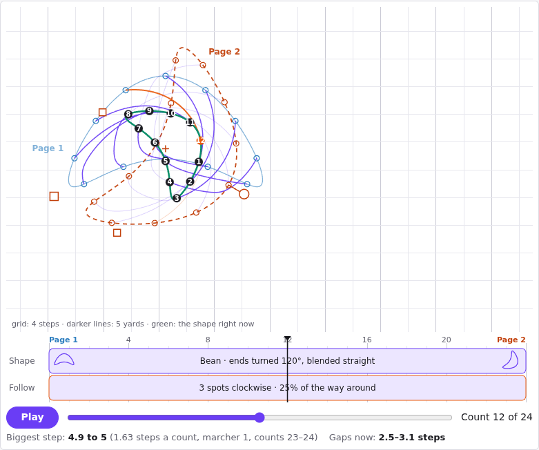
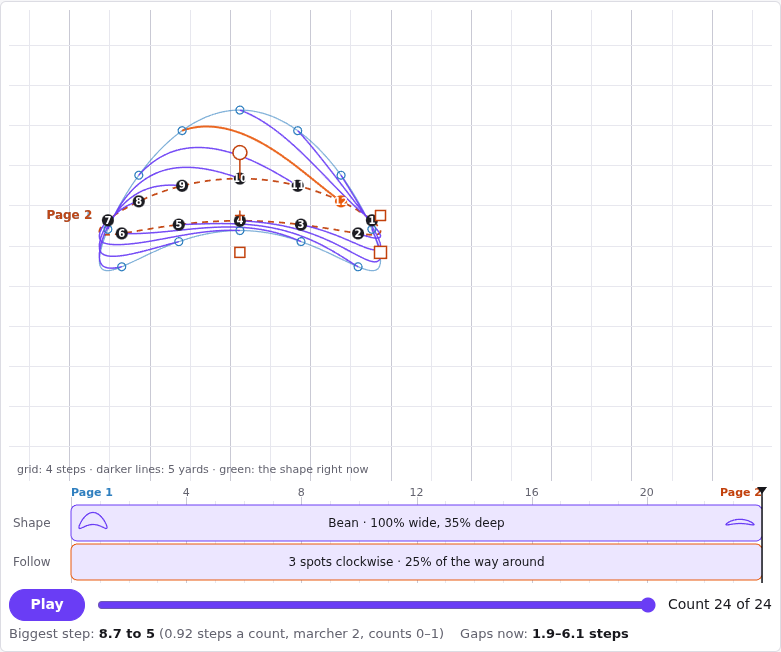
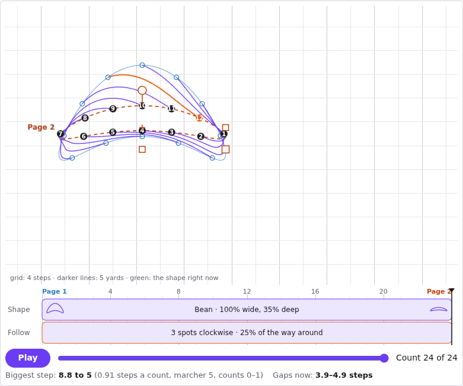
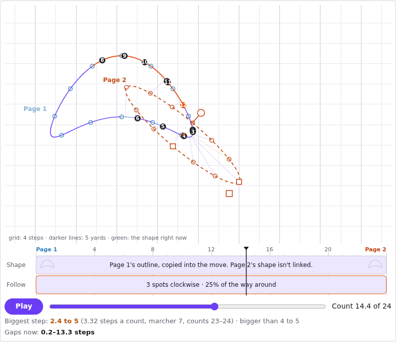

# A shape that changes while marchers follow around it

Status: proposed, 2026-11-24. Design and a throwaway prototype only. No app code, nothing built,
nothing decided. For fork issues #1174, #355, #1208 and #434.

Code references are to `pathways/host-10` at `9e455d0f2`. Paths are under `apps/desktop/src/`
unless they start with `packages/` or `docs/`.

## What wasn't checked

Read this first: it limits everything below.

- **The prototype is a browser sketch, not the resolver.** It draws outlines as 720 sampled points
  and has its own copy of the follow rule. It shows how the motion looks and that the maths agree
  with each other. It doesn't show that the app can do it.
- **The new resolver rule isn't written.** "Old files play bit for bit" rests on the rule being
  switched off when a move has no changing shape, not on a test.
- **It builds on a proposal.** "A shape is a formation at a count" (the ADR 0006 revision of
  2026-11-22, branch `adr/0006-shape-at-count`, fork #1151) isn't accepted yet. If it changes,
  the linking part of this design changes with it.
- **Nobody has tried it.** The owner hasn't played with the prototype yet, and there was no lab
  test.
- **Export sizes are estimates,** worked out by hand.
- **Precedents:** the After Effects and Blender behaviors were checked against the pages linked
  under [Precedents](#precedents) on 2026-11-24. The Logic Pro one is from memory.
- **Not prototyped:** marchers standing off the outline, joiners and leavers, splitting the move
  at a count, and what the timeline looks like in the real app.

## The answer

**Can a shape change while marchers follow around it, as two separate things? Not today. The
model is one stored fact and one resolver rule away from it, and the two things are already
separate inside the resolver.**

Today (spec R-13‴; `computeAroundEntry` in `packages/core/src/timeline/resolver.ts`):

- A follow move around an outline stores **its own copy of the outline**, as a closed route in
  field coordinates, and its end spots as loose placed spots (DO-8, DO-9).
- Each marcher gets a start distance and an end distance around that one outline. Its position is
  `outline(distance)`.
- Nothing points back to the shape. Editing the shape later doesn't reach the move, and the
  outline's points can't be edited (AP-T15). This is what the owner called weird.

So the follow's timing (how far around) and the outline (where "around" is) are already two
separate inputs. What's missing:

1. **The outline at the other end.** The move stores the outline once. It needs the outline at
   its start and at its end.
2. **A rule that blends them.** The resolver walks a fixed outline. It needs to walk one that
   changes.
3. **A link to the shape.** The app needs to know which shape a move goes around, so an edit to
   the shape rewrites the move.

### Recommendation

1. **The move stores the outline at both ends, plus how far the shape turns between them.** The
   resolver blends the outline and walks each marcher a steadily growing share of the way around
   it. With the same outline at both ends nothing new is stored, and the move plays through
   today's code.
2. **The shapes at the two counts drive the two outlines.** A shape is a formation at a count
   (ADR 0006 revision). The move goes from the shape at its start count to the shape at its end
   count. Editing either shape rewrites the move's outlines and end spots, in one undo step. The
   resolver still never reads shapes (ADR 0016 §1).
3. **Turn, move, resize and reshape are one stored thing,** not four features. Bean to turned
   bean, bean to flat oval and bean to box all use the same rule.
4. **Build the link first.** "Edit the shape, the move follows" (#1208) needs no resolver change
   and no new file version. The changing shape (#1174, #355) comes second.

### Try it

The prototype is one HTML page: [demo/shape-over-time.html](demo/shape-over-time.html). Open it in
a browser. It also works on a phone.

- Drag the page 2 shape, turn it with the round knob, stretch it with the squares, or pick another
  outline. Press Play.
- "How the two combine" switches between the proposed rule and three others, described below.
- The Shape and Follow rows under the field are the two layers.



_Halfway through a 24-count move. Blue is the shape on page 1, dashed orange is page 2, green is
the shape right now. The orange trail is the leader's._

## Findings from the prototype

Numbers are from the prototype's own checks (`tools/check.mjs` and `tools/numbers.mjs` beside the
prototype's working copy in `/mnt/ssd/om-shape-over-time/`), run in Chromium on the GPU.

1. **With no change to the shape, it is today's move.** Twelve marchers, 0 to 17 spots, both ways
   around: the proposed rule and today's rule agree within 10⁻¹³ of a step at every sample.
2. **Turn, resize and move need no rule of their own.** When page 2's shape is page 1's shape
   turned 135°, grown 40% and moved, the proposed rule gives the same motion as "carry the outline
   rigidly" within 10⁻¹² of a step. Rigid motion is a special case of the blend.
3. **A straight blend isn't enough.** If every point of the outline goes straight to its match,
   nothing turns. A shape turned 120° shrinks to half its size in the middle of the move, and one
   turned 180° shrinks to a point. So the turn has to be stored and blended as an angle.

   

4. **Rigid-only can't flatten into a new outline, and it spaces a stretch badly.** A bean squeezed
   to 35% of its depth:
   - carried rigidly, neighbors end 1.9 to 6.1 steps apart (bunched at the ends of the bean);
   - with page 2's spots dealt along page 2's own outline, they end 3.9 to 5.0 steps apart.

   The two differ by up to 2 steps along the way. The proposed rule can do either, because it
   reads each marcher's end spot (see [End spots](#how-end-spots-are-derived)).

   | Carried rigidly                                                                                      | Spots dealt on page 2's outline                                                                                   |
   | ---------------------------------------------------------------------------------------------------- | ----------------------------------------------------------------------------------------------------------------- |
   |  |  |

5. **Today's behavior is clearly wrong once page 2 has a different shape.** The move goes around
   the old bean, then cuts straight to the new spots (DO-8). At count 14 of 24 in the opening
   example, neighbors are 0.2 to 13 steps apart (4.1 to 5.5 under the proposed rule), and the
   biggest step is 3.3 steps a count (1.7 under the proposed rule).

   

6. **Gaps between the pages are close to even, not exactly even.** In the opening example
   marchers are evenly spread along the outline on both pages. In between, a marcher is at most
   0.31 steps from where exactly even spacing would put it. Keeping it exact means measuring the
   blended outline again at every moment (the prototype's "Keep gaps even on every count").
7. **On a circle, turning the shape and walking around it are the same motion.** A quarter turn
   with nobody walking, and three of twelve spots around with no turn, agree within 10⁻⁴ of a
   step. On a bean they are clearly different. Both are needed, and a circle is the one shape
   where the designer can't tell which they asked for.
8. **Step size adds up.** Travel, turn, reshape and the walk around all add to a marcher's step.
   The opening example needs 24 counts to stay near a 5-to-5 step. The general step-size warning
   covers this (owner, 2026-11-22, #1174). Marchers on the inside of a turn can briefly walk
   backward.

## The model

Two layers, kept apart:

| Layer               | What it says                                                                 | Where it lives                                                                        |
| ------------------- | ---------------------------------------------------------------------------- | ------------------------------------------------------------------------------------- |
| **Shape over time** | The outline at the move's start and at its end, and how far it turns between | The shapes at the two counts (app data), copied into the move's route (resolver data) |
| **Follow**          | Who is in the line, in what order, who leads, which way, how far around      | As today: slot order, `path_params` (`ends`, `laps`, `reverse`), placed end spots     |

A marcher's position at share `p` of the move (0 at the start, 1 at the end):

```
outline(p, u) = center(p) + turn(p) · [ (1 − p) · a(u) + p · b(u) ]
position      = outline(p, u_q(p))
u_q(p)        = start_q + (end_q − start_q) · p
```

- `u` is a **share of the way around** the outline, from its start point: 0 to 1, and past 1 for
  more than once around.
- `a(u)` is the start outline's point at share `u`, measured from the start shape's center.
  `b(u)` is the end outline's point at share `u`, measured from the end shape's center, with the
  whole turn taken back out.
- `center(p)` goes straight from the start shape's center to the end shape's. `turn(p)` turns by
  the stored angle times `p`.
- `start_q` is where marcher `q` stands on the start outline. `end_q` is where its end spot is on
  the end outline, plus whole times around. These are R-13‴'s `s_q` and `e_q`, each divided by
  its outline's length.

What follows from it:

- **The same outline at both ends, no turn:** `outline(p, u)` is that outline, and the rule is
  today's.
- **Gaps grow with the shape** (owner, 2026-11-22), because a spot is a share of the way around,
  not a number of steps.
- **Each marcher has its own start and end share,** read from where it stands. So uneven spacing,
  a gap in the line and a line that only fills part of the outline all carry through, as they do
  today.
- **Only two point lookups per position,** one on each outline, both exact (lines and arcs). The
  resolver samples nothing and builds no table per moment.
- **The same rule covers a shape with nobody walking** (#355: a block turning, a circle growing).
  Then `u_q` doesn't change, and each marcher keeps its spot in the form.

## Options and trade-offs

### 1. What drives the outline over time

| Option                                            | What it is                                                                             | For                                                                                                                                          | Against                                                                                                  |
| ------------------------------------------------- | -------------------------------------------------------------------------------------- | -------------------------------------------------------------------------------------------------------------------------------------------- | -------------------------------------------------------------------------------------------------------- |
| **A. A free transform on the move**               | The move stores a frame (center, turn, size) at its start and end. No shape is needed. | Works on any trail, including a drawn snake. Smallest change. This is the #1174 feasibility note's model.                                    | Can't reshape (bean to flat oval). A second place to edit the same thing. Doesn't give #1208 on its own. |
| **B. The shapes at the two counts** (recommended) | The move goes from the shape at its start count to the shape at its end count.         | One thing to learn: go to the page and edit the shape. Covers #1208, #1174 and #355's follow case. Fits "a shape is a formation at a count". | Needs the ADR 0006 revision first. Does nothing for a drawn trail with no shape.                         |
| **C. Both**                                       | B where there is a shape, A elsewhere.                                                 | Covers everything.                                                                                                                           | Two ways to do one thing, and two UIs.                                                                   |

**Recommended: B now, with storage that doesn't care who wrote it.** The route stores "outline at
the start, outline at the end, turn". Whether a shape or a free transform wrote those is the app's
business. So A can be added later for drawn trails with no file format change.

### 2. Rigid transform or outline-to-outline morph

| Option                                                          | Result                                                                       |
| --------------------------------------------------------------- | ---------------------------------------------------------------------------- |
| Rigid transform only                                            | Can't reshape. Uneven gaps under a stretch (finding 4).                      |
| Straight blend of matching points                               | Pinches when the shape turns (finding 3).                                    |
| **Blend in the shape's own frame, turn by angle** (recommended) | Rigid changes come out exactly rigid (finding 2). Reshaping works. One rule. |

**How points correspond:** by share of the way around, from each outline's **start point**, walking
the same way.

- For the same kind of shape at both ends, the start point is the same point of the shape. It
  turns with the shape. Today a fitted outline starts "from its top, as the field is shown"
  (DO-2). That can't be used here: turn a bean a quarter turn and its top is a different point,
  so the marchers would slide a quarter of the way around for free. The route stores the end
  outline starting at the matching point, and stores the turn.
- For two different kinds (bean to box), each kind's own start point is used. If the morph twists,
  the designer moves the start point of page 2's outline. The prototype's Twist slider does this.
  It changes only the way there: the page 2 spots stay put. No extra field is stored, because the
  start point is where the stored outline begins.
- Pinning several matching points by hand is possible later (the rule would blend between pinned
  pairs). It isn't proposed.

**Even gaps between the pages.** The rule above keeps gaps even at both ends and close to even
between (finding 6). Exactly even needs the blended outline measured again for every position: no
exact lookups, a table per moment, and more to keep identical between the resolver and the
reference oracle. Recommended: don't, unless the owner sees the difference in the prototype and
minds it.

### 3. Where each layer is stored

**Shape over time, resolver side.** On the closed route's geometry JSON, beside `closed`:

```json
{
  "v": 1,
  "from": [0, 0],
  "to": [0, 0],
  "points": [],
  "closed": true,
  "change": {
    "from": [0, 0],
    "points": [],
    "toBulge": 0,
    "pivot": [0, 0],
    "pivotTo": [0, 0],
    "turn": 0
  }
}
```

- `change.from`, `points` and `toBulge` are the outline at the move's end, with the same rules as
  the outline at its start (I-R1: corners and arc legs).
- `pivot` and `pivotTo` are the shape's center at each end. `turn` is in radians, signed, and may
  be more than a full turn.
- No `change` means today's move.

| Option                                          | For                                                                                                                                               | Against                                                                                                            |
| ----------------------------------------------- | ------------------------------------------------------------------------------------------------------------------------------------------------- | ------------------------------------------------------------------------------------------------------------------ |
| **In the route's JSON** (recommended)           | No migration and no table rebuild. Arc legs (`bulge`) and closed outlines (`closed`) were added this way. One route is still one walked geometry. | Checked by the validator, not by the database.                                                                     |
| A second route row and an `end_route_id` column | A foreign key.                                                                                                                                    | Rebuilds `timeline_transitions` again (as 0022 and 0024 did). A migration is the one place v0.1.7 files can break. |
| A frame only (`center`, `turn`, `size` keys)    | Smallest.                                                                                                                                         | Can't reshape.                                                                                                     |

**Shape over time, app side (the link).** `timeline_route_sources` already exists (migration 0028)
and its `kind` check already allows `recipe`, reserved for this (pathways research O-13). It is
app data: the resolver never reads it, and it has history triggers. One row per linked move:

```json
{ "start": 12, "end": 15, "spots": 3 }
```

- `start` and `end` are recipe ids. No `end` means the end is the start shape, carried.
- No schema change. A build without the link plays the file the same, so the link needs no file
  version.

**Follow.** Unchanged. End spots stay ordinary placed spots (DL-9), written by the app.

### 4. Resolver changes

- **One new rule** beside R-13‴, used only when the route has `change`. Without it, today's code
  runs untouched, so every existing file resolves as before. The parity script (base against
  branch, every marcher at every 1/16 beat) proves it.
- **Ends are exact,** as today: at the start the marcher is at its origin, at the end on its spot
  (spec §8.10).
- **A marcher off the outline** at either end keeps its offset from its place, fading from the
  start offset to the end offset over the move. Today's rule (walk straight on, around, straight
  off) doesn't work when the outline is moving. This is a proposal for the spec step, not tested.
- **Validator:** `change` only on a closed route; its outline follows I-R1; `turn` is a finite
  number within a limit (owner question 4).
- **Caches:** `ftlEntry[T]` gains the end outline's length table. A route change already marks its
  transitions dirty (R-9′).
- **Everything that reads positions gets it free** (ADR 0016 §2): playback, 3D View, collisions,
  coordinate sheets, Big steps.
- **The reference oracle** in `docs/timeline/ref/` gains the same rule, written apart from core.

### 5. Editing the shape after a Follow

Today the outline's points are refused (AP-T15) and the shape is no longer part of the move.
Proposed: the shape stays a shape at both ends, and an edit goes to the page the playhead is on.

| The designer does                                                        | What happens                                                                                                                                                                                                                                     |
| ------------------------------------------------------------------------ | ------------------------------------------------------------------------------------------------------------------------------------------------------------------------------------------------------------------------------------------------ |
| Follow around a placed shape                                             | The move is linked to it. On the end page the shape is shown **carried**: the same shape, everyone N spots on.                                                                                                                                   |
| Edits the shape on the **start** page (move, turn, resize, another kind) | The move's outline and end spots are rewritten to match. It still goes N spots around, now around the new shape. One undo step. This is #1208.                                                                                                   |
| Edits the carried shape on the **end** page                              | The end page gets its own formation (the ADR 0006 revision's later-count copy). The move's end outline, turn and end spots are rewritten. The start doesn't move. **The shape now changes during the move.** This is #1174 and the owner's bean. |
| Edits the start page again after that                                    | Only the start changes. The end page keeps its own shape.                                                                                                                                                                                        |
| "Make page 2 match page 1"                                               | The end page's own formation is dropped, and the shape is carried again.                                                                                                                                                                         |
| Changes how far, which way or who leads (Follow again)                   | The follow layer changes. End spots are dealt again on the end shape. The shapes don't change.                                                                                                                                                   |
| Drags one marcher off its spot on the end page                           | That marcher leaves the shape, with the left-box toast. In the move it travels with the line and drifts off to its spot. The others stay linked.                                                                                                 |
| Deletes or ungroups a shape at either end                                | The move keeps the outline it has and plays the same, unlinked.                                                                                                                                                                                  |
| Remove trail                                                             | Everyone walks straight to the same spots, as today.                                                                                                                                                                                             |

So both of the owner's readings ("the original shape gets changed" and "the shape gradually
changes") exist. Which one happens depends on which page the edit is made on. Everything else on
the timeline works that way: an edit at a count belongs to that count.

**How the edit reaches the move.** The resolver never reads shapes, so the app copies. After a
shape edit, in the same transaction and undo step and never during undo or redo replay (as the
Held marks' upkeep runs):

1. find the follow moves linked to the edited shape (`timeline_route_sources`);
2. rebuild each move's start and end outline from its shapes (`kind.outline`, then `loopAlong` in
   `db-functions/closedOutline.ts`, which already turns a shape's outline into corners and arcs);
3. write `change` when the two outlines differ or the shape turned, and remove it when they don't;
4. deal the end spots again (`planGoRound` in `db-functions/timelineTrailAround.ts`) and write
   them through the canvas's range writer.

**What this asks of the ADR 0006 revision** (to settle in that thread, not here):

- A shape counts as carried through a follow move linked to it, though its members stand on each
  other's spots.
- Every closed kind gives its outline with a start point and a direction that turn with the shape.
- A shape's turn between two counts can be more than a full turn. Two formations can't say that,
  so the turn is the move's fact. It is set by the turn handle on the end page and stored in
  `change.turn`.

### How end spots are derived

- The end shape deals its own spots, as it does on any page. The line keeps its order, and each
  marcher takes the spot of the marcher N ahead of it (DO-5, by spots).
- The spots are written as ordinary placed spots. The resolver reads each marcher's end share
  back from its spot, as R-13‴ reads `e_q` today. So the rule doesn't decide how spots are spaced.
  A shape that deals even spots gives even spots. A stretch that squeezes them gives squeezed
  spots.
- "By steps" (DO-4) means "that many steps, measured on the start page's outline" when the shape
  changes length.

### 6. Joiners and leavers

Today's rules carry over, because the outline is defined at every moment:

- **A joiner** (someone who takes over partway, #654) walks straight from where it is to its spot
  (R-11), as today. Merging onto the moving outline is later work.
- **A leaver** (split by marchers, AP-T6) leaves a gap. The gap travels with the shape as a share
  of the way around.
- **A vacant spot** keeps its place around the outline.
- **Split at a count** stays refused (AP-T5). It would need the shape halfway through as a
  formation of its own, and a blend of a bean and a box isn't a shape kind. It could be allowed
  later when both ends are the same kind.

### 7. Exports (ADR 0018)

- A walk around a changing outline is not a line, an arc or a cubic. It becomes **points within
  1/100 of a step**. ADR 0018 §2 already does this for Adjust and handoffs on curves. This is a
  third case.
- A move with no `change` exports exact arcs and lines, as today.
- Size, estimated: staying within 1/100 of a step on a curve of 10 steps' radius needs a point
  about every 0.9 steps. A 20-step walk is about 22 points per marcher per move. Step 2's
  converter test measures the real number.
- **Bake path** gives each marcher a fixed path and drops the link and the shape layer, one way,
  as for any baked move.

### 8. File version and v0.1.7 files

- **`change` needs the next free file version,** written with a file's first changing shape and
  never lowered (ADR 0017 §9). A build that doesn't know it would walk the start outline and cut
  straight to the spots, so it must refuse the file.
- **The link needs no version** (see storage above).
- **No migration.** Nothing is added to the schema: the route JSON grows and the link table
  exists. v0.1.7 files have no routes and no shapes, convert as they do today, and are not
  touched. The prerequisite (the ADR 0006 revision's migration) carries its own risk and tests.
- **Numbers to fix when these land.** On `pathways/host-10`, file versions go up to 17, with 15 and
  16 reserved by open pull requests (`electron/database/fileVersion.ts`), and migrations go up to 0028. The ADR 0006 revision's draft names file version 15 and migration 0029 from an older
  base, so its numbers need another look.

### 9. Basic and Expert

- **Basic:** go to the page, select the shape, and move, turn, resize or swap it with the shape
  editor that is already there. Nothing new to learn, and no new panel. The Follow bar's line
  says what is going on: "Following around Bean → Flat oval · 3 spots · turns 40°".
- **Expert:** the same, plus the shape marks at the two counts that the ADR 0006 revision
  proposes. The move's clip shows a small "shape changes" glyph when its two ends differ. No new
  lane and no curves editor (#355: "no per-parameter animation curves or graph editor").
- The prototype's Shape and Follow rows explain the model. They are not a proposed timeline.

### 10. On the field and the timeline

- **On the end page, with the shape selected:** the shape's usual frame and handles. While
  dragging, the move's trails redraw live and the start page's shape shows as a ghost. This is the
  prototype's feel.
- **The turn handle counts turns:** dragging it around twice is two turns, and the bar says "turns
  720°". Shift snaps to 15°. The shortest way is the default.
- **Scrubbing the move** shows the shape as it is at that count, as a ghost outline.
- **Start point:** a small marker on the end outline, shown while the shape is selected and the
  two ends are different kinds. Dragging it is the prototype's Twist.
- **Commands** (every feature is a command): "Make shape match previous page", "Unlink Follow from
  shape", "Set shape start point". Each is in the palette and is one undo step.
- **Touch:** the shape editor's handles are already reachable by finger. Nothing here needs hover,
  right-click or a modifier key.
- **Greyed-out controls say why.** For example, Split at playhead on such a move says "This move
  goes around a shape that changes. Split isn't supported yet."

## Precedents

No single tool does this. Each of these does one layer and keeps it apart from the others.

- **After Effects shape layers.** A shape group has a Path, a Transform and, optionally, Trim
  Paths. Each is its own property with its own keyframes.
  - Trim Paths' Start, End and Offset are animated to move a visible stretch along the path
    ([Adobe: shape attributes](https://helpx.adobe.com/after-effects/using/shape-attributes-paint-operations-path.html)).
    That is the follow layer.
  - A keyframed Path morphs from one shape's first vertex to the next shape's first vertex. A
    twisted morph is fixed with Set First Vertex
    ([ProVideo Coalition: Set First Vertex](https://www.provideocoalition.com/after-effects-hidden-gems-set-first-vertex/)).
    That is the start point and Twist.
  - Rotation is a number that blends as a number, so a shape turns instead of pinching. That is
    why `turn` is stored.
- **Blender.** The Follow Path constraint with Fixed Position on places an object by an Offset
  Factor, where 0 is the curve's start and 1 its end, whatever shape the curve has
  ([Blender manual: Follow Path](https://docs.blender.org/manual/en/latest/animation/constraints/relationship/follow_path.html)).
  The curve can be moved, turned and reshaped separately. That is "a share of the way around".
- **Logic Pro** (from memory, not checked again). A region's notes and a track's automation are
  stored apart and combine on playback. Whether automation moves with a region is a setting. That
  is the "does page 2's shape change with page 1's" question.
- **Baking** (already in ADR 0018): Blender's Bake Action and After Effects' Convert Expression to
  Keyframes. That is what export and Bake path do to this move.

## Order of work

Each step is one pull request with something to try. Step 0 is someone else's.

0. **Shape at a count** (ADR 0006 revision, its steps 1 and 2).
1. **The link (#1208).** Follow around a placed shape records it. An edit to the shape on the
   start page rewrites the move and its end spots. The shape shows carried on the end page. No
   resolver change and no file version. Try: the owner's page 14 and 15 circle.
2. **The resolver rule.** `change`, the validator, the oracle, parity, the file version. No UI:
   fixtures written by hand.
3. **Edit the shape on the end page.** Same kind: turn, move, resize. Try: the bean, turned.
4. **Another outline on the end page,** and the start point. Try: bean to flat oval.
5. **Exports and Bake path,** with sizes measured.

Later, each its own decision: a free transform for drawn trails (option A), a shape that turns
with nobody walking (#355 for blocks), split at a count, joiners that merge onto a moving outline,
and a shape that flips between two pages.

## Questions for the owner

Each has a recommendation. The prototype shows most of them.

1. **You edit the shape on page 1 after a Follow, and page 2's shape has no change of its own.
   Should page 2 change with it?** Recommended: yes. The move still goes the same number of spots
   around, around the new shape.
2. **Once page 2's shape has its own change, should a later edit on page 1 leave page 2 alone?**
   Recommended: yes, with "Make page 2 match page 1" to undo the change.
3. **Between the pages, are gaps that are close to even good enough, or must they be exactly even
   on every count?** In the prototype: "Keep gaps even on every count". Recommended: close to
   even.
4. **Can a shape turn more than once around in one move?** Recommended: yes, up to a limit to be
   set in the spec.
5. **Should a drawn trail that isn't a placed shape (a snake) also be able to turn, move or
   resize during its move?** Recommended: later. The storage already allows it.
6. **If you drag one marcher off its spot on page 2, should it leave the shape while the rest
   stay linked, or should the drag be refused?** Recommended: it leaves, as it does in any shape
   today.
7. **Going from one outline to a different one (bean to box), is one "start point" you can slide
   enough to fix a morph that twists?** In the prototype: Twist. Recommended: yes for now.

## Related

- Fork issues: #1174 (follow around a shape that turns, grows or moves), #355 (shapes change over
  time), #1208 (follow stays linked to its shape), #434 (who owns where and how), #1151 (a shape
  is a formation at a count).
- ADRs: [0006](../../../adr/0006-shape-recipes.md), [0012](../../../adr/0012-timeline-motion-model.md),
  [0016](../../../adr/0016-moves-follow-drawn-paths.md), [0017](../../../adr/0017-lanes-on-slots.md),
  [0018](../../../adr/0018-exact-paths.md).
- Spec: [Appendix L.11](../../spec.md) (DO-1 to DO-9, R-13‴, AP-T13 to AP-T15).
- The draft ADR amendment: [adr-amendment-draft.md](adr-amendment-draft.md).
