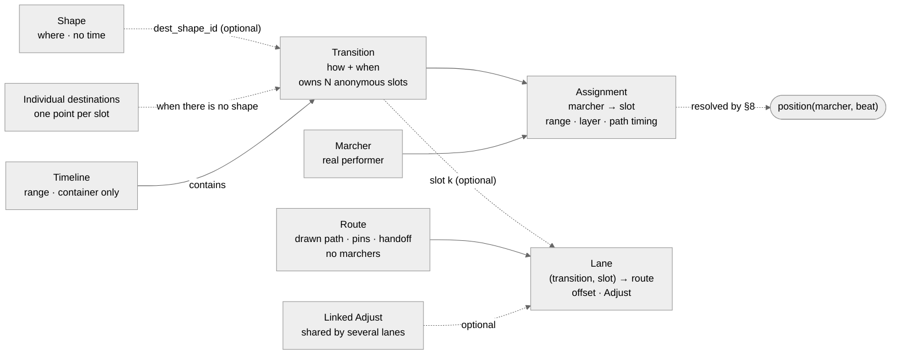
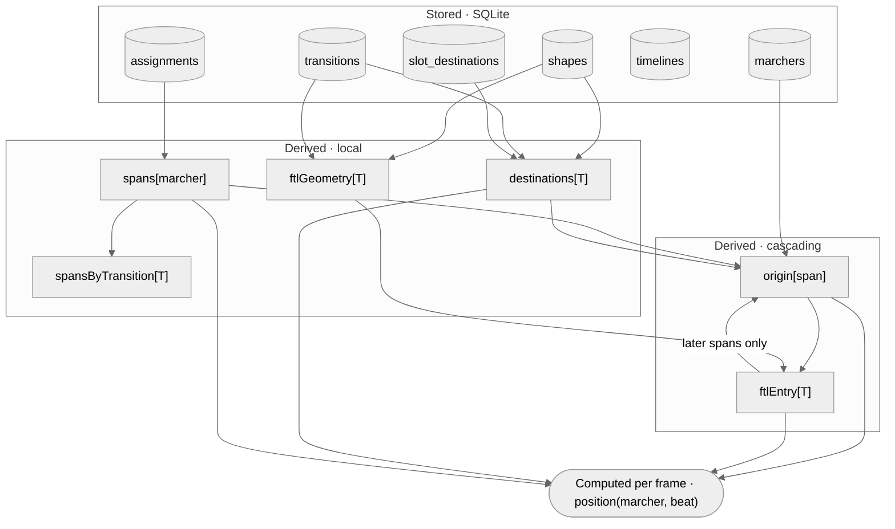
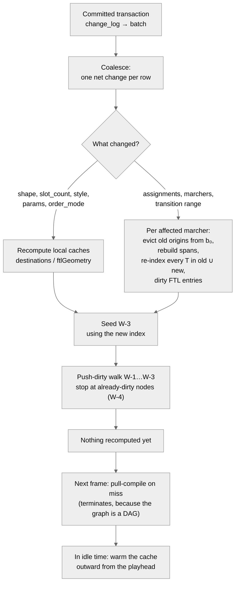
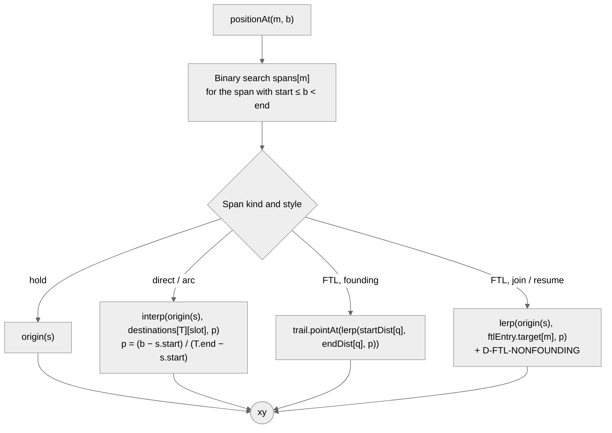

# OpenMarch Timeline Resolution Model: Specification

**Version:** 0.10: a slot walks a drawn path through a **lane** (ADR 0015, Appendix J). It builds on 0.9, which added routes step by step (Appendix I). 0.8 was revised after four structural reviews, two design changes and one implementation review. Appendices B to E map each review finding to its fix and evidence. Appendix F covers the design change: shapes are optional. Appendix G covers compatibility with the app's undo and redo. Appendix H covers how the app chooses layers. Appendix I covers routes, which v0.9 adds one build step at a time.
**Date:** 2026-11-06 (v0.10 decided; it is built from plan step 24 on); v0.9 steps 2 and 15 were 2026-11-04; step 1 was 2026-11-03; 0.8 was 2026-09-29
**Scope:** The data model and resolution engine behind timelines, shapes, transitions and assignments. It does not cover the editor UI.

---

## 0. How to read this document

This spec is written to be **checked**. Every rule, invariant and test has an ID, and the QA catalogue in §12 refers back to them.

| Prefix          | Meaning                                                                      |
| --------------- | ---------------------------------------------------------------------------- |
| `D-n`           | Design decision (§4)                                                         |
| `I-xx`          | Invariant on stored data (§6). Violations are rejected on write.             |
| `E-xx`          | Error code raised when an invariant is violated                              |
| `R-n`           | Normative resolution rule (§8). Together, these define the reference oracle. |
| `W-n`           | Invalidation rule (§9)                                                       |
| `U-n`           | Undo-safety rule for the schema (§6.1)                                       |
| `L-n`           | Layer priority rule for the app's write path (§6.2)                          |
| `P-n`           | Property that must hold for every valid dataset (§12.5)                      |
| `D-XXXX` (caps) | Runtime diagnostic, a warning or info message that is not an error (§8.9)    |
| `QA-…`          | Test case (§12)                                                              |

**Status tags.** Each section is marked with one of these:

- **[Decided]**: settled in the design discussion.
- **[Proposed]**: introduced here to make the model complete and testable. It needs sign-off.
- **[Open]**: an unresolved question (§13).

**Keywords.** MUST, SHOULD and MAY are used in the RFC 2119 sense.

**Relationship to the harness brief.** `timeline-harness-brief.md` still describes the test app to build (field view, inspector, instrumentation). Where the two documents disagree about the model, this spec wins. Appendix A lists the differences.

---

## 1. Purpose [Decided]

The engine answers one query:

> **Given a marcher and a beat position, where is that marcher on the field?**

Every table, cache and rule below exists to answer that query correctly and fast enough for 60 fps playback while the user edits.

The design replaces the current model, which stores one coordinate per (marcher, page). That model works, but it locks users into pages. The new model has to support:

1. **Tracks instead of pages.** Blocks of time in which a group of marchers moves, independent of other groups.
2. **Authored formations** (shapes), independent of time. Shapes are optional: marchers can also be moved individually (D-16).
3. **Authored motion** (transitions) between formations, including order-sensitive motion such as follow-the-leader.
4. **Breakaways** (the "flutter"). Some marchers leave a motion partway through, and their new motion starts from wherever they actually are at that moment.

---

## 2. Glossary

| Term                       | Definition                                                                                                                                                                                                                                                                                                                                                                                                                                                                                 |
| -------------------------- | ------------------------------------------------------------------------------------------------------------------------------------------------------------------------------------------------------------------------------------------------------------------------------------------------------------------------------------------------------------------------------------------------------------------------------------------------------------------------------------------ |
| **Beat**                   | The time unit. A beat position `b` is a real number. Authored boundaries are integers. Beat 0 is the start of the show.                                                                                                                                                                                                                                                                                                                                                                    |
| **Range**                  | A half-open interval `[start, end)` of beats.                                                                                                                                                                                                                                                                                                                                                                                                                                              |
| **Marcher**                | A real performer. It has a _home_ position, which is where it stands before its first assignment.                                                                                                                                                                                                                                                                                                                                                                                          |
| **Shape**                  | A formation drawn in absolute field coordinates, such as a line, freehand curve, circle, box or block. It has no knowledge of time or of marchers. **Optional**: a transition can place its slots individually instead (D-16).                                                                                                                                                                                                                                                             |
| **Timeline**               | A container with a range: a track in the UI. It has **no effect on resolution** (R-1). _App restriction (implementation-plan.md C-11): it is the container for start and stop, and every transition in it spans its whole range. App restriction (C-12): at most one timeline has a given range, and a page's box in the UI is the timeline ending at its flag; relaxed by UI-25 (2026-10-16): a move split off another keeps its range, and the page box is the oldest timeline over it._ |
| **Transition**             | Motion over a range, in a given path style, into slot destinations. The destinations come from a shape or are placed individually. It owns `slot_count` **anonymous slots**. It does **not** store where marchers start.                                                                                                                                                                                                                                                                   |
| **Slot**                   | An anonymous position within a transition, numbered `0…slot_count-1`. Its destination is sampled from the transition's shape, or is an individually placed point (R-13).                                                                                                                                                                                                                                                                                                                   |
| **Route** | _(v0.10)_ A drawn path in absolute field coordinates: `from`, `to`, and inner points with stable ids, each a corner or smooth (R-14). It has no knowledge of marchers. Its optional `timing` holds pins, holds and the spacing handoff. **Optional.** A slot walks a route only through a **lane**. A follow-the-leader transition may use one as its trail. |
| **Lane** | _(v0.10)_ A stored binding of one slot of one transition to a route: `(transition, slot) → route`. It carries the start offset `o_s` (both coordinates NULL for an **own** lane), the spot's own Adjust profile and an optional linked Adjust. Whoever occupies the slot at a beat walks the lane (D-4). A slot has at most one lane per move. |
| **Group path** | _(v0.10)_ A route whose lanes carry offsets. Every lane walks a parallel copy of the reference walk `W`, moved by its offset. |
| **Own path** | _(v0.10)_ A route walked by exactly one own lane (offset NULL). It walks R-14's own-path rule, through the marcher's real start and end. |
| **Spot** | _(v0.10, UI word)_ A slot as the designer sees it: a place in the formation. "The Adjust belongs to the spot." |
| **Occupancy** | _(v0.10)_ One assignment row seen as "marcher m holds spot k of T over `[start, end)`". A spot can have several occupancies in one move, one after another (I-A4′). |
| **Adjust** | _(v0.10)_ A displacement profile at places on a group path. It belongs to a spot (on the lane) or to a linked sub-group (a `route_adjusts` row shared by several lanes). It moves with the group path when the path is reshaped or retimed. |
| **Detach** | _(v0.10)_ Copy the group path for one spot. The spot keeps its offset and Adjust, so it walks in step with the group until the copy is edited. |
| **Anchor** | _(v0.10)_ A place on the reference walk named by `(a, b, f)`. `a` is a point id or `'from'`, `b` is a point id or `'to'`, and `f ∈ [0, 1]` is the fraction of the distance between them. |
| **Group clock** | _(v0.10)_ The route's map from a beat in `[T.start, T.end]` to a distance along `W`. It is linear without pins, and piecewise linear through the pins and holds with them. |
| **Lane clock** | _(v0.10)_ The occupancy's map from its beat to a group-clock beat. It is the identity for `cut_in` (the default). For `whole` it rescales the occupancy's own window onto the move. |
| **Handoff** | _(v0.10)_ Where a group path's spacing changes from start spacing (`o_s`) to destination spacing (`o_e`). It is a ramp between two anchors on the route. |
| **Checkpoint** | _(v0.10)_ On a follow-the-leader trail: a trail point, or a member's own start or end. An Adjust is zero at every checkpoint, and the member passes it on its unchanged count. |
| **Individual destination** | A point placed by hand for one slot of a transition that has no shape (`slot_destinations`, D-16). "Move marcher 7 here" means setting the point of marcher 7's slot.                                                                                                                                                                                                                                                                                                                      |
| **Assignment**             | A stored row saying _marcher m occupies slot k of transition T over range [s, e), at layer L_. This is the only link between real marchers and slots.                                                                                                                                                                                                                                                                                                                                      |
| **Layer**                  | An integer precedence. Where a marcher's assignments overlap in time, the higher layer wins. The resolver reads it as stored. The app derives it from the ranges (§6.2, D-18) and never asks the designer for it.                                                                                                                                                                                                                                                                          |
| **Base row**               | An assignment in a page's own move: the timeline a page's box stands for, stored as such by the app (ADR 0012). Base rows are underneath every other row (L-1).                                                                                                                                                                                                                                                                                                                            |
| **Span**                   | A derived, non-overlapping piece of one marcher's timeline, produced by flattening that marcher's assignments across layers (R-2). A span is either a **hold** (no assignment) or covers part of exactly one assignment.                                                                                                                                                                                                                                                                   |
| **Origin**                 | Where a marcher actually is at the start of a span (R-4). Derived, never stored.                                                                                                                                                                                                                                                                                                                                                                                                           |
| **Founding span**          | A span that starts exactly at its transition's `start_beat` (R-3).                                                                                                                                                                                                                                                                                                                                                                                                                         |
| **Join / resume**          | A non-founding span. A **join** is the first span of its assignment. A **resume** is a later span of the same assignment, after a higher layer let go. _v0.10:_ on a lane it enters the path by the entry rule (R-14′ item 8) instead of walking straight. |
| **Steal**                  | A higher-layer assignment that overrides part of a lower-layer one. The overridden transition keeps running _hypothetically_.                                                                                                                                                                                                                                                                                                                                                              |
| **Order-sensitive**        | A path style that reads marcher ordering as well as positions. Only `follow_the_leader` is order-sensitive.                                                                                                                                                                                                                                                                                                                                                                                |
| **Trail**                  | For follow-the-leader: the polyline every member walks along (R-9).                                                                                                                                                                                                                                                                                                                                                                                                                        |
| **FTL**                    | Short for follow-the-leader.                                                                                                                                                                                                                                                                                                                                                                                                                                                               |

---

## 3. Concept model [Decided]



The four concepts are strictly separated. Merging any two of them is the failure this design exists to prevent:

- **Shapes** say _where_, with no time. They are optional. A transition can instead place each slot's destination individually, and nothing downstream can tell the difference (D-16).
- **Timelines** say _which track_. They carry no motion. In the app they also say _when_: every transition in a timeline starts and ends with it (C-11 in implementation-plan.md), while assignments still come and go inside it.
- **Transitions** say _how and when_ for anonymous slots. A transition is a function whose starting point is filled in at resolve time. Its start state is an input to resolution, not stored data.
- **Assignments** say _who_, _when_ and _with what precedence_.
- **Routes** (v0.10) say _which way_, with no time beyond their own pins and no marchers. They are optional.
- **Lanes** (v0.10) say _which spot walks which route_. A lane belongs to a slot, not to a marcher, so whoever holds the spot at a beat walks it (D-4, D-22). Lanes never name a timeline (R-1).

---

## 4. Decision record

| ID   | Decision                                                                                                                                                                                                                                                       | Status                              | Rationale                                                                                                                                                                                                                                                                                                                                                                                                                                                                                                                                                                                                                                                                        |
| ---- | -------------------------------------------------------------------------------------------------------------------------------------------------------------------------------------------------------------------------------------------------------------- | ----------------------------------- | -------------------------------------------------------------------------------------------------------------------------------------------------------------------------------------------------------------------------------------------------------------------------------------------------------------------------------------------------------------------------------------------------------------------------------------------------------------------------------------------------------------------------------------------------------------------------------------------------------------------------------------------------------------------------------- |
| D-1  | **SQLite, with relational tables for the links and JSON for the leaves.** Shape geometry and path parameters are opaque JSON columns.                                                                                                                          | Decided                             | Nothing ever queries into geometry, so JSON is fine there. The assignment table is a many-to-many relationship over ranges, which is exactly what relational storage is good at. A document model would make it worse.                                                                                                                                                                                                                                                                                                                                                                                                                                                           |
| D-2  | **Positions are generated, not stored.** A marcher's coordinate at a beat is computed on demand. Only authored facts are persisted.                                                                                                                            | Decided                             | This was "path 1" in the discussion. Storing sampled coordinates ("path 2") creates a second source of truth and makes invalidation per-sample. Sampled data remains a valid **export** format (§11).                                                                                                                                                                                                                                                                                                                                                                                                                                                                            |
| D-3  | **Cache at the boundaries, not the interior.** The cached state is where marchers are when each span starts, plus FTL trails. Nothing between boundaries is cached.                                                                                            | Decided                             | A start state is fixed once the authored data is fixed. Caching it removes the recursive walk up the chain from the per-frame path (§9.6).                                                                                                                                                                                                                                                                                                                                                                                                                                                                                                                                       |
| D-4  | **Slots are separate from marchers.** Transitions own anonymous slots, and assignments put marchers into them.                                                                                                                                                 | Decided                             | Lets a designer author "a 16-person circle" before deciding who is in it.                                                                                                                                                                                                                                                                                                                                                                                                                                                                                                                                                                                                        |
| D-5  | **Shapes are absolute.** No shape or path is positioned relative to upstream geometry.                                                                                                                                                                         | Decided                             | An upstream edit makes the drill _look worse_: marchers take a longer approach and move faster. It never makes the drill _invalid_, so there are no cascading conflicts to resolve. §8.11 makes this hold numerically too.                                                                                                                                                                                                                                                                                                                                                                                                                                                       |
| D-6  | **Precedence is an explicit integer `layer`.** The resolver reads it as stored and never infers precedence itself.                                                                                                                                             | Decided                             | Stays predictable when steals are stacked. Cost: the UI eventually has to show layers. _Amended by D-18 (2026-10-16): the stored integer stays, but the app derives it from the ranges (base rows lowest, then the later start, then the shorter on a shared start). That ranking is a fixed function of what the timeline shows, so it stays predictable when steals stack, which was D-6's concern with inference by "most recent". The UI shows stacking order and overridden counts instead of numbers._                                                                                                                                                                     |
| D-7  | **Progress is measured against the transition's natural end** (`T.end_beat`), not against the end of the span after clipping.                                                                                                                                  | Decided                             | This is what makes steals correct. A marcher stolen halfway through is halfway there, not at the destination.                                                                                                                                                                                                                                                                                                                                                                                                                                                                                                                                                                    |
| D-8  | **Invalidation pushes, recompute pulls.** An edit marks dependents dirty straight away. Nothing is recomputed until something reads it.                                                                                                                        | Decided                             | Work scales with what the playhead needs, not with the length of the show.                                                                                                                                                                                                                                                                                                                                                                                                                                                                                                                                                                                                       |
| D-9  | **Order is a runtime input that only order-sensitive styles read.** It is not glue that users maintain everywhere.                                                                                                                                             | Decided                             | Avoids Pyware's gluing model, which forces an ordering onto shapes (such as boxes) that don't need one.                                                                                                                                                                                                                                                                                                                                                                                                                                                                                                                                                                          |
| D-10 | **Origins are cached per _span_, and entries per FTL transition. Nothing is cached per transition for direct or arc motion.**                                                                                                                                  | Proposed                            | Stacked steals create resumes (A → B → A), which is a **cycle** at the transition level. At the span level the graph is guaranteed acyclic (§9.3).                                                                                                                                                                                                                                                                                                                                                                                                                                                                                                                               |
| D-11 | **`arc` is order-free.** Each marcher moves along its own circular arc, controlled by a shared `bulge`.                                                                                                                                                        | Proposed                            | Earlier drafts listed arc as order-sensitive, but nothing in its definition needs order. A shared curved path that marchers walk in sequence is FTL with waypoints.                                                                                                                                                                                                                                                                                                                                                                                                                                                                                                              |
| D-12 | **Joins and resumes rebase.** A non-founding span of direct or arc motion starts from the marcher's actual position and finishes when the transition finishes. Non-founding FTL spans fall back to direct motion toward an FTL target, and raise a diagnostic. | Proposed                            | Keeps every marcher's position continuous. FTL has no well-defined meaning for a marcher who is not on the trail.                                                                                                                                                                                                                                                                                                                                                                                                                                                                                                                                                                |
| D-13 | **Empty slots are valid.** An unfilled slot is _vacant_: allowed, flagged, and not an error. Over-filling a transition is an error.                                                                                                                            | Proposed                            | Designers author slots before they cast marchers (D-4).                                                                                                                                                                                                                                                                                                                                                                                                                                                                                                                                                                                                                          |
| D-14 | **One edit is one database transaction, and the resolver hears about it once, as a batch.** The batch comes from a change log that triggers maintain, so it includes cascaded deletes and every row a multi-statement procedure changes.                       | Proposed (v0.2)                     | SQLite aborts only the failing _statement_, not the transaction. A single user edit can also change rows the app never touched directly. Both problems go away if the write wrapper owns atomicity and the database reports what actually changed (§6, §10.2).                                                                                                                                                                                                                                                                                                                                                                                                                   |
| D-15 | **Arcs are minor arcs only: `\|bulge\| ≤ ½`.**                                                                                                                                                                                                                 | Proposed (v0.4)                     | A major arc can carry a stolen marcher farther from its target than where it started. Chained steals then make positions grow geometrically, all the way to NaN (Appendix D). A minor arc never increases the distance to its target, which gives the provable bound in §8.11. The alternative was a runtime guard that clamps or flags out-of-range positions, and that would break D-5. **This is a product restriction.** The nearest remaining tool, FTL with waypoints, is not an exact substitute. It changes the path geometry, and it changes group motion: members follow one another instead of each sweeping its own arc. QA-SC-14 judges the restriction explicitly. |
| D-16 | **Shapes are optional. A transition's slot destinations come from a shape _or_ from individually placed points, never both.**                                                                                                                                  | Proposed (v0.6)                     | Designers need to move marchers individually as well as by shape. The resolver only ever needed one destination point per slot; a shape is just one way to produce those points. So individual placement is a second _source_ of slot destinations, and assignments, layers, steals, FTL ordering, invalidation and the derived-range bound (§8.11) are unchanged. Points are keyed by slot, not by marcher, which keeps D-4. Follow-the-leader still needs a shape, because it follows a path (I-T5). Mixing the two in one transition (a shape with a few slots nudged) is Q-14.                                                                                               |
| D-17 | **Triggers check; they never rewrite.** A change that touches several rows, such as the anchored range edit (R-E1), is an app procedure made of explicit statements, ordered so that every intermediate state is valid.                                        | Proposed (v0.7)                     | The app's undo replays each edit's row changes in reverse. That only works if every step of the edit landed on a valid state, and if replaying a statement has no side effects. A trigger that rewrites rows breaks both (§6.1, Appendix G).                                                                                                                                                                                                                                                                                                                                                                                                                                     |
| D-18 | **The app derives every layer from the ranges: base rows lowest, then the later start, then the earlier end (§6.2).** Nobody types or picks a layer, and no code chooses one outside the layer module.                                                         | Decided (project owner, 2026-10-16) | Keeps D-6's stored integer, so the resolver, triggers and `ref/` are unchanged. "Last edited on top" made playback depend on edit history the timeline doesn't show: a page-flag drag hid a breakaway, a one-count nudge flipped a path, and two identical timelines played differently. Start, then end, ranks a marcher's overlapping rows straight off the timeline. Cases and animations: [research/layer-priority](research/layer-priority/README.md).                                                                                                                                                                                                                      |
| D-19 | **A transition may walk a route: points between where its marcher starts and its destination (R-14).** Routes are resolver data, like shapes; recipes stay app data. _Amended by D-20 (v0.10): a slot walks a route through a lane. The `route` path style is retired, and a transition carries a route only as a follow-the-leader trail._ | Proposed (v0.9, ADR 0014) | Drill writers need runs, follow the leader on drawn trails, and one marcher bent around a collision. Each needs a path that isn't a straight line or a minor arc, stored where the resolver reads it, since positions come only from the resolver (D-2). v0.9 adds it one build step at a time (Appendix I); step 1 is corners only, step 2 adds smooth points, step 15 lets a group share one route at an offset per member. |
| D-20 | **A group path is one route. A lane binds (transition, slot) to it.** Drawing a path never moves a marcher to another transition. | Decided (owner, 2026-11-05) | Breakout (step 15) dropped shape links, left vacant slots and had no place for per-spot facts. A lane is the narrowest fact: one row per spot (ADR 0015, 04 §2.6). |
| D-21 | **Two overrides. Adjust is a profile at places on the group path, keyed by stable point id plus fraction. Detach is a copy.** A Detached spot walks in step with the group until its copy is edited. | Decided (owner) | Places inherit every retime, because pins map places to counts. Counts fail reshape and indexes fail point inserts (04 J.3). The precedents are an After Effects child layer, a Figma instance override, and Figma's Detach. |
| D-22 | **An Adjust belongs to the spot. A personal edit is refused while another marcher occupies the spot during the move.** | Decided (owner) | A person-keyed Adjust would need a marcher key and an occupant lookup in the resolver. Keying by slot keeps R-14 item 9 ("reads nothing of the other members"). The refusal keeps R-other: a personal edit never moves another marcher. |
| D-23 | **Spot occupancy is by count range** (I-A4′, I-A5′). Follow-the-leader keeps the timeless rules. | Decided (owner) | Swaps, re-entry on another spot, and "a marcher doesn't own a spot forever". R-9 step 5 needs a timeless I-A4 on follow-the-leader transitions. |
| D-24 | **Leaving and entering a path happen at counts, as assignment-row bounds. The spacing handoff happens at a place, as anchors on the route. `o_e` is derived from the spot's own destination.** | Decided (owner) | Counts are what a designer peels off on. "When the destination shape takes over" is a place on the path. A derived `o_e` passes S-22 #1 and #3 and reads only own data (06 MAJOR-6). |
| D-25 | **Late join: `cut_in` (the default) or `whole`, stored per occupancy on the assignment row.** | Decided (owner); storage Proposed | The window is meaningful only relative to one occupancy (06 MAJOR-2). The row already holds the occupancy's counts, so storing the window there needs no extra table and makes the window move with the row. |
| D-26 | **Copies now, links later.** One route's lanes sit in one move. Mirror, paste, split by marchers and a continuation into the next move write copies plus app-data links. | Decided (owner) | One range per route is what lets every lane share one group clock. A page flag inside one move is only a mark in time. |
| D-27 | **A follow-the-leader member may be Adjusted between locked checkpoints.** The Adjust is zero at checkpoints, their counts are kept, and the speed between them follows the adjusted length. | Decided (owner); details Proposed | It reuses the lane's `adjust`. It needs a trail with point ids (the trail step). On a follow-the-leader transition the slot is not the end spot (Appendix J.4). |

---

## 5. Storage [Decided schema shape; triggers Proposed]

### 5.1 DDL

> **v0.10 (ADR 0015).** The DDL below is the v0.9 step 15 schema the branch runs until plan step 24. v0.10 adds `timeline_lanes`, `timeline_route_adjusts`, `routes.timing` and `assignments.path_timing`, retires the `route` path style and turns I-A4 and I-A5 into overlap triggers. Those additions are in Appendix J.1; none rebuilds a table.

This schema was run against SQLite 3.45 (Python) and 3.51 (Node), using QA-DB-01 to QA-DB-24, QA-DB-13b and QA-DB-26 to QA-DB-41 (§12.2), and QA-UNDO-1 to QA-UNDO-8 with the app's history triggers installed (§6.1). It is also the schema the end-to-end fuzzer runs on, with undo and redo mixed into the edits (§12.10). Every check passes. `STRICT` tables need SQLite 3.37 or later. `PRAGMA foreign_keys = ON` MUST be set on every connection.

```sql
PRAGMA foreign_keys = ON;

CREATE TABLE marchers (
  id      INTEGER PRIMARY KEY,
  label   TEXT NOT NULL,
  home_x  REAL NOT NULL CHECK (abs(home_x) <= 1e6),
  home_y  REAL NOT NULL CHECK (abs(home_y) <= 1e6)
) STRICT;

CREATE TABLE shapes (
  id        INTEGER PRIMARY KEY,
  name      TEXT,
  kind      TEXT NOT NULL CHECK (kind IN ('line','freehand','circle','box','block')),
  geometry  TEXT NOT NULL CHECK (json_valid(geometry)),
  -- I-S1 (partial, DB-enforced): circle radius positive and within the coordinate bound;
  -- start_angle normalized to [0, 2π) so that adding a turn never loses precision
  CHECK (kind <> 'circle' OR (coalesce(json_type(geometry, '$.radius'), '') IN ('integer', 'real')
                              AND json_extract(geometry, '$.radius') > 0
                              AND json_extract(geometry, '$.radius') <= 1e6
                              AND coalesce(json_type(geometry, '$.start_angle'), '') IN ('integer', 'real')
                              AND json_extract(geometry, '$.start_angle') >= 0
                              AND json_extract(geometry, '$.start_angle') < 6.283185307179586))
) STRICT;

CREATE TABLE timelines (
  id          INTEGER PRIMARY KEY,
  name        TEXT,
  start_beat  INTEGER NOT NULL CHECK (start_beat BETWEEN 0 AND 2147483647),
  end_beat    INTEGER NOT NULL CHECK (end_beat   BETWEEN 0 AND 2147483647),
  CHECK (end_beat > start_beat)
) STRICT;

-- v0.9 (D-19, Appendix I): the path a route transition walks. No owner column, like shapes:
-- the resolver never reads timelines (R-1).
CREATE TABLE routes (
  id        INTEGER PRIMARY KEY,
  geometry  TEXT NOT NULL CHECK (json_valid(geometry))    -- §5.2, I-R1
) STRICT;

CREATE TABLE transitions (
  id             INTEGER PRIMARY KEY,
  timeline_id    INTEGER NOT NULL REFERENCES timelines(id) ON DELETE CASCADE,
  dest_shape_id  INTEGER          REFERENCES shapes(id)    ON DELETE RESTRICT,   -- NULL: slots placed individually (D-16)
  path_style     TEXT NOT NULL DEFAULT 'direct'
                 CHECK (path_style IN ('direct','arc','follow_the_leader','route')),
  path_params    TEXT CHECK (path_params IS NULL OR json_valid(path_params)),
  route_id       INTEGER          REFERENCES routes(id)    ON DELETE RESTRICT,   -- v0.9: required for 'route' (I-R2)
  order_mode     TEXT NOT NULL DEFAULT 'inherit' CHECK (order_mode IN ('inherit','slot')),
  slot_count     INTEGER NOT NULL CHECK (slot_count BETWEEN 1 AND 10000),
  start_beat     INTEGER NOT NULL CHECK (start_beat BETWEEN 0 AND 2147483647),
  end_beat       INTEGER NOT NULL CHECK (end_beat   BETWEEN 0 AND 2147483647),
  CHECK (end_beat > start_beat),
  -- I-T5: follow-the-leader follows a path, so it needs a destination shape
  CHECK (dest_shape_id IS NOT NULL OR path_style <> 'follow_the_leader'),
  -- I-T2 (partial, DB-enforced): an arc carries a numeric bulge with |bulge| <= 0.5 (minor arcs only, §8.11)
  CHECK (path_style <> 'arc' OR (coalesce(json_type(path_params, '$.bulge'), '') IN ('integer', 'real')
                                 AND abs(json_extract(path_params, '$.bulge')) <= 0.5)),
  -- I-R2 (v0.9): a route transition walks a route, has no shape and exactly one slot. Rules that later
  -- steps relax (which other styles may carry a route, its path_params) are commit checks instead
  -- (E-R2, E-R4), so relaxing them never rebuilds this table.
  CHECK (path_style <> 'route' OR (route_id IS NOT NULL AND dest_shape_id IS NULL AND slot_count = 1))
) STRICT;

CREATE TABLE assignments (
  id             INTEGER PRIMARY KEY,
  marcher_id     INTEGER NOT NULL REFERENCES marchers(id)    ON DELETE CASCADE,
  transition_id  INTEGER NOT NULL REFERENCES transitions(id) ON DELETE CASCADE,
  slot_index     INTEGER NOT NULL CHECK (slot_index >= 0),
  start_beat     INTEGER NOT NULL CHECK (start_beat BETWEEN 0 AND 2147483647),
  end_beat       INTEGER NOT NULL CHECK (end_beat   BETWEEN 0 AND 2147483647),
  layer          INTEGER NOT NULL DEFAULT 0 CHECK (layer BETWEEN -1000 AND 1000),
  CHECK (end_beat > start_beat),
  UNIQUE (transition_id, slot_index),
  UNIQUE (transition_id, marcher_id)
) STRICT;

-- D-16: individually placed destinations, used when a transition has no shape (one row per slot)
CREATE TABLE slot_destinations (
  transition_id  INTEGER NOT NULL REFERENCES transitions(id) ON DELETE CASCADE,
  slot_index     INTEGER NOT NULL CHECK (slot_index >= 0),
  x              REAL NOT NULL CHECK (abs(x) <= 1e6),       -- I-D2: inside the authored bound
  y              REAL NOT NULL CHECK (abs(y) <= 1e6),
  PRIMARY KEY (transition_id, slot_index)
) STRICT;

CREATE INDEX idx_asn_marcher    ON assignments(marcher_id, start_beat);
CREATE INDEX idx_tr_shape       ON transitions(dest_shape_id);
CREATE INDEX idx_tr_timeline    ON transitions(timeline_id);
-- (transition_id, ...) lookups are served by the UNIQUE(transition_id, slot_index) index.

-- I-A1, I-A2: assignment inside its transition's range and slot_count
CREATE TRIGGER asn_bounds_ins BEFORE INSERT ON assignments
WHEN NOT EXISTS (SELECT 1 FROM transitions t WHERE t.id = NEW.transition_id
                 AND NEW.start_beat >= t.start_beat AND NEW.end_beat <= t.end_beat
                 AND NEW.slot_index < t.slot_count)
BEGIN SELECT RAISE(ABORT, 'E-A1/E-A2: assignment outside transition range or slot_count'); END;

CREATE TRIGGER asn_bounds_upd BEFORE UPDATE ON assignments
WHEN NOT EXISTS (SELECT 1 FROM transitions t WHERE t.id = NEW.transition_id
                 AND NEW.start_beat >= t.start_beat AND NEW.end_beat <= t.end_beat
                 AND NEW.slot_index < t.slot_count)
BEGIN SELECT RAISE(ABORT, 'E-A1/E-A2: assignment outside transition range or slot_count'); END;

-- I-A3: one marcher, one layer, no overlapping ranges
CREATE TRIGGER asn_overlap_ins BEFORE INSERT ON assignments
WHEN EXISTS (SELECT 1 FROM assignments a WHERE a.marcher_id = NEW.marcher_id AND a.layer = NEW.layer
             AND a.start_beat < NEW.end_beat AND NEW.start_beat < a.end_beat)
BEGIN SELECT RAISE(ABORT, 'E-A3: overlapping assignments for one marcher at the same layer'); END;

CREATE TRIGGER asn_overlap_upd BEFORE UPDATE ON assignments
WHEN EXISTS (SELECT 1 FROM assignments a WHERE a.id <> NEW.id AND a.marcher_id = NEW.marcher_id
             AND a.layer = NEW.layer AND a.start_beat < NEW.end_beat AND NEW.start_beat < a.end_beat)
BEGIN SELECT RAISE(ABORT, 'E-A3: overlapping assignments for one marcher at the same layer'); END;

-- I-T1: transition inside its timeline
CREATE TRIGGER tr_in_timeline_ins BEFORE INSERT ON transitions
WHEN NOT EXISTS (SELECT 1 FROM timelines l WHERE l.id = NEW.timeline_id
                 AND NEW.start_beat >= l.start_beat AND NEW.end_beat <= l.end_beat)
BEGIN SELECT RAISE(ABORT, 'E-T1: transition outside its timeline'); END;

CREATE TRIGGER tr_in_timeline_upd BEFORE UPDATE OF start_beat, end_beat, timeline_id ON transitions
WHEN NOT EXISTS (SELECT 1 FROM timelines l WHERE l.id = NEW.timeline_id
                 AND NEW.start_beat >= l.start_beat AND NEW.end_beat <= l.end_beat)
BEGIN SELECT RAISE(ABORT, 'E-T1: transition outside its timeline'); END;

CREATE TRIGGER tl_contains_upd BEFORE UPDATE OF start_beat, end_beat ON timelines
WHEN EXISTS (SELECT 1 FROM transitions t WHERE t.timeline_id = NEW.id
             AND (t.start_beat < NEW.start_beat OR t.end_beat > NEW.end_beat))
BEGIN SELECT RAISE(ABORT, 'E-T1: timeline would no longer contain its transitions'); END;

-- I-A2 (transition side): slot_count cannot shrink below an occupied slot
CREATE TRIGGER tr_slots_upd BEFORE UPDATE OF slot_count ON transitions
WHEN EXISTS (SELECT 1 FROM assignments a WHERE a.transition_id = NEW.id AND a.slot_index >= NEW.slot_count)
BEGIN SELECT RAISE(ABORT, 'E-A2: slot_count below an occupied slot'); END;

-- I-T6 (row side): a destination row belongs to a shapeless transition and to one of its slots
CREATE TRIGGER sd_ins BEFORE INSERT ON slot_destinations
WHEN NOT EXISTS (SELECT 1 FROM transitions t WHERE t.id = NEW.transition_id
                 AND t.dest_shape_id IS NULL AND NEW.slot_index < t.slot_count)
BEGIN SELECT RAISE(ABORT, 'E-T6: destination row on a shaped transition or outside slot_count'); END;

CREATE TRIGGER sd_upd BEFORE UPDATE ON slot_destinations
WHEN NOT EXISTS (SELECT 1 FROM transitions t WHERE t.id = NEW.transition_id
                 AND t.dest_shape_id IS NULL AND NEW.slot_index < t.slot_count)
BEGIN SELECT RAISE(ABORT, 'E-T6: destination row on a shaped transition or outside slot_count'); END;

-- I-T6 (transition side): a shape and individual destinations are exclusive; slot_count keeps its rows valid
CREATE TRIGGER tr_shape_set BEFORE UPDATE OF dest_shape_id ON transitions
WHEN NEW.dest_shape_id IS NOT NULL AND EXISTS (SELECT 1 FROM slot_destinations d WHERE d.transition_id = NEW.id)
BEGIN SELECT RAISE(ABORT, 'E-T6: remove individual destinations before assigning a shape'); END;

CREATE TRIGGER tr_slots_dest_upd BEFORE UPDATE OF slot_count ON transitions
WHEN EXISTS (SELECT 1 FROM slot_destinations d WHERE d.transition_id = NEW.id AND d.slot_index >= NEW.slot_count)
BEGIN SELECT RAISE(ABORT, 'E-T6: slot_count below a placed destination'); END;

-- §6 commit-time invariants: the write wrapper aborts the edit if this view returns any row.
-- (Completeness can only be judged once the whole edit has run: a transition and its points are inserted together.)
CREATE VIEW commit_violations AS
  SELECT 'E-T6' AS code, t.id AS transition_id,
         'shapeless transition has ' || (SELECT count(*) FROM slot_destinations d WHERE d.transition_id = t.id)
           || ' of ' || t.slot_count || ' destinations' AS detail
    FROM transitions t
   WHERE t.dest_shape_id IS NULL
     AND (SELECT count(*) FROM slot_destinations d WHERE d.transition_id = t.id) <> t.slot_count
  UNION ALL
  -- I-R3 (v0.9 step 15): every route is walked by at least one transition
  SELECT 'E-R3', NULL,
         'route ' || r.id || ' is used by no transition' AS detail
    FROM routes r
   WHERE NOT EXISTS (SELECT 1 FROM transitions t WHERE t.route_id = r.id)
  UNION ALL
  -- I-R2 (v0.9 step 1): no other path style carries a route yet (trails relax this)
  SELECT 'E-R2', t.id, 'a ' || t.path_style || ' transition has a route' AS detail
    FROM transitions t
   WHERE t.path_style <> 'route' AND t.route_id IS NOT NULL
  UNION ALL
  -- I-R4 (v0.9 step 15): a route transition without an offset (one marcher's own path) walks its route alone
  SELECT 'E-R4', t.id, 'route ' || t.route_id || ' is shared but this transition has no offset' AS detail
    FROM transitions t
   WHERE t.path_style = 'route' AND t.path_params IS NULL
     AND (SELECT count(*) FROM transitions u WHERE u.route_id = t.route_id) > 1
  UNION ALL
  -- I-R5 (v0.9 step 15): every transition walking one route is in one timeline, over the same range
  SELECT 'E-R5', t.id, 'route ' || t.route_id || ' is walked in two moves or over two ranges' AS detail
    FROM transitions t
    JOIN transitions u ON u.route_id = t.route_id AND u.id < t.id
   WHERE t.timeline_id <> u.timeline_id OR t.start_beat <> u.start_beat OR t.end_beat <> u.end_beat;

CREATE INDEX idx_tr_route ON transitions(route_id);

-- I-A1 (transition side): a transition's range must still contain every one of its assignments.
-- A pure check. The anchored rewrite (R-E1) is an app procedure, NOT a trigger: a trigger that modifies rows
-- adds side effects that undo replays in the wrong order (§6.1, QA-UNDO-1).
CREATE TRIGGER tr_range_check BEFORE UPDATE OF start_beat, end_beat ON transitions
WHEN EXISTS (SELECT 1 FROM assignments a WHERE a.transition_id = NEW.id
             AND (a.start_beat < NEW.start_beat OR a.end_beat > NEW.end_beat))
BEGIN SELECT RAISE(ABORT, 'E-A1: range change strands an assignment'); END;

-- I-T3, I-T4: destination shape must suit the path style and slot_count
CREATE TRIGGER tr_dest_ins BEFORE INSERT ON transitions
WHEN EXISTS (SELECT 1 FROM shapes s WHERE s.id = NEW.dest_shape_id AND s.kind = 'block'
             AND (NEW.path_style = 'follow_the_leader'
                  OR json_extract(s.geometry,'$.rows') * json_extract(s.geometry,'$.cols') < NEW.slot_count))
BEGIN SELECT RAISE(ABORT, 'E-T3/E-T4: block shape used for FTL or over capacity'); END;

CREATE TRIGGER tr_dest_upd BEFORE UPDATE OF dest_shape_id, path_style, slot_count ON transitions
WHEN EXISTS (SELECT 1 FROM shapes s WHERE s.id = NEW.dest_shape_id AND s.kind = 'block'
             AND (NEW.path_style = 'follow_the_leader'
                  OR json_extract(s.geometry,'$.rows') * json_extract(s.geometry,'$.cols') < NEW.slot_count))
BEGIN SELECT RAISE(ABORT, 'E-T3/E-T4: block shape used for FTL or over capacity'); END;

CREATE TRIGGER shape_dest_upd BEFORE UPDATE OF kind, geometry ON shapes
WHEN NEW.kind = 'block' AND EXISTS (SELECT 1 FROM transitions t WHERE t.dest_shape_id = NEW.id
             AND (t.path_style = 'follow_the_leader'
                  OR json_extract(NEW.geometry,'$.rows') * json_extract(NEW.geometry,'$.cols') < t.slot_count))
BEGIN SELECT RAISE(ABORT, 'E-T3/E-T4: shape change invalidates a transition using it'); END;

-- §10.2 change log: one row per changed row, in commit order, including FK cascades (they fire
-- AFTER triggers). The write wrapper reads and clears it inside the same transaction, commits,
-- then hands the coalesced batch to the resolver. Undo and redo go through the same wrapper (§6.1).
-- Triggers on data tables either RAISE or write to bookkeeping tables (change_log, history_*); none
-- modifies a data table (§6.1 U-1).
CREATE TABLE change_log (
  seq     INTEGER PRIMARY KEY,
  tbl     TEXT NOT NULL,
  row_id  INTEGER NOT NULL,
  before  TEXT,            -- JSON row image, NULL on insert
  after   TEXT             -- JSON row image, NULL on delete
) STRICT;

CREATE TRIGGER log_marchers_ins AFTER INSERT ON marchers BEGIN INSERT INTO change_log(tbl,row_id,before,after) VALUES ('marchers',NEW.id,NULL,json_object('id',NEW.id,'home',json_array(NEW.home_x,NEW.home_y))); END;
CREATE TRIGGER log_marchers_upd AFTER UPDATE ON marchers BEGIN INSERT INTO change_log(tbl,row_id,before,after) VALUES ('marchers',NEW.id,json_object('id',OLD.id,'home',json_array(OLD.home_x,OLD.home_y)),json_object('id',NEW.id,'home',json_array(NEW.home_x,NEW.home_y))); END;
CREATE TRIGGER log_marchers_del AFTER DELETE ON marchers BEGIN INSERT INTO change_log(tbl,row_id,before,after) VALUES ('marchers',OLD.id,json_object('id',OLD.id,'home',json_array(OLD.home_x,OLD.home_y)),NULL); END;
CREATE TRIGGER log_shapes_ins AFTER INSERT ON shapes BEGIN INSERT INTO change_log(tbl,row_id,before,after) VALUES ('shapes',NEW.id,NULL,json_object('id',NEW.id,'kind',NEW.kind,'geometry',json(NEW.geometry))); END;
CREATE TRIGGER log_shapes_upd AFTER UPDATE ON shapes BEGIN INSERT INTO change_log(tbl,row_id,before,after) VALUES ('shapes',NEW.id,json_object('id',OLD.id,'kind',OLD.kind,'geometry',json(OLD.geometry)),json_object('id',NEW.id,'kind',NEW.kind,'geometry',json(NEW.geometry))); END;
CREATE TRIGGER log_shapes_del AFTER DELETE ON shapes BEGIN INSERT INTO change_log(tbl,row_id,before,after) VALUES ('shapes',OLD.id,json_object('id',OLD.id,'kind',OLD.kind,'geometry',json(OLD.geometry)),NULL); END;
CREATE TRIGGER log_transitions_ins AFTER INSERT ON transitions BEGIN INSERT INTO change_log(tbl,row_id,before,after) VALUES ('transitions',NEW.id,NULL,json_object('id',NEW.id,'dest',NEW.dest_shape_id,'style',NEW.path_style,'params',json(NEW.path_params),'order',NEW.order_mode,'slots',NEW.slot_count,'start',NEW.start_beat,'end',NEW.end_beat,'route',NEW.route_id)); END;
CREATE TRIGGER log_transitions_upd AFTER UPDATE ON transitions BEGIN INSERT INTO change_log(tbl,row_id,before,after) VALUES ('transitions',NEW.id,json_object('id',OLD.id,'dest',OLD.dest_shape_id,'style',OLD.path_style,'params',json(OLD.path_params),'order',OLD.order_mode,'slots',OLD.slot_count,'start',OLD.start_beat,'end',OLD.end_beat,'route',OLD.route_id),json_object('id',NEW.id,'dest',NEW.dest_shape_id,'style',NEW.path_style,'params',json(NEW.path_params),'order',NEW.order_mode,'slots',NEW.slot_count,'start',NEW.start_beat,'end',NEW.end_beat,'route',NEW.route_id)); END;
CREATE TRIGGER log_transitions_del AFTER DELETE ON transitions BEGIN INSERT INTO change_log(tbl,row_id,before,after) VALUES ('transitions',OLD.id,json_object('id',OLD.id,'dest',OLD.dest_shape_id,'style',OLD.path_style,'params',json(OLD.path_params),'order',OLD.order_mode,'slots',OLD.slot_count,'start',OLD.start_beat,'end',OLD.end_beat,'route',OLD.route_id),NULL); END;
CREATE TRIGGER log_assignments_ins AFTER INSERT ON assignments BEGIN INSERT INTO change_log(tbl,row_id,before,after) VALUES ('assignments',NEW.id,NULL,json_object('id',NEW.id,'marcher',NEW.marcher_id,'transition',NEW.transition_id,'slot',NEW.slot_index,'start',NEW.start_beat,'end',NEW.end_beat,'layer',NEW.layer)); END;
CREATE TRIGGER log_assignments_upd AFTER UPDATE ON assignments BEGIN INSERT INTO change_log(tbl,row_id,before,after) VALUES ('assignments',NEW.id,json_object('id',OLD.id,'marcher',OLD.marcher_id,'transition',OLD.transition_id,'slot',OLD.slot_index,'start',OLD.start_beat,'end',OLD.end_beat,'layer',OLD.layer),json_object('id',NEW.id,'marcher',NEW.marcher_id,'transition',NEW.transition_id,'slot',NEW.slot_index,'start',NEW.start_beat,'end',NEW.end_beat,'layer',NEW.layer)); END;
CREATE TRIGGER log_assignments_del AFTER DELETE ON assignments BEGIN INSERT INTO change_log(tbl,row_id,before,after) VALUES ('assignments',OLD.id,json_object('id',OLD.id,'marcher',OLD.marcher_id,'transition',OLD.transition_id,'slot',OLD.slot_index,'start',OLD.start_beat,'end',OLD.end_beat,'layer',OLD.layer),NULL); END;
-- slot_destinations rows are logged under their transition id (the resolver recomputes that transition's destinations)
-- v0.9: routes are logged like shapes
CREATE TRIGGER log_routes_ins AFTER INSERT ON routes BEGIN INSERT INTO change_log(tbl,row_id,before,after) VALUES ('routes',NEW.id,NULL,json_object('id',NEW.id,'geometry',json(NEW.geometry))); END;
CREATE TRIGGER log_routes_upd AFTER UPDATE ON routes BEGIN INSERT INTO change_log(tbl,row_id,before,after) VALUES ('routes',NEW.id,json_object('id',OLD.id,'geometry',json(OLD.geometry)),json_object('id',NEW.id,'geometry',json(NEW.geometry))); END;
CREATE TRIGGER log_routes_del AFTER DELETE ON routes BEGIN INSERT INTO change_log(tbl,row_id,before,after) VALUES ('routes',OLD.id,json_object('id',OLD.id,'geometry',json(OLD.geometry)),NULL); END;
CREATE TRIGGER log_slot_destinations_ins AFTER INSERT ON slot_destinations BEGIN INSERT INTO change_log(tbl,row_id,before,after) VALUES ('slot_destinations',NEW.transition_id,NULL,json_object('transition',NEW.transition_id,'slot',NEW.slot_index,'x',NEW.x,'y',NEW.y)); END;
CREATE TRIGGER log_slot_destinations_upd AFTER UPDATE ON slot_destinations BEGIN INSERT INTO change_log(tbl,row_id,before,after) VALUES ('slot_destinations',NEW.transition_id,json_object('transition',OLD.transition_id,'slot',OLD.slot_index,'x',OLD.x,'y',OLD.y),json_object('transition',NEW.transition_id,'slot',NEW.slot_index,'x',NEW.x,'y',NEW.y)); END;
CREATE TRIGGER log_slot_destinations_del AFTER DELETE ON slot_destinations BEGIN INSERT INTO change_log(tbl,row_id,before,after) VALUES ('slot_destinations',OLD.transition_id,json_object('transition',OLD.transition_id,'slot',OLD.slot_index,'x',OLD.x,'y',OLD.y),NULL); END;
```

**Changes from the discussion drafts:**

- `path_geometry` is renamed `path_params`, because it now holds `{"bulge"}` for arcs as well as `{"waypoints"}` for FTL.
- `dest_shape_id` is `NOT NULL`. v0.6 relaxes this again (D-16).
- `order_mode` is new.
- Two `UNIQUE` constraints are new.
- The triggers are new.
- **v0.2:** every table is `STRICT`, so integer columns reject values such as `0.5` and text (I-N1).
- **v0.2:** CHECK constraints bound beats, layers, slot counts and home coordinates (I-N2).
- **v0.2:** a `change_log` table and 12 logging triggers record every changed row, for batch notifications (§10.2).
- **v0.3:** CHECKs enforce a numeric circle radius in `(0, 10⁶]` and a numeric arc bulge. Both are NULL-safe, because a CHECK that evaluates to NULL passes in SQLite (QA-DB-32, -33).
- **v0.4:** the bulge CHECK narrows to `|bulge| ≤ ½` (D-15), and a new CHECK requires a numeric circle `start_angle` in `[0, 2π)` (QA-DB-33, -34).
- **v0.6:** `dest_shape_id` is nullable (D-16). The changes are:
  - a new `slot_destinations` table holds individual points;
  - a CHECK makes follow-the-leader require a shape (I-T5);
  - triggers keep points and shapes exclusive and consistent with `slot_count` (I-T6);
  - a `commit_violations` view lets the write wrapper enforce completeness at commit (§6);
  - `slot_destinations` changes are logged (QA-DB-35 to -41).
- **v0.7:** the `tr_range_anchor` trigger is gone. It rewrote assignment rows, which breaks undo (Appendix G). `tr_range_check`, a pure check, keeps I-A1 enforced from the transition side, and the anchored rewrite (R-E1) is now an app procedure (§6.1).

### 5.2 JSON schemas

**Shape `geometry`, by `kind`** (I-S1). All coordinates are absolute field units (D-5).

| kind       | geometry                                                                                    | Closed     | Traversal                                          |
| ---------- | ------------------------------------------------------------------------------------------- | ---------- | -------------------------------------------------- |
| `line`     | `{"points": [[x0,y0],[x1,y1]]}` (exactly 2 **distinct** points)                             | no         | `points[0]` → `points[1]`                          |
| `freehand` | `{"points": [[x,y], …]}` (2 or more points, total length > 0)                               | no         | in point order                                     |
| `circle`   | `{"center":[x,y], "radius": r>0, "start_angle": θ₀ ∈ [0, 2π) (radians), "clockwise": bool}` | yes        | θ = θ₀ ± 2πt (− when clockwise)                    |
| `box`      | `{"origin":[x,y], "width": w>0, "height": h>0}`                                             | yes        | origin → (x+w, y) → (x+w, y+h) → (x, y+h) → origin |
| `block`    | `{"origin":[x,y], "rows": R≥1, "cols": C≥1, "spacing":[dx,dy]}`                             | n/a (grid) | row-major                                          |

Every number in `geometry` and `path_params` MUST be finite. Every authored point MUST lie within `[−10⁶, 10⁶]²`: every home, every waypoint, every individual destination, and every point of every shape, including a block's whole grid, a box's far corner and a circle's whole perimeter. Circle start angles MUST be normalized to `[0, 2π)` when authored or imported. Take `θ mod 2π`, and store 0 if rounding produces exactly 2π (I-S1, I-T2). These bounds keep §8's arithmetic well-conditioned (§8.10) and bound every derived position (§8.11). SQLite's `json_valid` accepts `1e999`, so finiteness and the point bounds are checked in the app write path (QA-DB-31). The circle radius, the circle start angle and the arc bulge are also enforced by CHECKs. A `freehand` path may repeat consecutive points. §8.10 defines how those evaluate.

**Individual destinations** (`slot_destinations`, D-16). A transition with no shape has exactly one row `(slot_index, x, y)` for each of its slots. Points are absolute field coordinates within `[−10⁶, 10⁶]²` (I-D2). A transition with a shape has no rows. To switch a transition between the two, do it in one edit: set `dest_shape_id` to NULL and insert every point, or delete the points and set the shape.

**Transition `path_params`, by `path_style`** (I-T2):

| path_style          | path_params                                                                                                                         | Reads order? |
| ------------------- | ----------------------------------------------------------------------------------------------------------------------------------- | ------------ |
| `direct`            | `NULL`                                                                                                                              | no           |
| `arc`               | `{"bulge": k}` with \|k\| ≤ ½: minor arcs only (D-15, enforced by a CHECK). k = 0 is a straight line and \|k\| = ½ is a semicircle. | no           |
| `follow_the_leader` | `{"waypoints": [[x,y], …]}`. May be empty. Absolute coordinates.                                                                    | **yes**      |
| `route`             | `NULL` for one marcher's own path, or `{"offset": [dx, dy]}` for a member of a group path (I-R4, v0.9 step 15). The points live in the route (below). _Removed in v0.10:_ no transition has `path_style = 'route'` (I-R2′); a slot walks a route through a lane, whose JSON is in Appendix J.2. | no |

**Route `geometry`** (I-R1, v0.9 steps 1 and 2). Absolute field units (D-5):

```jsonc
{
  "v": 1,
  "from": [x, y],   // where the marcher stood at T.start_beat when the route was drawn
  "to": [x, y],     // its destination when the route was drawn
  "points": [       // inner points in walking order; may be empty
    { "id": "p1", "at": [x, y] },                  // a corner
    { "id": "p2", "at": [x, y], "tension": 1 }     // a smooth point (step 2)
  ]
}
```

- `from` and `to` are written by the app. They record what the route was drawn against. From step 2
  the resolver reads them for one thing only: they stand in for the real ends as the outer neighbours
  of the first and last inner points when R-14 works out a smooth point's tangent, so an earlier edit
  that moves where the marcher starts never bends the curve between inner points. Later steps also
  compare them with the real ends (re-fit, the "changed" flag). The walked path always starts at the
  marcher's real origin and ends at its real destination (R-14).
- Point ids are non-empty strings of at most 16 characters, unique within the route and never
  reused in it. Later steps name points by id (pins, spots), so editing one point never renumbers
  the others. The app makes each new id fresh (random), never from the route's current points, so
  an id that has left a route (deleted, or moved to another route by AP-R7) never comes back to it.
- A point has the keys `id` and `at`, and optionally `tension` (step 2). Without `tension` the point
  is a **corner**: the path turns sharply there. With it the point is **smooth**: the path bends
  through it, and `tension` is its roundness, a finite number with `0 < tension ≤ 2`. 1 is the plain
  centripetal Catmull–Rom curve, less is flatter, more is rounder (R-14). A corner never stores
  `tension: 0`. These are the shape tool's Line points (`LinePoint.tension`, ADR 0006), so a path's
  curves look and edit as a Line's do. Any other key is rejected (E-R1) until the step that defines it.
- Every number is finite, and `from`, `to` and every point lie within `[−10⁶, 10⁶]²`.
- A step 1 route (corners only) is a valid step 2 route and walks exactly as it did (QA-RT-9).

**Group paths** (v0.9 step 15, D-19). A route walked by transitions that carry an **offset** is a group
path: its `from`, `to` and points describe a **reference** line, and each walker's lane is that line
moved by its offset (R-14). The offset is `path_params.offset = [dx, dy]`, field units in field axes:
two finite numbers, each within `[−2·10⁶, 2·10⁶]` (the difference of two points in bounds), and no
other key (I-T2, `E-P1`). `NULL` means one marcher's own path, walked as drawn. A route is either
**own** (exactly one transition, `path_params` NULL) or a **group path** (one or more transitions,
every one with an offset): a group path keeps its offsets even when only one member is left, so the
two kinds never need a stored flag (E-R4). For a group path the app writes `from` as the reference
start and `to` as the reference end (AP-R8): when it is drawn, the means of its members' real starts
and destinations.

"Left" and "right" for `bulge` follow the rotation `(dx, dy) → (−dy, dx)` in field coordinates. Whether that looks like left on screen depends on which way the renderer's y-axis points. Positive bulge means the arc bows toward `+90°` from the chord direction.

---

## 6. Invariants [Proposed]

**Transactions.** One user edit is one SQLite transaction. The database does **not** guarantee that on its own. `RAISE(ABORT)` in a trigger, and every CHECK, UNIQUE and foreign-key failure, roll back only the _statement_ that failed. If the caller commits anyway, earlier statements in the same transaction survive (QA-DB-26b reproduces this). Atomicity therefore comes from the write wrapper, which is **normative**:

```
BEGIN
  run the edit's statements
  if SELECT … FROM commit_violations returns any row: fail          // commit-time invariants (I-T6)
  batch ← SELECT … FROM change_log ORDER BY seq;  DELETE FROM change_log
COMMIT
on ANY error: ROLLBACK, discard the batch, do not notify the resolver
after COMMIT: resolver.notify(batch)
```

With this wrapper, the resolver never sees a partial edit, and a rejected edit leaves no trace (QA-DB-26, QA-DB-30).

| ID   | Invariant                                                                                                                                                                                                                                                   | Enforced by                                                                                                                                                                                                      | Error      |
| ---- | ----------------------------------------------------------------------------------------------------------------------------------------------------------------------------------------------------------------------------------------------------------- | ---------------------------------------------------------------------------------------------------------------------------------------------------------------------------------------------------------------- | ---------- |
| I-S1 | Shape geometry matches the schema for its `kind` (§5.2). Every number is finite. Every point of the shape lies within `[−10⁶, 10⁶]²`, and a circle's `start_angle` lies in `[0, 2π)`. Line endpoints are distinct, and freehand paths have positive length. | App write path. The circle radius and start angle are also checked by a CHECK.                                                                                                                                   | `E-S1`     |
| I-T1 | A transition's range lies inside its timeline's range                                                                                                                                                                                                       | Triggers `tr_in_timeline_*`, `tl_contains_upd`                                                                                                                                                                   | `E-T1`     |
| I-T2 | `path_params` matches the schema for its `path_style` (§5.2). Every number is finite. Waypoints lie within `[−10⁶, 10⁶]²`, and `\|bulge\| ≤ ½` (minor arcs only, D-15).                                                                                     | App write path. The bulge is also checked by a CHECK.                                                                                                                                                            | `E-P1`     |
| I-T3 | A `follow_the_leader` transition's destination is not a `block`                                                                                                                                                                                             | Triggers `tr_dest_*`, `shape_dest_upd`                                                                                                                                                                           | `E-T3`     |
| I-T4 | For a `block` destination, `rows × cols ≥ slot_count`                                                                                                                                                                                                       | Triggers `tr_dest_*`, `shape_dest_upd`                                                                                                                                                                           | `E-T4`     |
| I-A1 | An assignment's range lies inside its transition's range                                                                                                                                                                                                    | Triggers `asn_bounds_*`, `tr_range_check`                                                                                                                                                                        | `E-A1`     |
| I-A2 | `0 ≤ slot_index < slot_count`                                                                                                                                                                                                                               | CHECK constraint plus triggers `asn_bounds_*`, `tr_slots_upd`                                                                                                                                                    | `E-A2`     |
| I-A3 | A marcher has no two assignments that overlap in time **at the same layer**                                                                                                                                                                                 | Triggers `asn_overlap_*`                                                                                                                                                                                         | `E-A3`     |
| ~~I-A4~~ → **I-A4′** | Rows sharing `(transition_id, slot_index)` don't overlap in `[start, end)`, at any layer. On a `follow_the_leader` transition, at most one row per slot whatever the beats. | Triggers `asn_slot_overlap_ins/upd`. `tr_ftl_unique_upd` checks a change of `path_style` to FTL | `E-A4` |
| ~~I-A5~~ → **I-A5′** | One marcher's rows in one transition don't overlap, at any layer. On a `follow_the_leader` transition, at most one row per marcher. | Triggers `asn_marcher_overlap_ins/upd`, `tr_ftl_unique_upd` | `E-A5` |
| I-A6 | Every range has positive length                                                                                                                                                                                                                             | CHECK `end_beat > start_beat`                                                                                                                                                                                    | constraint |
| I-D1 | A shape that a transition uses cannot be deleted                                                                                                                                                                                                            | FK `ON DELETE RESTRICT`                                                                                                                                                                                          | constraint |
| I-T5 | A `follow_the_leader` transition has a shape                                                                                                                                                                                                                | CHECK                                                                                                                                                                                                            | constraint |
| I-T6 | A transition has a shape **or** individual destinations, never both. With no shape, it has exactly one destination for each slot `0…slot_count−1`.                                                                                                          | Triggers `sd_ins`, `sd_upd`, `tr_shape_set`, `tr_slots_dest_upd`. Completeness is checked **at commit** through the `commit_violations` view, because a transition and its points are inserted in the same edit. | `E-T6`     |
| I-D2 | Individual destinations are finite and within `[−10⁶, 10⁶]²`                                                                                                                                                                                                | CHECK                                                                                                                                                                                                            | constraint |
| I-N1 | Integer columns (beats, slots, layers, ids) hold integers                                                                                                                                                                                                   | `STRICT` tables                                                                                                                                                                                                  | constraint |
| I-N2 | Beats lie in `[0, 2³¹−1]`, `layer` in `[−1000, 1000]` and `slot_count` in `[1, 10000]`. Home coordinates are finite with \|x\|, \|y\| ≤ 10⁶.                                                                                                                | CHECK constraints                                                                                                                                                                                                | constraint |
| I-R1 | Route geometry matches §5.2 (v0.9 steps 1 and 2): version 1, finite numbers, every point within `[−10⁶, 10⁶]²`, unique point ids, keys `id`, `at` and an optional `tension` in `(0, 2]`. | App write path. `json_valid` is a CHECK. | `E-R1` |
| ~~I-R2~~ → **I-R2′** | No transition has `path_style = 'route'`. A transition carries a route only when it is `follow_the_leader` (its trail, the trail step). | Branch: the old CHECK holds vacuously. Commit: E-R2. Main: a CHECK on the trail step's terms | `E-R2` |
| ~~I-R4~~ → **I-LN4** | An own lane (offset NULL) on a non-FTL transition is the only lane of its route, and has `adjust IS NULL`. | `commit_violations` | `E-R4` |
| ~~I-R3~~ → **I-R3′** | Every route is used by at least one lane whose slot holds a row at some beat, or is a follow-the-leader trail. | `commit_violations` | `E-R3` |
| ~~I-R5~~ → **I-LN5** | Every lane of a route is on a transition of one timeline. The same range follows from C-11. | `commit_violations` | `E-R5` |
| I-LN1 | `lane.slot_index < T.slot_count` | Triggers `lane_slot_ins/upd` and `tr_slots_lane_upd` (on `slot_count` decrease) | `E-LN1` |
| I-LN2 | A lane on a `follow_the_leader` transition is a **trail lane**: offset NULL, `group_adjust_id` NULL, and `route_id = T.route_id`. | `commit_violations` | `E-LN2` |
| I-LN3 | At most one lane per (transition, slot). | UNIQUE | constraint |
| I-J1 | A linked Adjust's `route_id` equals the `route_id` of every lane that points at it. | `commit_violations` | `E-J1` |
| I-J2 | Every linked Adjust has at least one lane (no orphans). | `commit_violations` | `E-J2` |
| I-J3 | Every id named by an anchor (in `lanes.adjust`, `route_adjusts.profile` or `routes.timing.handoff`) is a point id of the anchor's route. Profile and anchor JSON match J.2. | Ids: `commit_violations` (below). Shape and bounds: app write path | `E-J3`, `E-P1` |
| I-J4 | Profile keys are strictly increasing in place, at least `s_min` apart, and inside `[D_1, D_m]`. **Why one step (07 N2):** at `ε_geom` spacing a 1.5-step bulge is crossed in `10⁻⁹` of travel, a teleport in one frame. One step is the travel of one count at the standard step, the finest place a designer marks, so every change of an Adjust takes at least a count of travel at normal speed. It bounds the sideways rate at `|Δd|` steps per step of travel (P-14b). Whether that rate is marchable depends on `|Δd|` and the tempo, which change after the key is written, so feasibility is Big steps' job, not a refusal. A larger minimum (two steps) would refuse S-08's tight dodge outright. | App write path, in full (it needs `D` on curves). Commit view I-J5 for the part SQL can measure | `E-ARGS` |
| I-J5 | The SQL-visible part of I-J4 and I-H1: within one profile, or a handoff's two ends, two anchors that name the same `(a, b)`, where `a` and `b` are adjacent stored points and both are corners (no `tension`), are at least `s_min` apart. On that stretch `W` is a straight line, so their distance is exactly `|f₁ − f₂| · |b − a|` (to `ε_geom`, cleaning). The view compares squares, so it needs no `sqrt`. Two keys of one profile with equal `(a, b, f)` are refused wherever they lie. A handoff with `from = to` is the instant form and is exempt (I-H1 places it). | `commit_violations` (J.3) | `E-J5` |
| I-H1 | Handoff: `x(from) ≤ x(to)`. Either `x(to) − x(from) ≥ s_min`, or the handoff is instant (`from = to`) at a place `≤ D_1` ("immediately") or `≥ D_m` ("at the end"), never inside the rigid part. | App write path. Commit: I-J5 | `E-ARGS` |
| I-P1 | Every pin and hold names a point id of its route. Every pin's `at` lies in `(0, c)` for the move its lanes are in. Pins are strictly increasing in `at` along route order. | Ids and range: `commit_violations`. Order: app write path | `E-R7` |
| I-A7 | `path_timing` matches J.2: `join ∈ {cut_in, whole}`, `counts` an integer ≥ 1 only with `whole`, `entry` an integer ≥ 1 only with `cut_in`, `offset` two bounded finite numbers only on a row with no founding span, and no other key. | App write path; `json_valid` CHECK | `E-P1` |
| I-D3 | A route that a transition uses cannot be deleted | FK `ON DELETE RESTRICT` | constraint |

**v0.10 (ADR 0015).** Struck ids are replaced by the primed or new id beside them; the old text is in Appendix I. E-R2 now reads "a non-FTL transition with a route", and its old second sentence ("no other transition has a route") is part of I-R2′. The lane invariants are numbered I-LN1 to I-LN5 because I-L1 and I-L2 are §6.2's layer invariants. Their commit views and the overlap triggers are in Appendix J.3. `s_min` is defined in Appendix J.

Because of I-A3, at most one winner exists for any beat in R-2.

**R-E1: anchored range edits** [Proposed; moved from a trigger into app code in v0.7]. Changing a transition's range moves each of its assignments whose bound equalled the old bound to the new bound. This is an **app procedure**, not a trigger (D-17, U-1). To change T from `[s₀, e₀)` to `[s₁, e₁)`, one edit runs these statements:

1. Set T's range to the union, `[min(s₀, s₁), max(e₀, e₁))`. Skip this if the union equals the old range.
2. For each anchored assignment, one `UPDATE` to its new bounds: `s₀` becomes `s₁` and `e₀` becomes `e₁`.
3. Set T's range to `[s₁, e₁)`. Skip this if the union already equals it.

Every row moves inside the union, which contains both its old and its new range. So every intermediate state is valid in both directions, and undo can replay the edit backwards (§6.1). Unanchored rows stay where they are. If one no longer fits, step 3 fails with E-A1 (`tr_range_check`) and the whole edit rolls back. A moved row that becomes empty fails I-A6, and one that overlaps the same marcher's row at the same layer fails E-A3. A plain `UPDATE` of a transition's range, without the procedure, is accepted only if it strands no assignment (QA-DB-13b). Rippling neighbouring transitions is **[Open] Q-1**. The reference procedure is `rangeEdit` in `ref/history.mjs` (and `range_edit` in `ref/history.py`).

### 6.1 Undo and redo [Proposed, added in v0.7]

The app already has undo and redo, built on three tables. This spec doesn't change them; it makes the new schema safe to use with them.

```sql
CREATE TABLE history_undo  (sequence INTEGER PRIMARY KEY, history_group INTEGER NOT NULL, sql TEXT NOT NULL);
CREATE TABLE history_redo  (sequence INTEGER PRIMARY KEY, history_group INTEGER NOT NULL, sql TEXT NOT NULL);
CREATE TABLE history_stats (id INTEGER PRIMARY KEY CHECK (id = 1), cur_undo_group INTEGER NOT NULL,
                            cur_redo_group INTEGER NOT NULL, group_limit INTEGER NOT NULL);
```

**How it works.**

- **Record.** Every data table has `AFTER INSERT`, `UPDATE` and `DELETE` triggers. Each one writes the _inverse_ of one row change into `history_undo`, tagged with `cur_undo_group`. An insert logs a `DELETE`, a delete logs an `INSERT` of the old row, and an update logs an `UPDATE` back to the old values. Each edit bumps `cur_undo_group`, so one edit is one group. For example:
  ```sql
  CREATE TRIGGER hist_slot_destinations_insert AFTER INSERT ON slot_destinations BEGIN
    INSERT INTO history_undo(history_group, sql)
    VALUES ((SELECT cur_undo_group FROM history_stats WHERE id = 1),
            'DELETE FROM slot_destinations WHERE rowid=' || NEW.rowid);
  END;
  ```
  `ref/history.py` generates all 18 triggers from the table definitions.
- **Undo.** Run the newest group's statements in reverse `sequence` order. The same triggers log the inverses of what undo just did, and those become one group in `history_redo`.
- **Redo.** Run the newest redo group in reverse order. Its inverses become a new undo group.
- A new edit clears `history_redo`. `group_limit` caps how many groups are kept.

**Why undo is safe, and what would break it.** An edit is a sequence of row changes. Each one takes the database from one state to the next: S₀ → S₁ → … → Sₙ. The history holds one inverse per step. Undo runs them newest first, so it visits Sₙ₋₁, …, S₀: the same states in reverse, like playing a film backwards. Every statement undo runs passes through the same checks as a normal edit, but each one lands on a state the database has already been in. If all those states were valid, undo can't be rejected. Redo is the same argument run forwards.

That argument needs four things. The schema in §5.1 meets all four, and they are normative for any future change to it:

| ID  | Rule                                                                                                                                                                                                                                                                                                                                                                                      | Why                                                                                                                                                                                                                                                                | What breaks without it                                                                                                                      |
| --- | ----------------------------------------------------------------------------------------------------------------------------------------------------------------------------------------------------------------------------------------------------------------------------------------------------------------------------------------------------------------------------------------- | ------------------------------------------------------------------------------------------------------------------------------------------------------------------------------------------------------------------------------------------------------------------ | ------------------------------------------------------------------------------------------------------------------------------------------- |
| U-1 | **No trigger modifies a data table.** A trigger may `RAISE`, or write to bookkeeping tables (`change_log`, `history_*`). Changes to several rows are app procedures made of explicit statements (D-17).                                                                                                                                                                                   | A rewriting trigger makes one statement change several rows, in an order the trigger chooses. Undo replays those changes in reverse, and replaying the first statement fires the trigger again.                                                                    | v0.6's `tr_range_anchor`. Undoing a shrink restores the assignment before its transition, and the assignment check rejects it (QA-UNDO-1).  |
| U-2 | **Every check is a condition on the resulting state.** A trigger may read `NEW` and other rows. It never compares `NEW` with `OLD`.                                                                                                                                                                                                                                                       | Undo reverses the direction of every change. A check on direction, such as "may only grow", would reject the reverse step even though it lands on a valid state.                                                                                                   | —                                                                                                                                           |
| U-3 | **Every invariant is checked from every side that can break it**, so every intermediate state is valid, not just the state at commit. For example, I-A1 is checked when an assignment changes (`asn_bounds_*`) and when its transition's range changes (`tr_range_check`). Only invariants that can't be judged until the edit is complete go in `commit_violations` (I-T6 completeness). | If an edit can pass through an unchecked invalid state, its undo steps back onto that state from the checked side, and is rejected.                                                                                                                                | Without `tr_range_check`, "shrink T, then fix its rows" commits, and its undo is rejected (QA-UNDO-1b).                                     |
| U-4 | **Foreign keys use only `ON DELETE CASCADE` or `RESTRICT`.** There are no `ON UPDATE` actions, and primary keys are never changed.                                                                                                                                                                                                                                                        | SQLite logs each cascaded child delete before its parent's. QA-UNDO-3 pins this, two levels deep. Undo therefore re-inserts every parent before its children. On redo, the parent's delete finds its children already gone, so the cascade has nothing left to do. | If a future SQLite logged the parent first, QA-UNDO-3 would fail. The fallback is `RESTRICT` plus explicit child-first deletes in app code. |

**The range edit, before and after.** Shrink T from `[8,24)` to `[8,16)`. M1's row is `[8,24)`, so it is anchored at both ends.

|                      | v0.6 (trigger)                                                             | v0.7 (procedure, R-E1)                                                                                           |
| -------------------- | -------------------------------------------------------------------------- | ---------------------------------------------------------------------------------------------------------------- |
| Edit                 | `UPDATE T end = 16`. The trigger moves M1 to `[8,16)`. Logged: T, then M1. | Union `[8,24)` equals the old range, so step 1 is skipped. M1 → `[8,16)`, then T → `[8,16)`. Logged: M1, then T. |
| Undo (reverse order) | M1 → `[8,24)` while T is still `[8,16)`. **Rejected (E-A1).**              | T → `[8,24)`, then M1 → `[8,24)`. Valid at every step.                                                           |

**Operational rules:**

- **Undo and redo are edits.** They run inside the §6 write wrapper: one transaction, the `commit_violations` check, and a change-log batch for the resolver (QA-UNDO-7). The resolver doesn't need to know a batch came from undo. If undo were ever rejected, it would roll back and leave both stacks unchanged; the end-to-end fuzzer checks that this never happens (QA-UNDO-9).
- **Every data table in §5.1 MUST have history triggers.** A table without them is silently left out of undo. The end-to-end fuzzer catches that, because it compares the whole database with a snapshot after every undo and redo. The bookkeeping tables (`change_log` and the three history tables) have none.
- **A rejected edit leaves no history.** The rollback removes its history rows too (QA-UNDO-5).
- **Pruning drops whole groups, oldest first.** Undo only ever replays the newest group, so dropping old groups just shortens the stack (QA-UNDO-8). Dropping part of a group would corrupt it.
- The reference triggers identify rows by `rowid`, so tracked tables must not be `WITHOUT ROWID`. Keying by primary key works equally well.

**Lanes (v0.10).**

- **Statement order** for deletes: rows' `path_timing` (no FK), lanes, linked Adjusts, K6 rows,
  routes. Inserts go in the reverse order.
- Lanes reference transitions and routes with RESTRICT. Linked Adjusts reference routes with
  RESTRICT. Lanes reference linked Adjusts with RESTRICT.
- Undo replays every row image with its rowid (C-2), as for routes.

### 6.2 Layer priority [Decided, project owner 2026-10-16]

The resolver only reads `layer` (R-2). This section says how the app's write path chooses it, so that who wins depends only on what the timeline shows, never on the order of edits. Cases, a simulator and animations: [research/layer-priority](research/layer-priority/README.md).

- **L-1: base rows are underneath.** A base row loses to every non-base row of the same marcher where they overlap. One marcher's base rows can overlap each other (a flag inserted inside a page leaves the old move marked while a new one is made on the new page; a flag delete leaves two marked moves in the merged page); among themselves they rank by L-2 and L-3, still below every non-base row.
- **L-2: the later start wins.** Of two overlapping rows of one marcher of the same kind (both base or both non-base), the one with the later `start_beat` wins. The row's own `start_beat` counts, so a marcher who joins a move partway ranks by the beat they join.
- **L-3: on the same start, the shorter wins.** If they start on the same beat, the one with the earlier `end_beat` wins, and the longer one resumes after it (R-5, D-12). Put together: at any beat the marcher follows the row that started most recently among those still running (the shortest on a tie). A move inside another nests like brackets and hands the marcher back when it ends; a move that only partly overlaps an earlier one cuts it off, and the earlier one never resumes.
- **L-4: identical ranges are refused.** Two rows of one marcher of the same kind with the same start and end can't be ranked, so a write that would make them is refused (`E-ARGS`, naming the marcher and the move it already has there). Range edits that would land there (an edge drag, a flag drag that moves an end attached to the flag, a beat delete that shrinks a row) stop short of it, like other walls.
- **L-5: the number.** `layer(r)` is 0 if `r` beats no row it overlaps. Otherwise it is one more than the highest layer among the overlapping rows it beats. A base row is 0 unless it overlaps another base row it beats. A row that would need a layer above 1000 (I-N2) is refused (`E-A3`).
- **L-6: one writer.** Every edit that writes, moves or deletes assignments, or adds, moves or removes a page's mark, ends by setting the layers of the marchers it touched from L-1 to L-5, in the same transaction. No other code chooses a layer, and no UI edits one. So that every intermediate state stays valid in both directions (§6.1), the edit first moves every row it will move, and every row of a touched marcher whose derived layer will change, to a distinct negative temporary layer in `[−1000, −1]`. Then it makes its changes, then writes the derived layers. Derived layers are never negative, so the final writes can't collide with a temporary one in any order, and undo replays through the same valid states. Statement-ordering tricks that kept same-layer rows apart during an edit are no longer needed.

| ID   | Invariant                                                        | Enforced by                                                 | Error        |
| ---- | ---------------------------------------------------------------- | ----------------------------------------------------------- | ------------ |
| I-L1 | Every stored layer equals L-5's                                  | The layer module on every write; a test after every command | test failure |
| I-L2 | No two rows of one marcher of the same kind share the same range | Write path (L-4)                                            | `E-ARGS`     |

Steals are unchanged: an overridden row keeps running hypothetically, and a row that picks a marcher back up rebases (D-12). **Follow-the-leader founders depend on layers** (R-9, QA-REG-4): a row that a higher layer overrides at an FTL transition's start makes that marcher a joiner. So an edit that changes a marcher's ranking, such as moving the end of one of two rows that start together, can change who founds an FTL move and shift every member's target, even though the edited row isn't in that move. The FTL diagnostics report it. One non-base row can never hide another entirely, since hiding it would need the same start and a later end. Several shorter rows inside a longer one can still cover all of it; that's the designer's choice, shown by the longer row's faded counts.

---

## 7. Time model [Decided; details Proposed]

- The resolver works on **beat positions** (real numbers). Converting a wall-clock timestamp to a beat position is the tempo map's job, which is **out of scope**. See Q-9.
- Every range is half-open, `[start, end)`. Where two spans meet at beat `c`, the later span _owns_ `c`. Positions agree at `c` anyway (P-1).
- Authored bounds are integers, enforced by `STRICT` tables (I-N1) within the range set by I-N2. Sub-beat authoring is **[Open] Q-6**.
- A query before a marcher's first assignment returns home. A query after the last one returns the last exit position.

---

## 8. Resolution semantics (normative) [Decided core; Proposed details]

Sections 8.1–8.8 **are the reference oracle**. An optimised implementation MUST give the same results as this section to within the tolerance in §12.1, for every dataset that satisfies §6.

### R-1: Inputs

The resolver reads `marchers`, `shapes`, `transitions`, `assignments` (including `path_timing`), `slot_destinations`, `routes`, `lanes` and `route_adjusts`. It MUST NOT read `timelines` or any app-data table (recipes, `route_sources`, held marks). Timelines exist for organisation and containment (I-T1) only. _(v0.10: adds `path_timing`, `slot_destinations`, `routes`, `lanes` and `route_adjusts`, and app data.)_

### R-2: Flattening assignments into spans

For marcher `m` with assignment rows `Rₘ`:

1. Let `C` be the sorted set of distinct values in `{r.start_beat, r.end_beat : r ∈ Rₘ}`.
2. For each consecutive pair `[cᵢ, cᵢ₊₁)`, the **winner** is the row with the highest layer among rows where `r.start ≤ cᵢ` and `r.end ≥ cᵢ₊₁`. If no row qualifies, the piece is a **hold**.
3. Prepend a hold `(−∞, c₀)` and append a hold `[c_last, +∞)`. If `Rₘ` is empty, the result is a single hold `(−∞, +∞)`.
4. Merge adjacent pieces that have the same winner, where "the same" means the same row, or both holds.

The resulting `spans[m]` MUST satisfy these conditions:

- The spans partition `(−∞, +∞)`.
- They are sorted.
- Each has positive length.
- No two adjacent spans have the same winner.

Worked example (golden G3). Rows A [0,16) at L0, B [4,12) at L1 and C [6,10) at L2:

```
beat         0   2   4   6   8   10  12  14  16
L2  row C                [=======)
L1  row B            [===============)
L0  row A    [===============================)
flattened    A-------B---C-------B---A-------|  hold →
kind         F       F   F       R   R    (F = founding, R = resume)
```

The flattened spans are: hold(−∞,0) · A[0,4) founding · B[4,6) founding · C[6,10) founding · B[10,12) resume · A[12,16) resume · hold[16,∞).

### R-3: Span classification

For a span `s` whose winner is row `r` in transition `T`:

| Kind       | Condition                                          |
| ---------- | -------------------------------------------------- |
| `hold`     | `s` has no winner                                  |
| `founding` | `s.start = T.start_beat`                           |
| `join`     | not founding, and `s` is the first span of row `r` |
| `resume`   | `s` is not the first span of row `r`               |

Note: a row that begins at `T.start_beat`, but is overridden at that moment by a higher layer, produces a first span that is a **join**, not founding (QA-FL-03).

_v0.10:_ A row whose slot has another occupant earlier in the move is still classified by its own spans: its first span is a join unless it starts at `T.start_beat`.

### R-4: Origins

For `spans[m] = s₀, s₁, …` (where `s₀` is always the leading hold):

- `origin(s₀) = home(m)`
- `origin(sₖ) = eval(sₖ₋₁, sₖ.start)` for `k ≥ 1`

Every span therefore starts exactly where the previous one ended. Continuity (P-1) follows from this.

### R-5: Progress

For a non-hold span `s` in transition `T`:

```
p(s, b) = clamp01( (b − s.start) / (T.end_beat − s.start) )
```

The denominator is always positive, because `s.start < s.end ≤ T.end_beat` (I-A1).

**Why the denominator uses `T.end_beat` (D-7).** Take a founding span that is clipped by a steal at beat `c`. Its progress at `c` is the transition's own progress at `c`, so the marcher exits partway through. The steal then starts from that point. If the denominator used the clipped `s.end` instead, the marcher would arrive early and jump when the steal begins. Golden G2 shows the failure signature.

For joins and resumes, the same formula **rebases** the motion: whatever distance is left gets covered over the time the transition has left (D-12).

### R-6 to R-8: Evaluation, order-free

`eval(s, b)` for `b ∈ [s.start, s.end]`:

| Span                       | Result                                                                |
| -------------------------- | --------------------------------------------------------------------- |
| **R-6** `hold`             | `origin(s)`                                                           |
| **R-7** `direct`, any kind | `lerp(origin(s), dest, p(s,b))`, where `dest = destinations[T][slot]` |
| **R-8** `arc`, any kind    | `arcPoint(origin(s), dest, bulge, p(s,b))`, as defined below          |
| **R-14′** lane on `(T, k)` (v0.10) | The lane rule R-14′, in place of R-7 or R-8, whatever `T.path_style` is, except that follow-the-leader uses R-10′. |

`lerp(a, b, t)` is endpoint-exact: it returns `a` for `t ≤ 0` and `b` for `t ≥ 1`, bit for bit (§8.10).

**`arcPoint(A, B, k, p)`**: a circular **minor** arc from A to B, traversed at constant angular speed. Everything is measured from the chord, so the formula never forms a far-away centre or subtracts two large radii.

```
if p ≤ 0: return A                            // endpoints are exact
if p ≥ 1: return B
c = |B − A|;  if c < ε_geom: return lerp(A, B, p)   // below the geometric scale (§8.10)
h = c/2;  φ = 2·atan(2k)                      // signed half-angle at the centre; equals 2·atan(k·c/h) without dividing by h
if |φ| < 1e-12: return lerp(A, B, p)
u = (B − A)/c;  n = (−u.y, u.x);  M = (A + B)/2
along  = h · sin(φ(2p − 1)) / sin φ           // from M, toward B
normal = 2h · sin(φp) · sin(φ(1 − p)) / sin φ // toward +n when k > 0
return M + along·u + normal·n
```

With `|k| ≤ ½` (I-T2), `|φ| ≤ π/2`. So `sin φ` approaches zero only when `φ` does, and there the ratios are well-conditioned and the `10⁻¹²` cutoff applies. The only division by the chord is the unit vector `u = (B − A)/c`, and the `ε_geom` check guarantees `c ≥ 10⁻⁹` there. The half-angle no longer divides by the chord at all, so a chord near the smallest positive double can't underflow. v0.3 computed `k·c/h` and returned NaN there (Appendix D). Every intermediate is bounded by the positions it connects, and §8.11 bounds those.

v0.2's centre-and-radius form failed on two finite inputs. It returned NaN for `k = 10²⁰⁰`, and with a 10⁶ chord and `k = 10⁻⁹` it started 0.006 away from A (Appendix C). That form survives in `props.mjs`, but only as an independent cross-check at moderate inputs.

### R-9: FTL entry

Each `follow_the_leader` transition `T` with `n = slot_count` has one derived **entry**. An FTL transition always has a shape (I-T5), because its trail runs along it.

1. **Founding set.** `F` = the founding spans in `T`, with `m = |F|`. If `m = 0`, emit `D-FTL-EMPTY` and treat every occupant under R-11.
2. **Trail order.** Sort `F` by `key` (R-12) in ascending order, breaking ties by marcher id. This assigns `q = 0 … m−1`. `q = 0` is the **tail**, the last follower. `q = m−1` is the **leader**.
3. **Trail.** The trail has two parts:
   - a polyline `pre = [origin(f₀), …, origin(f_{m−1})] ++ waypoints ++ [destPath(0)]`;
   - then the **exact** destination path `destPath(s)` for `s ∈ [0, L]` (R-13). No curve is ever flattened.
4. **Distances.** `cum` is the cumulative length along `pre`. Then:
   - `startDist[q] = cum[q]`
   - `destOffset` = the total length of `pre`
   - `L` = the exact length of the destination path (2πr for a circle)
   - `endDist[q] = destOffset + t_{n−m+q} · L`
   - `trail(d)` is `pre.pointAtDistance(d)` when `d < destOffset`, and `destPath(d − destOffset)` otherwise.
5. **Targets.**
   - Members: `target[m_q] = p_{n−m+q}`.
   - Every **other assignment row** of `T` is a non-member occupant. That includes joiners, rows overridden at the transition's start, and rows that higher layers override completely. Sort them by `(slot_index, marcher_id)`. The _k_-th gets `p_{n−m−1−k}`, so they queue behind the tail. There are always enough points, because of I-A4.
   - A row reserves a point whether or not it currently produces a span (QA-REG-3). That does **not** make targets independent of layering. Layering elsewhere decides who is a founding member, which changes `m` and so shifts every index `n−m+q` and `n−m−1−k`. For example, overriding one of two founders at `T`'s start swaps both targets even though `T`'s own rows never change (QA-REG-4). §9.4 step 3.4 invalidates the entry in that case.
   - Targets are distinct _sample indexes_. Two different indexes can still fall on the same coordinate (§8.10, QA-DG-5).

Consequences, each tested in §12:

- The leader lands on the far end of the destination, and the tail lands nearest the entrance. When there are vacancies, the empty points are at the entrance end (G9).
- Moving the upstream shape changes `startDist` and `destOffset` but not `targets`. Marchers travel further and faster and land on the same points (D-5, G7).
- `startDist` and `endDist` both increase with `q`, and `destOffset ≥ startDist[m−1]`. Marchers therefore only move forward and **never overtake one another** (P-5).

### R-10: FTL evaluation, founding spans

```
q = the marcher's trail position, from a marcher → q map
p = clamp01((b − T.start_beat) / (T.end_beat − T.start_beat))
if p ≤ 0: eval = origin(s)                    // endpoints are exact (§8.10)
if p ≥ 1: eval = target[m]
else:     eval = trail( lerp(startDist[q], endDist[q], p) )
```

Each member moves along the trail at a constant speed of its own. A member who is stolen partway through leaves the trail at its current point. The remaining members carry on along the hypothetical trail, unaffected (G12).

### R-11: FTL evaluation, joins and resumes

Use **direct** interpolation: `lerp(origin(s), target[m], p(s,b))`, and emit `D-FTL-NONFOUNDING`. A resuming member heads back to its own `q` point. A joiner heads for a vacant point at the tail. Each has a sample index distinct from every member's (G11, G12). Their paths may still cross other marchers' paths, and a shape that revisits a point can give two indexes the same coordinate. Detecting geometric collisions is out of scope (§14). Richer semantics are **[Open] Q-3**.

### R-12: Order keys, used by R-9

- **`order_mode = 'slot'`:** `key(f) = f.slot_index` in `T`.
- **`order_mode = 'inherit'`** (the default): let `u(f)` be the marcher's nearest earlier span that is not a hold.
  - If every `u(f)` exists and all of them belong to the **same** transition `U`:
    - If `U` is order-free, `key(f) = u(f).slot_index` in `U`. The order source is `inherit(U)`.
    - If `U` is FTL and every `u(f)` is founding in `U`, `key(f) = q` of that marcher in `U`'s entry. The order source is `inherit(U)`.
  - Otherwise, fall back to `'slot'` keys, record the source as `slot`, and emit `D-ORDER-FALLBACK`.

Under `inherit`, the slot numbering of `T` does not affect the **order of founding members**. In G6, T's slots are assigned in deliberately reversed order and the result does not change. The slot numbering still decides **which points non-members get** (R-9 step 5). QA-DG-7 checks both: permuting the founders' slots changes nothing, while a joiner's slot decides its target.

What happens with FTL → box → FTL follows directly from this rule. The box is order-free, so the second FTL inherits the **box's slot order**. Any order established by the first FTL is lost, unless the box's slot assignments happen to preserve it. Scenario QA-SC-07 exists to judge whether that is acceptable (Q-4).

### R-13: Destinations

For a transition with `n = slot_count`, slot `i` gets `p_i`:

- **No shape (individual destinations, D-16):** `p_i` is the slot's row in `slot_destinations`, used exactly as authored.

- **Open path kinds** (`line`, `freehand`): the point at arc-length fraction `tᵢ = i/(n−1)`. When `n = 1`, `t₀ = 0`.
- **Closed path kinds** (`circle`, `box`): `tᵢ = i/n`. A circle is evaluated exactly, from its angle. A box is sampled by arc length along its perimeter.
- **`block`**: `p_i = origin + ((i mod C)·dx, ⌊i/C⌋·dy)`.

`destPath(s)`, used by FTL trails, is the destination's **exact** arc-length parameterization for `s ∈ [0, L]`, clamped at both ends:

- For `line`, `freehand` and `box`, it is the polyline itself.
- For a circle, it is `center + r·(cos θ, sin θ)` with `θ = θ₀ ± s/r`, and `L = 2πr`.

Curves are never flattened, so FTL arrival and trail adherence are exact at every radius. v0.2 flattened circles into 720 segments, which broke its own 0.01 tolerance above a radius of about 1,050 (Appendix C).

### R-14: Routes [Proposed, v0.9 steps 1, 2 and 15]

> **v0.10 (ADR 0015).** R-14′ below replaces this rule's dispatch ("For a span of a `route` transition"), "Own path or group member" and the group schedule. The geometry (cleaning, tangents, pieces, length and evaluation) is unchanged and R-14′ uses it as `walk`. The group schedule stays written here because R-14′ item 1 reads its item 1 and item 9 must match it bit for bit.

For a span `s` of a `route` transition `T` with route `R` (D-19, I-R2):

```
A = origin(s)                   the marcher's real start (R-4)
B = destinations[T][0]          its destination (R-13; a route transition has one slot)
P_1 … P_n = R.points[·].at      the inner points, in order
τ_1 … τ_n                       their tensions: R.points[i].tension, or 0 for a corner
F = R.from, G = R.to            the ends the route was drawn against (§5.2), never walked
```

**Own path or group member (step 15).** When `T.path_params` is NULL, `T` walks its route alone (one
marcher's **own path**, I-R4) and everything from here to "Group schedule" applies, exactly as in
steps 1 and 2 (QA-RT-9, QA-RT-17). When it is `{"offset": o}`, `T` is a member of a **group path**
and a founding span walks by the **group schedule** below, which places copies of the route's
reference walk by `o`.

An own path's **founding spans** walk the path through `A, P_1, …, P_n, B` described below. **Joins and resumes**
walk straight, exactly as R-7, and raise `D-REBASE`. A later step replaces this with a rejoin onto the
route.

**Cleaning.** Build `V` from `A`, the inner points and `B`:

1. Start with `V = [A]`.
2. For each `P_i` in order, append it, with its tension, only if `|P_i − last(V)| ≥ ε_geom`.
3. While `V` has more than one point and `|last(V) − B| < ε_geom`, remove `last(V)` (an inner point,
   never `A`).
4. Append `B`.

Write `V = [V_0, …, V_{m+1}]`, with `V_0 = A`, `V_{m+1} = B` and the inner points left `V_1 … V_m`, each
with its tension `τ(V_k)`. Every leg is at least `ε_geom` long, except when `V = [A, B]`. A point is
**smooth** when it is an inner point with `τ > 0`; `A`, `B` and every corner are not.

**Tangents (step 2).** Tangents come from the route alone, never from `A` or `B`. Let `P′` be the
inner points with each point within `ε_geom` of the last point kept before it dropped (compared with
inner points only, never with `F`, `G`, `A` or `B`), and `N = [F, P′_1, …, P′_r, G]`. An inner point
`P_i` is **represented** by the last point of `P′` at or before it: itself when it was kept, else the
kept point it was within `ε_geom` of. Each smooth point `V_k = P_i` has two handles, `out_k` toward
`V_{k+1}` and `in_k` toward `V_{k−1}`, from centripetal Catmull–Rom (α = ½) through its **tangent
neighbours** `a` and `c`, the entries of `N` just before and just after the point that represents
`P_i`. With `q = P_i` and `τ = τ(P_i)`, each coordinate evaluated exactly as written:

```
δa = a − q,  δc = c − q,  r_a = hypot(δa),  r_c = hypot(δc)
if r_a < ε_geom and r_c < ε_geom:  out_k = in_k = q          (no tangent: a corner in effect)
else if r_a < ε_geom:  δa = −δc, r_a = r_c                   (mirrored)
else if r_c < ε_geom:  δc = −δa, r_c = r_a
d₁ = √r_a,  d₂ = √r_c
out_k = q + (τ · (r_a · δc − r_c · δa)) / (3 · d₁ · (d₁ + d₂))
in_k  = q + (τ · (r_c · δa − r_a · δc)) / (3 · d₂ · (d₁ + d₂))
```

At `τ = 1` these are the Bézier control points of the centripetal Catmull–Rom curve (Yuksel, Schaefer
and Keyser, 2011), the shape tool's Line's curve (`catmullRomControls`, there in another algebraic
form, so equal within rounding); `τ` scales both handles from `q`, as the Line's tension does. The
mirrored case is the route's own: the Line collapses a handle whose neighbour coincides, and mirrors
only past its open ends. At `τ ≤ 1`, with `F` and `G` at the real ends, centripetal spacing doesn't
loop or cusp between uneven points; rounder points or a far `F` or `G` can.

**Pieces.** Piece `j` runs from `V_j` to `V_{j+1}`, `j = 0 … m`:

- a **line** when neither end is smooth (every piece in step 1);
- otherwise a **cubic Bézier** `(V_j, c₁, c₂, V_{j+1})` with
  - `c₁ = A + (V_1 − A)/3` when `j = 0` (the **chord rule**); else `out_j` when `V_j` is smooth; else
    `V_j` (a corner);
  - `c₂ = B + (V_m − B)/3` when `j = m` (the chord rule); else `in_{j+1}` when `V_{j+1}` is smooth; else
    `V_{j+1}` (a corner).

A corner next to a smooth point keeps its handle on itself, as a Line's corner does. Only the pieces
touching `A` and `B` read them, as their end and through the chord rule, and no tangent reads them.
So a piece between two inner points depends only on the route's own data: an earlier edit that moves
`A` reshapes the first piece and changes the speed, and bends no piece between two inner points that
stay in `V` (cleaning can still drop a point that `A` lands on, and its pieces with it).

**Length.** A line piece's length is `ℓ_j = |V_{j+1} − V_j|` (`hypot`). A cubic piece is measured
on `K = 64` samples, the same count the Line measures with:

```
Q(t) = k₀·V_j + k₁·c₁ + k₂·c₂ + k₃·V_{j+1},   u = 1 − t,
       k₀ = u·u·u,  k₁ = 3·u·u·t,  k₂ = 3·u·t·t,  k₃ = t·t·t     (each coordinate, summed left to right)
S_i = Q(i / K) for i = 0 … K                  (so S_0 = V_j and S_K = V_{j+1} exactly)
e_0 = 0,  e_i = e_{i−1} + |S_i − S_{i−1}|     (hypot, summed from i = 1 in float64)
ℓ_j = e_K
```

This sum is the **definition** of a curve's length, not an approximation of one; with the operation
order given here, two correct implementations agree bit for bit. It is never shorter than the chord, so a cubic piece is at least
`ε_geom` long. `D_0 = 0`, `D_{j+1} = D_j + ℓ_j`, summed from the first piece in float64, and
`L = D_{m+1}`.

**Evaluation**, with `p = p(s, b)` from R-5:

```
if p ≤ 0: return A                      // endpoints are exact (§8.10)
if p ≥ 1: return B
if V = [A, B] or L < ε_geom: return lerp(A, B, p)   // [A, B] is R-7 bit for bit (QA-RT-2)
d = p · L
j = the smallest index with d < D_{j+1}; if there is none (rounding), the last piece
x = d − D_j
line:  return lerp(V_j, V_{j+1}, x / (D_{j+1} − D_j))
cubic: i = the smallest index in 1 … K with x < e_i; if there is none (rounding), return V_{j+1}
       return Q((i − 1 + (x − e_{i−1}) / (e_i − e_{i−1})) / K)
```

`e_i > e_{i−1}` for the `i` chosen, and a line piece divides by `D_{j+1} − D_j` exactly as step 1's code does, so nothing divides by zero and step 1 routes walk bit for bit. With only `[A, B]` left, `(p · L) / L`
can differ from `p` in the last bit, so that case is R-7's `lerp` itself; otherwise a route with no
points would not be bit-identical to `direct` (QA-RT-2). A route with no smooth point has only line
pieces, so it walks exactly as in step 1.

The marcher moves at **constant speed** along the whole path as measured above: the same distance
every beat, from `s.start` to `T.end_beat`. Corners are passed through without stopping, and a path
may have more points than the move has counts (a run or a flutter). A founding span clipped by a
steal at beat `c` leaves the path at distance `p(s, c) · L`, and the next span starts there (R-4,
D-7), as for every other path style.

**Group schedule (step 15).** Every member of a group path passes its copy of each inner point at
the same moment, so the group holds its shape between its first and last points. Only each member's
**first leg** (from its own start onto the path) and **last leg** (off the path to its own end spot)
differ, in length and so in speed. For a founding span of member `T` with offset `o = [o_x, o_y]`:

1. **Reference walk.** `W` is this rule's path (cleaning, tangents, pieces and length above) for a
   marcher that starts at `F` and ends at `G`: `V^W = [F, W_1, …, W_m, G]`, with the inner points
   `W_k` it kept, their handles `in^W_k` and `out^W_k`, its distances `D^W` and its length `L^W`. It
   reads the route alone: no member's start, end or offset.
2. **No inner point left** (`m = 0`, as for a route with no points): the member walks R-7's line,
   `lerp(A, B, p)`, and the rest of this list doesn't apply.
3. **The moments.** `u_first = D^W_1 / L^W` and `u_last = D^W_m / L^W`: the fractions of the move at
   which the reference walk, at its one steady speed, reaches its first and its last kept inner point.
   Every leg of `W` is at least `ε_geom` long (cleaning), so in exact arithmetic `0 < u_first ≤ u_last < 1`;
   they are equal when `m = 1`. In float64 `u_first > 0` always holds (`D^W_1 ≥ ε_geom` and `L^W` is finite),
   but `u_last` can round to 1 when the last leg of `W` is below `L^W · 2⁻⁵³` (a leg of `10⁻⁹` on a path
   longer than about `10⁷`); the member then stays on its lane until `p = 1`, where it is at `B` (item 6
   never reaches the last leg, so nothing divides by zero). They are fractions of the move, so they need not fall on whole counts (putting a point
   on a count is pins, a later step). They depend on the route alone, so every member has the same
   ones; and every member reaches them on the same beat, `T.start_beat + u · c`, because every member
   has the same range (I-R5) and its founding span starts at `T.start_beat` (R-3), so every member has
   the same `p` at every beat. Item 7's rigidity rests on that.
4. **Placing.** `q + o` is `[q_x + o_x, q_y + o_y]`, each one float64 addition. The member's first
   point is `W_1 + o` and its last point `W_m + o`. Placing is a translation, so each member's
   **lane** is a parallel copy of the reference walk and the group keeps its orientation (it slides
   and never turns with the path: G-1).
5. **The legs.** The **first leg** runs from `A` to `W_1 + o`: a line when `W_1` is a corner or
   `|(W_1 + o) − A| < ε_geom`, else the
   cubic `(A, A + ((W_1 + o) − A)/3, in^W_1 + o, W_1 + o)` (the chord rule at `A`). The **last leg** runs
   from `W_m + o` to `B`: a line when `W_m` is a corner or `|B − (W_m + o)| < ε_geom`, else the cubic
   `(W_m + o, out^W_m + o, B + ((W_m + o) − B)/3, B)`. Each is measured as a piece is (Length above), giving
   `ℓ_first` and `ℓ_last`. Nothing is cleaned against the member's own `A` or `B`: every member keeps
   every point `W` kept, and a leg may be shorter than `ε_geom`, even zero long; such a leg is a line, so a
   member standing on its first point waits there until `u_first` instead of looping out to a handle.
6. **Evaluation**, with `p = p(s, b)` from R-5:

   ```
   if p ≤ 0:          return A
   if p ≥ 1:          return B
   if p < u_first:    return leg(first, p / u_first)
   if p ≤ u_last:     return walk(W, p) + o                   // the reference walk's evaluation, placed
   return leg(last, (p − u_last) / (1 − u_last))
   ```

   `walk(W, p)` is this rule's Evaluation of `W`. `leg(e, f)` for a leg `e` from `S` to `E` with length
   `ℓ`, at `0 < f < 1`: `lerp(S, E, f)` when `ℓ < ε_geom` or `e` is a line; else, with `x = f · ℓ`, the
   cubic branch of Evaluation on `e`'s samples (returning `E` when rounding finds no sample). Nothing
   divides by zero: `u_first > 0`, `1 − u_last > 0`, and a sample interval chosen is positive.
7. **Speeds.** Between `u_first` and `u_last` every member is `walk(W, p) + o`: the same point moved by
   its own offset, within one rounding, so the group is **rigid** there and walks at the reference
   walk's speed `L^W / c`, where `c = T.end_beat − T.start_beat` beats. The first leg's speed is
   `ℓ_first / (u_first · c)` and the last leg's `ℓ_last / ((1 − u_last) · c)`, each steady along its leg.
   Every member leaves its own start on the first count and lands on its own end spot on the last
   (the group **lands on its end set**, bit for bit).
8. **A block moved over.** A member whose start is `F + o` and whose end is `G + o` has legs that are
   `W`'s first and last pieces moved by `o` (within rounding), so it walks at `W`'s one steady speed
   from first count to last, `walk(W, p) + o` throughout. So a group whose end set is its start
   formation moved over by `G − F` stays rigid and moves at steady speed for the whole move (QA-RT-15).
   AP-R8 and AP-R10 set `o = A − F`, so every member starts at `F + o` when the path is drawn or
   joined: first legs differ only after an earlier edit moves a start (AP-R5), and last legs differ
   whenever the end set isn't the start formation moved over (and both after a point edit rewrites `from`
   or `to`, AP-R1).
9. **Inputs.** The schedule reads `origin(s)`, the destination, the route and the member's own offset,
   the same inputs as an own path (W-5). It reads nothing of the other members, so an edit to one
   member never moves another, and §9's invalidation is unchanged.

A founding span clipped by a steal at beat `c` leaves its lane where the schedule has it at
`p(s, c)`, and the next span starts there (R-4, D-7). Joins and resumes walk straight, as for an own
path. A group path with one member left keeps the schedule (it keeps its offset, §5.2). A member with
offset `[0, 0]` whose start is `F` and whose end is `G` walks as the own path would within rounding,
not bit for bit (QA-RT-17).

No step so far promises that a marcher lands on a point bit for bit at any beat: nothing ties a
point to a beat until pins (a later step). Facing is not derived from the path (ADR 0014, P-3).

### R-14′: Lanes [Decided, v0.10; replaces R-14's dispatch, "Own path or group member" and the group schedule]

The cleaning, tangents, pieces, length and evaluation of R-14 are **unchanged** and are used
below as `walk`. `walk_x(W, x)` is R-14's Evaluation entered at distance `d = x` instead of
`d = p · L`.

**Dispatch.** For a span `s` of row `r` in `T` at slot `k`:

- With **no lane** on `(T, k)`, evaluate by `T.path_style` as R-7, R-8 or R-10/R-11. `path_timing`
  is ignored.
- With a **trail lane** (on follow-the-leader), use R-10′.
- With an **own lane** (offset NULL):
  - a founding span uses R-14's own path, verbatim;
  - a join or resume uses item 8, with the own path's founding walk as reference.
- With a **group lane**, use items 1 to 9 below.

For a group lane, with `A = origin(s)` and `B = destinations[T][k]`, the start offset `o_s` is
`r.path_timing.offset` when `r` has no founding span and that key is set (a later occupant kept
on its old offset by a recast, AP-R16), and `(offset_x, offset_y)` otherwise:

1. **Reference walk.** `W`, `D_1 … D_m` and `L` come from the route alone (R-14, group schedule
   item 1).
   - With `m = 0` the member walks R-7's line: `lerp(A, B, q)`, where `q` is R-5's `p` when R has
     no pins or holds, and `x / L` otherwise.
   - If `L < ε_geom`, `q = (β(b) − T.start)/c`.
   - Adjust and handoff are ignored (T-11).

2. **Group clock `X(β)`.** It maps `[T.start, T.end]` onto `[0, L]`.
   - **Knots.** Start with `(T.start, 0)`. Add R-15's pin and hold knots (draft-model §3.2), each
     point's place being `D` of the kept point that represents it. End with `(T.end, L)`.
   - **Total rule T-6.** Drop a knot whose beat is outside `(T.start, T.end)`, or whose id isn't
     in the route. Then, scanning in route order, drop every knot whose beat isn't strictly
     greater than the previous kept knot's, or whose place is smaller than the previous kept
     knot's. Raise `D-PIN` for each drop.
   - `X` is linear between consecutive knots. Two knots at one place are a stop.
   - With no pins or holds, `X(β) = p · L`, with `p` computed by R-5's formula with
     `s.start = T.start`, so that item 9's bit-identity holds.

3. **Lane clock `β(b)`.** It comes from the row's `path_timing`.
   - **`cut_in`** (or NULL): `β(b) = b`.
   - **`whole`:** `ws = r.start_beat`, and `we = min(ws + counts, T.end)` (`T.end` when `counts`
     is absent). Then
     `β(b) = clamp(T.start + (b − ws) · c / (we − ws), T.start, T.end)`.
   - `we > ws` always, because `r.start_beat < r.end_beat ≤ T.end` (I-A1, I-A6) and
     `counts ≥ 1`.
   - **Total rule T-7.** Malformed `counts` is read as absent, and raises `D-TIMING`.
   - Before `ws` there is no span of `r`, so nothing is evaluated. After `we` the member is at `B`.
   - The place is `x(b) = X(β(b))`.

4. **Anchors.** An anchor's place is `x = D(a) + clamp01(f) · (D(b) − D(a))`, with:
   - `D('from') = 0` and `D('to') = L`;
   - for an id, `D` of the kept point that represents it (R-14, "represented").
   - **Total rule T-1.** An id not in the route reads as `'from'` for `a` and `'to'` for `b`, and
     raises `D-ANCHOR`. I-J3 keeps this from being committed.
   - **T-2.** `D(a) > D(b)` is evaluated by the same formula (the place lies between them), and
     raises `D-ANCHOR`.

5. **Offset `o(x)` and the handoff.**
   - `o_e = B − G`, per coordinate. It is the spot's own destination relative to the stored `G`,
     derived and never stored.
   - **No handoff:** `o(x) = o_s`.
   - **With a handoff:** let `h0` and `h1` be the places of `handoff.from` and `handoff.to`,
     swapped if `h1 < h0` (`D-ANCHOR`). The effective ramp (total rule **T-5**) is:
     - `h1 − h0 ≥ ε_geom`: the ramp `[h0, h1]`;
     - otherwise, with `h = h0`:
       - `h ≤ D_1`: `w ≡ 1` ("immediately"), so the first leg aims at destination spacing;
       - `h ≥ D_m`: `w ≡ 0` ("at the end"; the last leg reads only `P(D_m)`, so nothing jumps);
       - otherwise (`D_1 < h < D_m`): the kept stretch `[D_j, D_{j+1}]` with
         `D_j ≤ h < D_{j+1}`, raising `D-HANDOFF-WIDENED`.
     - The two ends are now symmetric (07 N4): an instant handoff on a kept end point reads as
       outside the rigid part, and only a strictly interior one is widened, always forward.
     - This rule is the resolver's ε-scale backstop. The write path keeps every interior ramp at
       least `s_min` long (I-H1), so T-5 fires only on states written without the app checks.
   - **Weight on a ramp `[ρ0, ρ1]`:** `w = 0` for `x ≤ ρ0`, `w = 1` for `x ≥ ρ1`, otherwise
     `(x − ρ0)/(ρ1 − ρ0)`. The denominator is at least `ε_geom`.
   - **Value:** `o(x) = o_s` when `w = 0`, `o_e` when `w = 1`, otherwise `o_s + w · (o_e − o_s)`
     per coordinate.

6. **Adjust `δ(x)`.** For each profile, the lane's linked Adjust `δ_g` and its own `δ_ℓ`
   (either may be absent, which counts as zero):
   - (i) Compute each key's place.
     - **T-3.** Clamp each place into `[D_1, D_m]`, raising `D-ADJUST-CLAMP` when one moves.
       Clamping keeps the profile's effect inside the rigid part, which is the only part that
       reads it (06 m9).
   - (ii) Sort the keys by place. Ties keep stored order.
   - (iii) **T-4.** Single-linkage scan in sorted order (07 N5): walk the sorted keys and start
     a new cluster whenever the gap to the previous key is at least `ε_geom`. So a cluster is a
     maximal run whose consecutive gaps are all below `ε_geom`, which makes the result
     independent of reading order. From each cluster keep the key that is last in stored order
     and drop the rest (`D-ADJUST-TIE`). This keeps the profile continuous (06 MAJOR-4). The
     oracle implements the same scan.
   - (iv) Evaluate:
     - no keys: `δ = 0`;
     - `x ≤` the first key's place: that key's `d`;
     - `x ≥` the last key's place: that key's `d`;
     - otherwise, between consecutive keys `i` and `i+1`:
       `d_i + (x − x_i)/(x_{i+1} − x_i) · (d_{i+1} − d_i)` per coordinate.

7. **Placing, legs and evaluation.**
   - **Placing:** `P(x) = ((walk_x(W, x) + o(x)) + δ_g(x)) + δ_ℓ(x)`. Each `+` is one float64
     addition per coordinate, in this order (06 m3).
   - **Placed handles:**
     - `in_1 = ((in^W_1 + o(D_1)) + δ_g(D_1)) + δ_ℓ(D_1)`;
     - `out_m` likewise, from `out^W_m` at `D_m`.
   - **First leg:** from `A` to `P(D_1)`.
     - It is a line when `W_1` is a corner or `|P(D_1) − A| < ε_geom`.
     - Otherwise it is the cubic `(A, A + (P(D_1) − A)/3, in_1, P(D_1))`.
   - **Last leg:** from `P(D_m)` to `B`, symmetric.
   - Both are measured as R-14's pieces.
   - **Evaluation** at `x = x(b)`:
     - `b ≤ s.start` and the span is founding: `A`;
     - `x ≥ L` with `β(b) = T.end`: `B`;
     - `x < D_1`: `leg(first, x / D_1)`;
     - `x ≤ D_m`: `P(x)`;
     - otherwise: `leg(last, (x − D_m)/(L − D_m))`.
   - Nothing divides by zero: `D_1 ≥ ε_geom` (cleaning), and `x > D_m` implies `L > D_m`.
   - **Step 3b:** an adjusted lane picks its piece with item 9's u-form comparisons (`p` against `D_1 / L` and `D_m / L`) and reads δ at `x = p · L`, so resolver and oracle agree bit for bit and a lane with no Adjust adds nothing.

8. **Joins and resumes (the entry rule; replaces "Joins and resumes walk straight").**
   - A non-founding span of `r` enters by the entry rule of draft-model §3.3, items 2 to 6.
   - The **reference** `Ref(b)` is items 1 to 7 evaluated for a hypothetical span of `r` with
     `A_ref`:
     - **`cut_in`:** `A_ref` is the origin of `r`'s founding span if `r` has one, else `F + o_s`,
       with `o_s` the row's own `path_timing.offset` when set (see the head of this rule).
     - **`whole`:** the reference uses `r`'s own lane clock (item 3), so a resume of a `whole`
       occupancy aims at its own windowed schedule, never at the founding one (06 MAJOR-2).
       `A_ref` is the origin of `r`'s first span if that span starts at `ws`, else `F + o_s`.
   - **Horizon:** the beat of the next knot after `b₀` in member beats, else `we` (`whole`) or
     `T.end`.
   - **Entry length:**
     - `path_timing.entry`, when set, clamped to the horizon;
     - otherwise the first fit at a normal step on the move's rate grid. Until steps per count
       ship, the grid is one step per beat and the step is the app's standard 8-to-5.
   - **Walk:** a straight line from `origin(s)` to `Ref(b_i)` over `[b₀, b_i]`, using R-7's
     `lerp`, which is endpoint-exact. Then `Ref` exactly.
   - **Diagnostics:** `D-REBASE` is replaced by `D-ENTRY` (info), and `D-ENTRY-LATE` (warning)
     is raised when nothing fits before the horizon.
   - 06 m11 (note only): a joiner with no founding row uses `F + o_s` as its reference start,
     which may differ from the first leg the founder walked. This matters only when the entry
     aims inside the first leg.

9. **Bit-identity rule.** For a founding span with `cut_in` or NULL `path_timing`, a route with
   no `timing`, and a lane with no `adjust` and no `group_adjust_id`, evaluation MUST be R-14's
   step 15 group schedule in its u-form (`core/geom.ts:568–723`), with `o = o_s`. QA-RT-15 to
   QA-RT-20 then stay bit-identical.
   - This covers **founding spans only.** Joins and resumes change by design from the
     range-occupancy step, because they enter the path instead of walking straight (06
     MAJOR-11).

**Inputs.** A lane reads `origin(s)`, its own destination, its own lane row, its own row's
`path_timing`, its linked Adjust and its route. It reads nothing of other members, so R-14 item 9
and §9's acyclicity hold. D-7 still applies: a steal at beat `c` leaves the member at its
evaluation at `c`.

**Consequences.**

- Lanes that share a lane clock and have no Adjust pass their copies of each kept point on the
  same beat, so the group holds its shape (R-hold).
- An adjusted lane passes `W_k + o(D_k) + δ(D_k)` on that same beat.
- Lanes only translate: nothing rotates (G-1).
- An exit is the row's `end_beat`. The next span starts where this one left off (R-4).

### R-10′: Follow-the-leader with a trail lane [v0.10, D-27; adds to R-10]

For a founding span of member `q` on an FTL transition with a trail route and a trail lane:

1. **Distance.** `d(β) = lerp(startDist[q], endDist[q], p)` as R-10, with `β = b`.
2. **Checkpoints.** The trail-route points at their trail distances `C_1 < … < C_n`, plus
   `startDist[q]` and `endDist[q]`. Sort them, merge those closer than `ε_geom`, and call them
   `κ_0 < … < κ_J`.
3. **Profile.**
   - Evaluate the lane's `adjust` as R-14′ item 6, with places measured along the trail.
   - Add a zero key at every checkpoint.
   - **T-3′.** A key outside `[κ_0, κ_J]`, or in the line-up part, is dropped (`D-ADJUST-CLAMP`).
   - **T-4.** Ties within `ε_geom` (the same single-linkage scan) keep the **checkpoint's** zero
     key. The write path keeps every key at least `s_min` from every checkpoint and from other
     keys (AP-R19).
4. **Adjusted stretch.**
   - For `κ_j ≤ d < κ_{j+1}`, the adjusted curve is `Γ_j(t) = trail(t) + δ(t)` for
     `t ∈ [κ_j, κ_{j+1}]`.
   - Its length `λ_j` is measured on the union of the trail's piece boundaries and the profile's
     key places. A line piece with linear δ gives a polyline, which is exact. A cubic piece uses
     R-14's 64-sample rule.
5. **Evaluation.** The member is at the point of `Γ_j` at adjusted arc length
   `λ_j · (d − κ_j)/(κ_{j+1} − κ_j)`.
   - It passes every checkpoint on its unchanged beat. `δ = 0` there, so it is on the trail.
   - Its speed within the stretch is `λ_j / (κ_{j+1} − κ_j)` times its trail speed.
6. **Total rule T-12.** A join or resume (R-11) ignores the trail lane.

### Total rules T-1 to T-14 [v0.10]

Every stored state that passes `json_valid` evaluates to a finite, continuous position, whatever
the app's write checks missed. Each rule raises its diagnostic.

| Rule | Case | What the resolver does | Prevented on write by |
| --- | --- | --- | --- |
| T-1 | An anchor id is missing | Reads as `'from'` / `'to'` (`D-ANCHOR`) | I-J3 commit |
| T-2 | An anchor's ends are reversed | Formula as written (`D-ANCHOR`) | write path |
| T-3 | A key outside `[D_1, D_m]` | Clamped (`D-ADJUST-CLAMP`) | I-J4 |
| T-4 | Keys tied within `ε_geom` (single-linkage clusters) | Last stored kept per cluster (`D-ADJUST-TIE`) | I-J4, I-J5 |
| T-5 | An instant handoff strictly inside `(D_1, D_m)` | Widened forward to its kept stretch (`D-HANDOFF-WIDENED`). At `≤ D_1` it is "immediately", at `≥ D_m` "at the end" | I-H1, I-J5 |
| T-6 | A pin outside `(0, c)`, a missing id, or out of order | Knot dropped (`D-PIN`) | I-P1 |
| T-7 | Malformed `counts` | Read as absent (`D-TIMING`) | I-A7 |
| T-8 | A lane on a slot ≥ `slot_count`; or any lane on a follow-the-leader transition that isn't a valid trail lane: a route other than `T.route_id`, a non-NULL offset, or a non-NULL `group_adjust_id` (07 N6) | Ignored; walks by `path_style` (R-10/R-11 on follow-the-leader) (`D-LANE-IGNORED`) | I-LN1, I-LN2 |
| T-9 | An own lane with `adjust` | `adjust` ignored | I-LN4 |
| T-10 | A linked Adjust of another route | Ignored | I-J1 |
| T-11 | `m = 0` | R-7 line; Adjust and handoff ignored | none (valid) |
| T-12 | A follow-the-leader join or resume | R-11; trail lane ignored | none (valid) |
| T-13 | `path_timing` with no lane | Ignored | none (valid) |
| T-14 | `path_timing.offset` on a row that has a founding span | Ignored; the lane's offset is used (`D-TIMING`) | I-A7 |

### 8.9 Diagnostics

Diagnostics never block playback or writes. The inspector MUST show them.

| Code                | Level   | Raised when                                                               |
| ------------------- | ------- | ------------------------------------------------------------------------- |
| `D-VACANT` (changed in v0.10) | warning | Slot `k` of `T` has no row over some range inside `T`. The range is reported. |
| `D-REBASE`          | info    | A direct, arc or route span is a join or resume (R-5 rebase; R-14)        |
| `D-ENTRY` (replaces `D-REBASE` for lanes) | info | A lane span is a join or resume and enters by the entry rule |
| `D-ENTRY-LATE` (v0.10) | warning | No entry fits at a normal step before the horizon |
| `D-ANCHOR` (v0.10) | warning | T-1 or T-2 |
| `D-ADJUST-CLAMP` (v0.10) | warning | T-3 or T-3′ |
| `D-ADJUST-TIE` (v0.10) | warning | T-4 |
| `D-HANDOFF-WIDENED` (v0.10) | warning | T-5 |
| `D-PIN` (v0.10) | warning | T-6 |
| `D-TIMING` (v0.10) | warning | T-7 |
| `D-LANE-IGNORED` (v0.10) | warning | T-8 |
| `D-FTL-NONFOUNDING` | warning | An FTL span is a join or resume, so R-11 applies                          |
| `D-FTL-EMPTY`       | warning | An FTL transition has no founding spans                                   |
| `D-ORDER-FALLBACK`  | info    | `inherit` could not find a single upstream source, so slot order was used |

### 8.10 Degenerate geometry [added in v0.2]

These rules keep every evaluation finite. QA-DG-1 to QA-DG-6 test them, and P-11 checks for NaN and infinity on every fuzzed show.

- **Positive length.** Line endpoints are distinct. A freehand path has positive total length. Circle radii and box sides are positive (I-S1). A destination polyline is therefore never zero-length.
- **Zero-length segments are allowed** in freehand paths, waypoints and trails. They occur, for example, when founders stand on the same spot or the leader already stands on the entrance.
- **`pointAtDistance(d)`.** If `d ≤ 0`, return the first point. If `d ≥ L`, return the last point. Otherwise, take the first vertex `i` with `cum[i] ≥ d`, which guarantees `cum[i−1] < d`, and interpolate on the segment from `i−1` to `i`. A zero-length segment is never selected, so nothing divides by zero.
- **Trail distances come from vertex indexes, not lookups.** `startDist[q] = cum[q]` (R-9 step 4). Coincident founders therefore share a start distance but keep their own `q` (QA-DG-2).
- **Arc with a degenerate chord.** When the origin equals the destination, `arcPoint` returns the origin (R-8, QA-DG-6).
- **One-slot FTL.** On an open shape with `n = 1`, `t₀ = 0`, so the only member ends on the entrance point (QA-DG-1).
- **FTL with no founders.** When `m = 0`, `D-FTL-EMPTY` is raised and the trail has no member vertices. Every occupant is a non-member, and targets are assigned starting from the far end, `p_{n−1}`, and working back (QA-DG-4).
- **Coincident samples.** A shape that revisits a point, such as a freehand path that returns to its start, can give distinct sample indexes the same coordinate. That is not an error (QA-DG-5).
- **Bounded inputs [v0.3, tightened in v0.4].** Every authored point (homes, waypoints, individual destinations, every point of every shape, and every route's points, `from` and `to`, v0.9) lies within `[−10⁶, 10⁶]²`, and every route offset within `[−2·10⁶, 2·10⁶]²` (step 15), so a placed route point lies within `[−3·10⁶, 3·10⁶]²`. Circle start angles lie in `[0, 2π)`, and `|bulge| ≤ ½` (I-S1, I-T2). Within those bounds every formula in §8 is finite and well-conditioned. §8.11 then bounds the positions the formulas derive from one another. `props.mjs` checks both on shows built at the bounds (§12.10).
- **Normalized angles [v0.4].** Without normalization, a start angle such as 10²⁰ makes a quarter turn vanish into rounding, so all four quarter-circle samples coincide. With `θ₀ ∈ [0, 2π)`, every angle evaluated stays within `(−2π, 4π)`.
- **Smallest meaningful distance [v0.4].** `ε_geom = 10⁻⁹` field units. An arc whose chord is shorter than `ε_geom` is evaluated as a straight line (R-8).
- **Exact endpoints [v0.3, extended in v0.4].** `lerp` returns its endpoints bit for bit. `arcPoint` returns A and B exactly (R-8). An FTL founding span returns its origin at `p ≤ 0` and its target at `p ≥ 1` (R-10), and the FTL destination part of a trail uses the shape's exact parameterization (R-13). Every arrival therefore equals the model's own sample point, with no interpolation residue (P-7).

### 8.11 Derived range [added in v0.4]

Authored points are bounded (I-S1), but positions are _derived_. An arc's origin is wherever the previous motion left the marcher, and that can lie outside the authored bounds. In v0.3, bulges could go up to 2. The third review chained 40 partial arcs, each stolen halfway, each leaving the marcher farther from its target than it started. The marcher reached about 3.4×10¹⁸, and a chain of about 1,000 produced NaN. v0.4 closes this with a restriction and a theorem.

**Restriction.** Arcs are minor: `|bulge| ≤ ½` (I-T2, D-15).

**Theorem.** Let β be the largest distance from the field origin to any authored point (homes, waypoints, individual destinations, every point of every shape, and every point of every route with its `from` and `to`, v0.9, placed by the offset of each transition that walks it, step 15). By I-S1, I-R1 and I-R4, β ≤ √2·10⁶, or `3·√2·10⁶` when a route is walked with an offset. Let `γ = β`, or `γ = (11/3)·β` when some route has a smooth point (v0.9 step 2). Every position the resolver produces satisfies

`|P| ≤ γ·√(1 + a)`

where `a` is the number of arc spans on the dependency path that leads to it. The total number of arc spans in the show always works as `a`.

**Why.** Write P for a span's origin and B for its authored target. Each primitive keeps its points Q bounded like this:

- **Direct, FTL fallback, hold:** Q lies on the segment from P to B, so `|Q| ≤ max(|P|, |B|)`.
- **Route (R-14, v0.9):** a line piece keeps Q on its segment. A cubic piece keeps Q inside the convex hull of its four control points, since every evaluated point is `Q(t)` for some `t ∈ [0, 1]`. Its ends are P, B or inner points. A chord-rule control is a convex combination of an end and an inner point. A handle lies within `τ · (2/3)·max(|a − q|, |c − q|) ≤ (4/3)·2β` of its point `q`, since `|r_a·δc − r_c·δa| ≤ 2·r_a·r_c` and `d₁/(d₁ + d₂) < 1` (for `out`; `in` likewise with `|a − q|`; the mirrored case gives `τ·|c − q|/3`), and its neighbours `a`, `c` are inner points or `F`, `G`, all authored. So `|Q| ≤ max(|P|, (11/3)·β)`, and with no smooth point `|Q| ≤ max(|P|, β)` as in step 1. A join or resume is direct.
- **Lane (R-14′, v0.10; replaces the step 15 group-member bullet):** between its moments `Q` is a reference-walk point plus `o(x) + δ_g(x) + δ_ℓ(x)`.
  - `o(x)` is a convex combination of `o_s` and `o_e`. Both are within `2·√2·10⁶` in norm: by the CHECK on `o_s` (or I-A7's bound when `o_s` comes from a row's `path_timing.offset`), and because `o_e = B − G` is the difference of two bounded points.
  - Each δ is within `2·√2·10⁶` (I-J3).
  - So `|Q| ≤ (11/3)·√2·10⁶ + 3·2·√2·10⁶ < (11/3)·7·√2·10⁶`, and `|Q| ≤ max(|P|, γ)` with β taken as `7·√2·10⁶`.
  - Legs lie in the hull of `A`, a chord-rule control, a placed handle and a placed point, so the same bound holds.
  - A trail lane adds one δ to a trail point: `β = 3·√2·10⁶`.
- **FTL founding:** Q lies on a polyline through member origins and waypoints, or on the destination path, so `|Q|` is at most the largest of those vertices.
- **Minor arc:** Q sees the chord PB at an angle of at least 90°, so by Thales it lies in the disk with diameter PB. Then `|Q| ≤ (|P+B| + |P−B|)/2 ≤ √(|P|² + |B|²)`.

Homes start with `|P| ≤ β ≤ γ`. A route span leaves the bound as it is, since `γ·√(1 + a) ≥ γ`. Only arcs grow the squared norm, and each by at most `β² ≤ γ²`. Induction along the dependency DAG (§9.3) gives the bound.

**Consequences.**

- Every position is finite for every valid dataset. Even with a million arc spans the bound is about 1.4×10⁹ (5.2×10⁹ with smooth route points; three times each when a route is walked with an offset, step 15; seven times each when a lane has an offset and Adjusts, v0.10), where float64 still resolves 10⁻⁶.
- D-5's promise now holds numerically as well as structurally: an upstream edit can make a drill look worse, but it can never make the numbers invalid. Marchers can still be driven off the field. That is ugly, not invalid.
- In practice positions stay far inside the bound. The reviewer's construction at the maximum allowed bulge ran 1,000 partial arcs without the marcher ever getting farther than its starting distance of 10⁶ (QA-REG-5). A randomized adversarial variant never exceeded about 1.8×10⁶.

**Checked by** P-13, at every probe of every property-checked show, including 30 adversarial arc chains. Re-enabling major arcs (mutation M7) violates it.

### 8.12 R-15: Drawable walked paths [added with pathways step 18]

Other apps and the exports need the path a marcher walks as something they can draw, beside its coordinates at a time (plan step 18, P-2, C-4). R-15 defines that path. It is **derived**: it reads the resolver and the tables the resolver was built from, stores nothing, and never changes a position. Its code is `walkedPath` in `packages/core/src/timeline/walkedPath.ts`.

For marcher `m` and beats `[from, to]`, the **drawable walked path** is a list of segments in beat order. Each segment has the beats `start < end` at which the marcher is at its `from` and `to` points, the transition it belongs to, and one of four kinds: `line`, `arc` (centre, radius, start angle and a signed sweep of at most half a turn), `cubic` (two control points) or `polyline` (points, each with its beat).

1. **Spans.** Each span of `m` (R-2) that is not a hold and overlaps `[from, to]` gives the segments of its walk between `max(from, s.start)` and `min(to, s.end)`. A segment that the range cuts is cut exactly where the marcher is at that beat: a line and an arc at that point, a cubic split at the parameter R-14's evaluation uses for that distance. A span that a higher layer cuts short stops at `s.end`, where the marcher leaves it (R-5's progress still runs to `T.end`).
2. **Which walk.** The same dispatch as the resolver's (R-6 to R-11, R-14′), with origin `O = origin(s)` and destination `B`:
    - **Direct (R-7), and every join or resume of a laned slot or of a follow-the-leader transition (R-11):** one line `O → B`.
    - **Arc (R-8):** item 3.
    - **Own lane, founding (R-14):** one segment per piece of the cleaned path: a line for a line piece, a cubic with the piece's controls `C1`, `C2` for a cubic piece. Segment `j` covers progress `D_j / L` to `D_{j+1} / L`. A path with no inner point kept is one line.
    - **Group lane, founding (R-14 group schedule, R-14′):** item 4.
    - **Follow the leader, founding (R-10):** the marcher's stretch of the trail from `startDist[q]` to `endDist[q]`: a line per trail leg (origins, waypoints, then a polyline destination path's sides), and for a circle destination, arcs about its centre. Legs of zero length give nothing.
3. **Arcs.** R-8's arc from `O` to `B` with bulge `k` is the circle through `O`, `B` and the apex `M + k·c·n` (chord midpoint `M`, chord `c`, `n` the +90° normal): radius `(h² + s²) / (2|s|)` with `h = c/2`, `s = k·c`, sweep `4·atan(2|k|)` toward the apex, walked at constant angular speed. With `c < ε_geom` or `|k| < 1e-7` it is a line (the two differ by less than `1e-7·c`).
4. **Group lanes.** The first leg and the last leg (group schedule item 5) are each one line or one cubic over progress `[0, u_first]` and `[u_last, 1]`. Between them, each reference piece `j` (`1 ≤ j < m`) is that piece moved by the lane's offset `o`: a line or a cubic with every point and control `+ o`, over progress `D_j / L` to `D_{j+1} / L`.
5. **Adjust.** With an Adjust profile (R-14′ item 6), each reference piece between the moments is split at the profile's keys that fall strictly inside it. On each part the displacement `δ` is linear in the place `x`, so:
    - a part of a **line** piece is a line from `W(x_a) + o + δ(x_a)` to `W(x_b) + o + δ(x_b)`, exact;
    - a part of a **cubic** piece on which `δ` is constant (before the first key, after the last, or between two equal keys) is the sub-cubic moved by `o + δ`, exact;
    - a part of a cubic piece on which `δ` changes has no exact line, arc or cubic form. It is a **`polyline`**: points on the walk, each with its beat, refined until the walk at the middle beat of every pair of neighbors is within `tol / 4` of the middle of the line between them (at least 8 parts, at most 12 halvings).
      The legs already carry `δ(D_1)` and `δ(D_m)` (R-14′ item 7) and stay one line or cubic each.
6. **Standing still draws nothing.** A hold has no segment. A line shorter than `ε_geom` (a move that goes nowhere) has none. So the path of a marcher that never moves in the range is empty, and beats between segments are beats it stands where the last segment ended.
7. **Agreement with the resolver.** `walkedPathPointAt(path, b)` is where the path puts the marcher at beat `b`: on a line by linear interpolation, on an arc by angle, on a cubic at constant speed along its own 64-sample length table (R-14's measure, so a whole piece is evaluated exactly as R-14 does), on a polyline between its two points by beat. For every `b` in `[from, to]` it is within **`tol = 0.05`** field units (`WALKED_SAMPLE_TOLERANCE`, under half a percent of an 8-to-5 step) of `positionAt(m, b)`. Lines, arcs and whole cubic pieces agree to rounding; `tol` covers cut cubics and polylines.
8. **SVG.** `walkedPathToSvg` writes the path as SVG path data in the resolver's coordinates (x right, y down): `M` to the first point, then `L x y` for a line, `A r r 0 0 f x y` for an arc (large-arc flag always 0 because no arc is over half a turn; sweep flag `f = 1` when the sweep is positive), `C c1 c2 to` for a cubic, and one `L` per point of a polyline. Numbers are rounded to 3 decimals by default. An empty path is the empty string.
9. **Polyline form.** `walkedPathToPolylines(path, tolerance)` gives the same path as points for apps that draw no curves: arcs and cubics are divided so no line is more than `tolerance` (default `tol`) from the segment it replaces; polyline segments keep their own points.
10. **Exports.** An individual drill chart draws, for the path from the previous page and the path to the next, the drawable walked path between the two pages' end beats, and puts the midpoint mark where the marcher is at the middle beat. When that path is one straight run from the first position to the second (only lines, every corner on the chord, none walked backward; a hold on the way counts as straight) the chart draws the straight line and its geometric midpoint exactly as before, so a show with no curves and no turns inside a page exports the same bytes. Coordinate sheets don't draw paths and are unchanged. The video export draws no paths: it samples `positionsAt` per frame, so it already shows the walked path.

**Not in R-15 yet:** handoffs, pins, the entry rule and trail lanes (R-14′ items 3, 5 and 8, R-10′) are not in the resolver yet; when a step adds one to the resolver's walk it adds the matching segments here, and QA-WP's agreement rows fail until it does. `walkedPath` rebuilds a follow-the-leader trail from `explain`, so a change to R-9's trail must be mirrored in it.

---

## 9. Derived state and caching [Proposed, refining Decided D-3/D-8]

> **v0.10.** The per-route schedule and profile caches, and the seeds for lanes, linked Adjusts and `path_timing`, are in Appendix J.7.

### 9.1 The three tiers



**Local** caches are recomputed on their own when their inputs change, and never propagate further. **Cascading** caches are the only derived state that propagates to other nodes. Timelines feed nothing in this diagram. That is deliberate (R-1).

### 9.2 Cache inventory

| #   | Cache               | Key                   | Value                                                                                                   | Depends on                                                                                         | Tier          |
| --- | ------------------- | --------------------- | ------------------------------------------------------------------------------------------------------- | -------------------------------------------------------------------------------------------------- | ------------- |
| 1   | `spans`             | marcher               | Span[] (R-2), sorted                                                                                    | that marcher's assignment rows                                                                     | local         |
| 2   | `spansByTransition` | transition            | span references                                                                                         | `spans`                                                                                            | local         |
| 3   | `destinations`      | transition            | `slot_count × 2` floats (R-13)                                                                          | the shape's geometry and `slot_count`, or the transition's `slot_destinations` rows                | local         |
| 4   | `ftlGeometry`       | FTL transition        | the exact destination path and its length (R-13)                                                        | dest shape                                                                                         | local         |
| 5   | `origin`            | (marcher, span.start) | xy                                                                                                      | the previous span's evaluation (R-4)                                                               | **cascading** |
| 6   | `ftlEntry`          | FTL transition        | members in q order, order source, startDist, endDist, targets (R-9); the trail references `ftlGeometry` | founding origins, `ftlGeometry`, the order source, and **every assignment row of T** (for targets) | **cascading** |
| 7   | `routeGeometry`     | route                 | the inner points `P_1 … P_n` with their tensions, and `F` and `G` (R-14), v0.9                          | the route's `geometry`                                                                             | local         |

Origins are keyed by `(marcher, span.start)`, not by span index. When `spans[m]` is rebuilt, entries whose start comes before the edit keep their key and stay valid.

**Correction to the last discussion diagram.** That diagram had a per-transition "entry" as the only cascading cache. That doesn't work, because resumes need origins that don't exist at any transition boundary. Direct and arc transitions need no per-transition cache at all.

### 9.3 Dependency graph, and why it is acyclic

The nodes are `origin(s)` and `ftlEntry(T)`. The edges point from a dependency to the nodes that depend on it:

- `origin(sₖ₋₁) → origin(sₖ)`, because R-4 and R-6 to R-8 read it.
- `origin(f) → ftlEntry(T)` for every founding span `f` of `T`.
- `ftlEntry(T) → origin(next(s))` for every span `s` in `T`, because of R-10 and R-11.
- `ftlEntry(U) → ftlEntry(T)` when `T` inherits its order from FTL `U`. This one is always implied by a path through origins.

Give each node a timestamp: `origin(s)` gets `(s.start, 0)` and `ftlEntry(T)` gets `(T.start_beat, 1)`. Every edge then goes strictly forward in lexicographic order:

- For consecutive spans, `sₖ₋₁.start < sₖ.start`.
- A founding origin at `(T.start, 0)` comes before `(T.start, 1)`.
- `next(s).start > T.start` whenever `s` is in `T`, because every span has positive length (I-A6).

The graph is therefore a **DAG** by construction, even when transitions form cycles such as A → B → A in G3.

Consequences:

- Pull-compile always terminates.
- A cold compile computes each node exactly once.
- **Termination is not bounded stack depth [v0.5].** Dependency depth equals the number of spans in a chain, which can reach tens of thousands. Pull-compile and the dirty walk MUST use an explicit work stack or an equivalent loop, not language recursion. Suppose a node comes back to the top of the work stack while its own dependencies are still unresolved. That is a cycle, and valid data can't produce one (see above). An implementation MUST treat it as an internal error and fail loudly rather than loop (QA-REG-6). The reference oracle (§12.1) is deliberately recursive, so it only runs on small shows.

**I-C1: cache closure** (runtime invariant). If a node is cached, every node it depends on is also cached. Pull-compile maintains this, because it computes dependencies first. The dirty walk maintains it by evicting dependents along with the node they depend on. Early stopping in the walk (W-4) is correct _because_ of I-C1: an uncached node can have no cached dependents. I-C1 also requires every cached origin key to belong to a span that currently exists. A key left behind by a rebuild is a stale node, and P-4 checks for both.

### 9.4 Invalidation rules

The resolver processes one **batch** per committed transaction (§10.2). It never processes part of an edit, and no query runs in the middle of a batch.

**Processing order within a batch:**

1. **Coalesce** the change log into one net change per row (§10.2).
2. **Find the affected marchers.** Each affected marcher `m` gets an earliest affected beat `b₀`:
   - Every marcher named in an assignment row image. `b₀` is the smallest `start` among its before- and after-images.
   - For a transition whose range changed, every marcher with a row in it. `b₀ ≤ min(old start, new start)`.
   - Every inserted, deleted or re-homed marcher. `b₀ = −∞`.
3. **For each affected marcher**, in this order:
   1. **Evict along the old structure.** Dirty `origin(s)` for every _old_ span with `s.start ≥ b₀`. W-1 applies, so old founding spans also dirty their FTL entry.
   2. **Rebuild** `spans[m]`, or drop it if the marcher was deleted.
   3. **Re-index** `spansByTransition` for **every transition in the old or new spans**, not just the edited row's transition. Remove all of `m`'s old spans and add all of its new ones.
   4. **Dirty `ftlEntry(T)`** for every FTL transition `T` that appears in `m`'s old spans, new spans **or changed row images**. The last group catches rows that produce no span because a higher layer overrides them completely. Those rows still hold targets (R-9 step 5).
4. **Transition and shape changes.** Recompute the local caches, then seed W-3 using the **new** index. For a deleted transition, drop its local caches, its entry and its index.

| Change                                                                                              | Local recompute                                                      | Dirty seeds         |
| --------------------------------------------------------------------------------------------------- | -------------------------------------------------------------------- | ------------------- |
| Shape `S` geometry or kind                                                                          | `destinations` and `ftlGeometry` of every T with `dest_shape_id = S` | W-3 for each such T |
| `T.slot_count`, `T.dest_shape_id` (including switching between a shape and individual destinations) | `destinations[T]` and `ftlGeometry[T]`                               | W-3 for T           |
| Individual destination inserted, updated or deleted                                                 | `destinations[T]`                                                    | W-3 for T           |
| `T.path_style`                                                                                      | `ftlGeometry[T]` (create or drop)                                    | W-3 for T           |
| `T.path_params`                                                                                     | `ftlGeometry[T]` if FTL                                              | W-3 for T           |
| `T.order_mode`                                                                                      | none                                                                 | W-3 for T           |
| Route `R` geometry updated (v0.9). On insert or delete, the same edit also changes `T.route_id` (AP-R1 to AP-R3, AP-R7 to AP-R10), and that row seeds W-3; a deleted route's T comes from the coalesced `before` image | `routeGeometry[R]` (create, recompute or drop) | W-3 for **every** T with `route_id = R` (a group path has several, step 15) |
| `T.route_id` (v0.9)                                                                                 | none (R-14 reads `routeGeometry` of the new route)                   | W-3 for T           |
| `T.start_beat` or `T.end_beat` (with R-E1)                                                          | step 3 for every marcher with a row in T                             | W-3 for T           |
| Transition inserted or deleted                                                                      | create or drop its local caches                                      | W-3, or drop        |
| Assignment insert, update or delete (including cascades, R-E1 procedure rows, undo and redo)        | step 3 for its marcher                                               | steps 3.1 and 3.4   |
| Marcher insert, delete or home change                                                               | step 3 with `b₀ = −∞`                                                | steps 3.1 and 3.4   |
| Timeline range                                                                                      | none (containment only, I-T1)                                        | none                |

**Walk rules:**

- **W-1** Dirtying `origin(s)` also dirties `origin(next(s))`. If `s` is founding in FTL transition `T`, it also dirties `ftlEntry(T)`.
- **W-2** Dirtying `ftlEntry(T)` also dirties `origin(next(s))` for every span `s` in `spansByTransition[T]`.
- **W-3** Seeding for transition `T` dirties `origin(next(s))` for every span `s` in `T`, plus `ftlEntry(T)` if `T` is FTL or was FTL before the edit.
- **W-4** If a node is already dirty, the walk does **not** continue past it. This is correct because of I-C1.
- **W-5** (v0.9) An implementation that caches a span's cleaned path `V`, its pieces and its lengths MUST drop that cache whenever `origin(s)` is dirtied or W-3 is seeded for the span's transition. R-14 reads `origin(s)`, `routeGeometry`, `destinations` and (step 15) the offset in `T.path_params`, and nothing else; an offset change is a `T.path_params` change, which seeds W-3 for T. A group member's reference walk `W` and its moments depend on the route alone and may be cached per route (dropped when the route changes); its legs depend on `origin(s)`, the destination and the offset, and are dropped with the span's cache as above.



### 9.5 Query path



Every read of `origin` or `ftlEntry` is a cache lookup. On a miss, the value is compiled on the spot, recursing into its dependencies (§9.3).

### 9.6 Complexity guarantees

The symbols are:

- `M`: number of marchers
- `k`: spans per marcher
- `S`: total spans
- `P_T`: vertices in the polyline part of an FTL trail (members plus waypoints plus the destination polyline, if it has one)
- `m_T`: members of an FTL transition
- `o_T`: non-member occupants of an FTL transition

| Operation                                   | Bound                                                                                              | Why                                                                                                                                                                                       |
| ------------------------------------------- | -------------------------------------------------------------------------------------------------- | ----------------------------------------------------------------------------------------------------------------------------------------------------------------------------------------- |
| `positionAt`, warm cache                    | O(log k), plus O(log P_T) in an FTL founding span                                                  | binary search for the span; `q` from a marcher → q map in O(1); a binary search along the trail (O(1) on a circle's exact path)                                                           |
| `positionsAt` for a whole frame, warm cache | O(M log k + M_F log P_max), where M_F is the number of marchers currently in FTL founding spans    | per marcher                                                                                                                                                                               |
| Cold compile of the whole show              | O(S log P_max + Σ_FTL (m_T log m_T + o_T log o_T + P_T))                                           | each DAG node is computed once; an origin that follows an FTL span pays one trail search; non-member targets are sorted using a per-transition row index, never a scan of all assignments |
| Applying a batch                            | O(Σ over affected marchers of (r² + old spans + new spans)), plus index updates and the dirty walk | §9.4                                                                                                                                                                                      |
| Dirty walk                                  | O(nodes dirtied + Σ over dirtied FTL entries of \|spans in T\|)                                    | W-4                                                                                                                                                                                       |
| Rebuilding one marcher's spans              | O(r²) naive, or O(r log r) with a sweep                                                            | r is the number of rows for that marcher, about 20                                                                                                                                        |

Without the origin and entry caches, a single query would re-walk the whole chain. Under FTL, every level needs every member resolved, so the cost grows exponentially with chain depth. **Caching the boundaries is what makes on-demand generation viable (D-2, D-3).** The cost of a full compile grows with the amount of authored data, not with the length of the show.

The counters confirm these bounds on the reference resolver (QA-CX, §12.10). On a 20-step ladder with about 2²⁰ dependency paths, a cold compile computes each node exactly once, a warm query recomputes nothing, and an edit visits 60 of 64 nodes.

An informational timing (QA-CX-06) measured warm per-member FTL evaluation at 50 and at 5,000 members. The cost grew about 1.0–1.7× across runs, which fits the O(log P_T) trail search. The v0.2 reference found `q` by linear search, and its cost grew 14×.

**Memory estimate** for the scale fixture (250 marchers, 200 transitions, 60 of them FTL, about 5,000 spans): about 1–2 MB, most of it FTL trails. For comparison, sampling every marcher at every beat of a 2,000-beat show takes 4–8 MB, can only answer the beats it sampled, and can only be invalidated one sample at a time.

---

## 10. Resolver API (normative for the harness) [Proposed]

### 10.1 Interfaces

```ts
type Beat = number;
type XY = readonly [number, number];

type SpanKind = "hold" | "founding" | "join" | "resume";

interface SpanInfo {
  marcherId: number;
  start: Beat; // −Infinity for the leading hold
  end: Beat; // +Infinity for the trailing hold
  kind: SpanKind;
  assignmentId: number | null;
  transitionId: number | null;
  slot: number | null;
}

type OrderSource =
  | { kind: "inherit"; fromTransitionId: number }
  | { kind: "slot"; fallback: boolean }; // fallback = true means D-ORDER-FALLBACK was raised

interface FtlEntryInfo {
  transitionId: number;
  members: number[]; // marcher ids, q = 0 (tail) … m−1 (leader)
  orderSource: OrderSource;
  startDist: number[];
  endDist: number[];
  targets: Array<[marcherId: number, xy: XY]>;
}

interface Explanation {
  span: SpanInfo;
  origin: XY;
  originFrom: SpanInfo | "home";
  progress: number | null; // null for holds
  ftl?: { q: number | null; entry: FtlEntryInfo };
  diagnostics: Diagnostic[];
}

/** One committed transaction, as read from change_log (§10.2). Replaces v0.1's per-edit `Edit`. */
interface ChangeBatch {
  changes: Array<{
    table:
      | "marchers"
      | "shapes"
      | "transitions"
      | "assignments"
      | "slot_destinations"; // slot_destinations: rowId = transition id
    rowId: number;
    before: RowImage | null; // null on insert
    after: RowImage | null; // null on delete
  }>;
}

interface InvalidationReport {
  marchersRebuilt: number[];
  originsDirtied: number;
  ftlEntriesDirtied: number;
  localRecomputed: { destinations: number[]; ftlGeometry: number[] };
}

interface Counters {
  originsComputed: number;
  ftlEntriesComputed: number;
  destinationsComputed: number;
  ftlGeometryComputed: number;
  cacheHits: number;
  cacheMisses: number;
  dirtyVisits: number; // number of nodes the walk touched
  spanLookups: number;
}

interface Resolver {
  positionAt(marcherId: number, beat: Beat): XY;
  positionsAt(beat: Beat, out: Float64Array): void; // marcher order is marcherIds()
  marcherIds(): readonly number[];
  explain(marcherId: number, beat: Beat): Explanation;
  ftlEntry(transitionId: number): FtlEntryInfo;
  notify(batch: ChangeBatch): InvalidationReport; // after COMMIT; applied atomically (§10.2)
  warmAll(): void; // compile every node
  counters(): Counters;
  resetCounters(): void;
  diagnostics(): Diagnostic[];
  checkCacheClosure(): boolean; // I-C1; debug builds only
}
```

Resolver arithmetic and every cache MUST use `Float64`. The golden fixtures are small, so passing them says nothing about accuracy across the supported range, and §8.11 allows positions up to β·√(1 + a). `Float32` is acceptable only for rendering and for exported keyframes (§11).

### 10.2 Change log and batches [Proposed, added in v0.2]

- **Capture.** `AFTER INSERT`, `UPDATE` and `DELETE` triggers on `marchers`, `shapes`, `transitions`, `assignments`, `slot_destinations` and (v0.9) `routes` write a JSON image of each changed row to `change_log` (§5.1). A `slot_destinations` row is logged under its transition's id, because the resolver recomputes that transition's destinations as a whole (QA-DB-41). The triggers also fire for foreign-key cascades (QA-DB-29). Undo and redo go through the same wrapper, so they produce ordinary batches (QA-UNDO-7). Timelines are not logged, because they don't affect resolution (R-1). A route's image is `{id, geometry}`, and a transition's image gains `route_id` (v0.9); coalescing compares `geometry` as it compares `params`.
- **Read.** The write wrapper reads and clears the log inside the same transaction (§6). A rolled-back edit leaves nothing in the log (QA-DB-30).
- **Coalesce.** The resolver reduces the batch to one net change per `(table, rowId)`, keeping the **first** `before` and the **last** `after`. A row that is inserted and then deleted in the same transaction disappears from the batch. This matters in practice: without coalescing, a transaction that edits a transition and then deletes it gets processed using the stale edit. The fuzzer found exactly this (§12.10).
- **Apply atomically.** The resolver applies the whole batch (§9.4) before answering any query. In a single-threaded runtime that means inside one call. If a worker is involved, queries wait for the batch.
- **Row data.** The resolver must see exactly the post-commit state. The reference implementation keeps its own row index (by id, by marcher and by transition), updated only from the batch's after-images. It reads marchers, shapes and transitions by id from the host's post-commit mirror.

---

## 11. Export format (not state) [Decided]

Keyframe data (timestamps plus coordinates, with linear interpolation between them) is the correct **wire format** for a player that doesn't include the resolver. It MUST be produced _from_ the resolver:

- one keyframe at each span boundary;
- extra keyframes along arc and FTL spans so that chord error stays within tolerance.

It MUST NOT be read back into the editor as state (D-2).

The **drawable walked path** (R-15, §8.12) is the second export form: exact lines, arcs and cubics per marcher with a beat on every end, for apps that draw the path rather than play it. It follows the same rule: produced from the resolver, never read back.

---

## 12. QA plan

> **v0.10.** The new rows (QA-DB-L, QA-RT-L, QA-AP-L, QA-MIG-L, QA-FV-L and the rest) are in Appendix J.9, and P-14 and P-14b in Appendix J.5.

### 12.1 Conventions

- **Tolerance ε:**
  - `1e-6` for golden vectors. The exception is arcs, which use `1e-4` because the table rounds them to four decimals.
  - Property checks use `10⁻⁹ × S + 10⁻¹²`, where `S` is the largest coordinate magnitude in the show. Nothing is flattened, so circles need no looser tolerance.
- **Notation.** `P(x,y)` is shorthand for a `line` shape `[[x,y],[x+1,y]]` used with `slot_count = 1`. Its only slot is at `(x, y)`.
- **Defaults.** Every fixture uses one timeline covering the whole show. Every transition is `direct` with `order_mode = 'inherit'` unless stated otherwise. Assignments are at layer 0 unless stated otherwise.
- **Oracle.** `ref/oracle.mjs`, a naive, uncached and recursive resolver written directly from §8. Because it recurses, it only runs on small shows. G1–G8 were calculated by hand before the oracle existed, and the oracle reproduces them. The other golden values come from the oracle. §12.10 explains what this evidence does and doesn't show.

### 12.2 Storage tests (QA-DB)

`ref/db_tests.py` runs QA-DB-01 to QA-DB-24, QA-DB-13b and QA-DB-26 to QA-DB-41 against the DDL in §5.1, and every case behaves as expected. QA-DB-25 covers checks that live in the app write path.

| ID        | Case                                                                                                                                                           | Expect                                                                                                 |
| --------- | -------------------------------------------------------------------------------------------------------------------------------------------------------------- | ------------------------------------------------------------------------------------------------------ |
| QA-DB-01  | Assignment extends past its transition's end                                                                                                                   | reject E-A1                                                                                            |
| QA-DB-02  | `slot_index ≥ slot_count`                                                                                                                                      | reject E-A2                                                                                            |
| QA-DB-03  | Two assignments in the same slot                                                                                                                               | reject (UNIQUE)                                                                                        |
| QA-DB-04  | Same marcher twice in one transition                                                                                                                           | reject (E-A3 or UNIQUE)                                                                                |
| QA-DB-05  | Same marcher, same layer, overlapping ranges across two transitions                                                                                            | reject E-A3                                                                                            |
| QA-DB-06  | Same marcher, overlapping, **higher** layer (a steal)                                                                                                          | accept                                                                                                 |
| QA-DB-07  | Same layer, ranges that touch end to start (half-open)                                                                                                         | accept                                                                                                 |
| QA-DB-08  | Transition outside its timeline                                                                                                                                | reject E-T1                                                                                            |
| QA-DB-09  | Timeline shrunk below one of its transitions                                                                                                                   | reject E-T1                                                                                            |
| QA-DB-10  | `slot_count` shrunk below an occupied slot                                                                                                                     | reject E-A2                                                                                            |
| QA-DB-11  | Transition stretched with the R-E1 procedure; the anchored assignment follows                                                                                  | accept; the row becomes `[0,24)`                                                                       |
| QA-DB-12  | Transition shrunk with the procedure; an unanchored row is left outside                                                                                        | reject E-A1                                                                                            |
| QA-DB-13  | Procedure moves the transition's start past an anchored row's end                                                                                              | reject (empty range)                                                                                   |
| QA-DB-13b | A plain range `UPDATE`, without the procedure, that strands an assignment                                                                                      | reject E-A1 (`tr_range_check`)                                                                         |
| QA-DB-14  | FTL transition into a `block`                                                                                                                                  | reject E-T3                                                                                            |
| QA-DB-15  | `block` destination with too many slots                                                                                                                        | reject E-T4                                                                                            |
| QA-DB-16  | `block` destination exactly at capacity                                                                                                                        | accept                                                                                                 |
| QA-DB-17  | Delete a shape that a transition uses                                                                                                                          | reject (FK)                                                                                            |
| QA-DB-18  | Delete a transition                                                                                                                                            | accept; its assignments cascade                                                                        |
| QA-DB-19  | Unknown `path_style`                                                                                                                                           | reject (CHECK)                                                                                         |
| QA-DB-20  | Geometry that is not valid JSON                                                                                                                                | reject (CHECK)                                                                                         |
| QA-DB-21  | Reshape a `block` so it is too small for a transition using it                                                                                                 | reject E-T4                                                                                            |
| QA-DB-22  | Zero-length assignment                                                                                                                                         | reject (CHECK)                                                                                         |
| QA-DB-23  | Update an assignment so it overlaps another at the same layer                                                                                                  | reject E-A3                                                                                            |
| QA-DB-24  | Stretch a transition (procedure) into a same-layer neighbour                                                                                                   | reject E-A3                                                                                            |
| QA-DB-25  | I-S1 and I-T2 (JSON _shape_, not just validity): bad geometry for the kind, bad params for the style                                                           | reject E-S1 / E-P1 in the app write path                                                               |
| QA-DB-26  | A single edit contains a label update and then an invalid insert, run through the write wrapper                                                                | the whole edit rolls back; the label is unchanged                                                      |
| QA-DB-26b | The same, but the caller commits after catching the error (**informational**)                                                                                  | the label change persists, which is why the wrapper is required                                        |
| QA-DB-27  | Fractional `slot_index`, `start_beat`, `end_beat` or `layer`; text in an integer column                                                                        | reject (STRICT, I-N1)                                                                                  |
| QA-DB-28  | Negative beat; beat above 2³¹−1; layer out of range; infinite or NaN home coordinate                                                                           | reject (I-N2)                                                                                          |
| QA-DB-29  | Stretch a transition with the R-E1 procedure, then delete it (cascade)                                                                                         | the change log holds the moved row with before- and after-images, and every cascaded delete            |
| QA-DB-30  | An edit that rolls back                                                                                                                                        | no change-log rows, so no notification                                                                 |
| QA-DB-31  | Geometry containing `Infinity`, compared with `1e999`                                                                                                          | `json_valid` rejects the first and accepts the second, so finiteness must be checked in the app (I-S1) |
| QA-DB-32  | Circle radius of 10⁴, 0, 2×10⁶, `"5"` (a string), or missing                                                                                                   | only 10⁴ is accepted                                                                                   |
| QA-DB-33  | Arc bulge of 0.5, −0.5, 0.6, 2, `1e999`, `"0.5"` (a string), or no params; direct transition with no params                                                    | only 0.5, −0.5 and the direct transition are accepted                                                  |
| QA-DB-34  | Circle `start_angle` of 0, 6.28, 6.3, −0.1, `1e20`, `"1"` (a string), or missing                                                                               | only 0 and 6.28 are accepted                                                                           |
| QA-DB-35  | A shapeless direct transition and a point for each of its slots, in one edit                                                                                   | accept                                                                                                 |
| QA-DB-36  | A shapeless transition with one slot left unplaced, in an edit that also renames a marcher                                                                     | rejected at commit (`E-T6`), and the whole edit is rolled back                                         |
| QA-DB-37  | Follow-the-leader without a shape                                                                                                                              | reject (I-T5)                                                                                          |
| QA-DB-38  | A point on a shaped transition; setting a shape while points exist; converting shape → individual and individual → shape, each in one edit                     | the first two are rejected; both conversions are accepted                                              |
| QA-DB-39  | A point at `slot_index ≥ slot_count`; shrinking `slot_count` below a placed slot; growing it without placing the new slot; growing it and placing the new slot | the first three are rejected; the last is accepted                                                     |
| QA-DB-40  | A point with an out-of-range, infinite, NaN or text coordinate                                                                                                 | reject (I-D2)                                                                                          |
| QA-DB-41  | Insert, update and cascade-delete individual points                                                                                                            | the change log holds every change, under the transition's id                                           |

**Undo and redo (QA-UNDO)** [added in v0.7]. `ref/undo_tests.py` runs QA-UNDO-1 to -8 on the §5.1 schema with the app's history tables and triggers (§6.1). "Round trip" means edit, undo, redo, undo, with the database compared exactly against the expected state after every step.

| ID           | Case                                                                                                                                                                                                                                                                                                                                                                   | Expect                                                                                                      |
| ------------ | ---------------------------------------------------------------------------------------------------------------------------------------------------------------------------------------------------------------------------------------------------------------------------------------------------------------------------------------------------------------------- | ----------------------------------------------------------------------------------------------------------- |
| QA-UNDO-1    | **Negative control** (informational). The v0.6 `tr_range_anchor` trigger restored; shrink a transition's end, then undo                                                                                                                                                                                                                                                | undo is rejected (E-A1) and the data stays at the edited state. This reproduces Appendix G.                 |
| QA-UNDO-1b   | **Negative control for U-3** (informational). `tr_range_check` removed; one edit shrinks T and then fixes its rows                                                                                                                                                                                                                                                     | the edit commits, and its undo is rejected                                                                  |
| QA-UNDO-2a–f | Round trip of the R-E1 procedure: shrink the end, grow the end, grow the start, shrink the start, shift right, shift left. An unanchored row stays inside every target.                                                                                                                                                                                                | every step matches exactly                                                                                  |
| QA-UNDO-2g   | The procedure with a target that strands the unanchored row                                                                                                                                                                                                                                                                                                            | reject E-A1; the data and history are unchanged                                                             |
| QA-UNDO-3    | Round trip of cascade deletes: a transition, a marcher, and a timeline holding two transitions (two levels of cascade)                                                                                                                                                                                                                                                 | every step matches exactly. Every child's inverse is logged before its parent's (U-4).                      |
| QA-UNDO-4    | Round trip of shape → individual, individual → shape, and grow-and-place (commit-time invariants)                                                                                                                                                                                                                                                                      | every step matches exactly                                                                                  |
| QA-UNDO-5    | A rejected edit, then undo                                                                                                                                                                                                                                                                                                                                             | no history is added, and the undo restores the edit before it                                               |
| QA-UNDO-6    | Undo, then a new edit; undo on an empty stack                                                                                                                                                                                                                                                                                                                          | the new edit clears redo; undo on an empty stack does nothing                                               |
| QA-UNDO-7    | Undo and redo of a range edit                                                                                                                                                                                                                                                                                                                                          | each emits a change-log batch naming the transition and its assignments                                     |
| QA-UNDO-8    | `group_limit = 3`, five edits, then four undos                                                                                                                                                                                                                                                                                                                         | three whole groups are kept; three undos restore exactly, and the fourth does nothing                       |
| QA-UNDO-9    | **End-to-end fuzz with undo** (`ref/e2e.mjs`). Undos, redos and bursts of both are mixed into the random edits, with `group_limit = 20`. After each one, the database is compared with a snapshot, and the resolver, fed only the change log, is compared with a fresh oracle. **Negative control:** with the v0.6 trigger restored (`--v06-anchor`), undo must break. | no rejected undo or redo, no snapshot mismatch, and no divergence. The negative control fails, as expected. |

### 12.3 Flattening tests (QA-FL)

| ID       | Case                                                                          | Expect                                                                |
| -------- | ----------------------------------------------------------------------------- | --------------------------------------------------------------------- |
| QA-FL-01 | Marcher with no rows                                                          | one hold `(−∞, ∞)`                                                    |
| QA-FL-02 | G3 rows                                                                       | exactly the 7 spans listed in R-2, with kinds as in R-3               |
| QA-FL-03 | Row A `[0,16)` at L0 in T `[0,16)`, overridden by row B `[0,4)` at L1         | A's first span is `[4,16)`, kind **join**                             |
| QA-FL-04 | Rows A `[0,8)` L0 and B `[8,16)` L0, plus a lower-layer row C `[4,12)` at L−1 | C's cut points **do not** split A or B: spans are A`[0,8)`, B`[8,16)` |
| QA-FL-05 | Any fixture                                                                   | the output satisfies R-2's partition conditions                       |
| QA-FL-06 | Rows inserted in a different order, or with different row ids                 | identical spans                                                       |

### 12.4 Golden vectors (QA-GV)

Output of `positionAt(marcher, beat)`.

**G1: baseline.** M1 has home (0,0). T1 `[0,16)` goes to P(16,0). The row is M1→T1 `[0,16)`.

| beat | −1    | 0     | 4     | 15.999     | 16     | 100    |
| ---- | ----- | ----- | ----- | ---------- | ------ | ------ |
| M1   | (0,0) | (0,0) | (4,0) | (15.999,0) | (16,0) | (16,0) |

**G2: flutter steal (D-7).** M1 has home (0,0). A `[0,16)` goes to P(16,0). B `[8,16)` goes to P(8,8). The rows are A `[0,16)` at L0 and B `[8,16)` at L1.

| beat | 4     | 7.999     | 8     | 12    | 16    |
| ---- | ----- | --------- | ----- | ----- | ----- |
| M1   | (4,0) | (7.999,0) | (8,0) | (8,4) | (8,8) |

_Failure signature:_ a position near (16,0) just before beat 8 means the progress denominator is using the clipped span end.

**G3: stacked steals, with resumes and a transition-level cycle.** M1 has home (0,0).

- A `[0,16)` goes to P(16,0), at L0.
- B `[4,12)` goes to P(4,8), at L1.
- C `[6,10)` goes to P(10,10), at L2.

| beat | 2     | 4     | 6     | 8     | 10      | 11    | 12    | 14     | 16     |
| ---- | ----- | ----- | ----- | ----- | ------- | ----- | ----- | ------ | ------ |
| M1   | (2,0) | (4,0) | (4,2) | (7,6) | (10,10) | (7,9) | (4,8) | (10,4) | (16,0) |

This MUST resolve without any recursion error. A → B → A is a cycle between transitions, but not between spans (§9.3).

**G4: gap.** M1 has home (0,0). T1 `[0,8)` goes to P(8,0). T2 `[12,20)` goes to P(8,8).

| beat | 4     | 8     | 10    | 12    | 16    | 20    |
| ---- | ----- | ----- | ----- | ----- | ----- | ----- |
| M1   | (4,0) | (8,0) | (8,0) | (8,0) | (8,4) | (8,8) |

**G5: join into a direct transition.** M2 has home (0,0). T1 `[0,16)` goes to P(0,16). The row is M2→T1 `[8,16)`, kind **join**, which raises `D-REBASE`.

| beat | 4     | 8     | 12    | 16     |
| ---- | ----- | ----- | ----- | ------ |
| M2   | (0,0) | (0,0) | (0,8) | (0,16) |

**G6: FTL, with order inherited from an order-free upstream.**

- M1–M4 have homes (0,0), (2,0), (4,0), (6,0).
- T1 `[0,4)` is direct to line `[[0,0],[6,0]]` with 4 slots. Mᵢ is in slot i−1.
- T2 `[4,12)` is `follow_the_leader` to line `[[6,2],[6,8]]` with 4 slots, `waypoints: []`. Mᵢ is in slot 4−i. The slots are **reversed on purpose**; under R-12 it must make no difference.

The expected entry is:

- order source `inherit(T1)`
- members M1, M2, M3, M4 (q = 0…3; M4 is the leader)
- startDist = 0, 2, 4, 6
- endDist = 8, 10, 12, 14

| beat | M1    | M2    | M3    | M4    |
| ---- | ----- | ----- | ----- | ----- |
| 8    | (4,0) | (6,0) | (6,2) | (6,4) |
| 12   | (6,2) | (6,4) | (6,6) | (6,8) |

_Failure signature:_ M1 at (3,1) on beat 8 means FTL fell back to straight-line motion. Every FTL position must lie on the trail (P-6).

**G7: G6 after moving T1's shape to `[[0,−4],[6,−4]]`** (scenario 6). Homes are unchanged.

The expected entry now has endDist = 12, 14, 16, 18. Each marcher travels 12 instead of 8, so it moves 1.5× faster.

| beat | M1     | M2     | M3    | M4    |
| ---- | ------ | ------ | ----- | ----- |
| 8    | (6,−4) | (6,−2) | (6,0) | (6,2) |
| 12   | (6,2)  | (6,4)  | (6,6) | (6,8) |

The final positions MUST equal G6's. `destinations[T2]` and `ftlGeometry[T2]` MUST NOT be recomputed (check `counters()`).

**G8: arc.** M1 has home (0,0). T1 `[0,8)` is `arc` to P(8,0).

| bulge  | beat 2           | beat 4  | beat 6           | beat 8 |
| ------ | ---------------- | ------- | ---------------- | ------ |
| 0.5    | (1.1716, 2.8284) | (4, 4)  | (6.8284, 2.8284) | (8, 0) |
| −0.125 | —                | (4, −1) | —                | (8, 0) |

**G9: FTL with a vacant slot.** G6 without M1. T2 still has 4 slots, so `D-VACANT` is raised.

The members are M2, M3, M4, with endDist = 8, 10, 12. At beat 12 the positions are M2 (6,4), M3 (6,6), M4 (6,8). The point nearest the entrance, (6,2), stays empty.

**G10: order fallback.** G6, but M1's upstream row is in a different transition: T3 `[0,4)` to P(0,0). Under `inherit`, the founding marchers now come from two different transitions, so `D-ORDER-FALLBACK` is raised and slot order is used.

The members are M4, M3, M2, M1 (T2's slot order). The trail runs back through the upstream line, then cuts across to the destination: destOffset = 6 + √40 = 12.3246. At beat 12 the positions are M4 (6,2), M3 (6,4), M2 (6,6), M1 (6,8).

The result looks bad but is valid, which is what D-5 intends.

**G11: FTL join.** G6, but M1's T2 row is `[8,12)`, which makes it a **join**. The other members are M2–M4 with endDist = 8, 10, 12. M1 is not a member, so its target is the tail point p₀ = (6,2). `D-FTL-NONFOUNDING` is raised.

| beat | 8     | 10    | 12    |
| ---- | ----- | ----- | ----- |
| M1   | (0,0) | (3,1) | (6,2) |

M1 MUST NOT end on the same point as M4 at (6,8).

**G12: FTL resume.** G6, plus T5 `[6,8)` to P(10,10), with the row M4→T5 `[6,8)` at L1. M4 is stolen from the lead of the FTL and then comes back as a **resume**.

| beat            | 6     | 8       | 10    | 12    |
| --------------- | ----- | ------- | ----- | ----- |
| M4              | (6,2) | (10,10) | (8,9) | (6,8) |
| M3 (unaffected) | —     | (6,2)   | —     | (6,6) |

**G13: individual moves mixed with a shape (D-16).** M1, M2 and M3 all have home (0,0).

- T1 `[0,8)` is direct with **no shape**. Its slots are placed individually at (4,4), (−2,6) and (10,0), for M1, M2 and M3.
- T2 `[8,16)` moves the whole group as the line shape `[[0,10],[8,10]]`, with 3 slots.
- Halfway through T2, M2 is pulled out by T4 `[12,16)`. T4 is a one-slot individual move to (20,20), assigned at layer 1.
- M3 then does T3 `[16,24)`, an individual **arc** (bulge ½) to (8,18).

| marcher | beat 4 | beat 8 | beat 12 | beat 14   | beat 16 | beat 20 | beat 24 |
| ------- | ------ | ------ | ------- | --------- | ------- | ------- | ------- |
| M1      | (2,2)  | (4,4)  | (2,7)   | —         | (0,10)  | —       | —       |
| M2      | —      | (−2,6) | (1,8)   | (10.5,14) | (20,20) | —       | —       |
| M3      | —      | —      | —       | —         | (8,10)  | (4,14)  | (8,18)  |

**Degenerate geometry (QA-DG), §8.10.** All FTL transitions here run `[0,8)` with `order_mode = 'slot'` and no waypoints, unless stated otherwise. The oracle and the cached resolver MUST agree, and no value may be NaN.

| ID      | Fixture                                                                                                                                             | Expected                                                                                    |
| ------- | --------------------------------------------------------------------------------------------------------------------------------------------------- | ------------------------------------------------------------------------------------------- |
| QA-DG-1 | One-slot FTL. M1 has home (0,0). Destination line `[[4,0],[4,6]]`.                                                                                  | beat 4: (2,0). Beat 8: (4,0), the entrance point.                                           |
| QA-DG-2 | Coincident founders. M1 and M2 both have home (0,0). Destination line `[[2,0],[2,4]]`, 2 slots.                                                     | beat 4: M1 (1,0), M2 (2,1). Beat 8: M1 (2,0), M2 (2,4).                                     |
| QA-DG-3 | Repeated waypoints `[[2,2],[2,2]]`. Leader M2 already stands on the entrance at (2,2). M1 has home (0,0). Destination line `[[2,2],[2,6]]`.         | beat 4: M1 (1,1), M2 (2,4). Beat 8: M1 (2,2), M2 (2,6).                                     |
| QA-DG-4 | No founders: every row is `[4,8)`. M1 (home (0,0)) is in slot 0, M2 (home (0,2)) in slot 1. Destination line `[[4,0],[4,6]]`.                       | `D-FTL-EMPTY`. Beat 6: M1 (2,3), M2 (2,1). Beat 8: M1 (4,6), M2 (4,0).                      |
| QA-DG-5 | Freehand destination `[[0,2],[0,2],[4,2],[4,2],[0,2]]`, 3 slots. M3 (home (−4,0)) in slot 0, M2 (home (−2,0)) in slot 1, M1 (home (0,0)) in slot 2. | beat 8: M1 (0,2), M2 (4,2), M3 (0,2). Indexes 2 and 0 share a coordinate, which is allowed. |
| QA-DG-6 | Arc from (3,3) to P(3,3), bulge 0.5                                                                                                                 | beat 4: (3,3)                                                                               |
| QA-DG-7 | Like G6, but T1 has 3 slots (M1–M3). In T2, the founders' slots are permuted (M1:3, M2:1, M3:2), and M4 joins in slot 0 over `[8,12)`.              | beat 12: M1 (6,4), M2 (6,6), M3 (6,8), M4 (6,2)                                             |

### 12.5 Properties (QA-P): run on every fixture and on randomly generated ones

| ID   | Property                                                                                                                                                                                                     |
| ---- | ------------------------------------------------------------------------------------------------------------------------------------------------------------------------------------------------------------ |
| P-1  | **Continuity.** At every span boundary `c`, `eval(prev, c) = eval(next, c)` within ε.                                                                                                                        |
| P-2  | **Determinism.** Shuffling row insertion order or renumbering ids gives identical positions and identical FTL members.                                                                                       |
| P-3  | **Cache equivalence.** After any sequence of edits, the incremental resolver, a freshly built resolver and the oracle agree within ε at sampled beats.                                                       |
| P-4  | **Closure.** `checkCacheClosure()` (I-C1) is true after every batch and every query. That includes having no stale origin keys.                                                                              |
| P-5  | **No overtaking (FTL).** For q < q′, the trail distance `d_q(b)` from R-10 is ≤ `d_q′(b)` at every beat, whether or not either member is currently stolen. Each `d_q(b)` never decreases over time.          |
| P-6  | **Trail adherence (FTL).** During its founding span, every member's position lies on the trail: on the polyline part or on the exact destination path.                                                       |
| P-7  | **Arrival.** A span that runs to `T.end_beat` ends at its destination (direct or arc) or at its target (FTL), bit for bit (§8.10).                                                                           |
| P-8  | **Absolute shapes.** Editing shape S leaves `destinations` and `ftlGeometry` unchanged, bit for bit, for every transition that doesn't use S.                                                                |
| P-9  | **Holding.** A marcher's position is constant during a hold span.                                                                                                                                            |
| P-10 | **Timeline independence.** Changing any timeline's name or range, within I-T1, never changes any position.                                                                                                   |
| P-11 | **Finite.** No position, distance or target is ever NaN or infinite.                                                                                                                                         |
| P-12 | **Causality [v0.3].** Adding or removing an assignment in transition `T` changes no position before `T.start_beat`.                                                                                          |
| P-13 | **Derived range [v0.4].** Every position satisfies `\|P\| ≤ γ·√(1 + a)`, where β is the largest distance of any authored point from the field origin (route points placed by each walker's offset, v0.9 step 15), `γ` is β, or `(11/3)·β` when a route has a smooth point (v0.9 step 2), and `a` is the number of arc spans in the show (§8.11). |
| P-14 | **No jumps [v0.10].** For every marcher, the position is continuous in `b` everywhere, including at handoff ramp ends, Adjust keys, entries, exits and changes of spot (Appendix J.5). |
| P-14b | **Bounded speed [v0.10].** On a lane's rigid part the speed is bounded by the reference walk's speed times `1 + |o_e − o_s| / s_min + Σ max |Δd| / s_min`, for every show that passes the write checks (Appendix J.5). |

**How each property is checked.**

- `props.mjs` asserts P-1, P-2, P-5, P-6, P-7, P-9, P-11, P-12 and P-13 directly. It runs on ordinary shows, on shows built at the input bounds, and on adversarial arc chains (§12.10).
  - Expected values come from geometry written independently of `geom.mjs`.
  - P-7 is checked twice: approximately against that independent geometry, and bit for bit against the model's own sample points.
- The fuzzers assert P-3 and P-4.
- P-8 and P-10 follow from the design (D-5, R-1). QA-INV-03 and the scenarios exercise them, but neither has a dedicated automated assertion yet.

P-12 exists because P-1 alone misses the classic steal bug. If progress is measured against the clipped span end instead of `T.end_beat`, every position stays continuous. The marcher simply moves too fast before the steal. Adding or removing the steal then changes positions _before_ the stealing transition starts, and P-12 catches that.

### 12.6 Invalidation tests (QA-INV)

| ID        | Case                                                                                                                                                                                                                                                     | Expect                                                                                                                                                                                           |
| --------- | -------------------------------------------------------------------------------------------------------------------------------------------------------------------------------------------------------------------------------------------------------- | ------------------------------------------------------------------------------------------------------------------------------------------------------------------------------------------------ |
| QA-INV-01 | 1,000 random edits across every edit kind, on each fixture                                                                                                                                                                                               | P-3 and P-4 hold after each edit                                                                                                                                                                 |
| QA-INV-02 | Chain A → B → C → D; edit B's shape                                                                                                                                                                                                                      | origins for spans starting before B.start are not dirtied; origins in C and D are dirtied                                                                                                        |
| QA-INV-03 | G6 → G7 (move the upstream shape)                                                                                                                                                                                                                        | `destinations[T2]` and `ftlGeometry[T2]` are not recomputed; `ftlEntry[T2]` is recomputed once                                                                                                   |
| QA-INV-04 | Delete M1's T2 row in G6                                                                                                                                                                                                                                 | T2's members drop to 3 and remaining members re-target to p₁…p₃; matches the oracle                                                                                                              |
| QA-INV-05 | Toggle T2's `order_mode` in G6                                                                                                                                                                                                                           | only `ftlEntry(T2)` and what it reaches are dirtied                                                                                                                                              |
| QA-INV-06 | Edits on G3, which has a transition cycle                                                                                                                                                                                                                | the walk terminates; P-3 holds                                                                                                                                                                   |
| QA-INV-07 | Change a marcher's home                                                                                                                                                                                                                                  | only that marcher's origins, and any FTL entries they reach, are dirtied                                                                                                                         |
| QA-INV-08 | **Differential fuzz** (`ref/fuzz.mjs`). Random shows get random batches of 1–3 edits, drawn from 15 kinds of edit, and are compared with the oracle after every batch.                                                                                   | zero divergences, closure violations or exceptions                                                                                                                                               |
| QA-INV-09 | **End-to-end fuzz** (`ref/e2e.mjs`). Random SQL edits, undos and redos go through the write wrapper, and the database rejects invalid edits. Each committed change log becomes the resolver's batch.                                                     | zero divergences, closure violations or exceptions                                                                                                                                               |
| QA-REG-1  | **Review finding 1.** A 4-slot FTL has founders M2 and M3, and joiner M1 in slot 3, whose target is p₁ = (6,4). Insert joiner M4 in slot 2.                                                                                                              | M1 re-targets to p₀ = (6,2). Under the v0.1 rules it stays at (6,4).                                                                                                                             |
| QA-REG-2  | **Review finding 2.** An FTL has 3 founders. A layer-1 row for M1 at the FTL's start turns M1 into a joiner.                                                                                                                                             | The founding members become [M2, M3]. The v0.1 rules keep a stale M1.                                                                                                                            |
| QA-REG-3  | **Found by the end-to-end fuzzer.** A 4-slot FTL has joiner M1 in slot 3, and a row for M5 in slot 2 that a higher layer overrides completely. Delete M5.                                                                                                | M1 moves from p₀ = (6,2) to p₁ = (6,4).                                                                                                                                                          |
| QA-REG-4  | **Second review.** A 2-slot FTL has founders M1 and M2. Add a layer-1 row for M2 in another transition at the FTL's start. The FTL's own rows are unchanged.                                                                                             | M1 becomes the only founder and moves from p₀ = (6,2) to p₁ = (6,8). Under the v0.1 rules it stays at p₀.                                                                                        |
| QA-REG-5  | **Third review.** Starting at (10⁶, 0), 40 or 1,000 transitions arc toward (0,0) at bulge ½. Each is stolen halfway, and the next starts from the partial exit. A direct move to (1,1) follows.                                                          | Every position stays within β√(1+a). In practice it never passes 10⁶. The direct move arrives exactly at (1,1). The same chain at bulge 2, which the schema now rejects, reaches about 3.7×10¹⁸. |
| QA-REG-6  | **Fourth review.** Three shows, each queried cold (no warming) on a deliberately small stack (`node --stack-size=300`): 20,000 half-completed direct transitions; the same chain again after its _first_ shape is edited; 5,000 chained FTL transitions. | The end positions match an independent loop and the last shape's points. There is no stack overflow. The v0.4 recursive resolver overflows on all three.                                         |

### 12.7 Complexity tests (QA-CX): assert on counters, never on wall-clock time

| ID       | Case                                                                                                                                                                              | Expect                                                                                                                                       |
| -------- | --------------------------------------------------------------------------------------------------------------------------------------------------------------------------------- | -------------------------------------------------------------------------------------------------------------------------------------------- |
| QA-CX-01 | `warmAll()` on any fixture                                                                                                                                                        | `originsComputed` = total spans, and `ftlEntriesComputed` = number of FTL transitions with at least one span: each computed **exactly once** |
| QA-CX-02 | `positionsAt` twice, warm                                                                                                                                                         | the second call adds 0 to `originsComputed` and `ftlEntriesComputed`, and `spanLookups` increases by M                                       |
| QA-CX-03 | Any edit                                                                                                                                                                          | `dirtyVisits` = `originsDirtied + ftlEntriesDirtied`; no node is visited twice                                                               |
| QA-CX-04 | Double the show by appending a copy of the chain                                                                                                                                  | cold-compile counters double, and do not quadruple                                                                                           |
| QA-CX-05 | **Ladder:** 2 marchers through 20 consecutive FTL transitions, 2 slots each. The dependency graph has about 62 nodes but about 2²⁰ paths. Edit the first FTL's destination shape. | `dirtyVisits` ≤ the number of nodes (about 62). Without W-4 the walk visits nodes once per path and explodes.                                |
| QA-CX-06 | **Informational timing.** Warm FTL evaluation per member, at 50 and at 5,000 members                                                                                              | The cost should grow no faster than log P_T. Measured 1.0–1.7× across runs (wall clock, so not a gate).                                      |

The reference resolver passes QA-CX-01, -02, -03 and -05 (`ref/cx.mjs`). QA-CX-04 has not been run.

### 12.8 Scenario suite (QA-SC)

These are the harness brief's scenarios, restated with pass criteria.

| ID       | Scenario                                                                                                                                                                                                                                                                                                                                               | Pass criteria                                                                                                                                                                                                                                        |
| -------- | ------------------------------------------------------------------------------------------------------------------------------------------------------------------------------------------------------------------------------------------------------------------------------------------------------------------------------------------------------ | ---------------------------------------------------------------------------------------------------------------------------------------------------------------------------------------------------------------------------------------------------- |
| QA-SC-01 | **Baseline.** 16 marchers go from a 4×4 block to a 16-slot circle, `direct`.                                                                                                                                                                                                                                                                           | At the end, every marcher is on its circle point (R-13). No diagnostics. P-1 to P-4 hold.                                                                                                                                                            |
| QA-SC-02 | **Chain.** A → B → C → D, all direct, 8 beats each.                                                                                                                                                                                                                                                                                                    | Each transition's founding origins equal the previous transition's destinations. QA-INV-02 passes.                                                                                                                                                   |
| QA-SC-03 | **Flutter steal.** 16 marchers march forward for 16 counts. At beat 8, the four marchers at each end are stolen by an L1 transition.                                                                                                                                                                                                                   | Per-marcher checks follow G2. Stolen marchers' origins equal A's evaluation at p = 0.5. No jumps (P-1).                                                                                                                                              |
| QA-SC-04 | **Stacked steals.** Layers 0, 1 and 2 overlap on the same marchers.                                                                                                                                                                                                                                                                                    | G3. No recursion error. P-4 holds.                                                                                                                                                                                                                   |
| QA-SC-05 | **Follow-the-leader.** Circle → freehand squiggle.                                                                                                                                                                                                                                                                                                     | G6 pattern. P-5 and P-6 hold. The inspector shows the trail and the order source.                                                                                                                                                                    |
| QA-SC-06 | **Upstream edit under FTL.** SC-05, then move the circle 4 steps downfield.                                                                                                                                                                                                                                                                            | G7 pattern. Final positions are unchanged. No errors and no new diagnostics. QA-INV-03 passes.                                                                                                                                                       |
| QA-SC-07 | **Ordering laundering.** FTL → box (direct) → FTL.                                                                                                                                                                                                                                                                                                     | The second FTL's order source is `inherit(box transition)`, and its members are in box slot order. **Variant:** permute the box's slot assignments; the second FTL's order follows the box, not the first FTL. Record a judgement in FINDINGS (Q-4). |
| QA-SC-08 | **Gap.**                                                                                                                                                                                                                                                                                                                                               | G4.                                                                                                                                                                                                                                                  |
| QA-SC-09 | **Join vs. steal.**                                                                                                                                                                                                                                                                                                                                    | G5 (direct join rebases). G11 (FTL join goes to a tail point with no collision). G12 (FTL resume).                                                                                                                                                   |
| QA-SC-10 | **Slot count mismatch.**                                                                                                                                                                                                                                                                                                                               | Over-filling is rejected (QA-DB-02, -03). Under-filling renders, with `D-VACANT` per empty slot. FTL ignores the vacancy (G9).                                                                                                                       |
| QA-SC-11 | **Scale.** A seeded generator produces 250 marchers, 200 transitions across 10 timelines and 120 shapes of mixed kinds. The style mix is 60% direct, 10% arc, 30% FTL. Slot counts are 8–32. At least one dependency chain is 30 or more transitions deep. Every marcher has at least 10 rows. 10% of rows get an L1 steal covering their second half. | QA-PF budgets are recorded. P-3 holds over 1,000 random edits. The output is identical for the same seed.                                                                                                                                            |
| QA-SC-12 | **Ladder.**                                                                                                                                                                                                                                                                                                                                            | QA-CX-05.                                                                                                                                                                                                                                            |
| QA-SC-13 | **Order fallback.**                                                                                                                                                                                                                                                                                                                                    | G10. `D-ORDER-FALLBACK` is shown in the inspector.                                                                                                                                                                                                   |
| QA-SC-14 | **Arcs at the limit [v0.5].** A block swings through a semicircle (bulge ½). Then a drill move that designers would normally author as a larger arc is rebuilt with the tools that remain: two chained minor arcs, or FTL with waypoints.                                                                                                              | A person judges whether minor arcs are enough in practice (D-15, Q-13) and records the verdict in FINDINGS.                                                                                                                                          |
| QA-SC-15 | **Individual and shape moves together [v0.6].** A block moves as a shape. One marcher is pulled out individually partway through, then rejoins. Later the whole group is converted from its shape to individual points and hand-adjusted.                                                                                                              | A person judges that individual moves feel like the current page-based editing, and that converting a shape to points loses nothing visible (D-16, Q-14).                                                                                            |

### 12.9 Performance budgets (QA-PF) [Provisional]

These are starting targets. Missing one is a **finding** to write up, not a reason to block.

| ID       | Metric (SC-11 fixture, reference laptop)                                                                  | Target                                                                  |
| -------- | --------------------------------------------------------------------------------------------------------- | ----------------------------------------------------------------------- |
| QA-PF-01 | `positionsAt` for 250 marchers, warm, p99 (resolver only, not drawing)                                    | ≤ 1 ms                                                                  |
| QA-PF-02 | Cold `warmAll()`                                                                                          | ≤ 16 ms (one frame). ≤ 50 ms is acceptable if idle warming is in place. |
| QA-PF-03 | Worst-case edit (the earliest shape in the deepest chain): walk time, then the first pull at the playhead | walk ≤ 2 ms; pull ≤ 16 ms                                               |
| QA-PF-04 | Total memory held by derived caches                                                                       | ≤ 5 MB                                                                  |

### 12.10 Reference implementation and evidence [added in v0.2, extended in v0.3 and v0.7]

The `ref/` folder that ships with this spec contains everything behind the claims in this document. `./run_all.sh` runs all of it as a single gate.

| File                        | Contents                                                                                                                                                                                               |
| --------------------------- | ------------------------------------------------------------------------------------------------------------------------------------------------------------------------------------------------------ |
| `schema.sql`                | The DDL in §5.1                                                                                                                                                                                        |
| `db_tests.py`               | QA-DB-01 to -24, -13b and -26 to -41, run against real SQLite                                                                                                                                          |
| `history.py`, `history.mjs` | A reference model of the app's undo and redo on its history tables (§6.1): the inverse-SQL triggers, undo, redo and group-limit pruning, all inside the write wrapper. Also the R-E1 range procedure.  |
| `undo_tests.py`             | QA-UNDO-1 to -8                                                                                                                                                                                        |
| `geom.mjs`                  | Shared, stateless geometry: R-2, R-8, R-13 and §8.10                                                                                                                                                   |
| `oracle.mjs`                | The uncached reference oracle (§8)                                                                                                                                                                     |
| `resolver.mjs`              | A cached, incremental resolver implementing §9 and §10.2. Passing `rules: 'v0.1'` reproduces the original invalidation rules.                                                                          |
| `golden.mjs`                | G1–G12, asserted against both the oracle and the resolver                                                                                                                                              |
| `regress.mjs`               | QA-REG-1 to -4 and QA-DG-1 to -7. The known v0.1 failures are marked as expected.                                                                                                                      |
| `props.mjs`                 | Direct property checks (§12.5), with independent geometry and boundary-valued shows                                                                                                                    |
| `mutate.py`                 | Mutation test for `props.mjs`: re-introduces nine known bugs and requires a named property to catch each one                                                                                           |
| `fuzz.mjs`                  | The differential fuzzer (QA-INV-08). `--expect-fail` inverts the exit status for the v0.1 run.                                                                                                         |
| `e2e.mjs`                   | The end-to-end SQLite fuzzer, with undo and redo (QA-INV-09, QA-UNDO-9). Needs Node 22 or later for `node:sqlite`. `--v06-anchor --expect-fail` restores the v0.6 range trigger as a negative control. |
| `cx.mjs`                    | Counter-based complexity checks (QA-CX), plus the informational timing CX-06                                                                                                                           |
| `deep.mjs`                  | Deep chains queried cold on a small stack (QA-REG-6)                                                                                                                                                   |
| `run_all.sh`                | Runs everything above. Exits non-zero on any unexpected result, including either negative-control run (v0.1 fuzz rules, v0.6 range trigger) finding no failures.                                       |

Every script exits non-zero on an unexpected failure. As negative controls, breaking the steal rule (D-7), re-enabling major arcs (D-15) or putting back a row-rewriting range trigger (U-1) in a copy of the folder makes `run_all.sh` fail.

Results at the time of writing, using each script's default seeds:

| Check                               | Result                                                                                                                                                                                                                                                                                                                                                                                                                                                                                                             |
| ----------------------------------- | ------------------------------------------------------------------------------------------------------------------------------------------------------------------------------------------------------------------------------------------------------------------------------------------------------------------------------------------------------------------------------------------------------------------------------------------------------------------------------------------------------------------ |
| Storage                             | 50 of 50 pass. QA-DB-26b is informational: it passes by reproducing the hazard.                                                                                                                                                                                                                                                                                                                                                                                                                                    |
| Undo and redo                       | 15 of 15 pass. QA-UNDO-1 and -1b are informational: they pass by reproducing the failure.                                                                                                                                                                                                                                                                                                                                                                                                                          |
| Golden vectors                      | All 14 fixtures (G1–G13, plus G8b) pass on both the oracle and the cached resolver.                                                                                                                                                                                                                                                                                                                                                                                                                                |
| Regressions and degenerate geometry | 13 pass under the current rules, including QA-REG-5 at 40 and at 1,000 arcs. QA-REG-1, -2 and -4 fail under the v0.1 rules, as expected.                                                                                                                                                                                                                                                                                                                                                                           |
| Properties                          | 300 ordinary shows, 300 boundary-valued shows and 30 adversarial arc chains: 253,917 checks, including 20,000 arc cross-checks against the centre form, with 0 failures. About 30% of direct and arc transitions are placed individually.                                                                                                                                                                                                                                                                          |
| Mutation test                       | All 9 seeded bugs are caught, each by a named property. The bugs are: 720-segment circle flattening; the v0.2 arc formula; major arcs re-enabled (P-13); the v0.3 arc dividing by the chord (R-8 finiteness); interpolation that isn't endpoint-exact (bit-exact P-7); a clipped progress denominator; an off-by-one FTL target; drifting holds; and joiner targets ordered by row id.                                                                                                                             |
| Differential fuzz, v0.2+ rules      | 1,000 seeds and 71,591 batches: no divergences, closure violations or exceptions. The batches include 5,359 individual-point edits and 7,220 switches between a shape and individual points.                                                                                                                                                                                                                                                                                                                       |
| Differential fuzz, v0.1 rules       | Fails, as expected: at least 276 of 300 seeds fail, with wrong positions, stale cache keys and more than 130 exceptions. Since v0.5 those exceptions are explicit dependency-cycle errors (§9.3) rather than stack overflows.                                                                                                                                                                                                                                                                                      |
| End-to-end fuzz, with undo          | 600 seeds: 28,069 committed edits (11,473 changing individual points; 2,248 using the R-E1 procedure), 11,239 undos and 1,897 redos. The database rejected another 10,099 edits, including 3,341 for missing or misplaced individual destinations (`E-T6`) and 1,364 range changes that would strand a row (`E-A1`). No undo or redo was rejected, every one restored its snapshot exactly, and the resolver matched the oracle after every edit, undo and redo. No divergences, closure violations or exceptions. |
| End-to-end fuzz, v0.6 range trigger | Fails, as expected: undo breaks in 83 of 300 seeds.                                                                                                                                                                                                                                                                                                                                                                                                                                                                |
| Deep chains                         | QA-REG-6 passes with a 300 KB stack: 20,000 direct transitions (with a 39,999-node dirty walk after an edit) and 5,000 FTL transitions.                                                                                                                                                                                                                                                                                                                                                                            |
| Complexity                          | QA-CX-01, -02, -03 and -05 pass. CX-06 is informational: warm per-member FTL cost grows 1.0–1.7× from 50 to 5,000 members, depending on the run.                                                                                                                                                                                                                                                                                                                                                                   |

**What this evidence shows, and what it doesn't:**

- **Implementation against spec.** The oracle and the cached resolver share only pure geometry helpers, and the oracle has no caching or invalidation at all. Agreement between them therefore tests §9's invalidation rules independently of §8.
- **Geometry and properties.** Because the oracle and the resolver share `geom.mjs`, agreement between them cannot catch a geometry bug. The second review showed exactly that with circle flattening. `props.mjs` closes that gap:
  - It computes expected values with its own geometry code.
  - It also runs on shows built at the input bounds.
  - `mutate.py` shows that it catches all nine relevant bugs, each one through at least one named property.
- **Spec against intent.** Agreement with the oracle can't show that §8 means what the design intends, because the oracle is written from the same rules. That question is covered in two other ways:
  - G1–G8 were calculated by hand from the design discussion.
  - The scenario suite (§12.8) asks a person to judge the results, especially QA-SC-06, -07 and -09.
- **Undo.** The end-to-end fuzzer compares the whole database with a snapshot after every undo and redo, so a missing history trigger or a lossy inverse would show up. It runs a reference model of the app's history tables, not the app's own undo code.
- **Not covered.**
  - The app's undo implementation itself. If it differs from the model in §6.1 (for example, if it skips the commit-time check or replays in a different order), the rules U-1 to U-4 still apply to it, but these results don't cover it.
  - The performance budgets (QA-PF) have not been measured. CX-06 is a single-machine timing, not a budget.
  - The scale scenario (QA-SC-11) has not been run.
  - Fuzzed and property-checked shows are small: at most 7 marchers, about 10 transitions and 25 assignments. Their coordinates, radii, bulges and beats do reach the bounds. The adversarial arc chains are 60 arcs long, and QA-REG-5 runs 1,000.
  - P-8 and P-10 have no dedicated automated assertion.
  - Seeds are fixed for reproducibility. Other seeds may find other bugs.

### 12.11 Drawable walked paths (QA-WP) [pathways step 18]

Every row builds a show, takes `walkedPath` for a marcher and samples `walkedPathPointAt` and `positionAt` at the same 401 beats across the range. "Agrees" means the largest gap is within the bound given. Core rows are in `packages/core/src/timeline/__test__/walkedPath.test.ts`; rows 13 and 14 are in the desktop's `exporting` tests.

| ID | Setup | Expected |
| --- | --- | --- |
| QA-WP-1 | A direct move | One line with the move's beats; `d` is `M 0 0 L 100 50`; agrees to `1e-9` |
| QA-WP-2 | An arc move, bulges `±0.5`, `0.2`, `−0.05`, `0.001` and `0` | One arc with the exact ends (a line for `0`); the sweep flag draws the side walked; agrees to `1e-6` |
| QA-WP-3 | An own path with two corners | A line per leg, beats split by length; agrees to `1e-9` |
| QA-WP-4 | An own path with smooth points and a corner | Cubics, then a line; agrees to `1e-9` |
| QA-WP-5 | Two marchers on a group path, corners and smooth | Legs and shared pieces as lines or cubics; the member's shared piece is the leader's moved by the offset, on the same beats; agrees to `1e-9` |
| QA-WP-6 | The same with an Adjust of two keys | On corners: only lines, split at the keys, agrees to `1e-9`. On curves: exact cubics where the Adjust is constant, polylines where it changes; agrees within `tol` |
| QA-WP-7 | Follow the leader with a waypoint, onto a line and onto a circle | Lines; arcs of at most half a turn on the circle; agrees to `1e-6` |
| QA-WP-8 | Two moves with a hold between; a range inside the hold; a move that goes nowhere | No segment for the hold; empty path, empty `d`, no polylines, no point |
| QA-WP-9 | Ranges cutting into lines, arcs, cubics and polylines | The first segment starts at `from`, the last ends at `to`; agrees within `tol` |
| QA-WP-10 | A higher-layer move joined part-way, with a lane, over an arc move | Arc to the cut, one straight line for the join, arc for the resume; `walkedPathOfMove` gives one move's beats only |
| QA-WP-11 | The polyline form at tolerances `0.05` and `1` | Every resolver position within the tolerance (plus `tol`) of the polyline; fewer points at the looser one |
| QA-WP-12 | A show with only direct moves | Only lines |
| QA-WP-13 | The v0.1.7 `realistic` show, converted as on open; individual charts with and without walked paths, and across the builds before and after step 18 | Byte-identical; no `<path>` element |
| QA-WP-14 | The same show with one move made an arc and a group path drawn for three marchers | Their charts draw `A` and `C` path data into and out of those pages; a chart no curve touches is unchanged |

---

## 13. Open questions

| ID   | Question                                                                                                                                   | Current behaviour                                                                                                                                                                                                                                                                                                 |
| ---- | ------------------------------------------------------------------------------------------------------------------------------------------ | ----------------------------------------------------------------------------------------------------------------------------------------------------------------------------------------------------------------------------------------------------------------------------------------------------------------- |
| Q-1  | Should stretching a transition ripple into its neighbours, or should assignment bounds be nullable and inherit the transition's range?     | Anchored rewrite, done by an app procedure. Aborts on conflict (R-E1).                                                                                                                                                                                                                                            |
| Q-2  | Should transition beats be absolute or relative to their timeline? Moving a timeline currently means moving each of its transitions.       | Absolute.                                                                                                                                                                                                                                                                                                         |
| Q-3  | What should FTL joins and resumes mean, beyond the direct fallback? Should the UI prevent them?                                            | R-11 fallback plus a diagnostic.                                                                                                                                                                                                                                                                                  |
| Q-4  | Is losing FTL order through an order-free transition acceptable, or should order-free transitions pass order through?                      | Laundered, following the upstream slot order (R-12).                                                                                                                                                                                                                                                              |
| Q-5  | Should vacant FTL points be kept as gaps (current), or should members close up the spacing?                                                | Gaps at the entrance end.                                                                                                                                                                                                                                                                                         |
| Q-6  | Sub-beat authoring (half counts): should beats be `REAL`, or should there be a subdivision column?                                         | `INTEGER` bounds.                                                                                                                                                                                                                                                                                                 |
| Q-7  | FTL spacing. When upstream spacing differs from destination spacing, members move at different speeds. Should all members share one speed? | Each member has its own constant speed.                                                                                                                                                                                                                                                                           |
| Q-8  | How and when to show `layer` in the UI.                                                                                                    | Resolved by D-18 (2026-10-16): never as a number. Clips stack by who wins, and overridden counts are drawn faded.                                                                                                                                                                                                 |
| Q-9  | Tempo map: the interface for converting a timestamp to a beat position.                                                                    | Out of scope.                                                                                                                                                                                                                                                                                                     |
| Q-10 | Should an explicit "hold" be authorable, rather than implied by a gap?                                                                     | Gaps imply holds.                                                                                                                                                                                                                                                                                                 |
| Q-11 | Physical feasibility: should the engine flag speeds a marcher can't sustain, abrupt direction changes, or collisions between marchers?     | Out of scope for v0.2 (§14). Candidate future diagnostics: `D-SPEED`, `D-TURN`, `D-COLLIDE`.                                                                                                                                                                                                                      |
| Q-12 | Should a row that a higher layer overrides completely still reserve an FTL point?                                                          | Yes (R-9 step 5). A reserved point stays put while its row exists. Targets still depend on layering through founding membership (QA-REG-4). The cost is a point nobody fills.                                                                                                                                     |
| Q-13 | Do designers need major arcs (`\|bulge\| > ½`)?                                                                                            | Not supported (D-15). QA-SC-14 is the acceptance check. There are two ways back. One is a derived-range guard, which weakens D-5. The other is a rule that major-arc spans can't be stolen partway through, because a major arc that completes always ends exactly on its target.                                 |
| Q-14 | Should a transition be able to use a shape **and** override a few of its slots individually?                                               | Not in v0.6: a transition uses one or the other (I-T6). The workaround is to convert the shape to individual points, which copies its samples, and adjust from there. The copied points no longer follow later edits to the shape. An override table keyed by `(transition, slot)` would fit the model if needed. |

---

## 14. Non-goals

This spec does not cover:

- the editor UI, file I/O, or collaboration. The undo and redo UI is out of scope, but the storage rules that keep the app's undo working are in scope (§6.1);
- rendering;
- audio or tempo sync;
- path styles beyond `direct`, `arc` and `follow_the_leader`;
- migrating existing page-based shows (a separate spec);
- field markings, or unit conversions beyond abstract field units;
- physical feasibility, meaning step-size or speed limits, abrupt direction changes, and collisions between marchers or between targets. Continuity (P-1) is guaranteed. Anything beyond that is a future diagnostic (Q-11).

---

## Appendix A: Changes from the discussion and harness brief

1. **Cache granularity.** Origins are cached per span, and an entry is cached per FTL transition (D-10). The brief had one "entry" per transition for every style. That can't represent resumes, and it forms cycles between transitions.
2. **`arc` is order-free** (D-11) and is fully defined (R-8). The brief listed it as order-sensitive.
3. **Schema.**
   - `path_geometry` becomes `path_params`.
   - `dest_shape_id` becomes `NOT NULL`. v0.6 made it nullable again (D-16).
   - New `order_mode` column.
   - New `UNIQUE(transition_id, slot_index)` and `UNIQUE(transition_id, marcher_id)` constraints.
   - New triggers for I-A1–I-A3, I-T1, I-T3 and I-T4, plus the anchored range edit (R-E1). v0.7 moved R-E1 out of a trigger and into app code (§6.1).
4. **Vacant slots are valid** (D-13). The brief's scenario 10 treated both over- and under-filling as errors. Now only over-filling is an error.
5. **Joins and resumes** are defined: they rebase (D-12), and FTL uses the fallback in R-11. The brief left this as "a defensible rule".
6. **FTL has reference semantics** (R-9, R-10), and trail order is defined as tail → leader.
7. **Order inheritance** has an exact rule, including its fallback (R-12). This settles scenario 7's behaviour so it can be judged rather than guessed.
8. **`destinations` is separate from cascading state.** This keeps the correction from the last discussion.
9. **Test hooks.** `counters()`, `explain()` and `checkCacheClosure()` are required (§10), so that invalidation and complexity can be checked deterministically.

---

## Appendix B: Review response (v0.1 → v0.2)

Before changing the spec, I checked each finding: by reproducing it in SQLite, by a directed test, or by the differential fuzzer.

| #   | Finding                                                                                               | Confirmed?                                                      | Change in v0.2                                                                                                                                                                                                                                                                             | Evidence                                                                            |
| --- | ----------------------------------------------------------------------------------------------------- | --------------------------------------------------------------- | ------------------------------------------------------------------------------------------------------------------------------------------------------------------------------------------------------------------------------------------------------------------------------------------ | ----------------------------------------------------------------------------------- |
| 1   | Editing FTL joiners can leave cached targets stale                                                    | Yes                                                             | `ftlEntry` now depends on every row of T. A batch dirties the FTL entries of the transitions in its changed row images (§9.2, §9.4 step 3.4).                                                                                                                                              | QA-REG-1. The v0.1 rules fail it.                                                   |
| 2   | `spansByTransition` must be updated for transitions other than the edited row's                       | Yes, and worse: stale entries can also cause infinite recursion | Every transition in the old and new spans is re-indexed. Eviction follows the old structure first. I-C1 now forbids stale keys (§9.3, §9.4 steps 3.1–3.3).                                                                                                                                 | QA-REG-2. The v0.1 rules fail the differential fuzzer on at least 281 of 300 seeds. |
| 3   | `RAISE(ABORT)` doesn't roll back the whole transaction                                                | Yes, reproduced                                                 | The write wrapper is now normative (§6)                                                                                                                                                                                                                                                    | QA-DB-26, -26b, -30                                                                 |
| 4   | `INTEGER` columns accept values such as 0.5                                                           | Yes, reproduced                                                 | `STRICT` tables and range CHECKs (I-N1, I-N2)                                                                                                                                                                                                                                              | QA-DB-27, -28                                                                       |
| 5   | The notification API can't describe deletes or multi-row edits                                        | Yes                                                             | One batch per transaction, taken from a trigger-maintained change log, coalesced per row and applied atomically (D-14, §10.2)                                                                                                                                                              | QA-DB-29; QA-INV-09 (the end-to-end fuzzer)                                         |
| 6   | "Slot numbering is ignored under inherit" has an exception                                            | Yes                                                             | R-12 now covers founder order only. R-9 step 5 states the joiner rule.                                                                                                                                                                                                                     | QA-DG-7                                                                             |
| 7   | Distinct indexes don't guarantee distinct positions                                                   | Yes                                                             | R-9 and R-11 now say "distinct sample indexes". Geometric collisions are out of scope.                                                                                                                                                                                                     | QA-DG-5 puts two indexes on one coordinate                                          |
| 8   | Degenerate geometry has no defined behaviour                                                          | Yes                                                             | New §8.10. Line endpoints must be distinct.                                                                                                                                                                                                                                                | QA-DG-1 to -6; P-11                                                                 |
| 9   | The complexity bounds leave out trail searches                                                        | Yes                                                             | §9.6 corrected                                                                                                                                                                                                                                                                             | Bounds corrected; the counters check QA-CX                                          |
| 10  | The evidence wasn't included, and agreeing with an oracle built from the same rules isn't independent | Partly                                                          | `ref/` now ships with the spec, and §12.10 says what the evidence does and doesn't show. For the caching layer, the differential fuzz _is_ independent of §8. Whether the spec matches the design's intent still rests on the hand-calculated goldens and on people judging the scenarios. | §12.10                                                                              |
| 11  | Physical feasibility isn't addressed                                                                  | Yes                                                             | Declared a non-goal, with candidate future diagnostics                                                                                                                                                                                                                                     | §14, Q-11                                                                           |

**Also found while fixing these:**

- **Batches must be coalesced per row.** A transaction that edited a transition and then deleted it produced two change entries. Acting on the first one crashed the resolver. The coalescing rule is now in §10.2.
- **FTL targets depend on assignment rows, not spans.** Deleting a marcher whose FTL row was completely overridden left the remaining joiner with a stale target. The rule is now in R-9 step 5, and QA-REG-3 covers it.

---

## Appendix C: Second review response (v0.2 → v0.3)

The reviewer reran every v0.2 check and reproduced the results. As before, I reproduced each finding before changing anything.

| #   | Finding                                                                                                                  | Confirmed?                                                                                                                      | Change in v0.3                                                                                                                                                                                                                                           | Evidence                                                                                                               |
| --- | ------------------------------------------------------------------------------------------------------------------------ | ------------------------------------------------------------------------------------------------------------------------------- | -------------------------------------------------------------------------------------------------------------------------------------------------------------------------------------------------------------------------------------------------------- | ---------------------------------------------------------------------------------------------------------------------- |
| 1   | Circle flattening breaks the 0.01 tolerance at large radii                                                               | Yes. At radius 10,000 the chord error was 0.095, and an FTL arrival missed its exact point by 0.093.                            | Nothing is flattened any more. FTL trails use the exact destination path (R-9, R-13). The radius is bounded at 10⁶ by a CHECK.                                                                                                                           | P-6 and P-7 at boundary scale. Mutation M1 (720-segment flattening) is caught.                                         |
| 2   | Finite inputs can still give NaN or discontinuous arcs                                                                   | Yes. NaN at bulge 10²⁰⁰; a 0.006 drift at the start with a 10⁶ chord and bulge 10⁻⁹.                                            | A chord-relative arc formula with exact endpoints (R-8). `\|bulge\| ≤ 2` and coordinates ≤ 10⁶ (I-S1, I-T2, CHECKs).                                                                                                                                     | P-1, P-7 and P-11 at the bounds; 20,000 R-8 cross-checks against the centre form; mutation M2 is caught; QA-DB-32, -33 |
| 3   | "Targets depend on T's own rows, not on layering" is wrong                                                               | Yes, reproduced with the reviewer's two-founder example. The invalidation rules already handled it; only the wording was wrong. | R-9 step 5 and Q-12 reworded                                                                                                                                                                                                                             | QA-REG-4 (passes under v0.2+, fails under the v0.1 rules)                                                              |
| 4   | The evidence is narrower than the property catalogue; shared geometry hides errors; scripts don't fail their exit status | Yes                                                                                                                             | `props.mjs` asserts eight properties using independent geometry and boundary-valued shows, including the new P-12. `mutate.py` shows it catches six seeded bugs. Every script now exits non-zero on an unexpected failure, and `run_all.sh` is the gate. | §12.5, §12.10                                                                                                          |
| 5   | `indexOf` and full scans exceed the stated bounds                                                                        | Yes                                                                                                                             | A marcher → q map; row indexes by marcher and by transition; the complexity table now includes occupant sorting (§9.6)                                                                                                                                   | CX-06: per-member cost grows 1.1–1.7× from 50 to 5,000 members, compared with 14× for the v0.2 reference               |

**Also found while fixing these:**

- **Continuity (P-1) can't catch the classic steal bug.** With a clipped progress denominator, every position stays continuous; the marcher just moves too fast before the steal. The new causality property P-12 catches it directly (mutation M3).
- **A CHECK that evaluates to NULL passes in SQLite.** The first version of the new radius and bulge CHECKs accepted a circle with no radius and an arc with no params. QA-DB-32 and -33 caught it, and the CHECKs now use `coalesce`.
- **One seeded mutation was invisible by construction.** Changing the tie-break in the FTL order sort has no effect, because order keys are always unique (slot indexes and trail positions). It was replaced with an observable bug.

---

## Appendix D: Third review response (v0.3 → v0.4)

The reviewer found no remaining structural contradiction in the timeline, assignment or invalidation model. All three findings were in the numerical domain, and all three reproduced exactly as reported.

| #   | Finding                                                    | Confirmed?                                                                                                                                                     | Change in v0.4                                                                                                                                                                                          | Evidence                                                                                                                                                                                               |
| --- | ---------------------------------------------------------- | -------------------------------------------------------------------------------------------------------------------------------------------------------------- | ------------------------------------------------------------------------------------------------------------------------------------------------------------------------------------------------------- | ------------------------------------------------------------------------------------------------------------------------------------------------------------------------------------------------------ |
| 1   | Bounded authored coordinates don't bound derived positions | Yes. 40 chained partial arcs at bulge 2 reached (−3.44×10¹⁸, −1.35×10¹⁸), and the next direct move to (1,1) arrived at (0,0). A chain of about 1,000 gave NaN. | Minor arcs only (D-15, enforced by a CHECK), plus the derived-range theorem (§8.11). Interpolation, arcs and FTL spans now return their endpoints exactly (§8.10). D-5's promise now holds numerically. | P-13 at every probe, including the adversarial chains. QA-REG-5: 1,000 arcs stay within 10⁶ and the final move arrives exactly. Mutations M7 (major arcs) and M9 (non-exact interpolation) are caught. |
| 2   | Circle start angles need normalization or bounds           | Yes. At `start_angle = 10²⁰`, all four quarter-circle samples coincided.                                                                                       | Start angles are normalized to `[0, 2π)` when authored or imported (I-S1, enforced by a CHECK)                                                                                                          | QA-DB-34                                                                                                                                                                                               |
| 3   | The arc formula underflows at tiny chords                  | Yes. `arcPoint((0,0), (MIN_VALUE,0), 0, ½)` returned NaN.                                                                                                      | `φ = 2·atan(2k)`, with no division by the chord. Chords shorter than `ε_geom = 10⁻⁹` are evaluated as straight lines (R-8, §8.10).                                                                      | R-8 finiteness checks at `Number.MIN_VALUE`; mutation M8 (the v0.3 formula) is caught                                                                                                                  |

**Also found while fixing these:**

- **The v0.3 `mutate.py` misread `props.mjs` output.** A summary line added late in v0.3 broke its parsing, so it reported every mutation as caught on exit status alone. The per-property attributions in Appendix C came from an earlier run and were correct, but the shipped script could no longer show them. It now parses correctly and counts a mutation only when a named property catches it.
- **Endpoint exactness wasn't observable at first.** Within the bounded range, a non-exact endpoint misses by only about 10⁻¹⁰, which is under the tolerance. P-7 now also checks arrival bit for bit against the model's own sample points, and that catches it (mutation M9).

---

## Appendix E: Fourth review response (v0.4 → v0.5)

The reviewer accepted the core design and found no new structural contradiction. There was one real defect, in the reference code, plus three clarifications.

| #   | Finding                                                                                | Confirmed?                                                                                                                                                                          | Change in v0.5                                                                                                        | Evidence                                                                    |
| --- | -------------------------------------------------------------------------------------- | ----------------------------------------------------------------------------------------------------------------------------------------------------------------------------------- | --------------------------------------------------------------------------------------------------------------------- | --------------------------------------------------------------------------- |
| 1   | Deep cold queries overflow the call stack                                              | Yes. With Node's default stack, 5,000 direct transitions overflowed; with a smaller stack, 3,000 did. The limit depends on the platform, which is why recursion can't be relied on. | Pull-compile and the dirty walk use explicit work stacks (§9.3). A cycle is detected and reported instead of looping. | QA-REG-6 on a 300 KB stack; the v0.4 resolver fails all three of its checks |
| 2   | Minor-arcs-only is a product restriction; FTL with waypoints isn't an exact substitute | Agreed                                                                                                                                                                              | D-15 says so. New visual acceptance scenario QA-SC-14.                                                                | —                                                                           |
| 3   | The Float32 allowance rests only on small golden fixtures                              | Agreed                                                                                                                                                                              | Float64 is required for resolver arithmetic and caches. Float32 is allowed only for rendering and export (§10.1).     | —                                                                           |
| 4   | R-8 says "no step divides by the chord", but `u = (B − A)/c` does                      | Correct                                                                                                                                                                             | R-8 now names the one division and the `ε_geom` guard that protects it                                                | —                                                                           |

**Also found while fixing these:** the first iterative version made the expected-failure v0.1 fuzz run exhaust memory. Stale v0.1 index entries form a dependency cycle. Recursion used to turn that into a quick stack-overflow exception, but a work stack just keeps growing. The resolver now detects the cycle and throws. The requirement to fail loudly on a cycle is in §9.3.

---

## Appendix F: Design change: shapes are optional (v0.5 → v0.6)

**Request:** marchers must be movable individually, as well as by shape.

**Change (D-16):**

- A transition's slot destinations come from one of two sources:
  - a shape, sampled as before;
  - a new `slot_destinations` table, with one point per slot.
- `dest_shape_id` is now nullable.
- Follow-the-leader still requires a shape (I-T5).
- The two sources are exclusive (I-T6).
- Completeness is enforced when the edit commits.

**What didn't change:** the resolver reads destinations through one function that doesn't care where they came from. Everything below that function is unchanged, and the full evidence suite was rerun to confirm it:

- assignments and layers;
- steals, joins and resumes;
- FTL entries;
- invalidation (apart from one new edit kind in §9.4);
- the derived-range bound, which now counts individual destinations as authored points.

| Evidence   | Result                                                                                                                                                                            |
| ---------- | --------------------------------------------------------------------------------------------------------------------------------------------------------------------------------- |
| Storage    | QA-DB-35 to -41 cover completeness at commit, FTL without a shape, exclusivity, switching sources both ways, consistency with `slot_count`, coordinate bounds, and change logging |
| Golden     | G13: an individual placement, then a shape move, a one-marcher individual steal partway through the shape move, and an individual arc                                             |
| Fuzzing    | Both fuzzers now generate individual transitions, edit individual points and switch sources. See §12.10 for the counts.                                                           |
| Properties | About 30% of generated direct and arc transitions are individual. P-7 arrival and the P-13 bound are checked against the placed points.                                           |

**Also found while making the change:** a `props.mjs` failure message read the shape's kind, and a shapeless transition has none. With a real arrival failure on an individual arc, that would have crashed the checker instead of reporting the failure. Mutation M2 exposed it, and it is fixed.

---

## Appendix G: Implementation review: undo compatibility (v0.6 → v0.7)

**Finding (from the implementing agent):** the range-edit trigger breaks undo. Undo replays changes in reverse, so undoing a transition shrink tries to grow the assignment before the transition, and is rejected. The proposed fix was to do the range rewrite in app code, with the statements in an order that stays valid when reversed.

| #   | Finding                       | Confirmed?                                                                                                                                                                                                                           | Change in v0.7                                                                                                                                                                                                                                                                                        | Evidence                                            |
| --- | ----------------------------- | ------------------------------------------------------------------------------------------------------------------------------------------------------------------------------------------------------------------------------------ | ----------------------------------------------------------------------------------------------------------------------------------------------------------------------------------------------------------------------------------------------------------------------------------------------------- | --------------------------------------------------- |
| 1   | `tr_range_anchor` breaks undo | Yes, reproduced two ways. A direct shrink can't be undone under the v0.6 trigger. The end-to-end fuzzer with the v0.6 trigger restored breaks undo in 83 of 300 seeds. Grows happened to undo correctly; shrinks and shifts did not. | The trigger is gone. `tr_range_check`, a pure check, enforces I-A1 from the transition side. R-E1 is an app procedure: grow to the union, move the anchored rows, shrink to the target (§6). §6.1 states the undo model and the four rules that make it safe (U-1 to U-4); D-17 records the decision. | QA-UNDO-1 to -9; QA-DB-11, -12, -13, -13b, -24, -29 |

**Also checked:**

- **Foreign-key cascades are side effects too, but they are safe.** SQLite logs each child's inverse before its parent's, so undo re-inserts the parent first. The inverse of a delete is an insert, which cascades nothing. QA-UNDO-3 pins the order, two levels deep, and names the fallback if a future SQLite changes it (U-4).
- **The rest of the schema already met the rules.** Every other trigger in §5.1 either checks a condition on the resulting state or writes only to `change_log` (U-1, U-2). Every immediate invariant was already checked from both sides except I-A1, where the removed trigger had been doing that job (U-3). Without a replacement check, an edit could pass through a stranded state and then fail to undo (QA-UNDO-1b).
- **The resolver needed no change.** Undo and redo produce ordinary change-log batches.

## Appendix H: Design change: the app derives layers (v0.7 → v0.8)

**Change (project owner, 2026-10-16):** the app never asks for a layer. It derives every layer from the ranges with L-1 to L-6 (§6.2, D-18), so who wins depends only on the timeline.

**Why:** each edit had its own layer rule (one above whatever it overlaps, keep the old layer, rise over page moves only, copy a neighbour's, or a number typed in the inspector). A whole-move drag kept its layer and was refused with `E-A3` where an edge drag over the same counts was allowed. "Last edited on top" was considered and rejected: it makes playback depend on edit history that nothing on screen shows. [research/layer-priority](research/layer-priority/README.md) has ten simulated cases comparing the two.

| Section | Change                                                  |
| ------- | ------------------------------------------------------- |
| §2      | **Layer** says it's derived; new term **base row**      |
| §4      | D-6 amended; new D-18                                   |
| §6.2    | New: L-1 to L-6, I-L1, I-L2, and a note on FTL founders |
| §13     | Q-8 resolved                                            |

**Unchanged:** the schema, the triggers (I-A3 still guards every write), R-2 and every other resolution rule, `ref/`, and the QA catalogue. The app stores which timeline is a page's own (ADR 0012), which is an app table, not part of §5.

**New tests for the app (QA-LP):**

| ID       | Setup                                                                                                             | Expected                                                                     |
| -------- | ----------------------------------------------------------------------------------------------------------------- | ---------------------------------------------------------------------------- |
| QA-LP-1  | A base row and a non-base row overlap                                                                             | Base row 0, other row 1                                                      |
| QA-LP-2  | Two non-base rows `[4,12)` and `[8,16)`                                                                           | `[8,16)` wins from 8 to 12                                                   |
| QA-LP-3  | Same start: `[8,10)` and `[8,16)`                                                                                 | `[8,10)` wins; `[8,16)` resumes at 10                                        |
| QA-LP-4  | A write that would give one marcher two non-base rows `[8,16)`                                                    | Refused, `E-ARGS`                                                            |
| QA-LP-5  | Three deep: base `[0,16)`, `[4,14)`, `[6,10)`                                                                     | Layers 0, 1, 2                                                               |
| QA-LP-6  | Lengthen a base row around a non-base row inside it                                                               | Winners unchanged                                                            |
| QA-LP-7  | The same rows written in two different orders                                                                     | Identical layers                                                             |
| QA-LP-8  | A row that would need layer 1001                                                                                  | Refused, `E-A3`                                                              |
| QA-LP-9  | Undo and redo of an edit that changed layers                                                                      | Layers restored exactly; every intermediate state valid                      |
| QA-LP-10 | Property: random rows for one marcher                                                                             | I-L1 holds, and R-2's winner matches L-1 to L-3 at every beat                |
| QA-LP-11 | Two base rows `[0,16)` (old page move, marked) and `[0,8)` (new page after a flag insert)                         | `[0,8)` wins on 0 to 8; layers 0 and 1                                       |
| QA-LP-12 | An FTL transition whose founder also has a same-start row elsewhere; shorten that row so it wins at the FTL start | The marcher becomes a joiner; founders and targets update; diagnostic raised |
| QA-LP-13 | A flag drag that would give one marcher two non-base rows with the same range                                     | The drag stops one beat short                                                |

---

## Appendix I: Design change: routes, step by step (v0.8 → v0.9)

**Change (project owner, 2026-11-03; ADR 0014):** a transition may walk a **route**, a drawn path from where its marcher starts to its destination (D-19). v0.9 grows one build step at a time. Each step adds the storage and rules it needs here, and nothing for later steps. The pathways research ([research/pathways](research/pathways/README.md)) is the reference each step draws on, not normative text.

**Why step by step:** the owner tries each step as a lab build before the next starts. Rules written ahead of that feedback would be guesses. Files saved by one step's lab build may not open in the next. Files from the v0.1.7 release open at every step, and the step migrations are folded into one before the integration branch reaches main.

### I.1 Step 1: corners, one marcher

| Section | Change |
| ------- | ------ |
| §2 | New term **Route** |
| §4 | New D-19 |
| §5.1 | New `routes` table; `transitions` gains `route_id`, the `route` path style and one CHECK (I-R2); `commit_violations` gains E-R2, E-R3 and E-R4; routes are logged; a transition's log image gains `route` |
| §5.2 | `path_params` for `route` is NULL; route `geometry` schema |
| §6 | New I-R1 to I-R4, I-D3 |
| §8 | New R-14; `D-REBASE` covers routes; §8.11 counts route points in β |
| §9 | New cache `routeGeometry`; two invalidation rows; W-5 |
| §10.2 | Routes are captured |

**File version:** step 1 bumps it once (ADR 0014), so older fork builds refuse files that may hold routes. The app writes it with a file's first route (AP-R1), as it writes the floor version with a file's first floor; a file without a route keeps its version.

**Unchanged:** every other resolution rule, layers (§6.2), FTL, and the meaning of every existing file. App table names keep the timeline prefix (`timeline_routes`, ADR 0012 C-4).

**Not in step 1:** smooth points and arcs inside a route; pins, holds and midsets; rejoining a route after a takeover (a join or resume walks straight); several marchers sharing a route; follow the leader on a drawn trail; steps per count; turns. Each comes with the step that builds it.

### I.2 App procedures for step 1

The spec covers the model, not the editor, but these procedures decide which rows an edit writes, so they are fixed here (as R-E1 is).

| ID | Edit | Statements, in one write-wrapper transaction |
| --- | --- | --- |
| AP-R1 | **Draw a route** for one marcher's move, or **draw it again** | If the marcher's transition in the move has a shape or more than one slot (a shape move, the later half of a split), first give the marcher its own one-slot shapeless transition with its resolved destination, as point drags already do (`createOwnTransitionsInTransaction`). Then, with no route: insert the route, and set `path_style = 'route'`, `route_id` and `path_params = NULL` **in one UPDATE** (any two-statement order breaks the I-R2 CHECK). With a route: update its `geometry` in place, keeping its id. `from` is the founding span's `origin(s)` and `to` its destination. **Refused** (`E-ARGS`, "taken over at the start of this move") when the marcher's span at `T.start_beat` is a join, because step 1 would never walk the route; and (`E-ARGS`, "follows the leader in this move") when its transition is `follow_the_leader`, because leaving it would shift the other members' targets (R-9 step 5). |
| AP-R2 | **Remove path** for one marcher's move | Set `path_style = 'direct'`, `route_id = NULL`, `path_params = NULL` in one UPDATE; then delete the route. That order is required: `RESTRICT` refuses the other (I-D3), and undo replays it reversed. One edit, one undo step. The Move card's **Straight** and **Arc** (`setMovePath`) on a move with a route in any of its transitions are **refused** (`E-ARGS`, "this move has a drawn path: remove it first"), and the route stays. |
| AP-R3 | **Delete a move or transition** with a route | Delete the transition (and what already goes with it), then its route, in `deleteTimelineTransitionRowsInTransaction`, the one helper that ripple, timeline delete, marcher delete, membership removal and split at a beat all delete through. |
| AP-R4 | **Range edits**: resize, page-flag drags, moving a move in time, R-E1 | Unchanged. The route is untouched; the marcher walks the same path over the new range. |
| AP-R5 | **End and start changes**: the destination is edited, or an earlier edit moves where the marcher starts | Unchanged. The route is untouched; the last piece goes to the new destination and the first piece starts from the new origin (R-14 always uses the real `A` and `B`; from step 2 those pieces use the chord rule there). |
| AP-R6 | **Everything else that would copy, split or merge a route transition, give it a shape, or change its `slot_count`** | Refused with a reason (`E-ARGS`), and nothing is written. A later step lifts each refusal when it supports the edit. By procedure: split by marchers (UI-25) when a marcher it splits off walks a route (marchers without one split off as before; the route transition stays in its move, untouched), and so each holds command that would take a route marcher into a move of its own first (`timelineMoveCuts`); merging moves; a point drag that would merge into the next move when either move has a route (`timelinePointMoves`); Remove keyframe's join (`timelineJoinAtBeat`); adding a marcher to a route transition; any procedure not listed here. |
| AP-R7 | **Cut at a count `b`**: split at the playhead (UI-27, `splitTimelineAtBeatInTransaction`), and the holds commands' cut that goes through it | As today for every other transition. For a route transition `T` with route `R` and its one row `r`: let `s` be `r`'s founding span, `V`, `D` and `L` its cleaned path and lengths (R-14), `p_b = (b − T.start_beat) / (T.end_beat − T.start_beat)`, `d = p_b · L`, and `C` R-14's evaluation of `s` at `p_b`. (When `s` shows at `b`, `C` is the marcher's position there, bit for bit.) **Before `b`:** insert a route `R′` with the inner points `V_k` whose `D_k < d` and `|V_k − C| ≥ ε_geom`, `from = A` and `to = C`; then the first half's counterpart of `T` is its own one-slot transition with destination `C`, `path_style = 'route'`, `route_id = R′` and `path_params = NULL`, holding `r`'s part before `b`. **From `b`:** update `R`'s geometry in place to the inner points whose `D_k > d` and `|V_k − C| ≥ ε_geom`, `from = C` and `to = B`. A point at or within `ε_geom` of `C` goes to neither, since R-14's cleaning would drop it. Points come from the cleaned `V`, so inner points that cleaning already removed are dropped from storage too, with their ids. Kept points keep their ids. If `r` ends at or before `b`, `T` has no row from `b`, and it goes with its route as AP-R3. **Motion is unchanged:** the first half walks the same path to `C` at the same speed, and from `b` a founding span walks the rest; if `r` is hidden at `b` by a higher layer, its later span from `b` is a join and walks straight, as the resume it replaces did. **Refused** (`E-ARGS`) when `r` has no founding span ("taken over at the start of this move"), or any visible piece of `r` other than `s` starting at or before `b` ("taken over earlier in this move"): a resume at `b` would become a founding span after the cut and walk the rest of the route, where before it walked straight. Basic's **+ page flag** inside a move (`splitMovesAtBeatInTransaction`) is unchanged: a route isn't `direct`, so the marcher isn't simple on the page and is left alone, as an arc is today. |

A marcher taken over by a later move partway through a route leaves the route where it is at that beat (R-14, D-7). When the takeover ends and the route transition resumes, the marcher walks straight to its destination.

**Big steps (app advice, not a rule).** A route's step size is its length `L` over the move's counts, so every leg has the same step size. The amber "Big steps" label uses the field's existing step-size warning and the same test as straight moves (`StepSize`), applied to `L`. "Worst leg" wording waits for pins, when legs can differ.

### I.3 New tests for step 1

| ID | Setup | Expected |
| --- | --- | --- |
| QA-RT-1 | Golden: one marcher, a route with two corners, an 8-beat move | Positions at every beat match hand-computed values within 10⁻⁹; the ends are bit-exact |
| QA-RT-2 | A route with no points | Bit-identical to the same transition as `direct` at every probe |
| QA-RT-3 | Property: random routes, founding spans | At every probe the position lies on leg `V_j → V_{j+1}`, and the polyline distance from `A` to it equals `p · L` within `10⁻⁹ · L`, so a walk that ignores the corners fails; P-1 (continuity) and P-13 (the bound, with route points in β) hold. Exact values come from the `ref/` oracle |
| QA-RT-4 | A founding span clipped by a steal at beat `c` | The marcher leaves at distance `p(s, c) · L` along the path; the steal starts exactly there |
| QA-RT-5 | A resume after the steal ends | Straight from the origin to the destination, as R-7; `D-REBASE` raised |
| QA-RT-6 | Degenerate: repeated points, a point within `ε_geom` of `A` or `B`, two points straddling `B` within `ε_geom`, every point within `ε_geom`, `A = B` | A route with an `ε_geom`-close inner point is bit-identical to the same route without it; every position is finite; no leg has zero length; ends exact |
| QA-RT-7 | Invalidation: edit a route's points; Remove path; cut at a count; an earlier edit moves `A`; delete the move; undo and redo each | After every batch, the resolver matches a fresh oracle at every probe (as QA-INV) |
| QA-RT-8 | Fuzz: the end-to-end fuzzer also draws, redraws and removes routes | No divergence from the oracle; no rejected undo or redo |
| QA-DB-R1 | A `route` transition with no route, with a shape or with two slots; a `direct` transition with a route; a route transition with `path_params` | The first three refused by the I-R2 CHECK; the last two refused at commit, `E-R2` and `E-R4` |
| QA-DB-R2 | Delete a route a transition uses | Refused (I-D3) |
| QA-DB-R3 | Commit with an unused route, or with two transitions on one route | Refused at commit, `E-R3` |
| QA-DB-R4 | Route geometry with a NaN, a point outside `[−10⁶, 10⁶]²`, a repeated point id, or a `smooth` key | Refused by the write path, `E-R1` |
| QA-AP-R1 | Each refused edit in AP-R6; AP-R1 on a join; the Move card's Straight and Arc on a move with a route; AP-R7 on a row taken over at the start, on one taken over and resumed before `b`, and on one resumed exactly at `b` | Reports `E-ARGS` with its reason and writes nothing: the database, both history stacks and the resolver are unchanged |
| QA-AP-R2 | AP-R1 on a marcher in a shape move and in the later half of a split | The marcher gets its own one-slot transition and the route in one edit; the other marchers' positions are unchanged at every beat; undo restores both exactly |
| QA-AP-R3 | AP-R7 on a route move: `b` between corners; `b` exactly on a corner; a corner within `ε_geom` of `C`; `b` while a higher layer hides the marcher (resuming after `b`); a takeover starting after `b`; a row ending before `b`; and the holds cut with the id kept by the part before, and by neither | Positions match the move before the cut at every beat within `ε_geom + 10⁻⁹ · max(1, L)`, and are exactly `C` at `b` when `s` shows there; no route has a point within `ε_geom` of `C`; E-R3 holds; one undo step restores the database exactly, ids included |
| QA-AP-R4 | Basic's + page flag inside a page where one marcher has a route | That marcher is listed in `leftAlone`; its transition and route are unchanged |
| QA-UNDO-R1 | Draw, Remove path, and delete a move with a route | Each round trip restores the database exactly, ids included |
| QA-MIG-R1 | Migrate a v0.1.7 file and a current fork file | Both open unchanged; `timeline_transitions` keeps every trigger, history trigger and rowid after the rebuild |

The reference implementation in `ref/` gains R-14 in step 1, so the oracle and the app's resolver are checked against each other as for every other rule.

### I.4 Step 2: curves

**Change (fork #644):** a route's inner point can be **smooth**, so a path bends through it. Points
are the shape tool's Line points: a corner, or smooth with a roundness (`tension`, 0 to 2, 1 the plain
curve). Drawing and editing a path's curves work as a Line's do (owner, lab feedback on step 1: "Is
there a reason this can't be exactly like the line editor, especially once we get to curves?").

| Section | Change |
| ------- | ------ |
| §2 | **Route**: each point a corner or smooth |
| §4 | D-19 notes step 2 |
| §5.2 | A point may carry `tension` in `(0, 2]`; `from` and `to` are read as tangent neighbours |
| §6 | I-R1 allows `tension` |
| §8 | R-14 gains tangents, pieces, the chord rule, the declared curve length and evaluation on pieces; §8.11's bound uses `γ` |
| §9 | `routeGeometry` holds tensions, `F` and `G`; W-5 covers pieces |
| §12 | P-13 uses `γ` |

**Why these rules.** The Line's model is the route's: centripetal Catmull–Rom at α = ½, a tension
that scales the handles, and a curve measured on 64 samples. Three things differ, and none is
visible while drawing:

- **Tangent neighbours come from the route: `F`, the inner points and `G`, never `A` and `B`**
  (draft model's Case B, fable review 1 §1.3). `F` and `G` equal the real ends when a path is
  drawn (AP-R1), so the curve drawn is the Line's (as a shape: a Line turns a cubic whose handles lie
  along its chord into a line, which R-14 doesn't, so collinear smooth points walk within rounding of
  it). They differ only after an earlier edit moves where the marcher starts or ends; then only the
  pieces touching `A` and `B` change, and §8.11's bound is a constant.
- **`A` and `B` use the chord rule**, a handle one third of the way along the piece's chord: the
  Line's open end at roundness 1. A path's ends aren't its points: they have no menu and no roundness.
- **The length is declared**, not "exact": the Line's 64-sample measure, written out so the oracle
  and the app agree bit for bit (fable review 1 §6). Lines are exact; step 1 routes walk as before.

**Files:** no version bump (ADR 0014 §3). A step 1 lab build walks a step 2 file's smooth points as
corners.

**Unchanged:** joins and resumes walk straight; range edits (AP-R4) and end and start changes (AP-R5)
leave the route alone; AP-R2, AP-R3 and AP-R6.

**Not in step 2:** handles you aim by hand (a smooth point's tangent always comes from its
neighbours, as on a Line); arcs inside a route; pins; rejoining after a takeover; groups; follow the
leader on a trail; steps per count; turns.

### I.5 App procedures for step 2

| ID | Edit | Change from step 1 |
| --- | --- | --- |
| AP-R1 | **Draw a route, or edit its points** | Points carry their tension; a point given roundness 0 is written as a corner (no `tension` key). Every edit of a route's points is AP-R1 with the whole new list: moving, adding or deleting a point, Corner or Smooth, roundness, a leg made straight or curved. One edit, one undo step; kept points keep their ids and new points get fresh ones, so redo restores the same ids. **`from` and `to`:** a new route takes the real ends, as in step 1. Editing an existing route keeps its `from` while its first point keeps its id and position, and writes the real start otherwise (the first point moved, deleted, or a point added before it); likewise `to` with the last point and the real destination. So editing a point bends only the pieces near it, as on a Line, and editing the first or last point brings that end's tangent back in line with where the marcher now starts or ends. |
| AP-R7 | **Cut at a count `b`** | Each kept point keeps its tension. The half before keeps the route's `from`: `R′` gets `from = R.from` (not `A`) and `to = C`; the route from `b` keeps its `to`: `R` gets `from = C` and `to = R.to` (not `B`). In step 1 `from` and `to` were not read, so this changes nothing there; here it keeps the tangents near the route's ends as they were. `C` is computed by R-14 as before, so when `s` shows at `b` the marcher is at `C` at `b`, bit for bit, and both halves meet there. **Motion is unchanged** within QA-AP-R3's tolerance, as in step 1, when the piece holding `C` is a line and no point dropped for being within `ε_geom` of `C` (step 1's rule) has a smooth neighbour: then every other piece keeps its control points. **Otherwise the cut redraws the pieces next to `C`**, through the same points: each half is a route of its own ending (or starting) at `C`; the piece touching `C` is a cubic by the chord rule when its other end is smooth, and a line otherwise (with `j = 0`, `R′` is `[A, C]` and walks direct); a smooth point at the cut piece's ends, or next to a dropped point, takes `C` as its tangent neighbour, so its other piece is redrawn too; and each half's length changes, so its steady speed changes and positions along the whole half shift a little. `C` and every point stay where they were. Keeping a curve exact through a cut needs aimed handles or pins, neither in step 2. |

**Editing a path (app, not a rule).** Everything is the Line's, on a path's inner points (its ends
are fixed and have no handles): a click selects a point; a double-click on it swaps corner and
smooth; a selected smooth point shows its tangent bar, whose ends drag its roundness (in tenths,
Shift for fine); the right-click or long-press menu on a point has Corner | Smooth, Roundness and
Delete point, and on a leg's midpoint Add point here and Straight | Curved; a click on a midpoint adds
a point there and a drag adds one and moves it. A point added on a leg sits halfway along it, on its
curve, a corner between corners and otherwise as smooth as the smoother end (`A` and `B` count as
corners). While drawing, a click places a corner and a press-and-drag places a smooth point whose
roundness is how far the drag went, against its shorter handle at roundness 1 (its direction comes
from its neighbors, as on a Line). **Big steps** uses
the path's length `L`, curves included.

### I.6 New tests for step 2

| ID | Setup | Expected |
| --- | --- | --- |
| QA-RT-9 | Every step 1 route fixture (no `tension`) | Bit-identical to step 1 as built (`routePoint` and `ref/` before step 2) at every probe; QA-RT-1's values unchanged |
| QA-RT-10 | Golden: `A = (0, 0)`, one smooth point `(4, 4)` at `τ = 1`, `B = (8, 0)`, `F = A`, `G = B`, an 8-beat move | Positions at every beat match the `ref/` oracle's independent code within 10⁻¹²; beat 4 is `(4, 4)` within 10⁻⁹ (symmetry); the ends are exact |
| QA-RT-11 | Property: random routes with random corners and tensions, founding spans | At every probe the position is `Q(t)` on piece `j`, `t = (i − 1 + f)/K`, with `D_j + e_{i−1} + f·(e_i − e_{i−1}) = p·L` within `10⁻⁹·L`, so a walk at constant parameter speed fails; P-1, P-11 and P-13 (with `γ`) hold |
| QA-RT-12 | The chord rule: an earlier edit moves `A` (and, separately, `B`), including onto the first (last) inner point | Every piece between two inner points that stay in `V` keeps its control points bit for bit; only the first (last) piece changes |
| QA-RT-13 | Degenerate: `F` within `ε_geom` of `V_1` (mirrored); `F` and `G` both within `ε_geom` of the only inner point (a corner in effect); a smooth point next to a dropped repeated point; `τ = 2` at a hairpin; a smooth point within `ε_geom` of `A` | Every position finite; ends exact; no zero-length piece; a dropped point's tension has no effect |
| QA-RT-14 | `τ = 1` handles against the shape tool's `catmullRomControls` for the same four points, none coinciding | Equal within `10⁻¹²·max(1, the largest coordinate)` |
| QA-DB-R5 | Route geometry with `tension` 0, −1, 2.5, NaN, `"1"`, or another key; and with 0.1 and 2 | The first six refused by the write path, `E-R1`; the last two accepted |
| QA-AP-R5 | AP-R7 with `b` on a cubic piece; on a line piece of a route that has smooth points; exactly on a corner whose next point is smooth | The marcher is at `C` at `b` exactly when `s` shows there; the halves' points, ids and tensions as specified; `R′.from = R.from`, `R.to` unchanged. Cubic and the corner case: every piece that touches neither `C` nor a smooth point next to it keeps its control points. Line: QA-AP-R3's tolerance. All: one undo step restores the database exactly, ids included |
| QA-AP-R6 | AP-R1 on a route whose `from` is stale: edit a middle point; then move the first point | The middle edit keeps `from`; moving the first point writes the real start |
| QA-UNDO-R2 | Each point edit: Corner, Smooth, roundness, add a point (straight leg, curved leg), delete, a leg Straight and Curved, and a pen drawing with smooth points | One undo step each; redo restores the same ids and tensions |

The `ref/` oracle gains step 2's R-14, coded independently of the app's geometry (QA-RT-10, QA-RT-11).

### I.7 Step 15: draw for a group

**Change (fork #656):** with several marchers selected, the pen draws one **group path**: the group
slides along it keeping its orientation (G-1), each member on its own parallel lane, and lands on its
end set. A member can break off with a copy of its lane (**Own path**) and come back (**Rejoin**).
Built third, after curves (implementation plan, build order).

| Section | Change |
| ------- | ------ |
| §2 | **Route**: several transitions can walk one route as a group path |
| §4 | D-19 notes step 15 |
| §5.1 | `commit_violations`: E-R3 relaxed to "used by at least one"; E-R4 now "a transition with no offset walks its route alone"; new E-R5 (one range per route) |
| §5.2 | `path_params` for `route`: NULL or `{"offset": [dx, dy]}`; group paths' `from` and `to` |
| §6 | I-R3 relaxed, I-R4 changed, new I-R5 |
| §8 | R-14: a group member walks the **group schedule** (the reference walk's moments, placed by its offset, with its own first and last legs); §8.11 counts placed points in β |
| §8.10 | Bounded inputs include offsets |
| §9 | A route edit seeds W-3 for every transition walking it (the resolver's route-to-transition index becomes one-to-many); W-5 names the offset |
| §12 | P-13's β counts placed route points |

**Why these rules.**

- **One route, an offset per member** (draft model §3.4, owner Q3): the shared line is stored once,
  so editing a point moves every lane, and a member that leaves needs only its own transition
  changed. The offset lives on the member's transition, which a route member already has to itself
  (AP-R1 gives each its own one-slot transition), so no table changes and history, the change log
  and undo cover it as they cover any `path_params` edit.
- **Slide only** (G-1, owner 2026-11-03): the offset is a translation in field axes. Nothing turns a
  lane, so a block keeps facing the same way along any curve; a group that should wheel is a turn, a
  later step.
- **A group path holds its shape** (owner, 2026-11-04, Q15-1): every member passes its copy of each
  inner point at the same moment, the moment the reference walk passes it at its steady speed (R-14,
  "Group schedule"). So the block is rigid between its first and last points, and only each member's
  first leg (onto the path) and last leg (off it to its own end spot) differ in speed; Big steps
  judges each leg (I.8). The moments come from the route alone, so the resolver reads nothing new and
  members never move each other. A block whose end set is its start formation moved over walks at one
  steady speed throughout, as the implementation plan's "steady speed stays the rule until pins" asks; any other end set changes speed twice,
  where the member joins and leaves the path. The rejected draft (each member at its own steady speed
  along its whole lane) kept speed steady but sheared the block through every turn.
- **The reference line is the group's centre** (`from` = mean start, `to` = mean end): it is what
  the designer draws, from the middle of the selection to the middle of its end spots, the way a
  Line drawn for a group is placed by its centre.

**Files:** no version bump (ADR 0014 §3); AP-R8 writes the route-model version with a file's first
route, as AP-R1 does. A step 2 build opens a file with a group path but ignores offsets (every member
walks the reference line), and can't write to it (its commit checks E-R3 and E-R4 refuse every edit); fork lab files may break between steps (ADR 0014 §3), and v0.1.7 files are
untouched (they hold no routes).

**Unchanged:** a single marcher's own path (`path_params` NULL) walks exactly as in step 2; joins and
resumes walk straight; AP-R4 and AP-R5 (a moved start or end changes only that member's first or last
leg, and its speed there).

**Not in step 15:** turning with the path (never, G-1); a hand edit to one lane making it the member's
own path (step 3: Own path is the way in this step); pins and holds shared by the group (step 5);
re-fit when the group's starts or ends move (step 3); the time split of a group path (AP-R7, refused
below); split by marchers and merging with paths (step 17); follow the leader; steps per count; turns.

### I.8 App procedures for step 15

Each is one write-wrapper transaction, so one undo step; redo replays the same rows, so it restores
the same route, transition and assignment ids and the same point ids. "The move" is one timeline;
every walker of a group path is in it (I-R5). Every route transition has one slot and, from AP-R1 and
AP-R8, exactly one row, so a member is both a marcher and a transition. Member lists are processed in
ascending marcher id. A mean is `fl(Σ)/n`: per coordinate, the sum in that order from left to right in
float64, then one division by `n`.

| ID | Edit | Statements, in one write-wrapper transaction |
| --- | --- | --- |
| AP-R8 | **Draw a group path** for the marchers `S` (two or more) in one move, or **draw it again** | **Refused** (`E-ARGS`, nothing written) when `S` has fewer than two marchers ("a group path is for two or more marchers"), and when a marcher of `S` has no row in the move ("not in this move"), follows the leader there, or is taken over at the move's start (AP-R1's reasons, naming the first such marcher). **Read first**, from the rows as they are: each member's `A_m` (the origin of its founding span at the move's start) and `B_m` (its destination, R-13); `F = mean(A_m)`, `G = mean(B_m)`; `o_m = A_m − F`, per coordinate. The geometry is `{v: 1, from: F, to: G, points}`, the drawn points as the reference line, each new point with a fresh id (§5.2). **Again:** when `S` is exactly the set of marchers walking one group path `R` in the move, `R`'s geometry is updated in place (it keeps its id), and each member's `path_params` is rewritten to `{"offset": o_m}`, so lanes start from where the members stand now. **Otherwise:** each member whose transition has a shape or more than one slot first gets its own one-slot shapeless transition ending at `B_m` (as AP-R1); a new route is inserted; each member's transition is set to `path_style = 'route'`, `route_id` the new route and `path_params = {"offset": o_m}` **in one UPDATE** (I-R2); then every route that no transition walks any more is deleted (the members' earlier own paths, and a group path all of whose members were in `S`). A group path that keeps members outside `S` stays as it is, so they keep their lanes. |
| AP-R1 | **Draw one marcher's path**, or edit points (change for step 15) | A marcher on a group path gets a **new own route** (`path_params` NULL in the same UPDATE as `route_id`), drawn as in step 1, and the group path is deleted if no one is left on it; the other members keep their lanes. "With a route: update its geometry in place" now applies only to an own route. **Editing a group path's points** (the open group path, step 2's point edits on the reference line): `R`'s geometry is updated in place with the whole new list, ids kept as in step 2, and no offset changes, so every lane moves with the edit. `from` is kept while the first point keeps its id and position, else written as `mean(A_m − o_m)` over the members that have a founding span at the move's start, with their current starts and offsets (kept when no member has one); `to` likewise with the last point and `mean(B_m − o_m)` over every member (step 2's rule: `mean(A_m − o_m)` is `F` within rounding when every member stands where it did). |
| AP-R9 | **Own path** for the marchers `K` on group paths in one move | **Refused** (`E-ARGS`) when a marcher of `K` doesn't walk a group path in the move ("doesn't follow a group path"). For each member `k` on group path `R` with offset `o`: insert a route with `from = R.from + o`, `to = R.to + o` and `points` = `R`'s points, each `at + o`, keeping its id and tension; then set `k`'s `route_id` to it and `path_params = NULL` in one UPDATE. Then delete every group path no transition walks any more (all its members took Own path). A copy outside I-R1's bounds is refused (`E-R1`), and nothing is written. **The line is kept, the timing becomes its own:** the copy's points, `from` and `to` are the lane's (R-14 adds the same offset to the same numbers), and an own path's tangents read `from` and `to`, so the member walks the same line, except where the two cleanings differ: an own path drops a point within `ε_geom` of the member's own `A` or `B`, which the group schedule kept, and keeps a point that `W` dropped within `ε_geom` of `F` or `G` when `A ≠ F + o` or `B ≠ G + o`. It now walks it at its own steady speed (R-14 for an own path) instead of the group schedule: unchanged within rounding for a member whose start and end are `F + o` and `G + o` (R-14, group schedule item 8); otherwise its speed evens out over the move and it leaves the group's moments. Ids may repeat across routes (§5.2 makes them unique within one). |
| AP-R10 | **Rejoin**: the marchers `J` in one move, not on `R`, follow the group path `R` there | **Refused** (`E-ARGS`) when a marcher of `J` has no row in the move, follows the leader there, or is taken over at the move's start (AP-R1's reasons); and when `R` isn't a group path in the move. For each `j`: `o_j = A_j − R.from` (its real start now). A marcher on a straight, arc or shape move first gets its own one-slot shapeless transition ending at its destination (as AP-R1); then `j`'s transition is set to `path_style = 'route'`, `route_id = R` and `path_params = {"offset": o_j}` in one UPDATE; then every route no transition walks any more is deleted (its own path, or another group path it was the last member of). So Rejoin both brings back a member that took Own path and adds a marcher to the group. A member that took Own path gets back its old offset and lane exactly, bit for bit, while its start and `R.from` are both unchanged since; a group point edit that rewrote `from` (AP-R1) or a moved start gives it the lane from where it stands now. An edit to its own path is dropped (undo brings it back). **Which group path** is the app's: the one the selected marchers' group members walk, or the move's only group path (I.8, "Editing a group path"). |
| AP-R2 | **Remove path** (change for step 15) | On a group path, every transition walking it goes back to `direct` with `route_id = NULL` and `path_params = NULL`, then the route is deleted. The whole group's path goes, whichever members are selected; Own path first keeps one member's. |
| AP-R3 | **Delete a move or transition** (change for step 15) | The transitions go first, then each of their routes that **no transition walks any more**. A group member removed from its move, or deleted, leaves the path to the others. |
| AP-R4, AP-R5 | Range edits; end and start changes | Unchanged. Range edits change every transition of a move together (C-11), so I-R5 holds. A member whose start or end moved walks its own first or last leg to it, at that leg's own speed (R-14, group schedule); the lanes and the moments stay where they are (re-fit is step 3b). The stored `from` and `to` stay too, but a group path's line is **drawn** from the middle of its members' starts now to the middle of their end spots now, so it stays on a box that has moved; its corners stay where they were placed (owner, 2026-11-08). |
| AP-R6 | Edits that can't keep a route exact | Unchanged, and they apply to group paths the same way: split by marchers when a marcher it splits off walks a route, merging, a point drag that would merge moves, Remove keyframe's join, adding a marcher to a route transition, any procedure not listed. |
| AP-R7 | **Cut at a count `b`** (change for step 15) | **Refused** (`E-ARGS`, "can't split a group path yet: give its marchers their own paths, or remove it, first") when any transition the cut would split walks a group path; nothing is written. The group schedule's moments come from the whole reference walk, so cutting the route at `b` would move them for both halves, and a cut in a first or last leg finds every member at a different place along its own leg: no one split of the reference line keeps every member's motion. Own path for the whole group, then the cut, keeps each member's motion as step 2's AP-R7 does. Basic's **+ page flag** inside a move leaves group members alone, as it leaves any route marcher. |

**Editing a group path (app, not a rule).** The floating path bar of step 1 and 2 holds, for group
paths, **Own path** and **Rejoin** (implementation plan, "Where a path is edited"), each also a named
command in the palette; neither has a shortcut.

- **What shows.** The marchers selected (performers only) are looked up in their moves at the
  playhead, as one marcher's are. When they are all in one move, at least one of them walks a group
  path, and every one of them on a group path walks the same one, that group path is shown: the reference line, every member's lane thin and faint,
  a ring on each member's start (blue, "Follows the group path") and on each selected marcher in the
  move that walks its own path (orange, "Own path"), and every member's end spot. One marcher on its
  own path is shown as in step 2. Anything else shows nothing (the pen can still draw).
- **Closed and open** work as in steps 1 and 2. A double-click on the reference line or on a lane, or
  Edit path in its right-click menu, opens it; its points are the reference line's, and point edits
  move every lane (AP-R1). The rules for showing a closed path (the start flag positions' paths level,
  N) are the same.
- **The pen** with two or more performers selected draws a group path (AP-R8) from the middle of
  their starts to the middle of their end spots, every lane drawn faint as it goes; the hint names the
  count ("Group path for 16 marchers"). Every selected marcher must have a move at the playhead, and
  they must be in one move; otherwise the pen refuses with that reason. With one marcher selected the
  pen draws its own path, also when it is on a group path (AP-R1).
- **Own path** shows when one or more selected marchers walk the shown group path: each gets its own
  copy of its lane (AP-R9); with one marcher selected its own path is then shown, open.
- **Rejoin** shows when a selected marcher in the move isn't on the group path there is to join: the
  one shown, or with only marchers off any group path selected, the move's only group path. With two
  group paths in the move and no member of either selected, Rejoin isn't offered: select the marchers
  with a member of the group they should join.
- **Where Own path and Rejoin are reached:** the floating bar, which shows while a path is open or
  drawn, and the palette (their commands are enabled whenever a group path is shown, closed too). The
  closed path's right-click menu stays Edit path and Remove path (owner, step 1).
- **Rings** mark the members (blue) and, among the selected marchers, those in the move off the group
  path (orange, "Own path" when they walk one). Unselected marchers who left are not ringed: select
  the group to see them.
- **Remove path** removes the shown path, for the whole group (AP-R2), and its toast says so
  ("Removed the path for 16 marchers", with Undo). Backspace or Delete on the open path with no point
  selected does the same, as in step 2.
- **Big steps** judges each leg of each member (R-14, group schedule), each with the same test as
  straight moves (`StepSize`) applied to a distance over `c` beats, written so nothing divides by a
  rounded difference: the **first leg** as `ℓ_first · L^W / D^W_1` over `c` (its speed, since its time
  is `u_first · c = D^W_1 · c / L^W`, and `D^W_1 ≥ ε_geom`); the **middle** as `L^W` over `c`, the same
  for every member and judged once (skipped when `m = 1`, no distance in no time); the **last leg** as
  `ℓ_last · L^W / (L^W − D^W_m)` over `c`, and big without dividing when `L^W − D^W_m` is 0 in float64
  and `ℓ_last ≥ ε_geom`. A leg shorter than `ε_geom` is never big. The label names the worst big leg
  ("Big steps · 4 to 5 off the path", "onto the path" or "along the path") and its tooltip lists every
  big leg, the first and last with their marchers and the middle once. With `m = 0` each member has one
  straight leg over the whole move. An own path keeps step 2's one-length test.

### I.9 New tests for step 15

| ID | Setup | Expected |
| --- | --- | --- |
| QA-RT-15 | Golden: a 2 × 2 block, a group path with one smooth point then one corner, an end set that is the start moved by `G − F`, a 16-beat move | Every member at every probe equals the own path oracle's walk of `W` (from `F` to `G`) at the same `p`, plus its offset, within 10⁻⁹: rigid for the whole move and at `W`'s one steady speed; ends exact; oracle and resolver agree bit for bit |
| QA-RT-16 | Golden: the same block and path, the end set a 4-marcher line; and the same with the corner first and the smooth point last | Oracle and resolver agree bit for bit at every probe; at the beat `u_first · 16` (where `p` is `u_first` within rounding) every member is on `W_1 + o`, and at `u_last · 16` on `W_m + o`, within 10⁻⁹; between them every two members differ by their offsets' difference within 10⁻⁹ (rigid); each leg is walked at steady speed, measured along the leg (a line: equal distance per sub-step within 10⁻⁹·ℓ; a cubic: the distance along its samples at `f` is `f · ℓ` within 10⁻⁹·ℓ); members' last-leg lengths differ; every member is at its own end spot at the last beat, bit for bit. The two orders check both cubic leg formulas |
| QA-RT-17 | Every step 1 and 2 route fixture (`path_params` NULL); and, for the fixtures with `from = A` and `to = B`, the same with `{"offset": [0, 0]}` | NULL: bit-identical to step 2 at every probe. Zero offset: equal within 10⁻⁹ (a block moved over: the group schedule walks the same line at the same steady speed by another sum). Fixtures with `from ≠ A` or `to ≠ B` aren't compared: the two cleanings keep different points, so the moments differ by design |
| QA-RT-18 | Invalidation: edit a group path's geometry; change one member's offset; Own path; Rejoin; move an end; remove a member's transition; undo and redo each | After every batch the resolver matches a fresh build bit for bit and the oracle at every probe for every member (a route edit seeds W-3 for every walker) |
| QA-RT-19 | Degenerate group schedules: a group path with no points; with one smooth point (`u_first = u_last`); a member standing on a smooth `W_1 + o` (a zero-length first leg); a first point the reference cleaning drops (within `ε_geom` of `F`); offsets at `±2·10⁶` | Finite everywhere (P-11) and within P-13; no points: R-7's line for each member, bit for bit; one point: every member on its placed point at the beat `u_first · 16` within 10⁻⁹; zero leg: the member stands on its point, bit for bit, until `u_first` (no loop to the handle) and then moves with the group; oracle and resolver agree bit for bit |
| QA-RT-20 | Property, random group shows (2 to 6 members, 0 to 5 points, corners and smooth, random starts, ends and offsets including `±2·10⁶`) | Rigid in `[u_first, u_last]` within 10⁻⁹ relative to the path's scale; on `W_1 + o` and `W_m + o` at the moments; P-1 (ends exact), P-11 and P-13; the app's `u_first`, `u_last`, `ℓ_first` and `ℓ_last` equal the oracle's bit for bit. QA-RT-3 and QA-RT-11 (distance along the path is `p · L`) apply to own paths only: a group member changes speed by design |
| QA-DB-R6 | Two transitions on one route, one with NULL `path_params`; two on one route with different ranges; a route with no walker; an offset with a NaN, a string, a third number, a value beyond `2·10⁶`, or another key | Refused: at commit `E-R4`, `E-R5`, `E-R3`; by the write path `E-P1` |
| QA-AP-R7 | AP-R8 on 4 marchers in a block move: one has a shape slot, one has its own path, two are straight | One undo step; the shape member got its own transition; the own path is deleted; every member walks its lane; undo restores the database exactly, ids included; redo restores the same ids |
| QA-AP-R8 | AP-R8 again on the same 4 after an earlier edit moved their starts; and AP-R8 on 2 of them | Again: the route keeps its id and the offsets are rewritten. On 2: a new route for them, the old group path keeps the other 2 with their offsets unchanged |
| QA-AP-R9 | Own path for one member; Rejoin it; Own path for every member; Rejoin a straight marcher | Own path: on a member whose start and end are `F + o` and `G + o`, its positions equal before and after within 10⁻⁹; on a member whose end isn't, the same line (its polyline within 10⁻⁹) at its own steady speed; the others are bit-identical. Rejoin (nothing moved, `from` unchanged): back on the group path with its old offset, positions bit-identical to before Own path. Straight marcher: its transition becomes a route member with `o = A − R.from`. Every member: the group path is deleted (E-R3 holds). One undo step each, ids restored |
| QA-AP-R10 | Refusals: AP-R8 with a marcher not in the move, following the leader, or taken over at the start; AP-R9 on a marcher with its own path; AP-R10 on a marcher following the leader; AP-R7 on a move with a group path; split by marchers and merge on it | `E-ARGS` with its reason; the database, both history stacks and the resolver unchanged |
| QA-AP-R11 | AP-R2 on a group path; AP-R3 deleting one member's transition, then the move | Remove path: every member direct, the route gone, one undo step. Delete one member: the others keep the route and their lanes. Delete the move: the route goes |
| QA-AP-R12 | AP-R1 on a group path's points: move a middle point; move the first point after a member's start moved | Every member's lane moves with the point; offsets unchanged; `from` kept, then rewritten as `mean(A_m − o_m)` |
| QA-AP-R13 | Range edits (resize, a page-flag drag) on a move with a group path | Every member's transition keeps the route; E-R5 holds; positions follow the new range |
| QA-UNDO-R3 | AP-R8 (new and again), AP-R9, AP-R10, AP-R2 on a group, AP-R1 on a group's points | Each round trip restores the database exactly, ids and point ids included |

**What the `ref/` oracle computes** (coded independently of the app, QA-RT-15 to QA-RT-20). Both its
uncached oracle and its cached resolver branch on `path_params`: NULL walks `routeWalk` as in step 2; an
offset walks `groupWalk(A, points, B, F, G, o)`, which

1. builds `W = routeWalk(F, points, G, F, G)` with its own cleaning, Catmull–Rom and Bézier code, exposing
   `V`, `D`, `L`, its pieces and each kept vertex's tension;
2. with `m = 0` returns R-7's `lerp(A, B, p)`;
3. sets `u_first = D[1] / L` and `u_last = D[m] / L`;
4. takes `in^W_1` as piece 0's second control and `out^W_m` as piece `m`'s first control (the cubic
   pieces next to a smooth `W_1` or `W_m`), places them and `W_1`, `W_m` by one addition per coordinate,
   and builds each leg as a line (a corner end, or ends within `ε_geom`) or the cubic of item 5,
   measured with its own 64-sample code;
5. evaluates by item 6, `W`'s own evaluation placed in the middle.

Its schema's `commit_violations` carries E-R3, E-R4 and E-R5 as §5.1 writes them.

### I.10 Step 3a: paths as objects

**Change (owner, 2026-11-06):** a drawn path is a thing on the field you can select, as a shape is in
Figma or a clip in a DAW, and not only a property of the marchers you happened to select. The owner
split step 3 into three lab builds: **3a** paths as objects (this section), **3b** Adjust and Re-fit,
**3c** Detach and Rejoin (implementation plan, step 3). Step 3a stores nothing new: no table,
column, JSON key or file version changes, and the model sections (§2 to §12, Appendix J) are
unchanged. These are app rules, fixed here because they decide what an edit writes and when.

**Already there from steps 1, 2, 15 and 24 (step 3's "kept" items, audited 2026-11-06):** dragging,
adding and deleting points (I.5); Corner ↔ Smooth (I.5); Paths Off / Selected / All, the start flag
positions' paths level, which hides or shows a closed path (I.8, "Closed and open"). 3a builds none
of them again.

| ID | Rule |
| --- | --- |
| AP-O1 | **A path object is a route** (a row of `timeline_routes` with at least one lane), named by its route id: one marcher's own path, or a group path with all its lanes. It has three states on the field: **shown** (closed, because its marchers are selected, I.8), **selected** (the object is the selection), and **open** (being edited, step 1). Selected and open are about the path, not about who walks it: a selected or open path is read again by its route id after every edit, undo and redo, so when its spots change hands it stays the same path, walked by whoever holds them now (D-22). It is let go of when the route is gone (Remove path, an undo). |
| AP-O2 | **Which paths can be clicked:** the path shown for the selected marchers (I.8, "What shows"), and, while start flag positions draw every marcher's path (the paths level in effect is **All**, with the start flag positions drawn at all: a range selected, not isolating, the start flag not hidden, the beat shown after it), **every path in a move at the playhead**. A path is in a move at the playhead when one of its walkers' rows on its lanes is that walker's move there by `findPathTarget`'s rule: the row holding the beat, or arriving on it when the beat is its end; a row leaving from the beat counts only when the walker has no row arriving on it. Nothing is drawn or clickable while playing. |
| AP-O3 | **A click or tap on a path's line selects the path**, also with nothing selected. On its line means within the handle reach (`hitRadius`, a few screen pixels at any zoom) of what is drawn for it: a shown or selected path's line (curves included) or a group lane; a Paths All group path's reference line or lanes (AP-O7); an own path's start flag positions' path, which is its marcher's walk sampled between the later of the start flag and the move's start and the earlier of the beat shown and the move's end. The shown path is tested first, then Paths All's paths in route id order. **The path becomes the selection**: the marchers selected are let go of (a field has one selection, as in Figma), and Shift doesn't add a path to marchers. A press on a marcher's dot is the dot's, and a press on a line that moves past the click slop is the field's (a marquee): **dragging a dot still makes a new move and never edits a path (P-1)**. Selecting writes nothing and is not an undo step. A right-click, a Mac's Ctrl-click or a long press on a line selects that path too, then opens the field's menu with Edit path and Remove path; on the open path's line it keeps the path open. **Under a selected placed box** (owner, 2026-11-09) the same holds outside the box: a click on the path's line selects it and a double-click opens it, with no need to pick a marcher out of the box first; a right-click there offers its menu. Inside the box's frame the box keeps its presses (drag moves it, a double-click goes inside at the nearest member), because its members' lanes cross it everywhere. |
| AP-O4 | **A selected path** is drawn in the selection color with a halo under its line, with its marchers' ghosts and end spots (a group path also its faint lanes and its members' rings), whatever the paths level, and its marchers' start flag positions give way to it, as for a shown path (I.8). The pointer over any clickable line is a hand. It is let go of by **Escape**, a **click on empty field**, **selecting anything else** (a marcher, a box, another path), playback, or the **playhead leaving its move** (outside `[start, end]` of its transitions). **Opening** works as in step 1: a double-click on its line (the first click selects it, the second opens it) or **Edit path** in its menu. Escape on an open path that was selected goes back to selected first (as leaving a vector's edit mode does), with a point selected it clears the point first; a path opened from a marcher's selection (Edit path) closes to shown, as in step 1. |
| AP-O5 | **Touch and pencil** reach the same actions: a tap selects (AP-O3), a double-tap opens, a long press on a line selects it and opens its menu (Edit path, Remove path), and on the open path a long press on a point or a leg's midpoint opens that point's or leg's menu (I.5). Nothing needs a hover, a right-click or a modifier key. |
| AP-O6 | **Delete or Backspace on a selected path removes it**: exactly AP-R2 (J.8), the whole path for every marcher on it, in one write-wrapper transaction, so one undo step, and undo restores the route, its lanes and every id. The selection goes with it. The key repeat is ignored, so a held key removes one path. A path only shown for its selected marchers takes no key (a stray Delete there removes nothing, owner 2026-11-04); the open path keeps step 2's keys (Backspace or Delete deletes the selected point, and with no point selected removes the path). Remove path in the menu, the open path's bar and the palette is unchanged. |
| AP-O7 | **Paths All draws a group path as its one line:** each group path in a move at the playhead (AP-O2) is drawn as the closed group path is (I.8, "What shows"): its reference line, every member's lane thin and faint, the members' ghosts and end spots, but no rings naming who follows it (those are for a selection). Its members' start flag positions (dots and paths) give way to it, as for the shown path, so no lane is drawn twice. **One marcher's own path draws as before**: its start flag positions' path, at the paths level's normal weight. Paths All draws nothing of its own while the pen draws or an open shape has the field; the shown or selected path is drawn once, by itself. |
| AP-O8 | **Edits on an open or selected path are path edits (07 N3).** A point edit on the open path (drag, add, delete, Corner, Smooth, roundness, Straight, Curved) writes J.8 AP-R1's "editing a route's points" **by its route id**, own or group; **drawing it again** (the pen, P, with a path selected, or with a path open however it was opened, through a marcher selection too) writes AP-R1 or AP-R8 "again" by its route id, keeping the id: P on a group path opened through one of its members draws the group path again, not an own path for that member. Neither is refused for who holds its spots: not for a marcher with more than one row in the move, not for `SHARED`, not for a spot taken over at the move's start. **Own path, edited:** `from` is kept while the first point keeps its id and position, else written as the real start `A` of the lane's founding occupant (kept when the spot has none); `to` likewise with the last point and the lane slot's destination `B`. **Own path, again:** every point is new (fresh ids), so `from = A` and `to = B`. **Group path, again:** `F` and `G` are the means of `A` and `B` over the lanes' founding occupants in ascending marcher id, each of their lanes' offset is rewritten to `A − F`, and a lane whose spot has no founding occupant keeps its offset; refused (`E-ARGS`) when no lane has a founding occupant. **Group path, edited:** J.8 AP-R1 unchanged. P with marchers selected and no path open (their path only shown, closed, or none) is still the personal edit (AP-R1, AP-R8), with every refusal, as J.8 AP-R1 scopes them. |

**Not built in 3a (owner, 2026-11-06):** Adjust and Re-fit (3b); Detach and Rejoin, which replace Own
path for group members (3c). **Collisions sampled along the path** and a "No collisions" state are
not built: collision detection is off app-wide (`showCollisions` is forced off, the Collisions tab is
hidden and `useCollisionDetection` is unmounted), so there is nothing to sample into. The
implementation plan moves them out of step 3.

**Existing edits** (resize, page-flag drags, split at the playhead, split by marchers, merge, holds)
are unchanged by 3a: selecting a path writes nothing, and every write above is an existing
procedure or AP-R1/AP-R8 by route, which never change a transition or a row.

### I.11 New tests for step 3a

| ID | Setup | Expected |
| --- | --- | --- |
| QA-AP-O1 | Hit tests: a click on a shown path's line; on a Paths All group path's line and on one of its lanes with nothing selected; on an own path's drawn walk; on empty field; a press on a line (claims) | The first three select that path (closed, object) by its route; empty field selects nothing and is the field's; the pointer is a hand over lines only; a press is never the path's (P-1) |
| QA-AP-O2 | Selection state: a selected path under paths level Off; a click on empty field; a double-click; Escape twice; a right-click on a line; a click on another path | Drawn selected whatever the level; let go of; open (first click selects); open → selected → nothing; selected with Edit path and Remove path offered; the other path replaces it |
| QA-AP-O3 | Delete on a selected path; on a path only shown for its marchers | Enabled and labeled Remove path; a shown path takes no key |
| QA-AP-O4 | Paths All with a group path and an own path | The group path draws its line and faint lanes, no member rings, and its members give way; the own path has no drawing of its own; `moveIsAt` holds, arrives on, and leaves from a beat as AP-O2 says |
| QA-AP-O5 | An own path; two marchers trade slots (the lane stays with the slot); a point edit by the route; then drawing it again | The same route and point id, moved; no route added and no lane, row or transition written; the spot's new marcher walks through the moved point; again: same id, fresh point ids, `from = A`, `to = B`; one undo step each, redo restores the same rows |
| QA-AP-O6 | A group path; two members trade slots; drawing it again by the route | The same id; `F`, `G` the means over the founding occupants; each lane's offset is its slot's marcher's start less `F`; one undo step |
| QA-UNDO-O1 | A point edit by the route on a group path, then Remove path by the route | Every marcher on it listed; the route gone; one undo step restores every row and id, redo the same |

---

## Appendix J: Design change: lanes on slots (v0.9 → v0.10)

**Change (project owner, 2026-11-05 and 2026-11-06; [ADR 0015](../adr/0015-lanes-on-slots.md)):** a group path is one route, and a **lane** binds one slot of one transition to it (D-20). Marchers are no longer moved out of their transitions to get a path. Overrides are **Adjust** (a displacement profile at places on the group path, owned by the spot) and **Detach** (a copy that keeps the group's timing). Occupancy of a spot is by count range (D-23).

**Status.** v0.10 is decided. It is built from plan step 24 on ([implementation plan](research/pathways/implementation-plan.md): steps 24 to 27, and amended steps 3, 5, 12 and 17). Until step 24 merges, the branch runs v0.9 step 15 (I.7 to I.9). Each step still writes its own detail into this spec when it starts.

**Step 24 (lanes storage), as built.** `timeline_lanes` with `offset_x`/`offset_y` only (J.1; `adjust` and `group_adjust_id` come later as `ADD COLUMN`), I-LN1 triggers, commit checks E-R2 (I-R2′, also refusing the retired `route` style), E-R3 (I-R3′), E-R4 (I-LN4), E-R5 (I-LN5) and E-LN2, change log and history. Migration 0020 moves each step-15 `route` transition to a lane `(T, 0)` and makes it `direct` (QA-MIG-L2); a file with a lane is written as version 11. The resolver dispatches lane first; joins and resumes on a lane still walk straight until the entry rule (plan step 12). I-A4/I-A5 stay UNIQUE until step 12, so `SHARED` can't hold yet. Procedures: AP-R1, AP-R2, AP-R3, AP-R8, AP-R10, AP-R15, AP-R20 and AP-H3 as J.8; step 15's Own path (copy translated by the offset, an own lane) stays until Detach (step 3); AP-R7 cuts own lanes and refuses group lanes as step 15 did. **Refused in step 24** (AP-H2's refuse half, `E-ARGS`, "this move has a drawn path"): split by marchers of a laned marcher (AP-R21's copy comes later), merge and Remove keyframe's join (AP-R6), casting, recast and slot changes on a laned transition (AP-R16 comes later), making a laned transition follow the leader; Basic and Hold from previous page treat a laned marcher as not simple. The holds cuts and `keepThroughMovesAcross` still abort on a group lane instead of skipping its route (07 N10 deferred). Covered by tests: QA-RT-L1, QA-MIG-L2, QA-DB-L1 to L3 (ref `db_tests.py` DB-L*), and desktop tests for AP-R1/R2/R8 to R10/R15/R20.

**Step 3b (Adjust and Re-fit), as built.** `timeline_lanes.adjust` by `ADD COLUMN` (migration 0021, no rebuild), in the change-log image; E-J3, E-J5 and E-R4's "an own lane has no Adjust" in `timeline_route_violations`; file version 12 with a file's first Adjust, never lowered by a reset or an undo, as 11 isn't. The resolver reads R-14′ item 6 with T-1 to T-4 (cached per lane, J.7), and `D-ANCHOR`, `D-ADJUST-CLAMP` and `D-ADJUST-TIE` are raised; the `ref/` oracle has its own copy written from this text. **One writer of route geometry:** `writeRouteGeometryInTransaction` (`db/timelineRouteGeometry.ts`) runs AP-H1, and every update of a route goes through it: AP-R1 own and group point edits and redraws, AP-R8 "again", AP-R7's cut (an own lane, so nothing to re-home today) and Re-fit. Handoffs, pins and holds and linked Adjusts add their own pass beside it in their steps; AP-R21's merge and join will write through it. **Decisions settled in the build** (the owner's A to C are in AP-H1, AP-R11 and AP-R22): a key within `s_min` of an end of the rigid part goes on that end; a zero key that would crowd another key isn't written; a profile with only zero keys is NULL; step 15's Own path refuses an adjusted spot until Detach (3c) can keep the Adjust, since an own lane can't hold one (I-LN4) and dropping it silently is what AP-H1 forbids; an anchor naming a point cleaning dropped reads the kept point before it, or 0; the re-homed badge stays until the spot is adjusted again, reset, or accepted from the path's bar (one undo step, positions unchanged); Delete with a lane picked removes its key, or resets the spot, never the path. **The D-22 refusal** is coded in AP-R1, AP-R8, step 15's Own path and AP-R11 and tested on a fixture with the UNIQUE indexes dropped (QA-AP-L2), since it can't be reached before step 12; Detach and Leave the path don't exist yet. Adjust keys on joins and resumes have no effect until the entry rule (plan step 12), which walks them straight.

**Where the reasoning is.** [research/pathways/model-c/](research/pathways/model-c/README.md) holds the grill's reports: 01 (today's model), 02 (scenarios), 03 (precedents), 04 (evaluation), 05 (model C for review), 06 (adversarial review), 07 (re-check) and the owner's answers. "06 MAJOR-n", "06 mn" and "07 Nn" below cite them. "M0" to "M9" are the first draft's build track; the implementation plan maps them to steps. K1, K5 and K6 are storage keys from draft-model and 04.

**Main-body changes.**

| Section | Change |
| ------- | ------ |
| §2 | Route replaced; new Lane, Group path, Own path, Spot, Occupancy, Adjust, Detach, Anchor, Group clock, Lane clock, Handoff, Checkpoint; Join / resume amended |
| §3 | Diagram gains Route, Lane and Linked Adjust; two new bullets |
| §4 | D-19 amended; new D-20 to D-27 |
| §5.1, §5.2 | Pointers to J.1 and J.2; `route` `path_params` removed |
| §6 | I-R2 → I-R2′, I-R3 → I-R3′, I-R4 → I-LN4, I-R5 → I-LN5, I-A4 → I-A4′, I-A5 → I-A5′; new I-LN1 to I-LN3, I-J1 to I-J5, I-H1, I-P1, I-A7 |
| §6.1 | Delete and insert order for lanes |
| §8 | R-1 replaced; R-3 one sentence; R-6 to R-8's `route` row replaced; new R-14′, R-10′ and total rules T-1 to T-14; §8.9 `D-VACANT` changed and nine new codes; §8.11 lane bound |
| §9, §12 | Pointers to J.7 and J.9; P-14 and P-14b in §12.5 |

**Ids.** New ids continue the spec's sequences. A primed id (I-A4′) replaces the unprimed one. The lane invariants are I-LN1 to I-LN5 and their errors `E-LN1` and `E-LN2`, because I-L1 and I-L2 are §6.2's layer invariants (the grill drafts called them I-L1 to I-L5). AP-R ids keep their numbers when the edit is the same edit (AP-R1 is still "draw one marcher's path"), and their text is replaced. T-1 to T-14 are the resolver's total rules; they are not the turn rules of draft-model.

Short paths: `core/` is `packages/core/src/timeline/` and `db/` is `apps/desktop/src/db-functions/`.

Symbols used throughout:

- `T` is a transition, `k` a slot and `r` an assignment row (marcher `m`).
- `ℓ = lane(T, k)` is the lane on that slot, if there is one.
- `R` is a route, with `F = R.from` and `G = R.to`.
- `c = T.end_beat − T.start_beat`.
- `W` is R's reference walk (R-14, group schedule item 1), with `V^W = [F, W_1 … W_m, G]`.
- `D_k` is the distance of kept point `W_k` along `W`, and `L = L^W`.
- `ε_geom` is §8.10's geometric scale.
- `s_min = 11.25` field units: the **minimum spacing** for Adjust keys and handoff ramp ends
  (one 8-to-5 step on the default field, `stepSizeInches = 22.5` × `PIXELS_PER_INCH = 0.5`).
  It is a file-independent constant, so changing the field's step size never makes a saved show
  fail its commit checks. Big steps still uses the field's real step size. Why one step: see
  I-J4.

### J.1 Storage (§5.1 additions)

```sql
-- K1 adds timing; ADD COLUMN, no rebuild
ALTER TABLE timeline_routes ADD COLUMN timing TEXT
  CHECK (timing IS NULL OR json_valid(timing));

-- a slot walks a route
CREATE TABLE timeline_lanes (
  id              INTEGER PRIMARY KEY,
  transition_id   INTEGER NOT NULL REFERENCES timeline_transitions(id) ON DELETE RESTRICT,
  slot_index      INTEGER NOT NULL CHECK (slot_index >= 0),
  route_id        INTEGER NOT NULL REFERENCES timeline_routes(id) ON DELETE RESTRICT,
  offset_x        REAL CHECK (offset_x IS NULL OR offset_x BETWEEN -2000000 AND 2000000),
  offset_y        REAL CHECK (offset_y IS NULL OR offset_y BETWEEN -2000000 AND 2000000),
  adjust          TEXT CHECK (adjust IS NULL OR json_valid(adjust)),
  group_adjust_id INTEGER REFERENCES timeline_route_adjusts(id) ON DELETE RESTRICT,
  UNIQUE (transition_id, slot_index),                                  -- I-LN3
  CHECK ((offset_x IS NULL) = (offset_y IS NULL)),
  CHECK (offset_x IS NOT NULL OR group_adjust_id IS NULL)              -- own or trail lane: no linked Adjust
) STRICT;
CREATE INDEX timeline_idx_lane_route  ON timeline_lanes(route_id);
CREATE INDEX timeline_idx_lane_adjust ON timeline_lanes(group_adjust_id);

-- a linked Adjust shared by several lanes of one route (depth is fixed: route → this → lane)
CREATE TABLE timeline_route_adjusts (
  id       INTEGER PRIMARY KEY,
  route_id INTEGER NOT NULL REFERENCES timeline_routes(id) ON DELETE RESTRICT,
  profile  TEXT NOT NULL CHECK (json_valid(profile))
) STRICT;
CREATE INDEX timeline_idx_radj_route ON timeline_route_adjusts(route_id);

-- per-occupancy timing; ADD COLUMN on a STRICT table, no rebuild
ALTER TABLE timeline_assignments ADD COLUMN path_timing TEXT
  CHECK (path_timing IS NULL OR json_valid(path_timing));

-- I-A4/I-A5 become overlap triggers (I-A4′/I-A5′); the UNIQUE indexes go, plain indexes replace them (06 m1)
DROP INDEX timeline_assignments_transition_slot_unique;
DROP INDEX timeline_assignments_transition_marcher_unique;
CREATE INDEX timeline_idx_asn_slot    ON timeline_assignments(transition_id, slot_index, start_beat);
CREATE INDEX timeline_idx_asn_tr_marcher ON timeline_assignments(transition_id, marcher_id, start_beat);
```

Notes:

- **The change log** captures `timeline_lanes` and `timeline_route_adjusts` like routes (§10.2).
  The assignment log image and the history triggers gain `path_timing`.
- **K6 app data.** `timeline_route_sources(route_id, kind ∈ {detached_from, recipe, mirror_of,
  pasted_from, split_from, continues}, source_route_id NULL, data JSON)` gets history triggers
  but is outside the change log. The resolver never reads it.
- **Main.** The folded migration (0019 or later on fork main) creates these tables directly. It
  never adds `'route'` to `path_style` and never adds the I-R2 CHECK. On fork main the two
  UNIQUE indexes are standalone `CREATE UNIQUE INDEX` statements
  (`0017_timeline_model.sql:71–72`), so dropping them needs no table rebuild.
  `timeline_transitions.route_id` exists only for the follow-the-leader trail step. If that step
  isn't in the fold, the column isn't either, and adding it later is an `ADD COLUMN`.
- **The `route` path style is retired.** On the branch, the lanes storage step's migration rewrites every `route`
  transition to `direct` and moves its route into a lane (implementation plan, step 24). The I-R2 CHECK then
  holds vacuously until the fold.

### J.2 JSON (§5.2 additions)

**`path_params` for `route`: removed.** No transition has `path_style = 'route'` (I-R2′).

**Anchor:**

```jsonc
{ "a": "p1" | "from", "b": "p2" | "to", "f": 0.25 }
```

- `a` and `b` are point ids of the route, or the ends.
- `f` is finite and in `[0, 1]`.
- `a` comes at or before `b` in route order (write path).

**Adjust profile** (`lanes.adjust`, `route_adjusts.profile`):

```jsonc
{ "v": 1,
  "keys": [ { "a": "p1", "b": "p2", "f": 0.5, "d": [dx, dy] }, … ],   // 1 or more
  "rehomed": true }                                                   // optional, UI badge only
```

- `d` is a field-axis displacement. Each coordinate is finite and within `[−2·10⁶, 2·10⁶]`.
- Keys are strictly increasing in place, at least `s_min` apart, and inside `[D_1, D_m]`. The
  app write path checks this (I-J4), and a commit view checks the part SQL can measure (I-J5).
  The resolver has total rules for anything else (R-14′ T-3 and T-4).

**Route `timing`** (K1 from plan step 5, plus the handoff):

```jsonc
{ "v": 1,
  "pins":  [ { "point": "p3", "at": 6 } ],          // beats from T.start, 0 < at < c (I-P1)
  "holds": { "start": 0, "end": 0, "at": [ { "point": "p3", "for": 2 } ] },   // draft-model §3.2
  "handoff": { "from": Anchor, "to": Anchor,         // optional (I-H1)
               "rehomed": true } }                    // optional, UI badge only (07 N4)
```

**`assignments.path_timing`** (one occupancy):

```jsonc
{ "v": 1,
  "join": "cut_in" | "whole",   // default cut_in
  "counts": 10,                 // only with whole: walk the path in this many counts from start_beat; integer ≥ 1
  "entry": 3,                   // only with cut_in: typed entry length in counts; integer ≥ 1
  "offset": [dx, dy] }          // only on a row with no founding span: the o_s this occupancy rides (Q2, 07 N9)
```

- NULL means `cut_in` with first-fit entry.
- The resolver ignores `path_timing` on a row whose slot has no lane.
- `offset` is written only by AP-R16, when the spot's start-of-move occupant changes, so that a
  later occupant keeps riding where it rode. Each coordinate is finite and within
  `[−2·10⁶, 2·10⁶]`, like the lane's. It is ignored on a founding row (T-14).

### J.3 Commit views and overlap triggers

Every rule above that can be written in SQL is a commit view, and the write path checks the rest.
Two examples:

```sql
-- E-J3: an anchor names a missing id (lanes; route_adjusts and handoff likewise)
SELECT 'E-J3', l.id FROM timeline_lanes l, json_each(l.adjust, '$.keys') k, timeline_routes r
 WHERE r.id = l.route_id
   AND ( (json_extract(k.value,'$.a') <> 'from' AND NOT EXISTS (SELECT 1 FROM json_each(r.geometry,'$.points') p
          WHERE json_extract(p.value,'$.id') = json_extract(k.value,'$.a')))
      OR (json_extract(k.value,'$.b') <> 'to'   AND NOT EXISTS (SELECT 1 FROM json_each(r.geometry,'$.points') p
          WHERE json_extract(p.value,'$.id') = json_extract(k.value,'$.b'))) );

-- E-R7: a pin outside (0, c) of the move its lanes are in
SELECT 'E-R7', r.id FROM timeline_routes r, json_each(r.timing, '$.pins') p
 WHERE EXISTS (SELECT 1 FROM timeline_lanes l JOIN timeline_transitions t ON t.id = l.transition_id
                WHERE l.route_id = r.id
                  AND NOT (json_extract(p.value,'$.at') > 0
                           AND json_extract(p.value,'$.at') < t.end_beat - t.start_beat));

-- E-J5: two keys of one lane profile on one straight corner-to-corner stretch, closer than s_min
-- (route_adjusts.profile likewise; timing.handoff likewise but skipping from = to; 126.5625 = s_min²)
WITH pts AS (
  SELECT r.id AS route_id, CAST(p.key AS INTEGER) AS i, json_extract(p.value,'$.id') AS pid,
         json_extract(p.value,'$.at[0]') AS x, json_extract(p.value,'$.at[1]') AS y,
         json_type(p.value,'$.tension') IS NULL AS corner
    FROM timeline_routes r, json_each(r.geometry,'$.points') p),
keys AS (
  SELECT l.id AS lane_id, l.route_id, k.key AS n, json_extract(k.value,'$.a') AS a,
         json_extract(k.value,'$.b') AS b, json_extract(k.value,'$.f') AS f
    FROM timeline_lanes l, json_each(l.adjust,'$.keys') k)
SELECT 'E-J5', k1.lane_id
  FROM keys k1 JOIN keys k2 ON k2.lane_id = k1.lane_id AND k2.n > k1.n
                           AND k2.a = k1.a AND k2.b = k1.b
 WHERE k1.f = k2.f
    OR EXISTS (SELECT 1 FROM pts pa JOIN pts pb ON pb.route_id = pa.route_id AND pb.i = pa.i + 1
                WHERE pa.route_id = k1.route_id AND pa.pid = k1.a AND pb.pid = k1.b
                  AND pa.corner AND pb.corner
                  AND (k1.f - k2.f) * (k1.f - k2.f)
                      * ((pb.x - pa.x) * (pb.x - pa.x) + (pb.y - pa.y) * (pb.y - pa.y)) < 126.5625);
```

E-J5 never refuses a legal state: on a straight corner-to-corner stretch the along-path distance
equals `|Δf|` times the chord. Keys on curves or on different stretches are left to the write
path (I-J4), because their distance needs R-14's cleaning and tangents.

**Overlap triggers (I-A4′, sketch).**

```sql
CREATE TRIGGER timeline_asn_slot_overlap_ins BEFORE INSERT ON timeline_assignments
WHEN EXISTS (SELECT 1 FROM timeline_assignments o JOIN timeline_transitions t ON t.id = NEW.transition_id
             WHERE o.transition_id = NEW.transition_id AND o.slot_index = NEW.slot_index
               AND (t.path_style = 'follow_the_leader'
                    OR (o.start_beat < NEW.end_beat AND NEW.start_beat < o.end_beat)))
BEGIN SELECT RAISE(ABORT, 'E-A4'); END;
```

- The `_upd` trigger is the same, with `o.id <> NEW.id`.
- The I-A5′ triggers are the same on `marcher_id`.
- `tr_ftl_unique_upd` refuses `path_style → 'follow_the_leader'` when two rows share a slot or a
  marcher.

**Procedure rule (06 m2).** An edit that moves the boundary between two occupancies of one slot,
or exchanges two occupants, deletes the affected rows and then inserts them, as the
`reinsertWithSlots` pattern does (`db/timelineAssignmentEdits.ts:74–99`). An UPDATE would pass
through an overlapping state, which the triggers refuse.

### J.4 Follow-the-leader: what makes Adjust harder (D-27)

1. **It needs a trail with ids.**
   - Today's trail is derived: R-9's line-up through member origins, then `waypoints` as plain
     `[x, y]`, then the destination path. Nothing on it has a stable id.
   - So D-27 waits for the trail step (K5: `transitions.route_id` on FTL, draft-model §4).
   - Until then AP-R19 refuses: "this follow the leader has no drawn trail".
2. **The slot is not the end spot.**
   - R-9 gives founder `q` the spot `p_{n−m+q}`, ordered by R-12. It does not use the slot index.
   - Spots are timeless on a follow-the-leader transition (I-A4′ exception), so slot k is one
     marcher for the whole move, and the Adjust follows that marcher.
   - If upstream order changes and the marcher lands on another spot, its Adjust goes with it.
   - This is the one place where "Adjust belongs to the spot" reads as "belongs to the person".
     **Decided (owner, Q3): keyed by the slot**, `lanes.slot_index`. Keying by end spot would
     need a stored target index that moves whenever founders change (R-9, QA-REG-4), so a tweak
     would jump between marchers after an unrelated edit upstream.
3. **There is no shared clock.**
   - Every member walks its own constant speed from `startDist[q]` to `endDist[q]` (R-10).
   - So the adjusted stretch lengths are cached per lane, not per route.
4. **Overtaking (P-5) is kept only along the trail.**
   - An Adjust can move a member sideways across a neighbour's line.
   - Collision checks see it; no rule forbids it.
5. **Joins and resumes on follow-the-leader stay R-11 (straight to a target).** The Adjust is
   ignored there (T-12).
6. **The line-up part of the trail has no ids**, because it runs through other members' origins.
   Keys there are refused, so the Adjust is zero before the first trail point.

### J.5 Properties P-14 and P-14b

#### P-14: No jumps

**Statement.** For every marcher, the position is continuous in `b` everywhere: within every
span, and at every span boundary. In particular it is continuous at the ends of a handoff ramp,
at every Adjust key, at the end of an entry, at an exit (row end), and where a marcher moves to
another spot.

**Why it holds:**

- **The clocks are continuous.** `X` is piecewise linear and continuous. `β` is continuous
  and clamped.
- **`o(x)` is continuous.** `w` is continuous on every effective ramp: T-5 never leaves a step
  inside `(D_1, D_m)`. The steps T-5 does allow are at `≤ D_1` and `≥ D_m`, where no `P(x)` is
  evaluated on the far side:
  - the first leg reads only `P(D_1)` with `w(D_1) = 1`;
  - the last leg reads only `P(D_m)` with `w(D_m) = 0`.
- **`δ(x)` is continuous.** T-3 and T-4 leave keys strictly increasing, and the profile is
  linear between keys and constant beyond them.
- **The legs meet the rigid part exactly.** They end at `P(D_1)` and start at `P(D_m)`, using
  the same additions.
- **An entry is continuous at both ends.** It starts at `origin(s)` and its `lerp` is
  endpoint-exact at `Ref(b_i)`.
- **Span boundaries are continuous by R-4.**
- **R-10′ is continuous.** δ is zero at every checkpoint, and the arc-length fraction is
  continuous in `d`.

**Checked by** QA-P-14.

#### P-14b: Bounded speed (07 N2)

P-14 alone is only continuity at the `ε_geom` scale: keys `10⁻⁹` apart are continuous and still
a teleport. P-14b bounds the speed for every show that passes the write checks (I-J4, I-H1).

**Statement.** On a lane's rigid part, between consecutive breakpoints (kept points, key places,
ramp ends and clock knots), the lane's speed is at most
`v_W · (1 + |o_e − o_s| / s_min + Σ_profiles max_i |d_{i+1} − d_i| / s_min)`, where `v_W` is the
reference walk's speed there (`dX/dβ`, from the group clock). Legs are bounded by their length
over their time, as today.

**Why it holds.** `walk_x` has unit speed in `x`. `o` changes by at most `|o_e − o_s|` over a ramp
at least `s_min` long. Each profile changes by `|d_{i+1} − d_i|` over at least `s_min`. Each term
scales by `dX/dβ`.

**Checked by** QA-P-14b. States written without the app checks keep P-14 (continuity) only.

### J.6 Big steps on lanes (app advice; extends step 15's per-leg rule, 07 N2)

- Big steps judges each lane of the open path. It includes the lane's adjusted speed on its
  rigid part, not just the reference walk's `L^W / c`.
- **Stretches.** Split the rigid part at every kept point, key place (both profiles), handoff
  ramp end and clock knot. On each stretch `[x₀, x₁]`, the lane's travel is the length of
  `P(x)` there. That is a polyline (exact) on a line piece, since `o` and `δ` are linear there,
  and R-14's 64-sample rule on a cubic piece. The counts spent there are `β(x₁) − β(x₀)`,
  through the group and lane clocks.
- **Test.** The same `StepSize` test as straight moves, applied to travel over counts, at the
  field's real step size.
- **Legs.** The first and last legs keep step 15's rule.
- **Label.** It names the worst stretch with its spot and counts, for example "Big steps ·
  spot 3, counts 5 to 6 (adjusted)" or "… (spacing change)". The tooltip lists every big
  stretch.
- **Ungated.** An Adjust or ramp that is legal (`≥ s_min`) but too steep to march is advice,
  never a refusal.

### J.7 Caching and invalidation (§9 additions)

**Caches:**

- `routeSchedule[R]` holds `W`, `D`, `L`, the kept points, the knots of `X`, the effective
  handoff ramp, and each anchor's place. It depends on R's geometry and timing only, and replaces
  today's per-point `groupSchedule` rebuild (W-5 allows it).
- `profile[R, P]` holds a profile's resolved, sorted, tie-merged keys. It depends on R and P.

**Seeds (W-3 means "the transition's spans and origins downstream"):**

| Change | Seeds |
| --- | --- |
| A route's geometry or timing | W-3 for every `T` with a lane on R. `routeWalkers` becomes route → lanes → transitions. An FTL trail also seeds R-9 entry invalidation for its `T` (§9.4 step 3.4) |
| A lane is inserted, updated or deleted | W-3 for its `T` (old and new `T` on update) |
| A linked Adjust | W-3 for every `T` that has a lane pointing at it |
| An assignment's `path_timing` | As any assignment change (§9.4) |
| A destination of `(T, k)` | As today. `o_e` derives from it, so nothing more |

W-3 per `T` over-invalidates the other occupants of a large transition, but stays correct.
Per-(T, slot) seeding is an optimisation.

### J.8 App procedures (replace I.2, I.5 and I.8 where they conflict)

Each edit below is one write-wrapper transaction, so it is one undo step. Redo restores the same
ids.

Terms:

- **"The move"** is one timeline M.
- **"Member"** means `(r, m, T, k)`.
- **`SHARED(T, k, m)`** means slot `k` of `T` has a row of a marcher other than `m` at any beat
  of M.
- **"Founding occupant of `(T, k)`"** is the row on that slot with a founding span, if any.
- Member lists are processed in ascending marcher id. Means are `fl(Σ)/n`, as in I.8.

#### Helpers

| ID | Helper | Rule |
| --- | --- | --- |
| AP-H1 | **Re-home** (`rehome(R, oldGeom, newGeom)`) | **Called by every writer of R's geometry**: AP-R1 point edits, AP-R8 "again", AP-R7, Re-fit, AP-R21 merge and join. It covers every anchor on R: in lane `adjust`s, in linked Adjusts, in `timing.handoff`, and every pin or hold id. **For an anchor naming an id not in `newGeom`:** <br>1. Let `x_old` be its place on the old `W`. <br>2. Let `a′` be the nearest point at or before `x_old` in old route order that survives in `newGeom`, else `'from'`. Let `b′` be the nearest such point after it, else `'to'`. <br>3. Set `f′ = (x_old − D_old(a′)) / (D_old(b′) − D_old(a′))`, or 0 when the denominator is 0. <br>4. Anchors whose ids survive are untouched. <br>5. A redraw (no id survives) gives `('from', 'to', x_old / L_old)`. <br>**Then, on the new geometry:** clamp keys into `[D_1, D_m]`. **Spacing (07 N2):** scan each profile's keys in place order, keeping the first. When a key is closer than `s_min` to the last kept key, drop whichever of the two was re-homed by this edit (if both or neither, drop the earlier in stored order). A key counts as moved when its anchor was rewritten **or its place changed in this edit** (decision B, owner 2026-11-09: a stretch changes distances with no anchor renamed, so two untouched-by-name keys can end up closer than `s_min`). Point drags don't reach this rule: they stop short (AP-R11). It is for every other writer: a point delete, a corner or smooth change, Re-fit, a redraw. A route left with no kept point has no shared part, so its whole profile goes and the toast says so. A profile left with only zero keys is cleared the same way: a lane marked adjusted that displaces nothing would say something false. **Handoff:** a ramp now shorter than `s_min` is re-written as a ramp of length `s_min` centred on its old midpoint and shifted to fit inside `[0, L]`. An instant handoff that now falls strictly inside `(D_1, D_m)` becomes that ramp too. So what is written always satisfies I-H1, and the resolver's T-5 never has to widen it. **Badge:** set `"rehomed": true` on every profile whose keys this edit re-anchored, clamped or dropped, and on `timing.handoff` when this edit changed it (a stretch that only changes key places writes no badge, since the keys still sit where their anchors say) (07 N4: the widened handoff is badged, not silent). **Pins and holds** on a deleted point are deleted with it (plan step 5). **The app** badges a re-homed Adjust and its toast says so, so an Adjust is never dropped silently. |
| AP-H2 | **Carry or refuse** (`laneGuard`) | Any procedure that moves a row to another transition or slot, deletes or renumbers slots, or copies a transition MUST, in the same edit, (a) carry the lane by the rule its row below states, and (b) copy `path_timing` with the row. Otherwise it refuses with `E-ARGS` ("<marcher> walks a drawn path in this move"). One helper replaces the scattered `pathStyle === 'route'` tests. **Row writers that must copy `path_timing` (07 N8).** Each uses an explicit field list today that drops the new column: `reinsertWithSlots` (`db/timelineAssignmentEdits.ts:84–97`), `writeFirstHalfTransition` (`db/timelineSplitAtBeat.ts:588–597`), `createOwnTransitionsInTransaction` (`db/timelineMembership.ts:152`), the layer writers, and every other `insert` into `timeline_assignments` (the storage step greps them and lists them in its PR). The assignment change-log image and the history triggers also name fields explicitly, so they gain `path_timing` in the same migration. QA-DB-L10 checks every writer. |
| AP-H3 | **Orphan sweep** | Runs at the end of every procedure that deletes or re-points lanes or rows. In order: <br>1. Delete linked Adjusts with no lane. <br>2. For each route none of whose lanes has a row at any beat of M: delete its lanes. This is the vacancy default, Q1. <br>3. Delete K6 rows naming routes about to go. <br>4. Delete routes with no lane that aren't follow-the-leader trails. |

#### Procedures

| ID | Edit | Statements |
| --- | --- | --- |
| AP-R1 | **Own path** for one marcher `m` in M, drawn or drawn again; or **edit a route's points** | **Scope of the refusals (07 N3).** They gate only the personal edit reached by selecting a marcher: drawing a new own path for `m`. **Editing an open path's points** (own or group), and **drawing it again from the open path**, are path edits. They are never refused for multiple rows or `SHARED`, so a reshape after a swap works (S-20 #1, S-27 #1). They move every occupant of the path's spots, because the path belongs to the spots (D-22). **Refused (`E-ARGS`)** when: `m` has no row in M; `m` has more than one row in M ("is in more than one spot in this move"); its row has no founding span ("taken over at the start of this move"); its transition is follow-the-leader; or `SHARED(T, k, m)` ("spot k is also walked by <other> from count n", D-22). **Writes:** <br>• No lane on `(T, k)`: insert the route (`from = A`, `to = B`), then the lane with offset NULL. <br>• An own lane: update its route's geometry in place, then AP-H1. <br>• A group lane: insert a new own route; update the lane to that route with offset, `adjust` and `group_adjust_id` all NULL; then AP-H3. <br>**No transition or row is written.** <br>**Editing a route's points:** the whole new list, with ids kept as in step 2, then AP-H1. Own route: `from`/`to` as step 2. Group route: `from` is kept while the first point keeps its id and position, else written as `mean(A − o_s)` over the founding occupants. `to` is kept while the last point does, **and always when R has a handoff** (06 m7: `G` is `o_e`'s origin, so changing it would move every handed-off lane). Otherwise it is written as `mean(B − o_s)` over the lanes' slots. |
| AP-R2 | **Remove path** (a group path, or an own path) | Delete R's lanes, then its linked Adjusts, then K6 rows naming R, then R. Members never left their transitions, so a shaped move is a shape again (S-02-a, S-06 #7, S-13 #5). **Adjusted members:** the app may offer Logic's choice first: **Convert** runs AP-R9 on each adjusted spot, then AP-R2 on the rest. **Revert** is AP-R2 alone. Either way it is one edit. |
| AP-R2b | **Leave the path** for marchers `K` (the spot walks its transition's style again) | Refused when `SHARED` (D-22). Delete each lane, then AP-H3. |
| AP-R3 | **Delete a move, transition or marcher** | In `deleteTimelineTransitionRowsInTransaction`: <br>1. Delete the lanes of the deleted transitions. <br>2. Delete their rows and transitions as today. <br>3. AP-H3. <br>**Deleting a marcher** deletes its rows (`compact = true`), then AP-R15, then AP-H3. |
| AP-R4 | **Range edits**: resize, page-flag drags, `shiftTimeline`, R-E1, Alt-scale | **Rows:** as today. `path_timing.counts` is relative to the row's start, so it moves with the row and is never rewritten. A `whole` window past `T.end` is clamped by item 3. **Pins and holds (R-pin):** <br>• an end-edge drag writes nothing; <br>• a start-edge drag by `Δ` subtracts `Δ` from every pin offset of every route with a lane in M, in the same edit; <br>• Alt-scale multiplies them by `new/old`. <br>A drag that would put a pin outside `(0, c)` stops short (`timelineResizeLimits` gains a `pin` stop), and I-P1 refuses anything the drag limit missed. Lanes are untouched. **A page flag inside a move** is a mark in time and writes nothing here. |
| AP-R5 | **End and start changes** | Unchanged: lanes are untouched, and `G` stays stored; the drawn line's ends follow the members' current middles (J.8 AP-R4, AP-R5). A moved `B` changes `o_e` (derived), so a spot past its handoff follows its new destination. A moved `A` changes the first leg. |
| AP-R6 | **Refused edits** (until a later step lifts each) | Merging two moves when either has lanes. Remove keyframe's join (`timelineJoinAtBeat`) when the next move has lanes. Adding a lane to a follow-the-leader transition other than a trail lane. Any procedure that AP-H2 doesn't cover. |
| AP-R7 | **Cut at a count `b`**: split at the playhead and the holds cuts | **Own lanes:** step 2's AP-R7, unchanged. The first half's lane is a new own lane on the first half's slot. **Group lanes on `T`, route `R`, with `x_b = X(b)`:** see "AP-R7 for group lanes" below this table. **Reach (07 N10):** `splitRefusal` returns its refusal per route, with the spots it covers, instead of one boolean for the edit. Split at the playhead still refuses the whole edit and names the first reason. The callers that cut many spots at once (the holds cuts in `timelineMoveCuts`, and `keepThroughMovesAcross`) skip the refused route's spots, leave them uncut, and finish the rest. The toast counts the skipped marchers ("3 marchers on a drawn path were left as they were"). A group route is cut whole or not at all, so the skip is per route, never per spot. |
| AP-R8 | **Draw a group path** for marchers `S` (two or more) in M, or draw it again | **Refused** (`E-ARGS`, naming the first marcher found) for: fewer than two; a marcher not in M; one with more than one row in M; one with no founding span; one on follow-the-leader; or `SHARED(T_m, k_m, m)` with the other marcher **not in `S`**. **Read:** `A_m`, `B_m`, `F = mean(A)`, `G = mean(B)`, `o_m = A_m − F`. **Again** (from the open path, or S equals the founding occupants of R's lanes): a path edit, so the multiple-row and `SHARED` refusals don't apply (07 N3). Update R's geometry in place, then AP-H1. Then set each lane's offset to `o_m` of its founding occupant. A lane whose spot has no founding occupant keeps its offset, and rows' `path_timing.offset` are kept. **Otherwise:** <br>1. Insert R. <br>2. For each member, insert the lane `(T_m, k_m, R, o_m)`. If the slot already has a lane, update it to R with `o_m` and clear its `adjust` and `group_adjust_id`, since those were anchored on another route; the toast counts them ("2 adjustments removed"). <br>3. AP-H3. <br>**No transition is written.** Members may sit in several transitions of M. |
| AP-R9 | **Detach** marchers `K` from their group path | Refused when a marcher isn't on a group lane, or when `SHARED` (D-22). For each spot `(T, k)` on R: <br>1. Insert `R* = copy(R)` with geometry and timing verbatim, ids kept. <br>2. If the lane has `group_adjust_id`, insert a copy of that linked Adjust on R*. <br>3. Update the lane: `route_id = R*`, `group_adjust_id` = the copy. Offset and `adjust` are kept. <br>4. Insert K6 `(R*, detached_from, R)`. <br>5. AP-H3, which deletes R if every spot left. <br>**Positions are bit-identical**, because every input is the same. The spot passes each point on the group's counts until R or R* is edited (owner). **The editor** shows and edits the copy's lane (its points plus `o_s`) and writes points minus `o_s`. |
| AP-R10 | **Rejoin**: marchers `J` follow group path R in M (back from Detach, or new to R) | Refused for a marcher not in M, on follow-the-leader, or with more than one row in M. Refused when `SHARED` and the other occupant's lane isn't already on R. **From Detach** (K6 says the lane's route was `detached_from` R): <br>• re-point the lane to R; <br>• set `adjust` and `group_adjust_id` to NULL, always (owner, Q4): the spot walks the plain group lane. There is no toast. Undo restores both. <br>• delete the copy, and the copy's linked Adjust, with AP-H3. <br>The offset is unchanged. So a spot that had no Adjust is bit-identical to before Detach, provided R wasn't edited since. An adjusted spot visibly drops its tweak, which is the decided behaviour. K6's `data.group_adjust_id` is no longer needed and isn't written (AP-R9 step 4). **New to R:** <br>• a founding marcher gets `o_s = A_j − R.from`; <br>• a marcher with no founding span (a joiner) gets `o_s = B_j − G`, a destination-derived lane (S-17-a default); <br>• then upsert the lane on `(T_j, k_j)` and run AP-H3. |
| AP-R11 | **Adjust** a spot (a lane drag on the open group path, or a key edit) | Refused when: the spot isn't on a group lane; `SHARED` (D-22); I-J4 fails (a key outside `[D_1, D_m]` reads "Adjust reaches only the shared part of the path; drag the end spot for the legs"); or a key is closer than `s_min` to another (I-J4, "keep adjustments at least a step apart"). **Writes** the lane's `adjust` as a whole new JSON value. **The gesture (decision C, owner 2026-11-09, replacing "a drag at the playhead", which conflicted with P-1 and AP-O3 because the marcher's dot sits exactly at that place):** with a group path open, a press on a member's lane line and a drag makes the key at the place `x` along the lane nearest the press, as bending what you grabbed does in Figma or Illustrator. `d` is the lane's whole displacement there once the grabbed point lands where the pointer took it (as a point lands: on the half-step grid, off it with fine). Keys show as small handles on an adjusted lane while the path is open: a drag on one changes its `d`, its place stays; removing a key and resetting the spot are in its menu and the path's bar. Hovering a lane tints it and names its spot. **One line reads as selected (owner, 2026-11-09):** while a lane is picked or being dragged it is the only heavy line. The group path stays visible as context, thin and grey with no handles, and its points can't be grabbed; a click on that line, or Escape, lets the lane go and brings the handles back. A drag picks the lane it bent. **What wins a press:** the path's own handles, then a dot (P-1, AP-O3), then a key handle (it is small and deliberately aimed at, and it can sit on the bold line), then the bold line, then the nearest lane. With a lane picked there are no path handles, and that lane wins over the muted line where they overlap; the muted line still wins over the other lanes. **Delete with a lane picked:** a picked key goes and the lane stays picked with no key, so a second Delete does nothing until something is picked again; a picked key is followed by its anchor when the path is read again; with no key picked the spot resets, and a plain lane writes nothing. Delete on a picked lane never removes the path. Where lanes lie exactly on top of each other (a row of a block on a leg running along the row), the first is taken, the note by the pointer says how many are there, and a click on a picked lane goes to the next, as a click cycles through stacked layers in a drawing app (settled in step 3b). If no key lies on either side within the stretch, it also writes zero keys, each at the stretch end or `s_min` from the new key, whichever is farther from it, clamped into `[D_1, D_m]`. So the bulge stays local and every gap is at least `s_min`. A zero key that would land within `s_min` of another key is not written: that key already bounds the bulge, and writing it would break I-J4 (settled in step 3b). A press within `s_min` of `D_1` or `D_m` puts the key **on** that end, with no zero key beyond it: the clamp above would otherwise leave a zero key closer than `s_min`, and within a step of a corner it is that corner the designer grabbed (settled in step 3b; decision B's question about a lane drag near the ends after a stretch is answered by this and by the rule before it). A drag closer than `s_min` to an existing key edits that key instead of adding one. When the rigid part is shorter than `2·s_min` the gesture is refused ("this path's shared part is too short to adjust; Detach to edit it"). A reset is `adjust = NULL`. **Point drags** (AP-R1 path edits) that would bring two keys of any profile, or a ramp's ends, closer than `s_min` stop short, as a resize stops at a pin. A point delete re-homes through AP-H1. |
| AP-R22 | **Re-fit** a path (decision A, owner 2026-11-09; PR #778's "ends follow, corners stay; Re-fit stretches the corners on demand") | Let `F`, `G` be the route's stored ends and `F′`, `G′` the members' current middles (the means `drawnEnds` draws the line between, over each marcher's first row on the route; for one marcher, its real start and end). `ΔF = F′ − F`, `ΔG = G′ − G`. Each inner point at along-path fraction `t_i = D_i / L` on the old route moves by `(1 − t_i)·ΔF + t_i·ΔG`, written `ΔF + t_i·(ΔG − ΔF)` so that `ΔF = ΔG` is exactly a translation. **Writes** `from = F′`, `to = G′`, the points (ids and tensions unchanged), each group lane's offset as `A − F′` for its founding occupant so every spot still starts where its marcher stands (a lane whose spot has no founding occupant keeps its offset, as AP-O8's redraw does), then AP-H1. One write-wrapper transaction by route id. **Offered** only when the ends differ from the stored ones by more than `ε_geom`: in the open path's bar and the field's right-click menu on the path's line, hidden otherwise, as Own path is. **Refused** when nothing changed ("The path already fits where its marchers stand") or nobody starts on the path. This supersedes the parts of `model-c/` that call Re-fit a translation. |
| AP-R12 | **Linked Adjust** for spots `K` on R | **Create:** insert a linked Adjust on R, then set `group_adjust_id` on each lane. A lane already in another linked Adjust is moved; the app confirms. **Edit:** update its profile. **Reset** (06 m5): set `group_adjust_id = NULL` on its lanes first, then delete the row. The spots' own Adjusts are kept, since they are relative (S-14-a default). **Detach the sub-group:** AP-R9 for all of `K`, with one shared copy of the linked Adjust. Refused when any spot in `K` is `SHARED` (D-22). |
| AP-R13 | **Set the handoff** on R | Writes `timing.handoff`. The UI presets are: <br>• **"Immediately"**: `from = to = ('from', W_1, 0)`; <br>• **"At the end"**: no handoff; <br>• **"Over a stretch"**: two anchors at least `s_min` apart; dragging a marker stops at `s_min` from the other. <br>Refused when I-H1 fails. One edit for the whole route. |
| AP-R14 | **Occupancy timing**: join mode, walk counts, entry length; the ripple tool | Writes `path_timing` on each selected row. The ripple tool (S-32) is app logic: "by rank, interval 2" writes each rank's rows (`start_beat` and `counts`) through AP-R16's delete-then-insert. The rule itself is app data, so deleting B2 leaves the B rank on count 2. Not refused by D-22, because these are the occupancy's own facts. |
| AP-R15 | **Vacancy and compaction** (`removeAssignmentRowsInTransaction`) | **A free slot** has no row at any beat of M (06 MAJOR-7). **Compaction** (shapeless, non-FTL, `compact = true`), for each free slot `k` and the top slot `t > k`: <br>1. delete `lane(T, k)` if any; <br>2. update `lane(T, t).slot_index = k` if any; <br>3. update every row on `t` to slot `k`. Valid as an UPDATE, because `k` holds no row at any beat; <br>4. copy `t`'s point to `k`, then delete `t`'s point; <br>5. lower `slot_count`. <br>I-LN1 and I-A4′ hold after each statement. Then AP-H3. **A shaped transition** is never compacted (`db/timelineMembership.ts:547`). A slot that is now free keeps its lane, with its offset and Adjust, while another lane of the route still has an occupant (owner, Q1). Whoever is cast there next takes it over, and the app says "takes over spot 3's path (adjusted)". AP-H3 removes the whole path once no lane has an occupant. **Partly vacant** slots keep their lanes. |
| AP-R16 | **Recast and reassignment**: `castMarchersIntoTransition`, `recastTransition`, `setAssignmentSlot`, least-travel reassignment, swapping end spots by slot | **Rows** go through delete-then-insert (06 m2), and `path_timing` goes with its row, because it belongs to the person's occupancy. **Lanes stay with the spot:** route, `adjust` and `group_adjust_id` are untouched (D-22). **Start spacing (owner, Q2; 07 N9):** when the founding occupant of `(T, k)` changes, the edit runs, in order: (1) for every other row on `(T, k)` (a later occupant) whose `path_timing` has no `offset`, write `offset` = the lane's current `o_s` into that row's `path_timing`; (2) rewrite the lane's offset to `A_new − F`. So the new start-of-move occupant's lane starts where it stands and first legs don't cross (06 MAJOR-8). Later occupants evaluate exactly as before, because they read their own frozen offset (R-14′ head), and a recast of one person moves no one else. A recast of a later occupant changes no offset, and the row's `path_timing` (including `offset`) goes with its occupancy to the newly cast person. A founding-occupant change on a spot with no later occupants writes only step 2. **On a `dest_shape_id` transition**, the reassignment is a slot change, so the new occupant takes the spot's Adjust and handoff destination. **On a points transition**, "swap end spots" by destination edit writes points only: lanes stay, and `o_e` (derived) swaps the two spots' destination-side spacing (S-22 #3). **Recipes** (06 m8): reopen and re-place use the slot the marcher holds at `T.end`, if any. |
| AP-R17 | **Paste** a move with paths | Copy each route of the source move, with geometry translated by the paste offset (none when absolute) and timing verbatim. Copy each lane to the mapped `(T′, k)` (mapping by slot, S-35-a), with its offset and `adjust` verbatim. Copy linked Adjusts. Copy `path_timing` with the rows. Insert K6 `pasted_from`. A source lane whose slot has no target is refused (`E-ARGS`, naming it). |
| AP-R18 | **Mirror** about `x = 0` (side 1 ↔ side 2) | As AP-R17, with `x → −x` on `from`, `to` and every point (ids and tensions kept), on the offset's x, on every key's `d.x`, and on every copied row's `path_timing.offset` x. Anchors, pins and the handoff are unchanged. `o_e` comes from the mirrored destinations. Insert K6 `mirror_of`. The copy is one-time. A live link would need the resolver to read a transform, which is not allowed (D-26). |
| AP-R19 | **Adjust a follow-the-leader member** (D-27) | Refused when the transition's trail isn't a route ("this follow the leader has no drawn trail", J.4 item 1); for a key in the line-up part or outside the member's `[startDist, endDist]`; or for a key within `s_min` of a checkpoint or of another key (I-J4's spacing, measured along the trail). **Writes** the trail lane `(T, k, T.route_id, offset NULL, adjust)`, inserting it if missing. The app shows each checkpoint's count unchanged. |
| AP-R20 | **Shape or slot-count change** on a transition with lanes (06 m6) | Before `slot_count` is lowered, delete lanes on slots `≥` the new count, then AP-H3. The toast counts the paths removed. A shape change that keeps the count keeps every lane: destinations move, so last legs and `o_e` follow. |
| AP-R21 | **Split by marchers**, **merge**, **Basic** and other breakouts | **Split by marchers** (peel): each peeled spot with a group lane gets `copy(R)` with ids and timing (plus a linked-Adjust copy) in the new move; a lane on its new one-slot transition, slot 0, with offset and `adjust` kept; and K6 `split_from`. Positions are identical. R keeps the other lanes. An own lane moves with its row: the lane is re-pointed to the new transition. **Merge**, and **Remove keyframe's join**: AP-R6, refused. **Basic** (`basicSimple`): a marcher whose slot has a lane isn't simple and is left alone. **Basic's + page flag** inside a move therefore leaves a path untouched; that page flag is a mark in time (owner). **`holdFromPreviousPage`**: laned marchers are skipped. **Point drags:** destinations only. A shape-to-points switch keeps slots, and so keeps lanes. `severalMoves` refuses a marcher with two rows in M until point drags iterate. |

#### AP-R7 for group lanes

This is the procedure for the AP-R7 row above when the transition's lanes are on a group route.
It is revised for 07 N1.

**Notation.**

- `T` is the transition, `R` its route, `x_b = X(b)` and `C = walk_x(W, x_b)`.
- `D_p` is the last kept point with `D_k < x_b`, and `D_n` the first with `D_k > x_b`.
- **The stretches next to the cut** are the open intervals `(D_p, x_b)` and `(x_b, D_n)`. Both
  lie on the one piece of `W` that contains `C`.
- **A bend** is a place where some lane's original motion `walk + o + δ` changes slope inside
  that piece: a key place of any profile (own or linked) on any lane of R, or a handoff ramp
  end `ρ0`, `ρ1`.

**The goal: no Adjust key or ramp end is straightened.** The first draft made each stretch next
to the cut into a leg. A leg is straight, so a bend inside the stretch was lost, by up to the
key's `d` (07 N1).

**How.**

- **C is a fixed corner of both halves:** the first half's `to` and the second half's `from`.
- **Every bend inside a stretch next to the cut becomes a new kept corner** of that half, at
  `walk_x(W, x_bend)`.
- So each leg next to `C` runs between `C` and the nearest bend, where the original motion has
  no bend. A straight leg traced linearly in `x` reproduces it exactly.
- **Why C isn't also stored as an inner point.** The first half's clock must end at `x_b`. That
  holds only if its `to` is `C`, and cleaning would then merge an inner point at `C` into `to`.
  Making `C` the end point and every bend a kept corner gives the same guarantee. The
  alternative would be a new stored clock fact ("arrive at the last point on the last count").

**Refused** (`E-ARGS`, naming the marcher and the count; nothing is written) in these cases:

- (a) A row on a lane of R has no founding span ("taken over at the start of this move").
- (b) A visible piece other than the founding span starts at or before `b` ("taken over earlier
  in this move"). This and (a) are today's two refusals (06 MAJOR-5).
- (c) A row starts after `T.start` and at or before `b` ("joins this path at count n").
- (d) The marcher is in an entry at `b`.
- (e) A row has `join = 'whole'` (its own window; cohort split deferred, J.11).
- (f) `x_b < D_1` or `x_b > D_m` ("the cut falls on the legs"; S-44-a).
- (g) **Narrowed.** Some lane has `δ(x_b) ≠ 0`, and the handoff ramp starts before the first
  half's last kept point (`ρ0 < D_p′`, where `D_p′` is that point after bends become corners).
  - **Why it can't be exact:** the first half's derived `o_e1 = B1 − C`, and `B1` (the lane's
    position at `b`) includes `δ(x_b)`. So its ramp would aim at `o_e + δ(x_b)`, and add the
    Adjust twice after it. Fixing that needs a stored per-lane end offset, which D-24 keeps
    derived.
  - **Accepted instead:** a ramp that starts at or after `D_p′` is simply dropped from the first
    half. That is exact whatever `δ(x_b)` is, because the first half's last leg ends at `B1`.
- (h) The transition is follow-the-leader with trail lanes.
- (i) **New.** A bend lies in a stretch next to the cut, and that stretch's piece is a cubic
  (one of its ends is a smooth point). A corner put on a cubic changes the neighbouring smooth
  points' tangents, so the bend can't be kept exactly. Message: "spot 3's adjustment bends on
  the curve at the cut. Move the playhead off this curve, or past the bend". A cut on a cubic
  with no bend in its two stretches is accepted at step 2's redraw tolerance, as for an own
  path.
- (j) **New.** A profile changes across the cut, and its last key before `D_p′` lies within
  `s_min` of `D_p′` (or, on the second half, its first key after `D_n′` lies within `s_min` of
  `D_n′`).
  - **Why it can't be exact:** keeping the profile exact needs a key at `D_p′` with the value
    `δ` has there (item 4 below). That key would sit closer than a step to the other one, which
    I-J4 forbids. Moving or dropping either key would change the motion.
  - The same applies to a ramp that item 3 gives a half (`(ρ0, 'to')` or `('from', ρ1)`): if its
    ends would be closer than `s_min`, the cut is refused, since the ramp can't be lengthened
    without changing the motion.
  - Message: "spot 3's adjustment has a key less than a step before point p4. Cut on another
    stretch", or "the spacing change ends less than a step from the cut".

**Otherwise it writes:**

1. **The two routes.**
   - `R1` (first half) is new. Its points are the kept points with `D_k < x_b` and
     `|W_k − C| ≥ ε_geom`, then a new corner, with a new id, at each bend in `(D_p, x_b)`. Its
     `from = R.from` and its `to = C`.
   - `R` (second half) is updated in place. Its points are a new corner at each bend in
     `(x_b, D_n)`, then the kept points with `D_k > x_b`. Its `from = C` and its
     `to = R.to`. AP-H1 runs on it.
   - The new corners lie on the piece containing `C`. That piece is a line, by (i) whenever a
     bend exists, so `W`'s shape and every distance along it are unchanged. Bends within
     `ε_geom` of each other share one corner.
2. **Pins.**
   - Pins before `b` go to R1 with their offsets unchanged.
   - Pins after `b` stay on R, with `b − T.start` subtracted from their offsets.
   - A pin at `b` goes, along with its point, because the point is `C`.
   - `X` is piecewise linear, so each half's clock equals the original restricted to that half.
3. **Handoff** (`ρ0 ≤ ρ1`).
   - **Wholly after the cut** (`ρ0 ≥ x_b`): R keeps it and R1 has none.
   - **Starting before the cut, at or after `D_p′`:** R1 has none (exact, see (g)).
   - **Starting before `D_p′`** (every `δ(x_b) = 0`, by (g)):
     - if it ends by the cut (`ρ1 ≤ x_b`), R1 keeps `(ρ0, ρ1)`, and `o_e1 = B1 − C = o_e`;
     - if it straddles the cut, R1 gets `(ρ0, 'to')`, and `o_e1 = o(x_b)`.
   - **On R:**
     - if it ended by the cut, R gets "immediately";
     - if it straddles, R gets `('from', ρ1)`. Every lane on R gets offset `o(x_b)`, and every
       row on T with a `path_timing.offset` gets its own `o(x_b)` likewise.
   - Each half's `o` equals the original restricted to that half, exactly in real arithmetic.
     Ramp ends inside the stretches are bends, so they are kept corners of their half.
4. **Adjusts.**
   - For each profile, R1's copy keeps the keys at or before `D_p′`. If the profile changes
     between its last such key and its next key, it also gets a key at `D_p′` with the value
     `δ` has there.
   - R's copy is the mirror image, at `D_n′`.
   - A key at a bend is now on a kept corner, so it is simply re-anchored there.
   - This preserves `δ` on each half's rigid part. (j) guarantees that the added key is at least
     `s_min` from the others.
   - Linked Adjusts on R1 are new rows. R keeps its own.
5. **Lanes.** The first half's transitions renumber slots per row (`writeFirstHalfTransition`).
   For each row moved there, insert the lane `(T1, k1, R1, o_s, adjust copy, linked copy)`. T
   keeps its lanes.
6. **`path_timing`** goes with each half's row. Both are founding.

**Exactness:**

- **Exact within QA-AP-R3's tolerance** when `C`'s piece is a line. Every bend next to `C` is a
  kept corner, so the legs next to `C` trace motion with no bend.
- **On a cubic piece with no bend** in the two stretches: within step 2's redraw tolerance, as
  for an own path.
- **Refused** on a cubic piece with a bend (i), when an added key would break the spacing (j),
  and in case (g).
- The handoff and Adjust splits are exact in real arithmetic.

### J.9 New tests

| ID | Setup | Expected |
| --- | --- | --- |
| QA-DB-L1 | A lane with `slot_index ≥ slot_count`; lower `slot_count` below a lane | Refused, `E-LN1` |
| QA-DB-L2 | Two lanes on one (T, k); a trail lane with another route; an own lane with `adjust`; an own lane plus another lane on its route | UNIQUE; `E-LN2`; `E-R4`; `E-R4` |
| QA-DB-L3 | Lanes of one route in two timelines; a route with no lane; a route whose lanes' slots all have no row | `E-R5`; `E-R3`; `E-R3` |
| QA-DB-L4 | A linked Adjust with no lane; one whose route differs from its lane's | `E-J2`; `E-J1` |
| QA-DB-L5 | An anchor naming a missing id (lane adjust, linked Adjust, handoff); a pin outside `(0, c)`; a pin on a missing id | `E-J3`; `E-R7`; `E-R7` |
| QA-DB-L6 | Overlapping rows on one slot (same layer and different layers); a marcher in two slots at once; back-to-back rows `[0,6)` and `[6,16)` on one slot | `E-A4`; `E-A5`; accepted |
| QA-DB-L7 | On FTL: two rows on one slot in disjoint ranges; one marcher twice; change a direct transition holding such rows to FTL | `E-A4`; `E-A5`; `E-A4` from `tr_ftl_unique_upd` |
| QA-DB-L8 | `path_timing` with `counts: 0`, `1.5` or `"3"`; `counts` with `cut_in`; `entry` with `whole`; another key | `E-P1` |
| QA-DB-L9 | Insert 2,000 rows into one transition (paste) | Under QA-CX's counter budget; uses `timeline_idx_asn_slot` (06 m1) |
| QA-DB-L10 | **Column carried (07 N8).** For every row writer listed in AP-H2 (`reinsertWithSlots`, `writeFirstHalfTransition`, `createOwnTransitionsInTransaction`, the layer writers, and each other `insert` into `timeline_assignments`), run its edit on a row with a non-NULL `path_timing` that includes `offset`; then undo | The written row carries `path_timing` byte for byte; the change log and history images include it; undo restores it |
| QA-DB-L11 | E-J5: two keys of one profile on a straight corner-to-corner stretch `0.9·s_min` apart; the same at `1.0·s_min`; the same pair on a smooth stretch; two keys with equal `(a, b, f)`; a handoff with `from = to` | `E-J5`; accepted; accepted by the view (left to I-J4); `E-J5`; accepted |
| QA-RT-L1 | Bit-identity: every QA-RT-15 to QA-RT-20 fixture migrated to lanes, founding spans | Bit-identical to step 15 at every probe |
| QA-RT-L2 | Golden: S-08's Adjust (2×2 block, keys around `Q1..Q2`); add a point between them; drag `Q2`; resize; pin `Q2` at 8 | Oracle equals resolver bit for bit. The adjusted spot passes `W_k + o + δ(D_k)` on the same beat as the others. After the point insert the bulge stays on its stretch. After the pin it passes `Q2` on 8 |
| QA-RT-L3 | Golden: handoff "immediately", "over `Q1..Q2`", "at the end", for a block into a line (S-22, S-23, S-24) | "At the end" is bit-identical to step 15. "Immediately": the first leg aims at `W_1 + o_e`. Ramp: `o` is linear in place between the anchors. End-recipe 4→3 step: every handed-off lane spaces at 3 (S-22 #1) |
| QA-RT-L4 | T-5 cases (written without the app checks): an instant handoff at `D_1`, inside `(D_1, D_m)`, at `D_m`, past `D_m` | No jump (P-14). At `D_1`: "immediately". At and past `D_m`: "at the end" (`w ≡ 0`, 07 N4). Inside: widened forward to its kept stretch, with `D-HANDOFF-WIDENED` |
| QA-RT-L5 | T-3 and T-4: keys tied, keys `10⁻¹²` apart, a chain of three keys each `0.6·ε_geom` apart (07 N5), keys in the first-leg region | Continuous; diagnostics raised; the chain is one cluster and keeps its last stored key; resolver and oracle agree |
| QA-RT-L6 | `whole`: Y joins at 8 over a 16-count move (S-18); the same with `counts: 6`; with a pin at 4 (proportional); Y's row taken over at `[8,10)` then resumed | Y passes each kept point at `ws + (β_k − T.start)·(we − ws)/c`. The resume aims at Y's own windowed reference, not X's (06 MAJOR-2 scenario 2) |
| QA-RT-L7 | Entry rule: a `cut_in` joiner at 6 (S-17); a resume after a takeover (S-21 #3); typed entry 3; nothing fits before the horizon | Continuous at the entry start and end. On the reference after `b_i`. `D-ENTRY-LATE` in the last case |
| QA-RT-L8 | K3 swap (S-20): m3 on slot 3 `[0,6)`, an excursion row elsewhere `[6,10)`, slot 7 `[10,16)`; m7 mirrored | m3 rides lane 7 from 10 after an entry. Reshaping R moves both lanes. Positions continuous at 6 and 10 |
| QA-RT-L9 | Detach (AP-R9), then edit the group path, then edit the copy | Bit-identical at Detach. The group edit doesn't move the detached spot; the copy edit doesn't move the group |
| QA-RT-L10 | R-10′: an L-shaped trail, one member adjusted between the corners | On every checkpoint on its unchanged beat. δ is zero there. Steady speed within each stretch at `λ_j / stretch` times its trail speed |
| QA-RT-L11 | Total rules T-1, T-6, T-7, T-8 (including a lane on a follow-the-leader transition with an offset, and one with a `group_adjust_id`, 07 N6) and T-14, forced by writing rows without the app checks (commit views off) | Every position finite and continuous; each diagnostic raised; the FTL members walk R-10 as if the lane weren't there |
| QA-RT-L12 | Later occupant's frozen offset: m3 founds spot 7 `[0,8)`, m9 rides it `[10,16)`; recast m3 → m21 standing elsewhere | m9's positions are bit-identical before and after; m21's first leg starts at m21 |
| QA-P-14 | Property: random lane shows (2 to 6 lanes, 0 to 5 points, random keys, handoffs, `whole` windows, K3 swaps, takeovers) | P-1 at every beat, at sub-beat steps of `10⁻³` around every ramp end, key place, entry end, row end and slot change. P-11 and P-13 with `β = 7·√2·10⁶` |
| QA-P-14b | Property: the same generator, restricted to shows that pass the write checks (keys and ramp ends `≥ s_min`) | Over every sub-beat step `h` on a rigid part, the position moves at most `h` times P-14b's bound. A second run with keys `ε_geom` apart (write checks off) fails the bound, which shows that the test can see a teleport |
| QA-BS-L1 | Big steps on an adjusted lane: S-08's 1.5-step bulge over one step at 8-to-5; the same over four steps; a block-to-line ramp over one step | The first and third are flagged, naming the spot, counts and "(adjusted)" or "(spacing change)"; the second isn't |
| QA-INV-L1 | Each AP-R1 to AP-R21 edit, and its undo and redo | The resolver matches a fresh build bit for bit and the oracle at every probe |
| QA-AP-L1 | AP-R8 on a recipe block in a shaped move; then AP-R2 | No transition or row written. Remove path leaves the block shaped with its recipe. One undo step each |
| QA-AP-L2 | D-22: own path, Adjust, Detach and Leave the path on m7 while m3 holds slot 7 from 10 | `E-ARGS` naming m3 and count 10; nothing written |
| QA-AP-L3 | AP-H1: delete an anchored point; redraw ("again"); delete both anchors of a key; a delete that re-homes a key to within `0.5·s_min` of a surviving key; a delete that leaves a ramp `0.3·s_min` long; a point drag that would squeeze two keys under `s_min` | Keys re-homed by fraction; the re-homed key dropped, never the surviving one; the ramp re-written to `s_min` about its midpoint; `rehomed: true` on the profile and on `timing.handoff`; the drag stops short. Positions before and after the edit are equal at places away from the deleted points |
| QA-AP-L4 | AP-R7 group cut (07 N1): between corners with no bend near (exact); between corners with an Adjust key at `x_b − 0.4` and a ramp end at `x_b + 0.3` in the stretches next to the cut, with `δ(x_b) = 0`; the same with `δ(x_b) ≠ 0` and the ramp starting on the inserted corner; on a cubic with no bend (redraw tolerance); each refusal (a) to (j) | Exact within QA-AP-R3: the bends become kept corners and every lane matches the uncut show at every probe. The ramp case is accepted with R1 having no handoff. Redraw tolerance on the cubic. Each refusal reports its reason and writes nothing |
| QA-AP-L11 | Holds cuts and `keepThroughMovesAcross` over a move where one group route is refused (07 N10) | The other marchers are cut; the refused route's spots are left uncut; the toast counts them; one undo step |
| QA-AP-L14 | AP-R22 Re-fit: both ends moved alike; unequal ends; one member's start moved; a smooth first point; keys a stretch crowds; nothing changed; undo | Exactly a translation; each point by its fraction, ids kept; offsets `A − F′`; tangents read `F′`, `G′`; AP-H1 drops and badges; refused; one undo step restores ids |
| QA-AP-L15 | AP-R11 as amended (decision C): a press on a lane, a dot, the bold line, a point handle; near a key; near an end; a rigid part under `2·s_min`; on a leg | The lane's, the dot's, neither, the handle's; that key edited; the key on the end; refused with their reasons |
| QA-AP-L12 | Path edits after a swap (07 N3): m3 and m7 trade spots at 10 (S-20); edit a point of the open group path; draw it again from the open path; try "own path" on m7 | The point edit and the redraw succeed and move both occupants; own path is refused, naming m3 and count 10 |
| QA-AP-L5 | AP-R15: delete m3 under K3 (S-20); delete B3 from a shaped move (S-46) | Shapeless: compaction moves rows and lanes, and I-A4′ holds throughout. Shaped: lane 3 kept while the group has occupants (Q1) |
| QA-AP-L6 | AP-R16: least-travel on a shaped arc (S-30); recast m3 → m21 (S-20 #3); recast the founder of a spot that has a later occupant (07 N9) | The new founding occupant's offset is `A_new − F`, so first legs don't cross. The Adjust stays on the spot. m21 does m3's whole story. The later occupant's row gains `path_timing.offset` = the old `o_s`, and its positions don't change (QA-RT-L12) |
| QA-AP-L7 | AP-R17 and AP-R18 on S-34 and S-35 setups | Copies exact; mirror positions are the mirror within `10⁻⁹`; K6 rows written |
| QA-AP-L8 | AP-R19 refusals: no trail route; a key on a checkpoint; a key in the line-up part | `E-ARGS` with its reason |
| QA-AP-L9 | AP-R20: re-place a recipe with fewer marchers over lanes on high slots | Lanes deleted in the same edit, with a toast; no raw trigger error (06 m6) |
| QA-AP-L10 | AP-R10 after AP-R9: on an unadjusted spot; on a spot with its own Adjust; on a spot in a linked Adjust; each with R unedited and with R edited | Unadjusted, R unedited: bit-identical to before Detach. Adjusted: `adjust` and `group_adjust_id` NULL, the spot on the plain group lane, no toast (Q4). Undo restores both exactly |
| QA-AP-L13 | Q1: delete B3 from a shaped move with an adjusted lane 3, then cast B9 into spot 3 | B9 walks lane 3 with its Adjust; the app shows "takes over spot 3's path (adjusted)". Deleting every occupant of the route removes the path |
| QA-UNDO-L1 | Each procedure above | One undo step; the database restored exactly, ids and point ids included; redo restores the same ids |
| QA-MIG-L1 | A v0.1.7 file; a new file; a step-15 lab file | Converts unchanged with the new tables empty and `path_timing` NULL; a new file has exactly `schema.ts`'s tables; a lab file from before the lanes storage step (step 24) is refused unchanged (file version) |
| QA-MIG-L2 | Step 24's migration on a branch file with a group path and an own path | Each `route` transition becomes a lane `(T, 0)`, and the transition becomes `direct`. Positions bit-identical (QA-RT-L1) |
| QA-FV-L1 | For each bumping step, open a file it wrote in the build before it. For the storage step in particular, a laned shapeless show opened in the step-15 build (07 N7: compaction there would leave lanes on the wrong spot) | Refused with the existing "newer release" message |

### J.10 Review findings (06, 07) and how each is resolved

#### MAJOR

| # | Finding | Resolution | Where |
| --- | --- | --- | --- |
| 1 | Personal edits on a multi-occupant lane leak to other occupants | The owner decided that an Adjust belongs to the spot. Every personal edit (AP-R1 own path, AP-R2b leave, AP-R9 Detach, AP-R11 Adjust) is refused while `SHARED(T, k, m)`, naming the other marcher and count. A group draw is refused when the other occupant isn't in the selection. The S-27 #3 "F2 before 8" workaround is dropped: a count-bounded personal Adjust isn't offered | D-22, AP-R1/R2b/R8/R9/R11/R12, QA-AP-L2 |
| 2 | Lane timing is per-occupancy data stored per slot; `ws` derived from `s.start` gives a negative denominator, and a resume of a `whole` occupancy aims at the founding schedule | Timing moves to `assignments.path_timing`, one per occupancy. `ws` is the row's stored `start_beat`, never `s.start`. `we = min(ws + counts, T.end) > ws` by construction, so there is no window to invert. A resume of a `whole` occupancy aims at its own windowed reference | D-25, J.2, R-14′ items 3 and 8, QA-RT-L6 |
| 3 | A handoff can jump at the last kept point; `0/0` at `x_h0 = x_h1`; near-equal anchors; I-J4 isn't commit-checkable | `w` is defined by cases with no `0/0`. An instant handoff is allowed only at `≤ D_1` (w ≡ 1) or `≥ D_m` (w ≡ 0, 07 N4). Every other ramp is at least `s_min` long (I-H1, 07 N2), checked by the write path and, where SQL can measure it, by I-J5; AP-H1 re-writes a squeezed ramp to `s_min`. The resolver's T-5 widening stays as the ε-scale backstop. The old I-J4 is gone, because `o_e` is derived | R-14′ item 5, T-5, I-H1, QA-RT-L4 |
| 4 | Adjust profiles jump when two keys share a place | The writer keeps keys at least `s_min` apart (I-J4, I-J5; 07 N2). The resolver clusters keys within `ε_geom` by a single-linkage scan and keeps the last stored per cluster (T-4, 07 N5), which keeps the profile continuous; the review's "use the later key from that place on" would still jump. AP-H1 drops a re-homed key that lands within `s_min` of another | R-14′ item 6, AP-H1, QA-RT-L5 |
| 5 | Split at the playhead dropped today's refusals and is unspecified for non-founding spans | Today's two refusals are kept, and refusals are added for joiners at or before `b`, being in an entry at `b`, `whole` occupancies, cuts on legs, a handoff begun before the cut with a nonzero Adjust there, and follow-the-leader trail lanes. Revision 2 makes the accepted cases exact (07 N1): `C` is the fixed end of both halves, and every Adjust key or ramp end between `C` and its neighbouring kept point becomes a kept corner, so nothing is straightened. (g) is narrowed; (i) refuses a bend on a cubic at the cut and (j) a cut that would need a key closer than `s_min` | AP-R7, QA-AP-L4 |
| 6 | A frozen `o_e` fails S-22 #1 and #3 | `o_e = B − G`, derived from the spot's own destination. G stays frozen (S-42). The end-offset columns are dropped | D-24, R-14′ item 5, QA-RT-L3 |
| 7 | Compaction and vacancy under K3 are undefined; vacated shaped slots keep zombie lanes | A free slot has no row at any beat. Compaction moves or deletes lanes before lowering `slot_count`, in a stated order. AP-H3 deletes every lane of a route none of whose lanes is occupied, and I-R3′ (occupied lane) makes that a commit check, so routes that can't be selected can't exist. A vacated spot on a shaped move keeps its lane and Adjust while the group has occupants (owner, Q1). `D-VACANT` is per range | AP-R15, AP-H3, I-R3′, QA-AP-L5 |
| 8 | "Recast touches rows only" is wrong for shaped end sets | The documented rule: lanes (route, Adjust, linked Adjust) stay with the spot (D-22), `path_timing` goes with the person, and the lane's offset is rewritten for a new founding occupant so first legs don't cross (owner, Q2). Later occupants keep their old offset on their own row, so they don't move (07 N9). Swapping end spots by destination edit writes points only | AP-R16, QA-AP-L6 |
| 9 | The file version must bump at M0, M4, M6 and M7; the baseline is stale | Bump at every step that adds a fact an older build would play **or edit** wrong instead of refusing (07 N7). Never reuse a lab-written number: the step-15 lab wrote 10, so the storage step takes 11. Rebase on fork main's collapsed migrations (`0017_timeline_model`, next 0019, max version 8 with 9 parked). Pathways-lab files are dropped: fork main's legacy repair already refuses route-prototype files | ADR §9, build-steps B0 and per step, QA-FV-L1 |
| 10 | Out-of-range pins, windows and anchors have no total rule; about 10 procedures must rewrite JSON | Windows no longer need rewriting: `counts` is relative to the row. Pin range and every anchor id are commit views (I-P1, I-J3). The resolver has total rules T-1 to T-13. One re-home helper (AP-H1) is called by every geometry writer. The pin rewrite on a start-edge drag stays (R-pin), now checked at commit | §5.2, AP-H1, AP-R4, QA-RT-L11 |
| 11 | "Bit-identical to today" holds only for founding spans | The rule is scoped to founding spans with no new facts. Joins and resumes change on purpose at the range-occupancy step (the entry rule). Row-level parity tests allow the split's extra rows | R-14′ item 9, QA-RT-L1 |

#### MINOR

| # | Finding | Status |
| --- | --- | --- |
| m1 | Dropping the UNIQUE indexes drops the index the trigger needs | **Resolved.** Plain indexes on `(transition_id, slot_index, start_beat)` and `(transition_id, marcher_id, start_beat)` (J.1); QA-DB-L9 |
| m2 | UPDATE-swapping occupants passes through an overlapping state | **Resolved.** Delete-then-insert as a procedure rule (J.3, AP-R16) |
| m3 | Float order of the δ sum | **Resolved.** A fixed order: offset, linked, own (R-14′ item 7) |
| m4 | §8.11's bound with two profiles | **Resolved.** β = `7·√2·10⁶` for lanes (§8.11) |
| m5 | Reset sub-group order | **Resolved.** Lanes first, then the row (AP-R12). With depth fixed by structure, no child nodes exist |
| m6 | A shape or slot-count change over lanes on high slots | **Resolved.** AP-R20 |
| m7 | AP-R1's `to` rewrite with a handoff | **Resolved.** `to` is kept whenever R has a handoff (AP-R1) |
| m8 | Recipes keyed by marcher under K3 | **Resolved.** Use the slot held at `T.end` (AP-R16) |
| m9 | Adjust keys on legs have no effect | **Resolved.** Refused on write (AP-R11) and clamped by the resolver (T-3). A leg bulge is a product limit (J.11 #3) |
| m10 | A lane-marker drag with a pinned count can't be per member | **Deferred, accepted as a limit.** An Adjust is a place; the pin stays route-level. Not counted as a pass for S-48 #2 |
| m11 | A joiner's reference start `F + o_s` differs from the founder's first leg | **Noted** in R-14′ item 8; it matters only when the entry aims inside the first leg |

#### Re-check (07) and owner answers

| # | Finding | Resolution | Where |
| --- | --- | --- | --- |
| N1 MAJOR | The accepted group cut straightens an Adjust key or ramp end that lies between the cut and its neighbouring kept point | **Resolved.** `C` is the fixed end of both halves. Every bend in the stretches next to `C` becomes a new kept corner of its half, on the straight piece, so legs next to `C` trace motion with no bend. **Refused only where exactness is impossible:** (g) narrowed, where the first half's derived `o_e1` would include `δ(x_b)`; (i) a bend on a cubic at the cut, where a corner would change the smooth tangents; (j) a boundary key or ramp that would be closer than `s_min`. `C` isn't also stored as an inner corner, because the first half's `to` must be `C` for its clock, and cleaning would merge the two | AP-R7, QA-AP-L4 |
| N2 MAJOR | "No jumps" is only ε-continuity; keys or ramps `10⁻⁹` apart teleport | **Resolved.** `s_min` = one step (11.25 field units) between keys of a profile, between a ramp's ends, and between a follow-the-leader key and a checkpoint. It is checked in full by the write path, and by commit view I-J5 where SQL can measure it exactly (straight corner-to-corner stretches, equal anchors). Point drags stop short; AP-H1 drops a re-homed key or re-writes a squeezed ramp. Big steps judges each adjusted stretch (spot, counts). P-14b and QA-P-14b assert bounded speed. The resolver stays ε-total (T-4, T-5) for states written without the app checks | J.2, I-J4, I-J5, I-H1, AP-H1, AP-R11, AP-R13, AP-R19, P-14b, Big steps on lanes, QA-DB-L11, QA-P-14b, QA-BS-L1 |
| N3 | Unclear whether AP-R1's "more than one row" refusal gates point edits and "again" | **Resolved.** Point edits on an open path and drawing it again from the open path are path edits, never refused for multiple rows or `SHARED`. Only drawing a new own path for a selected marcher is personal | AP-R1, AP-R8, QA-AP-L12 |
| N4 | T-5 widens asymmetrically; widened anchors are persisted with no badge | **Resolved.** An instant handoff at `≥ D_m` is "at the end" (`w ≡ 0`), mirroring `≤ D_1`, and only strictly interior ones widen, forward. The write path never stores an interior instant handoff (I-H1). AP-H1's re-written ramp sets `timing.handoff.rehomed` for the badge | R-14′ item 5, T-5, AP-H1, QA-RT-L4 |
| N5 | T-4's "less than ε apart" doesn't say pairwise or transitive | **Resolved.** Single-linkage scan in sorted order; keep the last stored key per cluster; the oracle uses the same scan | R-14′ item 6, QA-RT-L5 |
| N6 | T-8 has no branch for a lane on a follow-the-leader transition with an offset or a `group_adjust_id` | **Resolved.** Added to T-8: ignored, `D-LANE-IGNORED`, walks R-10/R-11 | T-8, QA-RT-L11 |
| N7 | The bump criterion misses steps that edit wrong (M1 lanes on multi-slot transitions) | **Resolved.** "Play **or edit** wrong." The storage step (M0 and M1 together) bumps once, to 11 | ADR 0015 §9, implementation plan, QA-FV-L1 |
| N8 | Row writers with explicit field lists drop `path_timing` | **Resolved.** AP-H2 names them: `reinsertWithSlots`, `writeFirstHalfTransition`, `createOwnTransitionsInTransaction`, the layer writers and every other `insert`, plus the change-log and history triggers. QA-DB-L10 is the "column carried" row | AP-H2, QA-DB-L10 |
| N9 | The Q2 offset rewrite also moves the spot's later occupants | **Resolved per owner.** Only the start-of-move occupant's offset is rewritten. Each later occupant first gets the old `o_s` on its own row (`path_timing.offset`), so it doesn't move. This adds one optional JSON key to an existing column (open-questions.md) | J.2, I-A7, R-14′ head, AP-R16, T-14, QA-RT-L12, QA-AP-L6 |
| N10 | The new split refusals make the holds cuts and `keepThroughMovesAcross` abort whole edits more often | **Resolved.** `splitRefusal` reports per route. Those callers skip the refused routes' spots, finish the rest, and count the skipped marchers in the toast. Split at the playhead still refuses whole | AP-R7 row, QA-AP-L11 |
| 3, 4, 5 (PARTLY in 07) | Ramps and keys at ε scale; split not exact | Closed by N2 (3, 4) and N1 (5) above | — |
| Q1 | Emptied spot | **Decided:** keeps lane and Adjust while the route has an occupied lane | AP-R15, AP-H3, QA-AP-L13 |
| Q2 | Recast start offset | **Decided:** follows the new start-of-move occupant; path and Adjust stay with the spot; later occupants are not moved (N9) | AP-R16 |
| Q3 | Follow-the-leader Adjust key | **Decided:** the slot | J.4 item 2, D-27 |
| Q4 | Rejoin after Detach | **Decided, changed from the draft's recommendation:** always drops the Adjust (own and linked); no toast; undo restores | AP-R10, AP-R9, QA-AP-L10 |

#### 04 claims that change

- **Lane survival.** "The lane survives on the vacant slot" (04 F-36) holds while the route has another occupied lane (owner, Q1).
- **Fixed depth.** "Depth ≤ 2 by I-J1" is replaced by depth fixed by structure (06 §D.2).
- **Where facts live.** The lane no longer stores `end_offset` or `timing` (06 §D.1 and §D.3).
- **Follow-the-leader Adjust.** 04's "I-L2: no lane on follow-the-leader" becomes I-LN2 (trail lanes),
  by owner decision D-27.

### J.11 What the model still can't do (product limits)

1. **A person-keyed Adjust**, one that follows a marcher to another spot. By owner decision, a
   personal edit on a shared spot is refused (D-22).
2. **A slot walking two routes in one move** (I-LN3). Use another spot (K3) or a takeover move.
3. **An Adjust on a first or last leg** (refused). Drag the end spot, or Detach and edit.
4. **Live links:** a mirror, a route shared by two moves, or a path continued into the next move
   (D-26). A page flag inside one move is unaffected.
5. **Exits and entries at a place or a sub-beat.** They are row bounds, which are integers (I-N1).
   Handoffs and Adjusts are places.
6. **A group split at the playhead** in the AP-R7 refusal cases: joins, entries, legs,
   follow-the-leader trails, and the three cases where an exact cut is impossible ((g) a ramp
   begun before the last kept point with an Adjust at the cut, (i) a bend on a curve at the cut,
   (j) a cut that would need keys or ramp ends closer than a step). In particular, `whole`
   occupancies (cohort split) are deferred. Re-expressing pins through two composed clock maps
   isn't exact in float64, and the review found that the cohort rule as drafted couldn't see
   derived windows.
7. **Turning with the path** (G-1). Lanes and Adjusts only translate.
8. **A follow-the-leader Adjust before the trail step** (J.4 item 1).
9. **Merge and Remove keyframe's join with paths** (AP-R6) until a step defines how routes reunite.
10. **Adjust keys or a spacing change tighter than one step** (I-J4, I-H1). A steeper tweak than
    that is allowed, but Big steps flags it.
11. **Keeping an Adjust through Rejoin.** Rejoin after Detach always drops it (Q4). To keep a
    tweak, stay detached, or Adjust again after Rejoin.
